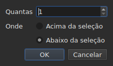

# Inserir, remover, unir, dividir, ordenar e tornar disjuntas as legendas

<!-- machine-translated -->
> Esta página é uma tradução automática e ainda não foi revisada por um leitor do idioma.

Oito itens do menu `Edit`, sob um separador que os distingue de
`Find and Replace…`. Quatro têm em comum o fato de mudarem o número de linhas, ao passo que
recortar, copiar e colar, mais acima, deslocam textos; `Sort Subtitles` muda
apenas **a ordem** das linhas, `Join Repeated Subtitles` volta a formar uma única
legenda a partir dos trechos consecutivos de um mesmo texto, e `Make Ranges Disjoint…`
volta a cortá-las onde se sobrepõem.

| Item | Atalho | O que faz |
| :--- | :----- | :-------- |
| Inserir legendas… | `Ins` | abre uma caixa de diálogo e depois acrescenta linhas em branco |
| Remover legendas | `Del` | remove a seleção, sem perguntar nada |
| Mesclar legendas | nenhum | forma uma única linha a partir de um bloco de linhas vizinhas |
| Dividir legenda | nenhum | corta uma linha em duas no meio de sua duração |
| Unir legendas repetidas | nenhum | forma uma única legenda a partir dos trechos consecutivos de um mesmo texto |
| Ordenar legendas | nenhum | recoloca as linhas na ordem de seu início, em todo o projeto |
| Tornar faixas disjuntas… | nenhum | corta as linhas que se sobrepõem para que nenhum intervalo se sobreponha mais a outro |
| Reparar legendas… | nenhum | encadeia os três itens anteriores — unir as repetições, ordenar, cortar os intervalos — de uma só vez |

Os oito entram no histórico: `Ctrl+Z` os desfaz como o resto.

## Inserir

| Campo | O que contém | Padrão |
| :---- | :----------- | :----- |
| `How many` | um número inteiro de 1 a 99 999 | `1` |
| `Where` | `Above the selection` ou `Below the selection` | a última escolha, `Below` na primeira inicialização |

`OK` acrescenta as linhas, `Cancel` não acrescenta nada.

### Onde ficam

**Na última linha selecionada**, não na primeira. Selecionar as linhas 1 e 3
e depois inserir abaixo coloca a nova linha na posição 4 — não na
posição 2. É o que o Gaupol faz há vinte anos, e o que a mão
espera depois de percorrer a tabela de cima para baixo.

`Above the selection` a coloca logo antes dessa mesma linha.

### Quanto tempo duram

Uma linha em branco não tem texto, mas tem posições. Elas são deduzidas
do espaço disponível:

| Situação | Início | Duração |
| :------- | :----- | :------ |
| entre duas legendas | o fim da anterior | o espaço até a seguinte, dividido em partes iguais |
| depois da última | o fim da última | três segundos cada uma |
| no início de um arquivo | a origem | o espaço até a primeira, dividido |
| em um arquivo vazio | a origem | três segundos cada uma |

Quando o arquivo tem sobreposição no lugar escolhido, **não há espaço
para dividir**: as linhas recebem uma duração zero, que a tabela mostra, em vez
de uma duração inventada que ultrapassaria a vizinha.

### O documento vazio

**Nenhuma seleção é exigida**, e é a única maneira de começar um
novo arquivo: as linhas vão para o índice zero. A escolha do lado fica então desativada
na caixa de diálogo — não há seleção em relação à qual posicioná-las.

Assim que o documento contém uma linha, o item `Insert Subtitles…` **fica desativado enquanto
nada estiver selecionado**: sem seleção, o índice seria adivinhado.

### Depois

As linhas acrescentadas ficam **selecionadas**, e a tabela vai até elas. Pressionar
`Ins` uma segunda vez insere, portanto, depois delas, sem precisar clicar entre os
dois gestos.

### O lado é lembrado

`Above` ou `Below` é lembrado **de uma inserção para a seguinte, e de uma sessão para
a seguinte**: trata-se da opção `edit.insert-placement` do
[arquivo de preferências](preferences.md#o-arquivo). Não se insere uma única vez,
inserem-se dez linhas seguidas, sempre do mesmo lado.

## Remoção

`Remove Subtitles`, ou `Del`, remove as linhas selecionadas — inclusive uma
seleção descontínua, cada linha voltando ao seu lugar se a operação for desfeita.

**Nenhuma confirmação é pedida**, e não se trata de um esquecimento:
a operação se desfaz com `Ctrl+Z`. Uma caixa modal antes de um gesto reversível
custaria um clique a cada vez para poupar um `Ctrl+Z` de vez em quando.

**O item fica desativado quando nada está selecionado.** No resto da janela,
“nada selecionado” significa “o arquivo inteiro” — é isso que torna um
deslocamento utilizável sem selecionar quatro mil linhas. Aqui, essa leitura
esvaziaria um documento com um `Del` infeliz, e por isso ela não é oferecida.

Depois da remoção, **a linha que ocupou o lugar da primeira removida fica
selecionada** — ou a última restante, se a remoção levou o fim do
arquivo. Pressionar `Del` várias vezes seguidas remove, portanto, as linhas uma
a uma.

Um arquivo totalmente esvaziado deixa a janela utilizável: `Insert Subtitles…`
volta a ficar ativado, já que se insere em um documento vazio sem seleção.

## Mesclagem

`Merge Subtitles` forma **uma única linha** a partir das linhas selecionadas:

| O que a linha mesclada recebe | De onde vem |
| :---------------------------- | :---------- |
| seu início | o início da primeira |
| seu fim | o fim da última |
| seu texto | os textos de todas, em ordem, com uma quebra de linha entre dois |
| sua tradução | as traduções, unidas da mesma maneira |
| o que o formato guarda além disso — um estilo, uma camada, coordenadas | o da primeira |

**Um texto vazio não deixa linha vazia**: mesclar `Un.`, uma linha sem
texto e `Trois.` dá duas linhas de texto, não três.

As linhas mescladas desaparecem, e a linha que as substitui ocupa o lugar
da primeira.

**O item fica desativado** enquanto a seleção não for **um bloco de pelo menos
duas linhas vizinhas**. Uma única linha não tem com quem se mesclar; as linhas
1 e 3 sem a 2 tampouco, pois o resultado passaria por cima da 2 e
a cobriria.

Depois da mesclagem, **a linha mesclada fica selecionada**: `Split Subtitle` está
pronto para cortá-la novamente.

## Divisão

`Split Subtitle` corta a linha selecionada **no meio de sua duração**, ao
milissegundo:

| Metade | Início | Fim | Texto |
| :----- | :----- | :-- | :---- |
| a primeira | o início original | o meio | **todo** o texto, e a tradução |
| a segunda | o meio | o fim original | vazio |

**O texto não é cortado na quebra de linha.** Isso estaria certo para uma
legenda de duas linhas e errado para uma legenda de uma linha ou de três;
todo o texto fica na primeira metade, e o que deve ir para a segunda
é movido manualmente.

A primeira metade conserva o que o formato guardava além do texto; a segunda
nasce como uma linha inserida, sem nada.

**O item fica desativado** enquanto a seleção não contiver **exatamente uma
linha**. Aqui, nada selecionado não significa “o arquivo inteiro”.

Depois da divisão, **as duas metades ficam selecionadas** — é o que o Gaupol
faz depois de qualquer inserção, e `Merge Subtitles` fica então pronto para desfazer o
gesto.

## Ordenação

`Sort Subtitles` recoloca **todo o projeto** na ordem dos inícios. Nunca a
seleção: uma ordem é uma propriedade do documento, e ordenar metade de um
arquivo não significa nada. A ordenação é **estável**: duas legendas que
começam juntas conservam a ordem em que o arquivo as dava.

**Uma barra corre na barra de status durante a ordenação, e o cursor vira uma
ampulheta**: em um arquivo longo, a janela fica sem responder por algum tempo — a
tabela é reconstruída linha a linha —, e sem isso não se saberia se algo
está em andamento. A barra não mostra fração, pois a ordenação não informa nenhuma,
e some junto com ela.

A barra de status diz quantas linhas mudaram de lugar — `3 subtitles moved`
— ou, quando tudo já estava em ordem, `already in order`. **Um projeto já em ordem
não entra no histórico**: uma operação que não muda nada não é
uma operação a desfazer. O item fica desativado para um projeto de uma legenda.

Um arquivo **com algo a corrigir na abertura** o oferece por conta própria,
[em uma única caixa](#na-abertura-uma-única-caixa): veja abaixo. As
legendas fora de lugar também são [contadas junto com os diagnósticos](files.md#os-diagnósticos-de-uma-leitura),
de modo que se as encontra sem percorrer a tabela.

Na linha de comando, [`sort`](../subedit-cli/sort.md) faz o mesmo em
arquivos, e `--sort` o faz de passagem em
[`convert`](../subedit-cli/convert.md#ordenar-ao-escrever),
[`append`](../subedit-cli/append.md#ordenar-o-resultado) e
[`split-file`](../subedit-cli/split-file.md#cortar-em-ordem-temporal).

## Unir legendas repetidas

`Join Repeated Subtitles` forma **uma única legenda** a partir das legendas que mostram a
mesma coisa em sequência: um texto cortado em trechos consecutivos, como
algumas ferramentas de segmentação o deixam. Age sobre **todo o projeto**.

**Uma repetição** tem o mesmo texto, a mesma tradução e as mesmas configurações de formato
(um estilo, uma posição, configurações de cue) que outra, **e começa, no
mais tardar, quando aquela termina**. Uma sequência de repetições torna-se a que começa
primeiro, com o maior fim da sequência; as outras desaparecem.
`Alpha [1, 2]`, `Alpha [2, 4]` e `Alpha [4, 6]` dão `Alpha [1, 6]`.

- **A ordem do arquivo não muda nada nisso, e não é alterada**: a legenda mantida
  é a que começa primeiro, onde quer que estejam as outras.
- **Nada é unido por engano**: outro texto, outras configurações, um intervalo
  entre dois trechos, uma legenda sem texto ou cujo fim precede o início
  permanecem separados.
- A barra de status diz o que foi feito — `2 repeated subtitles joined`, ou
  `no repeated subtitles`.

**A fazer antes de ordenar e cortar**, que leem melhor uma sequência limpa: um
texto em três trechos, mais outro texto sobre toda a faixa, fornecido
fora de ordem, é ordenado e cortado em linhas que alternam de um trecho para o outro; unido
antes, cai em ordem e se mescla de forma limpa. A caixa de abertura, abaixo, faz
os três nessa ordem.

## Tornar os intervalos disjuntos

`Make Ranges Disjoint…` corta as legendas que se sobrepõem para que **nenhuma faixa
`[start, end]` se sobreponha mais a outra**. Age sobre **todo o
projeto**, nunca sobre a seleção: um grupo de legendas que se sobrepõem
é cortado onde elas se sobrepõem, e metade de um grupo não significa nada.

**Nada é encurtado nem alongado.** Em cada instante, a janela mostra os
mesmos textos de antes. O que muda é a maneira como a linha do tempo é cortada:
ela é cortada em cada início e em cada fim de um grupo; um intervalo coberto
por uma única legenda continua sendo essa legenda; um intervalo coberto por várias
torna-se **uma** legenda cujas linhas são as delas, **a mais antiga na linha 1**.
`A [0, 5]` e `B [3, 8]` dão `[0, 3] A`, `[3, 5] A / B`, `[5, 8] B`.

A caixa de diálogo pede três configurações, lembradas de uma vez para a seguinte:

| Campo | O que contém | Padrão |
| :---- | :----------- | :----- |
| `Shortest interval kept` | de 0 a 10 000 ms: um intervalo mais curto é absorvido por um vizinho | `80 ms` (cerca de dois quadros) |
| `Most lines in a subtitle` | de 0 a 10; `No limit` em 0 | `2` |
| `Put a dash before each subtitle's text` | um travessão antes do que cada legenda contribui para uma legenda mesclada | desmarcado |

`OK` corta, `Cancel` não faz nada. **As linhas escritas ficam selecionadas**
depois, e a barra de status diz o que foi feito: `2 subtitles split, 1 merged`.
Uma segunda passagem não muda nada e o diz: `already disjoint`.

- **Uma linha nunca é duplicada.** Duas legendas com o mesmo texto dão uma
  única linha onde se sobrepõem, e dois trechos vizinhos que mostram a
  mesma coisa formam apenas uma legenda. O texto de uma legenda cortada em vários
  trechos é, fora isso, repetido em cada um: é o que está na tela naquele instante.
- **Um intervalo muito curto é absorvido por um vizinho**: aquele cujas linhas
  já contêm as suas, ou, na falta dele, o mais longo, estende sua faixa para cobri-lo.
  Uma legenda inteira mais curta que o limite nunca é absorvida.
- **Mais linhas que o limite: janelas.** Três linhas ao longo de três segundos
  tornam-se duas metades, as duas primeiras linhas e depois as duas últimas;
  quatro linhas, três terços, e assim por diante. Nada é truncado.
- A tradução segue os mesmos cortes; o estilo e a posição da primeira
  legenda que cobre são mantidos.

**O que não pôde ser feito por completo é dito em uma caixa a fechar**, não na
barra de status: janelas, intervalos absorvidos, legendas curtas demais
deixadas inteiras, estilos que diferem, legendas cujo fim precede o
início (deixadas onde estão).

**O item é recusado, com o motivo, quando as legendas não estão na
ordem de seu início**: os grupos são sequências de vizinhas, e o núcleo nunca
ordena por conta própria. `Sort Subtitles` primeiro — ou a caixa de abertura, que
faz os dois nessa ordem.

### Tudo de uma vez: `Repair Subtitles…`

`Repair Subtitles…` executa os três itens anteriores **um depois do outro**, na única ordem que funciona: as
repetições são unidas, as legendas colocadas na ordem de seu início, e então as faixas tornadas disjuntas. É o item
para um arquivo mal segmentado, mal ordenado e com sobreposições, quando se sabe que se quer os três. A caixa de diálogo pede as
configurações de corte (as mesmas de `Make Ranges Disjoint…`, lembradas de uma vez para a seguinte) e informa que une e ordena
primeiro. A barra de status — ou a caixa a fechar, quando algo não pôde ser feito por completo — dá **um único relato**
dos três: `2 repeated subtitles joined; already in order; 2 subtitles split, 1 merged`. Cada correção é uma entrada própria do
histórico: `Ctrl+Z` as desfaz uma a uma. Na linha de comando: [`repair`](../subedit-cli/repair.md).

### Na abertura, uma única caixa

Um arquivo que abre com algo que se sabe corrigir **o oferece em
uma única caixa**, `Problems found in this file`, em vez de abrir uma por
problema. Cada problema encontrado é uma linha com sua caixa de seleção, marcada:

- `Join the repeated subtitles` — legendas repetem outra que
  tocam, com seu número;
- `Sort the subtitles` — as legendas não estão na ordem de seu início,
  com seu número;
- `Make the ranges disjoint` — legendas começam antes do fim da anterior,
  contadas **depois que o arquivo está em ordem**, pois é onde são corrigidas.

**Cada problema é contado onde é corrigido**, em uma cópia à qual as
correções que o precedem já foram aplicadas: um texto cortado em trechos é a
causa de parte da desordem, e uni-lo primeiro pode não deixar nenhuma — a caixa
não oferece então a ordenação.

Um problema que não foi encontrado não tem linha. Desmarcar a ordenação **desativa e
desmarca** a outra caixa: as faixas só são tornadas disjuntas em ordem.
`Fix` aplica o que está marcado — a união, depois a ordenação, depois o corte, com as
configurações do último `Make Ranges Disjoint…` — e dá **um único relato** disso;
`Keep as is` não toca em nada. **Nada é feito sem um sim**, cada correção
é uma entrada do histórico, e um arquivo sem nada a corrigir não é objeto
de nenhuma pergunta.

Na linha de comando, [`disjoint`](../subedit-cli/disjoint.md) faz o mesmo em arquivos, e `--disjoint`
o faz de passagem em [`convert`](../subedit-cli/convert.md#tornar-os-intervalos-disjuntos),
[`append`](../subedit-cli/append.md#tornar-os-intervalos-disjuntos) e
[`split-file`](../subedit-cli/split-file.md#tornar-os-intervalos-disjuntos).

### Por que não os atalhos do Gaupol

O Gaupol mescla com `M` e divide com `S`. Uma letra isolada seria capturada pela
tabela antes de chegar a uma célula em edição, e `Ctrl+S`
já salva: os dois itens são acessados pelo menu.

## O que a ação de desfazer diz a respeito

**Uma entrada de histórico por gesto.** Mesclar cinco linhas se desfaz com um único
`Ctrl+Z`, que devolve as cinco linhas como estavam — posições, textos e
tudo o que o formato guardava.

| Operação | O que `Undo` mostra |
| :------- | :------------------ |
| uma inserção | `Undo: inserting` |
| uma remoção | `Undo: removing` |
| uma mesclagem | `Undo: merging` |
| uma divisão | `Undo: splitting` |
| uma união de repetições | `Undo: joining repeated subtitles` |
| um corte das faixas | `Undo: making the ranges disjoint` |

Uma correção oferecida na abertura é uma entrada de histórico por correção: a união, a ordenação e depois o corte são desfeitos um após o outro.

Veja [Desfazer e refazer](undo.md).

## Atalhos enquanto uma célula está aberta

`Ins` e `Del` pertencem ao campo de entrada enquanto um editor de célula
estiver aberto: a tecla de exclusão apaga um caractere ali, não uma
legenda. Fechar o editor — `Enter` ou `Esc` — devolve-lhes seu significado. Acionado
pelo menu, `Remove Subtitles` primeiro confirma a entrada, como os outros
gestos de [Editar uma célula](editing.md).

Este manual nomeia as teclas como o menu as exibe — veja
[Os menus](index.md#os-menus).
