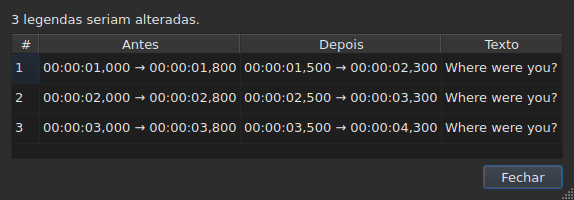
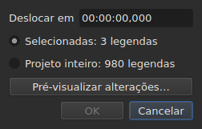
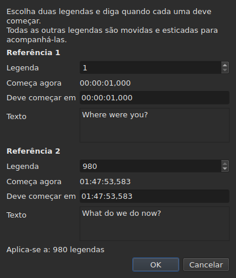
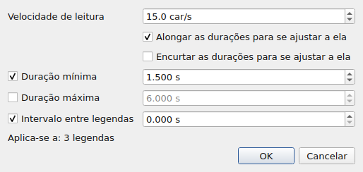
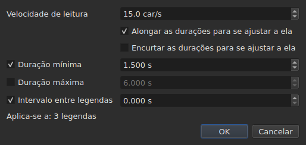
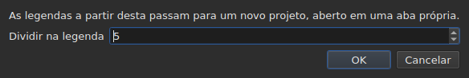

# As operações

<!-- machine-translated -->
> Esta página é uma tradução automática e ainda não foi revisada por um leitor do idioma.

O menu **Ferramentas** reúne dezesseis operações, uma análise e duas entradas de ortografia. Cada uma das
dezesseis é desfeita com um `Ctrl+Z`; a análise não modifica nada. `Check Spelling…` também é desfeita, e `Spell-Check Settings…` não toca em nenhum texto.

| Entrada | Caixa de diálogo | O que faz |
| :---- | :----- | :----------- |
| `Shift Positions…` | sim | desloca o alvo por uma duração |
| `Transform Positions…` | sim | corrige o alvo a partir de dois marcadores |
| `Convert Frame Rate…` | sim | ressincroniza o alvo de uma taxa de quadros para outra |
| `Adjust Durations…` | sim | move os fins para respeitar uma velocidade de leitura, durações e um intervalo |
| `Append File…` | um seletor de arquivos | anexa um arquivo ao final do projeto |
| `Split Project…` | sim | corta o projeto em dois, o restante vai para uma nova aba |
| `Italic` | **não** | coloca o alvo em itálico, ou o retira |
| `Dialogue` | **não** | coloca um travessão de diálogo no início de cada linha, ou o remove |
| `Maiúsculas/minúsculas ▸ Iniciais maiúsculas` | **não** | cada palavra recebe uma maiúscula |
| `Maiúsculas/minúsculas ▸ Inicial de frase` | **não** | a primeira letra do texto, e somente ela |
| `Maiúsculas/minúsculas ▸ TUDO EM MAIÚSCULAS` | **não** | tudo em maiúsculas |
| `Maiúsculas/minúsculas ▸ tudo em minúsculas` | **não** | tudo em minúsculas |
| `Remove Hearing-Impaired Mentions…` | sim, sem configurações | remove as menções para deficientes auditivos |
| `Correct Texts…` | sim, um assistente de várias páginas | propõe correções — menções, unir e dividir palavras, erros comuns, maiúsculas, quebra de linha — e as aplica depois de aceitas, veja [Corrigir textos…](correct-texts.md) |
| `Check Spelling…` | sim, um percurso palavra por palavra | percorre as palavras desconhecidas do dicionário e aplica o que foi corrigido, veja [Verificar ortografia…](check-spelling.md) |
| `Spell-Check Settings…` | sim | escolhe o idioma, o alvo e o documento da verificação, e o sublinhado durante a digitação, veja [Verificar ortografia…](check-spelling.md#configurações-da-verificação-ortográfica) |
| `Snap to Frame Rate…` | sim | recoloca cada marca de tempo no quadro mais próximo |
| `Shift Whole File onto Grid (…)` | **não** | recoloca o arquivo inteiro em sua grade |
| `Frame Rate Analysis…` | sim, sem configurações | **não modifica nada** — veja [A grade de quadros](frame-grid.md) |

**O que uma operação fez é dito em uma caixa de informação que precisa ser
fechada, exceto para `Italic`, `Case` e `Dialogue`**: essas três não abrem
nenhuma caixa de diálogo, e seu relatório — “nada a alterar” inclusive — é exibido
na barra de status, sem nada a fechar. `Split Project…` também dá o seu
na barra de status: seu resultado já está diante de você, na nova aba. As mensagens são citadas na
seção de cada operação.

Inserir, remover, unir e dividir linhas não estão aqui, mas no
menu `Edit`, porque mudam o número de linhas. Veja
[Inserir, remover, unir e dividir linhas](lines.md).

## Sobre o que atuam

**As linhas selecionadas, ou o arquivo inteiro se não houver nenhuma.** É a mesma
regra para todas, e as caixas de diálogo, quando há uma, a lembram com
palavras simples:

```
Applies to: 4 subtitles
```

Selecionar todas as linhas equivale a não selecionar nenhuma.

**Quando apenas uma parte das linhas está selecionada, a caixa de diálogo pergunta
sobre o que atuar.** Duas escolhas são exibidas, com sua contagem, e **a seleção
é a que está marcada**:

```
(•) Selected: 2 subtitles
( ) Whole project: 4 subtitles
```

Marcar `Whole project` estende a operação ao arquivo inteiro sem precisar antes
mudar a seleção. Quando não há nada a escolher — nada
selecionado, ou tudo —, a linha `Applies to:` acima fica sozinha.

As caixas de diálogo de `Shift Positions…`, `Transform Positions…`,
`Convert Frame Rate…`, `Adjust Durations…`, `Snap to Frame Rate…` e
`Remove Hearing-Impaired Mentions…` oferecem essa escolha.

### Ver antes de aplicar

`Shift Positions…`, `Transform Positions…`, `Convert Frame Rate…`,
`Adjust Durations…` e `Snap to Frame Rate…` trazem um botão **`Preview changes…`**.
Ele abre uma pequena janela que diz quantas legendas a operação
alteraria **com o que está digitado naquele momento, sobre o alvo marcado**, e
lista as doze primeiras: seu número, sua posição antes, sua posição
depois, e a primeira linha de seu texto. **Nada é aplicado**: fechar a
janela volta à caixa de diálogo, onde se pode mudar um valor e olhar
de novo.




Ela abre grande o bastante para mostrar todas as colunas, e pode ser redimensionada
à mão.

Se a operação não alterasse nada, a janela o diz (`Nothing would change.`).
Enquanto o que foi digitado não define uma operação — uma duração ilegível, dois
marcadores na mesma legenda —, a pré-visualização fica vazia pela mesma razão pela qual o
botão `OK` fica esmaecido. `Remove Hearing-Impaired Mentions…` não tem pré-visualização: o que
ela altera é texto, e o relatório que ela dá depois
o diz.

**Com uma tradução, qual texto?** As operações de posição e de estrutura
atuam sobre a legenda inteira — seus dois textos acompanham. As que
reescrevem um texto — `Italic`, `Case`, `Dialogue`,
`Remove Hearing-Impaired Mentions…` — têm como alvo **o texto da coluna da célula atual**: a
tradução em sua coluna, o texto principal nas demais. O outro permanece intacto, e
a barra de status diz qual é o alvo. Veja [A tabela](table.md#o-texto-sobre-o-qual-as-operações-atuam).

**Uma exceção, e seu rótulo a carrega**: `Shift Whole File onto Grid`
ignora a seleção. Uma grade é uma propriedade do documento, e meio
documento não tem grade própria; a entrada, portanto, o diz em seu nome em vez de
apenas neste manual.

**`Append File…` também ignora a seleção**, por outra razão: ela não
é um alvo que reescreve, é um fim que empurra. Veja sua
[própria seção](#append-file). **O mesmo vale para `Split Project…`**: ela corta onde lhe
dizem para cortar. Veja [a sua](#split-project).

**`Correct Texts…` escolhe seu alvo em sua própria página**, em vez de seguir
a seleção atual: a seleção, o projeto atual ou todos os projetos
abertos. Veja [Corrigir textos…](correct-texts.md). **`Check Spelling…` o escolhe em
`Spell-Check Settings…`**, e o lembra: veja [Verificar ortografia…](check-spelling.md).

**As duas operações de grade não falam da mesma coisa que a grade.**
Uma operação atua sobre a seleção; a análise e a barra de status falam do
**documento inteiro**. Alinhar cinco linhas de cento e setenta e seis altera de fato essas
cinco — a tabela o mostra — sem que nenhuma das duas se mova, o que
parece uma atualização perdida. Não é: elas não têm nada a
dizer. Veja [`Snap to Frame Rate…`](#snap-to-frame-rate) e
[A grade de quadros](frame-grid.md).

### O que significa “nada selecionado”, entrada por entrada

A regra vale para o menu `Tools` e para a pesquisa. As entradas do
menu `Edit` que tocam nas linhas ou as esvaziam a leem de outro modo — senão um
`Del` ou `Ctrl+X` desastrado esvaziaria o documento.

| Entrada | Sem seleção | O que exige |
| :---- | :------------------ | :--------------- |
| as operações do menu `Tools` | o arquivo inteiro | um documento não vazio |
| `Shift Whole File onto Grid` | o arquivo inteiro, **sempre** | uma grade encontrada |
| `Find and Replace…` | o arquivo inteiro | um documento não vazio |
| `Cut Texts`, `Copy Texts`, `Paste Texts` | **desativadas** | ao menos uma linha selecionada |
| `Remove Subtitles` | **desativada** | ao menos uma linha selecionada |
| `Merge Subtitles` | **desativada** | um bloco de ao menos duas linhas vizinhas |
| `Split Subtitle` | **desativada** | exatamente uma linha |
| `Insert Subtitles…` | desativada, exceto em um documento vazio | uma linha em relação à qual colocá-las |

Cada página dá a razão: [a área de transferência](clipboard.md#sobre-o-que-atuam),
[as linhas](lines.md), [a pesquisa](find-and-replace.md#o-que-a-pesquisa-abrange).

As entradas ficam **desativadas em um arquivo vazio**: não haveria nada a
deslocar. `Italic` tem uma segunda condição, que sua seção descreve: o
formato aberto precisa ser capaz de escrever um estilo. Maiúsculas/minúsculas e travessões não têm nenhuma — um
texto é um texto nos nove formatos.

## `Shift Positions…`

Move o alvo por uma duração, para frente ou para trás. Os dois limites de
cada legenda se movem do mesmo valor: nenhuma fica na tela por mais ou menos tempo
que antes.

A duração é escrita **como uma marca de tempo, sinal inclusive** — `00:00:02,500` avança,
`-00:00:01,250` recua. **O campo é sobrescrito, não se digita nele**: começa como `00:00:00,000`, um dígito substitui o dígito sob o cursor e o cursor pula sozinho os `:` e a `,`, de modo que a forma nunca muda. Só são aceitos dígitos, e `-` (ou `+`) para mudar o sinal; `Backspace` e `Delete` recolocam um zero. O mesmo campo é usado em todo lugar onde se define um tempo: o diálogo de transformação, as células de posição da tabela e o intervalo de uma transcrição.




| Recusa | Por quê |
| :------ | :-- |
| uma duração ilegível | o botão permanece desativado; nada é deslocado ao acaso |
| um deslocamento de zero | não há operação a registrar |
| uma legenda iria antes do início do vídeo | **nenhum arquivo pode conter tal posição** |

O terceiro caso nomeia o culpado — “a legenda 1 começaria antes da origem” —
e é o que se deve olhar para ver quanto você errou. Nada
é aplicado.

## `Transform Positions…`

A correção de um arquivo temporizado para outro corte. Diz-se onde **duas**
legendas realmente começam, e todo o resto acompanha, proporcionalmente.

A caixa de diálogo pede duas vezes a mesma coisa: um número de legenda e a
posição onde seu início deve estar. Para cada marcador, ela mostra **o que esse
número designa** — seu texto (`Text`) e a hora em que ele começa
**agora** (`Now starts`), como simples rótulos — e eles acompanham o número
à medida que ele muda. O texto mantém **três linhas de espaço**, diga o que disser
a legenda: um texto mais longo, ou um endereço longo, rola dentro dele, e
a caixa de diálogo conserva seu tamanho quando o marcador muda. **Um único campo deve ser digitado por marcador:
`Should start`**, a hora em que essa legenda deve começar. Não é preciso procurar na tabela qual linha é a `980`.

`Should start` é **proposto com o valor atual**: enquanto não se
mexe nele, o marcador diz “esta legenda já está onde deve estar”. Só se
muda o que se quer mudar. O segundo marcador vem preenchido com a última
legenda do arquivo — dois marcadores distantes dão uma correção mais segura
que dois vizinhos.




**Os dois marcadores caem exatamente onde foram pedidos.** Não é
uma aproximação: o cálculo é feito para que seja verdade.

| Recusa | Por quê |
| :------ | :-- |
| dois marcadores na mesma legenda | não definem nenhuma correção |
| uma posição ilegível | mesma razão que para o deslocamento |

Um número fora do arquivo não pode ser digitado: o campo é limitado pelo
número de legendas.

## `Convert Frame Rate…`

Ressincroniza o alvo quando as posições foram calculadas com uma taxa de
quadros e devem sê-lo com outra.

As duas listas oferecem as oito taxas de quadros padrão.

> **Errar a taxa de quadros de entrada desloca o arquivo inteiro sem avisar
> nada.** É o pior modo de falha desta operação, e é por isso que
> a caixa de diálogo diz de onde vêm os valores que propõe em vez de
> defini-los em silêncio.

### As duas fontes, e o que respondem

A caixa de diálogo traz até duas linhas a mais, cada uma aparecendo quando tem
algo a dizer:

| Linha | O que diz | O que preenche |
| :--- | :----------- | :---------------- |
| `The positions say` | a [grade de quadros](frame-grid.md) deduzida das posições do arquivo | `Timed against` |
| `The video declares` | a taxa de quadros que o contêiner anuncia, por exemplo `24000/1001` | `Should play at` |
| `The file was read at` | a taxa de quadros com que um arquivo **contado em quadros** foi lido | `Timed against` |

**Cada proposta vai para o campo ao qual responde.** A grade diz contra o que o
arquivo foi *escrito* — é a lista de cima. O que o contêiner anuncia é
a taxa de quadros com que o filme *roda*, e portanto aquela em que as legendas
devem chegar — é a lista de baixo.

**Somente uma grade limpa preenche a entrada.** Uma grade parcial é um
indício que a própria dedução qualifica de parcial, e este campo decide uma
operação sobre o arquivo inteiro. A [barra de status](frame-grid.md) e a análise
tratam desse caso; esta caixa não.

**Um arquivo contado em quadros substitui a grade em vez de se somar a ela.**
O MicroDVD traz números de quadro, e as posições do documento foram
calculadas a partir deles com a taxa de quadros de leitura: uma grade deduzida dessas posições
só pode reencontrar esse número. `The positions say` portanto desaparece, e
`The file was read at` toma seu lugar — é a mesma escolha que
[a barra de status](frame-grid.md#um-documento-contado-em-quadros-não-tem-grade-tem-uma-taxa-de-quadros) faz.

**É assim que se muda a taxa de quadros de um MicroDVD.** Definir a taxa de quadros lida
como entrada e a verdadeira como saída recalcula cada posição a partir dos
quadros do arquivo — sem ler nada de novo, e a operação é desfeita como as
outras.

### Um desacordo não é uma contradição

As duas linhas podem ser exibidas juntas e anunciar números diferentes.
**Não é um erro a arbitrar**: o filme roda a uma taxa de quadros, o
arquivo foi escrito em outra grade. Um arquivo a 24 para um filme a 25 é
exatamente o caso que o alinhamento — `snap` na linha de comando — existe para
tratar.

Nada é portanto escolhido no lugar do usuário: as duas listas permanecem
editáveis, e isso é deliberado. Uma fonte que se impõe impede a verificação cruzada.

As linhas não aparecem quando não há nada a dizer: nenhum vídeo
associado, nenhum `ffprobe`, ou nenhuma grade limpa. A caixa de diálogo é então a que foi
descrita acima, e **nenhuma operação se recusa por isso** — a taxa de
quadros vem do usuário. Veja
[O vídeo associado](video.md#ffmpeg-não-é-obrigatório).

Uma taxa de quadros que o filme anuncia mas que não é uma das oito padrão
é **exibida sem ser escolhida**: saber que o filme roda a uma
taxa de quadros incomum é a informação, e não há nada para o qual convertê-la aqui.

Converter uma taxa de quadros nela mesma não altera nada: o botão permanece desativado.

## `Adjust Durations…`

Alonga ou encurta a duração das legendas do alvo **movendo seu
fim, nunca seu início**. Mover o início moveria a legenda, o que é
tarefa de [`Shift Positions…`](#shift-positions).





### As quatro restrições

| Campo | O que pede | Valores | Padrão |
| :---- | :--------------- | :----- | :------ |
| `Reading speed` | o tempo necessário para ler o texto | de 1 a 99 caracteres por segundo, ao décimo | 15 caracteres/s |
| `Lengthen durations to match it` | alongar o que é curto demais para ser lido | marcado ou não | marcado |
| `Shorten durations to match it` | encurtar o que permanece exibido por mais tempo que o necessário | marcado ou não | desmarcado |
| `Minimum duration` | uma duração-piso | de 0 a 99 s, ao milissegundo | marcado, 1,5 s |
| `Maximum duration` | uma duração-teto | de 0 a 99 s, ao milissegundo | desmarcado, 6 s |
| `Gap between subtitles` | o intervalo a deixar antes da legenda seguinte | de 0 a 99 s, ao milissegundo | marcado, 0 s |

São os valores padrão do Gaupol.

**Uma restrição desmarcada está ausente**: seu campo fica esmaecido e não é lido. Uma
restrição marcada em zero vale zero — um intervalo de 0 s proíbe uma
legenda de se sobrepor à seguinte. A velocidade de leitura só é lida se
`Lengthen` ou `Shorten` estiver marcado.

**Quando tudo está desmarcado, `OK` fica desativado**: não há nada a pedir.

A caixa de diálogo reabre com os valores do último ajuste, **e os conserva de uma
sessão para a outra** — como as duas opções de pesquisa. **Uma caixa desmarcada
conserva seu valor**: desmarcar `Minimum duration` depois de definir 2 s não traz de volta
1,5 s, e marcá-la de novo reencontra 2 s. As nove configurações estão no
[arquivo de preferências](preferences.md#o-arquivo), sob `duration-adjust.`.

**A linha de comando as compartilha.** [`subedit-cli adjust`](../subedit-cli/adjust.md) lê as
mesmas nove configurações por padrão, de modo que uma velocidade definida aqui é a velocidade que ele usa, a menos que suas próprias opções
digam o contrário; [`subedit-cli config`](../subedit-cli/config.md) as mostra e as altera. Veja
[Dois blocos, um deles compartilhado com a linha de comando](preferences.md#dois-blocos-um-deles-compartilhado-com-a-linha-de-comando).

### Em que ordem, e qual prevalece

Cada legenda do alvo passa pelas quatro restrições **nesta ordem**, e
cada uma define o fim por sua vez:

| Ordem | Restrição | O que define |
| ---: | :--------- | :----------- |
| 1 | velocidade de leitura | `end = start + length ÷ speed`, se a legenda é curta demais (`Lengthen`) ou longa demais (`Shorten`) |
| 2 | duração mínima | `end = start + minimum`, se a duração é menor |
| 3 | duração máxima | `end = start + maximum`, se a duração é maior |
| 4 | intervalo | `end = next start − gap`, se o fim está próximo demais dele — nunca antes do início |

**A última aplicada prevalece.** O intervalo vem por último e pode trazer uma
duração de volta abaixo do mínimo recém-definido: duas legendas na tela ao mesmo
tempo são uma falha que o espectador vê, uma legenda ligeiramente curta
não é.

**O comprimento do texto é contado sem marcações**, em caracteres, quebras de linha
inclusive: `<i>été</i>` conta três caracteres. A velocidade de leitura fala do
que o espectador lê.

**A seguinte é a legenda seguinte do arquivo**, esteja ou não no alvo. **A última legenda do arquivo não tem seguinte**: o intervalo
não a restringe.

### O que nenhum fim pode satisfazer é dito

Terminado o ajuste, a janela diz quantos fins se moveram, e **o que
não pôde ser respeitado** — uma restrição só aparece se foi
sacrificada para ao menos uma legenda:

```text
adjusted the durations of 12 subtitles; could not satisfy the reading speed in 9 subtitles, the minimum duration in 4 subtitles
```

As três menções possíveis são `the reading speed`, `the minimum duration` e
`the gap`. **A duração máxima é sempre respeitada**: vem depois da velocidade
e do mínimo, e só o intervalo a segue, que só pode encurtar. Um mínimo
maior que o máximo cede a este, e é o mínimo que é contado. O intervalo
só é sacrificado quando a seguinte começa antes do início da própria
legenda.

A contagem cobre todo o alvo, **inclusive as legendas cujo fim não
se moveu**: uma legenda já posicionada em relação à seguinte e curta demais para o
mínimo é contada. Quando nenhum fim se move, a janela o diz —
`no duration to adjust` — e nada entra no histórico.

## `Append File…`

Anexa um arquivo ao final do projeto aberto. **Nada é inserido entre os
dois**: o arquivo escolhido é deslocado pelo fim da última legenda do
projeto, exatamente como o Gaupol faz.

**Desativada em um documento vazio**: não haveria fim a partir do qual deslocar. Um
seletor de arquivos abre, sem codificação a escolher — como `Open…`.

**O arquivo anexado passa pela conversão**, nas palavras de `Save As…` e da
[colagem a partir de outro formato](clipboard.md#as-marcações-de-outro-formato-são-traduzidas):
suas marcações são traduzidas para o formato do projeto, e o que esse formato não consegue
escrever é dito:

```text
appended 12 subtitles; Advanced SSA into SubRip: 1 tag dropped
```

**O que o arquivo anexado trazia não sobrevive inteiro.** Suas posições
acompanham, marcações inclusive; seu cabeçalho, seus campos específicos do formato — nome
de estilo, margens — e o que uma marcação não consegue se tornar no formato do projeto
não acompanham, e o dizem. **Ele não tem tradução**: uma tradução permanece
específica do documento que a recebeu, e o arquivo anexado chega sozinho.

**Selecionadas depois**, como as linhas que uma colagem escreveu além do
fim. Quando nada se perde, a contagem é exibida na barra de status em vez de
em uma caixa a fechar — a mesma regra que
[abrir uma tradução](files.md#abrir-uma-tradução).

**Uma única entrada de histórico**, seja qual for o número de legendas
anexadas: `Ctrl+Z` as remove todas de uma vez.

**Um arquivo já aberto pode ser anexado a si mesmo**: nada o proíbe, como
no Gaupol.

**Na linha de comando**, [`append`](../subedit-cli/append.md) faz a mesma coisa para vários arquivos
de uma vez, em um único resultado.

## `Split Project…`

Corta o projeto em dois: **o inverso exato de `Append File…`**. Uma caixa
pergunta a partir de qual legenda cortar — da segunda à última, numerada
como na tabela — e abre na linha atual.

**A tabela mostra onde se corta antes de cortar**: cada número que a
caixa assume seleciona sua linha. `Cancel` devolve a seleção anterior.




**Desativada com menos de duas legendas**: um corte quer uma legenda de cada
lado.

**O restante é copiado para um novo projeto, aberto em uma nova aba, e
removido do projeto original.** O novo projeto é **deslocado de menos o fim da
última legenda que ficou**: dividir e depois anexar devolve o projeto de partida.
Seus dois textos, principal e tradução, acompanham suas legendas, e ele
conserva o formato e a codificação do original — **sem caminho**: nenhum arquivo
o mantém ainda. Sua aba é portanto escrita `untitled*` desde o nascimento, e
fechá-lo sem salvar faz a pergunta feita para tudo o que não está
escrito.

**A barra de status diz quantas legendas saíram**, sem caixa a
fechar — a nova aba já mostra o resultado:

```text
split 12 subtitles into a new project
```

**Uma única entrada de histórico**, no projeto original:
`Undo: splitting the project` devolve a ele o seu restante. O novo projeto tem um histórico
próprio, vazio; desfazer não o toca, e ele permanece aberto.

**Recusada quando nenhum arquivo poderia escrever o resultado.** Se as duas
metades se sobrepõem no corte, o deslocamento traria uma legenda antes do
início do vídeo — uma posição negativa, que nenhum formato escreve. A caixa
que recusa **nomeia a legenda** e sugere cortar em outro ponto:

```text
Cannot split at subtitle 3: subtitle 3 would fall before the start of the video. Cut somewhere else.
```

Chegar exatamente ao início é permitido: zero é uma posição.

**Na linha de comando**, [`split-file`](../subedit-cli/split-file.md) corta um arquivo do mesmo modo, em dois
arquivos nomeados.

## `Snap to Frame Rate…`

Coloca **cada marca de tempo** — início e fim — no quadro mais próximo da
taxa de quadros escolhida. Uma única lista, e essa é toda a diferença em relação à
conversão: uma conversão precisa de duas taxas de quadros porque redimensiona o
arquivo de uma para a outra; um alinhamento só precisa da
grade sobre a qual cair.

| | `Convert Frame Rate…` | `Snap to Frame Rate…` |
| :--- | :-------------------- | :-------------------- |
| movimento | proporcional ao tempo — **vários segundos** em um longa-metragem | meio quadro no máximo, **em toda parte** |
| para qual arquivo | um arquivo cuja **sincronização está errada** | um arquivo cuja sincronização está **certa** e cuja grade está errada |

**O caso de uso**, explicitado: um filme a 25 quadros por segundo,
legendas escritas em uma grade a 24, linhas já mais ou menos no
lugar, com diferença de alguns milissegundos. Não há nada a ressincronizar — apenas
recolocar as marcas de tempo nos quadros certos.

A lista **abre no que o vídeo declara**, e não no que as
posições dizem: a intenção é juntar-se à grade do filme, e a
dedução nomeia aquela que está sendo deixada. Sem vídeo ou sem `ffprobe`, ela abre
na taxa de quadros do projeto.

Alinhar um arquivo na grade que ele já ocupa não o altera, e não é
um erro: a operação se aplica, não move nada, e é desfeita como
qualquer outra.

**Alinhar parte do arquivo o diz, uma vez feito.** Um aviso é exibido
quando a seleção não cobre tudo e o documento ainda é lido em outra
grade:

```
5 of 176 subtitles aligned to 25 fps; the document is still read on a 24 fps grid
```

Ele liga o gesto ao seu efeito, e explica por que a barra de status e
a análise não se moveram: elas falam do documento, a operação atuou sobre
cinco linhas. Nada é impedido — alinhar parte de um arquivo pode ser
intencional.

**É quase sempre involuntário, e isso é medido.** Sobre os oito arquivos
de grade do repositório, alinhar o arquivo inteiro leva a taxa de quadros deduzida ao
alvo e sua concentração a 100 %; alinhar cinco linhas nunca move a taxa
de quadros deduzida e **reduz** a concentração em sete casos de oito — as linhas
alinhadas saíram da grade em que o restante do arquivo vive. O oitavo é
50 para 25, em que a grade de destino divide a do arquivo e em que as posições já
estavam nela.

O aviso não é exibido quando a seleção cobre o arquivo inteiro, quando
nenhuma grade é deduzida, ou quando o documento agora é lido na taxa de quadros
pedida — isto é, quando o alinhamento fez o que lhe foi pedido.

## `Shift Whole File onto Grid`

Desloca **o arquivo inteiro** pelo valor que recoloca suas posições na grade
que elas deixaram. Um arquivo cujas posições estão em uma grade a menos de uma
constante foi deslocado, e essa constante pode ser medida.

**A entrada de menu traz o valor e o escopo** —
`Shift Whole File onto Grid (+0.001 s)`. Não há caixa de diálogo:
a operação não toma opção alguma, e uma entrada que vai mover um arquivo
inteiro deve dizer de quanto, e que o fará por inteiro, antes de ser escolhida.
É a única operação do menu que ignora a seleção.

**Ela fica desativada quando nenhuma grade foi encontrada.** Não há então nada a
juntar, e uma fase medida sobre ruído moveria o arquivo ao acaso.
“Nada a juntar” e “juntar de zero” não dizem a mesma coisa: a
segunda continua oferecida, porque um arquivo já em sua grade é um
caso normal dela.

**Isto não é `Snap to Frame Rate…`.** Esta entrada desloca tudo do mesmo valor
e preserva a sincronização relativa **exatamente**; o alinhamento move cada
posição independentemente e absorve de passagem as que haviam sido corrigidas à
mão. Em um arquivo limpo ambos dão o mesmo resultado; em um
arquivo parcial, não — e o [detalhe da análise](frame-grid.md) diz qual dos
dois se tem diante de si.

## `Italic`

Coloca o alvo em itálico escrevendo as marcações do **formato aberto**, ou
as remove se ele já está em itálico. Nenhuma caixa de diálogo: a operação não tem configuração, e
é desfeita com um `Ctrl+Z` como as outras.

| Ação | Atalho | Onde |
| :----- | :------- | :---- |
| Itálico | `Ctrl+I` | menu **Ferramentas**, barra de ferramentas |

É a única operação do menu `Tools` que tem um botão na
[barra de ferramentas](index.md#a-barra-de-ferramentas).

### O que ela escreve, formato por formato

O texto de uma legenda é o de seu arquivo, marcações inclusive — veja
[Editar uma célula](editing.md). Cada formato tem as suas, e é isso que
esta entrada poupa você de saber:

| Formato | O que é escrito |
| :----- | :-------------- |
| SubRip, WebVTT, SubViewer 2 | `<i>text</i>` |
| Sub Station Alpha, Advanced SSA | `{\i1}text{\i0}` |
| MicroDVD | `{Y:i}text` — a marcação vai até o fim da legenda, não há nada a fechar |
| MPL2 | `/` no início de **cada** linha, o marcador valendo apenas para a sua |
| TMPlayer, LRC | nada: esses dois formatos não escrevem estilo |

**A entrada fica desativada para um TMPlayer e um LRC, não oculta.** Uma
entrada ausente não ensina nada; uma entrada esmaecida responde a “por que não
posso?”.

**O formato lido é o do texto visado.** Com uma tradução, o texto principal
pode estar em SubRip e a tradução em Advanced SSA: `Italic` escreve `<i>` no
primeiro e `{\i1}` na segunda. A entrada também fica desativada quando o
texto visado está em um formato que não escreve estilo, mesmo que o outro escreva.

### Em que sentido ela vai

Uma única entrada para os dois sentidos, e é o alvo que decide:

- **basta uma única legenda fora do itálico** para que o alvo inteiro vá para o itálico;
- o alvo sai dele apenas quando está **inteiramente** nele.

É a regra do Gaupol, e é a única que torna um único botão
utilizável: uma seleção mista vai como um bloco em vez de ser invertida
linha por linha, e pressionar duas vezes a devolve como estava.

O relatório diz o que foi feito, no sentido em que foi feito:

```
2 subtitles put in italics
2 subtitles taken out of italics
```

**Uma linha vazia nunca ganha marcações** — um `<i></i>` em torno de nada
apareceria na tabela. Um alvo que contém apenas tais linhas não altera, portanto, nada, e
o diz: “nada a alterar”. Nenhuma entrada entra então no histórico.

### O que ela não toca

**As outras marcações permanecem exatamente onde estão**: uma cor, uma
fonte, um `{\pos(x,y)}` do Advanced SSA atravessam a operação sem se mover.
Apenas as marcações de itálico são colocadas e removidas.

Uma marcação que diz várias coisas ao mesmo tempo não é retirada inteira:
`{\b1\i1}` torna-se `{\b1}`, e `{Y:bi}` torna-se `{Y:b}`. O negrito permanece, e o
texto realmente sai do itálico.

## `Case` e `Dialogue`

Duas transformações do **texto visível**, e as marcações não são tocadas: uma
legenda posta em minúsculas conserva seu `<I>` como está, e um travessão é colocado
antes do texto, não antes de uma marcação de abertura. **Nenhuma marcação muda
de lugar**: `<i>bon</i>jour` em maiúsculas dá `<i>BON</i>JOUR`, onde
[uma substituição](find-and-replace.md#o-texto-pesquisado-é-o-texto-visível) teria
estendido o itálico à palavra inteira.

| Entrada | Atalho | O que faz |
| :---- | :------- | :----------- |
| Maiúsculas/minúsculas ▸ Iniciais maiúsculas | — | `bonjour marie` torna-se `Bonjour Marie` |
| Maiúsculas/minúsculas ▸ Inicial de frase | — | `BONJOUR MARIE` torna-se `Bonjour marie` |
| Maiúsculas/minúsculas ▸ TUDO EM MAIÚSCULAS | — | tudo em maiúsculas |
| Maiúsculas/minúsculas ▸ tudo em minúsculas | — | tudo em minúsculas |
| Diálogo | — | acrescenta ou remove os travessões |

### O que a troca de maiúsculas e minúsculas não toca

**O que precede a primeira letra ou o primeiro dígito é deixado como está.**
Um travessão de diálogo, uma aspa de abertura, um parêntese sobrevivem:
`- bonjour` posto em inicial de frase dá `- Bonjour`, e não `- bonjour` com um
travessão em maiúscula, o que não faria sentido.

**A inicial de frase recoloca o restante em minúsculas.** `BONJOUR MARIE` torna-se
`Bonjour marie`: é o que o Gaupol faz, e é o que permite atenuar uma
legenda digitada em maiúsculas.

**Acentos e alfabetos não latinos são tratados corretamente.** `éléonore`
dá `ÉLÉONORE`, e um apóstrofo não corta uma palavra: `l'été` posto em iniciais
maiúsculas dá `L'été` e não `L'Été`. Uma letra que muda de comprimento conserva suas
marcações em torno: `fi <i>x</i>` em maiúsculas dá `FI <i>X</i>`.

**As maiúsculas e minúsculas não dependem do idioma do sistema.** Seguem as regras comuns
a todos os idiomas: `istanbul` em maiúsculas dá `ISTANBUL`, quer a máquina
esteja configurada em francês ou em turco.

### Em que sentido `Dialogue` vai

Uma única entrada para os dois sentidos, e é o alvo que decide:

- **basta uma única linha sem travessão** para que o alvo inteiro ganhe um;
- o alvo os perde apenas quando **todas** as suas linhas têm um.

Pressionar duas vezes devolve o alvo como estava. É a regra de
[`Italic`](#italic), e a única que torna um único botão utilizável.

**Três travessões são reconhecidos** — o hífen do teclado e os dois
travessões do tipógrafo, `–` e `—` — e é o hífen que é escrito.
Os espaços extras após o travessão desaparecem. Uma linha vazia não ganha
nenhum.

### O que elas dizem

```
2 subtitles recased
2 subtitles dashed
2 subtitles undashed
```

E quando nada muda — um alvo já nas maiúsculas e minúsculas pedidas — “nada a
alterar”, sem pôr nada no histórico.

## `Remove Hearing-Impaired Mentions…`

Remove as menções destinadas a espectadores surdos ou com deficiência auditiva — as
descrições de sons entre colchetes. **Os parênteses permanecem**: servem também para
falas sussurradas, e é `Correct Texts…` que os remove, por sua caixa de seleção `Sound in parentheses`.
**Nada mais**: letras de música
entre sinais de número e o nome do locutor antes de dois-pontos só são removidos por
[`Correct Texts…`](correct-texts.md), página `Mentions`.

A caixa de diálogo não pergunta nada: a operação não tem configuração, e a caixa só serve para
confirmar e lembrar sobre o que ela atua.

**É a única do menu `Tools` que faz linhas desaparecerem**, e a única
de todo o programa que as faz desaparecer sem que isso lhe seja pedido. Uma
legenda que era *apenas* uma menção não tem mais texto depois de limpa, e uma
legenda sem texto não tem razão de ser: ela é removida do arquivo. As outras
são reescritas sem sua menção.

**As marcações do formato não contam como texto**: `<i>[SOUPIR]</i>` de um
SubRip e `{\i1}[SOUPIR]{\i0}` de um Advanced SSA são removidos da mesma forma.
Um `<i>` em um TMPlayer ou um LRC, que não escrevem marcação, é texto.

**Com a tradução como alvo, ela não remove nenhuma linha.** Uma tradução que a
regra esvazia — um texto que era apenas uma menção — é **esvaziada** e a legenda
permanece: ela tem um texto principal, que a operação não visou, e removê-la o
destruiria. O relatório a conta como limpa:

```text
1 subtitle cleaned, 0 removed
```

As marcações lidas são as do formato da tradução, que pode não ser o
do arquivo principal.

O relatório diz as duas coisas:

```
1 subtitle cleaned, 1 removed
```

**Quando nada pega, nada acontece** — e a caixa de diálogo o diz: “nenhuma menção
a remover”. Nenhuma entrada entra no histórico, porque uma operação que
não altera nada não é uma operação a desfazer.

**Desfazer devolve tudo**, as legendas removidas assim como os textos
reescritos, cada um com o texto que tinha. Uma legenda que a regra esvaziou
nunca é reescrita antes de ser removida, justamente para que volte
inteira.

> **A seleção é perdida nesta ocasião**: remover linhas muda a
> estrutura da tabela, que é reconstruída. Todas as outras operações do
> menu `Tools` a conservam, `Italic`, `Case` e `Dialogue` inclusive. As quatro
> entradas de estrutura do menu `Edit` — inserir, remover, unir, dividir —
> também mudam a estrutura, e devolvem uma seleção no lugar da que
> retiraram — veja
> [Inserir, remover, unir e dividir linhas](lines.md).

Uma referência puramente numérica — “Veja [1] a nota” — não é uma menção
e permanece como está.

## Além do fim do filme

Quando um vídeo está aberto, uma operação que **empurra legendas para além do
fim do filme** o relata, uma vez feita:

```
shifting leaves 3 subtitles past the end of the video, by 4.200 s at most
```

A frase nomeia a operação — `shifting`, `transforming`,
`converting the frame rate`, `adjusting durations`,
`aligning on the frame rate` —, quantas legendas ultrapassam, e de quanto
vai a mais distante. `Shift Whole File onto Grid` é um deslocamento, e se chama
`shifting`.

| O que é contado | O que não é |
| :-------------- | :---------- |
| o que a operação acabou de tocar, isto é, o alvo | uma legenda que ninguém moveu |
| uma legenda que termina **depois** do fim | uma legenda que termina exatamente com ele |

**É um aviso, e nada mais.** Nada é recusado, nada é
corrigido: uma legenda que cai depois dos créditos finais pode ser
exatamente o que se queria, e uma recusa equivocada custa mais que um
aviso ignorado. A operação está no histórico, e `Undo`
a desfaz como qualquer outra.

**Uma única caixa por operação.** `Adjust Durations…` e `Align` já têm
algo a dizer — o que um ajuste não pôde respeitar, o que um alinhamento
parcial deixou de lado. Quando também empurram uma legenda além do fim,
a caixa traz as duas frases, uma sob a outra, a da operação
primeiro:

```
adjusted the durations of 2 subtitles
adjusting durations leaves 1 subtitle past the end of the video, by 1.000 s at most
```

A mensagem não aparece se nenhum vídeo está aberto: a duração vem do
reprodutor, e sem filme não há fim a ultrapassar. Apenas as cinco operações
nomeadas acima são visadas — `Adjust Durations…` inclusive, que pode
alongar um fim além do filme. Todas as outras não o são: as do menu
`Tools` que reescrevem um texto, e no menu `Edit` a inserção,
a união, a divisão, a colagem, a substituição e as células editadas — um
fim digitado à mão além do filme não é relatado.
