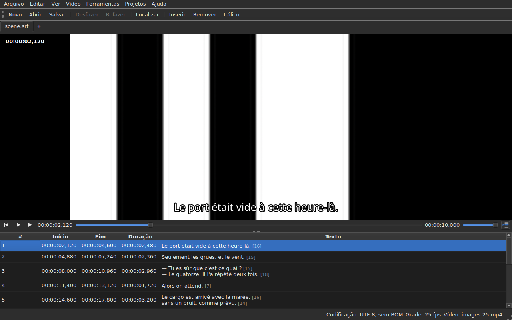

# O reprodutor

<!-- machine-translated -->
> Esta página é uma tradução automática e ainda não foi revisada por um leitor do idioma.

O vídeo associado é assistido **na própria janela**, com a linha atual
desenhada sobre ele. É isso que permite verificar no filme o resultado
de um deslocamento, de uma transformação ou de uma conversão de taxa de quadros.

Veja [O vídeo associado](video.md) para saber como associar um filme; esta
página descreve o que acontece depois que ele está associado.

## A visualização do vídeo

| Situação | O que a janela mostra |
| :------- | :-------------------- |
| um vídeo é associado e abre | a imagem ocupa a parte de cima, a tabela fica embaixo |
| nenhum vídeo associado | nenhuma imagem, a tabela ocupa a janela inteira |
| o vídeo não abre | nenhuma imagem, uma mensagem, e a janela continua utilizável |

A divisão entre a imagem e a tabela **se move com o mouse**. A imagem
não fica abaixo de 180 pixels de altura. Aumentar a janela dá o espaço ganho
à tabela, não à imagem: o que falta ao editar são linhas.

Sob a imagem, **uma barra de reprodução**: onde o filme está, quanto dura,
reproduzir e pausar, e o volume. Veja [A barra de reprodução](#a-barra-de-reprodução).

## Reproduzir e parar

| Comando | Atalho | O que faz |
| :------ | :----- | :-------- |
| Vídeo ▸ Reproduzir / Pausar | `Ctrl+P` | reproduz se a reprodução está parada, e a para caso contrário |

O comando fica **desativado enquanto nenhum vídeo estiver aberto**. Um vídeo que
acabou de ser associado é aberto **parado**: abrir um filme não é
assisti-lo.

`Ctrl+P` onde o Gaupol tem um simples `P`: um atalho de uma só letra no
escopo da janela é capturado antes que o widget que tem o foco o veja,
e um `P` seria engolido a caminho de um editor de célula. Nada
se imprime aqui, a combinação está livre.

## A barra de reprodução

Sob a imagem, da esquerda para a direita — os três botões são **ícones**, os do tema da área de trabalho quando ele os tem, os do estilo do Qt caso contrário:

| Elemento | O que faz |
| :------- | :-------- |
| os dois botões de passo | movem o filme para trás e para frente **de um passo de quadros** — veja [Quadro a quadro](timing.md#quadro-a-quadro) |
| reproduzir / pausar | reproduz ou para, como `Ctrl+P` — o botão mostra **o que vai fazer**: um triângulo quando parado, duas barras durante a reprodução; a dica de ferramenta o diz em palavras simples |
| a posição | `HH:MM:SS,mmm`, escrita como a tabela escreve uma posição — **como número de quadro** quando [`Ver ▸ Posições em quadros`](table.md#posições-em-quadros) está marcado |
| o controle deslizante | **lê e move**: arrasta-se a alça, clica-se na ranhura, usam-se as setas |
| a duração | a que o vídeo declara, escrita como a posição |
| o volume | de 0 a 100, veja [O volume](#o-volume) |
| acompanhamento da tabela | pressionado enquanto a tabela acompanha a reprodução, e a traz de volta à linha em reprodução quando é pressionado — veja [A tabela acompanha a reprodução](#a-tabela-acompanha-a-reprodução) |

**O controle deslizante não transmite a cada pixel.** Arrastar a alça pede dezenas de
posições por segundo, e cada uma custa um quadro decodificado: a primeira posição sai
imediatamente, as seguintes esperam um vigésimo de segundo, e **a última posição pedida é
sempre a alcançada** — no mais tardar quando a alça é solta. A imagem, portanto, não
fica atrás da mão, e não começa a desenhar um caminho que ninguém está olhando.

**O controle deslizante se move sozinho durante a reprodução**, e isso não conta como um gesto:
apenas o que se faz move o filme. Enquanto se segura a alça, a reprodução não a retoma.

## O código de tempo

**A posição é escrita sobre a imagem**, no canto superior esquerdo, sobre um fundo translúcido que a torna
legível em qualquer cena. É desenhada pela janela, com sua fonte, e não pede
nada ao reprodutor além da posição que ele já fornece; atualiza-se a cada gesto,
sem esperar a próxima rodada de acompanhamento.

## Navegar pelo filme

No menu **Vídeo**, **os gestos do Gaupol**, sob os nomes dele. Todos ficam **desativados sem vídeo**, como a
reprodução; os três que agem sobre a seleção também ficam desativados enquanto nada estiver selecionado.

| Comando | Atalho | O que faz |
| :------ | :----- | :-------- |
| Vídeo ▸ Reproduzir seleção | `Ctrl+Shift+P` | reproduz a partir de **um pouco antes do início** da seleção **até o fim de sua última legenda**, e para na imagem |
| Vídeo ▸ Ir para legenda anterior | `Ctrl+Left` | põe a reprodução no início da última legenda **terminada** antes da posição |
| Vídeo ▸ Ir para próxima legenda | `Ctrl+Right` | põe a reprodução no início da primeira legenda que **começa** depois da posição |
| Vídeo ▸ Ir para trás | `Ctrl+Shift+Left` | volta um salto — trinta segundos por padrão |
| Vídeo ▸ Ir para frente | `Ctrl+Shift+Right` | avança um salto |
| Vídeo ▸ Ir para início da seleção | `Ctrl+Up` | põe a reprodução no início da seleção, **com a antecedência antes dele** |
| Vídeo ▸ Ir para fim da seleção | `Ctrl+Down` | põe a reprodução no fim da seleção, **com a antecedência antes dele** |

**Os atalhos são os do Gaupol**, exceto um: `Play Selection` é `O` lá, e uma
letra isolada é capturada pela janela antes que a célula em edição a veja — digitar um
`o` em um texto iniciaria o filme. `Ctrl+P` é a resposta da reprodução, `Ctrl+Shift+P` a da
seleção. As setas do teclado ficam com o editor de célula quando ele está
aberto: `Ctrl+Left` move ali o cursor de uma palavra, não a reprodução.

- **O salto** é de 30 segundos, e pode ser ajustado de 1 segundo a uma hora — veja
  [O reprodutor](preferences.md#o-reprodutor). Não ultrapassa nem o início do filme nem o seu fim.
- **A antecedência** é de um segundo: assiste-se um pouco **antes** da legenda, para vê-la chegar.
  Pode ser ajustada de 0 a 60 segundos, e a reprodução não desce abaixo de zero.
- **Uma vizinha que não existe** — nada antes da primeira legenda, nada depois da última — não
  faz nada, e não diz nada: a reprodução fica onde está.
- **Cada gesto aparece imediatamente**: a barra, o código de tempo e a linha desenhada estão
  atualizados quando ele termina, sem esperar a próxima rodada.

## O volume

O volume é o do **reprodutor**, de 0 a 100, e não o do sistema. É ajustado com o controle deslizante da
barra, ou por dois gestos, no submenu `Vídeo ▸ Áudio`, em passos de cinco:

| Comando | Atalho | O que faz |
| :------ | :----- | :-------- |
| Vídeo ▸ Áudio ▸ Abaixar volume | `Ctrl+-` | abaixa o volume em cinco |
| Vídeo ▸ Áudio ▸ Aumentar volume | `Ctrl++` ou `Ctrl+=` | aumenta-o em cinco — o segundo para os teclados em que o sinal de mais exige a tecla Shift |

**É lembrado de uma sessão para a seguinte**, e dado a cada vídeo que se abre. Um valor fora de
0 a 100 no arquivo de configurações não impede a abertura: é ignorado, e a janela o informa.
**A faixa de áudio, em compensação, não é lembrada** — um número de faixa é o do seu arquivo; veja
[A faixa de áudio](video.md#a-faixa-de-áudio).

## Seleção e reprodução

Ambas funcionam nos dois sentidos.

| O que se faz | O que acontece |
| :----------- | :------------- |
| selecionar uma linha | a reprodução vai **para o início dessa legenda** |
| estender a seleção para baixo | nada mais: é a primeira linha da seleção que conta |
| a reprodução avança | a **linha atual** acompanha a legenda na tela, **colorida**, e a tabela a **centraliza** — veja [A tabela acompanha a reprodução](#a-tabela-acompanha-a-reprodução) |

A linha atual e a seleção são duas coisas distintas. A reprodução
move a primeira e **nunca toca na segunda**: a seleção é aquilo a que
uma operação se aplica, e um filme rodando em um canto não tem de modo algum o direito de
reescrever o alvo do usuário linha após linha.

A cor segue essa mesma regra: é um marcador, não uma seleção. **Uma
anomalia prevalece sobre ela** — uma linha que tem as duas conserva a cor
de seu defeito, pois um defeito está ali para ser reparado, ao passo que uma linha exibida só o é
durante uma fala. Veja [A tabela](table.md).

### A tabela acompanha a reprodução

**A tabela centraliza a linha em reprodução** — no meio do que mostra, e não na borda, onde bastaria para
torná-la visível. Faz isso **quando a linha muda**, não a cada tique do acompanhamento: uma fala dura
segundos, e recentralizar a cada décimo de segundo seria rolar sem motivo.

**Uma rolagem manual suspende o acompanhamento.** A roda do mouse, a barra de rolagem e um clique na tabela
o suspendem: a tabela fica onde foi posta, enquanto a linha atual, a linha desenhada e a barra
continuam acompanhando o filme. O botão de acompanhamento — **o ícone das linhas de uma tabela, uma delas marcada com uma seta**, à direita da barra de
reprodução; sua dica de ferramenta diz “Follow playback” — **fica pressionado enquanto a tabela acompanha** e depois volta a subir.

**O acompanhamento é retomado com um gesto do reprodutor**: reprodução iniciada, um salto, um passo, um marcador definido, uma
inserção na posição, ou um movimento da barra — a tabela então centraliza imediatamente a
linha em reprodução, mesmo que já fosse a mesma. **Ou sob demanda**: pressionar o botão o restabelece, e
soltá-lo o suspende. Não há temporizador: o que retoma o acompanhamento é sempre um gesto.

Passar para outra aba retoma o acompanhamento no filme dessa aba.

**Uma edição em andamento não é interrompida.** Enquanto um editor de célula
estiver aberto, a linha atual fica onde está; a linha desenhada sobre
a imagem, por sua vez, continua acompanhando, pois não incomoda ninguém.

## A linha desenhada

O que é exibido sobre a imagem vem do **documento aberto**, nunca de um arquivo:
**o que se vê na imagem é o que acabou de ser digitado**, sem passar pelo
disco. O texto aparece centralizado, na parte de baixo da imagem, e desaparece entre duas
legendas.

**Com uma tradução, a linha é a do texto visado**: a tradução quando
a célula atual está na coluna `Translation`, o texto principal
em todos os outros casos. É a regra de todas as operações de texto — veja [O
texto sobre o qual as operações atuam](table.md#o-texto-sobre-o-qual-as-operações-atuam) —
e **não há configuração**: passar de uma coluna para a outra muda o que
a imagem mostra, no máximo um décimo de segundo depois. Sem tradução, ou
com a coluna removida, nada muda: é o texto principal.

Uma legenda que a tradução ainda não alcançou mostra **nada** enquanto
a coluna atual for a da tradução: não é o texto principal que
toma o seu lugar.

**As marcações do formato são interpretadas, nunca desenhadas como estão.** O modelo guarda o
texto como o arquivo o escreve, e é o pivô de marcações — o da conversão
de formato — que o lê antes de entregá-lo à imagem:

| No arquivo | Na imagem |
| :--------- | :-------- |
| negrito, itálico, sublinhado | aplicados: `<i>no</i>` é exibido como *no*, sem suas marcações |
| cor | aplicada |
| fonte, tamanho | removidos, o texto permanece |
| posição, alinhamento, locutor, qualquer coisa sem equivalente na tela | removidos, o texto permanece |
| `{` e `}` no texto | desenhados: “{laughs}” é exibido como “{laughs}” |

Um arquivo Advanced SSA é lido da mesma forma: seus `{\i1}` são aplicados, e seu
`{\an8}` é removido — a linha permanece na parte de baixo da imagem. Cada texto é lido **no formato
de seu próprio arquivo**, a tradução tanto quanto o texto principal.

**O arquivo de legendas vizinho não é carregado** pelo reprodutor, mesmo que tenha o nome do
filme. Seria aquele em edição, e a imagem mostraria então o estado do disco
enquanto a tabela mostra outra coisa.

## Pré-visualizar uma alteração

Não há **nada de especial a fazer**: aplica-se a operação, assiste-se
ao filme, e escolhe-se `Undo: shifting` — ou a operação em questão — se o
resultado não servir. Veja [Desfazer e refazer](undo.md).

Não existe um modo de pré-visualização separado, e isso é deliberado: o que se
assiste é o documento como ele é, não um estado provisório invisível.

## Quando a imagem não aparece

Duas mensagens possíveis, ambas prefixadas com o caminho do arquivo:

| Mensagem | O que aconteceu |
| :------- | :-------------- |
| `<file>: <reason>` | o reprodutor recusou o arquivo — formato desconhecido, arquivo ausente, diretório |
| `<file>: no video player is available` | nenhum reprodutor pôde ser construído |

Nos dois casos, **o vídeo continua associado** — é preciso ver de qual
arquivo se trata para escolher outro — e **a janela continua utilizável**:
o documento está aberto, as operações funcionam, e o salvamento também.

**A imagem é desenhada na própria janela**: a `libmpv` preenche um buffer do
tamanho da visualização, em pixels reais, e a janela o pinta. Nada disso depende da
plataforma gráfica — a mesma imagem sob X11, sob Wayland e sem tela — e
acompanha o redimensionamento: a proporção do filme é preservada, o resto da
visualização fica preto.

A segunda mensagem só aparece, portanto, se a biblioteca `libmpv` se recusar a iniciar,
embora seja exigida na compilação.

A renderização passa pelo processador, mas **a decodificação pode ser feita na placa de vídeo**: ela
decodifica, a imagem é copiada de volta para a memória, depois desenhada como antes. Uma máquina sem
placa utilizável decodifica no processador, sem mensagem. Em um filme 1080p em H.264, a reprodução acompanha
o tempo real com folga. **Um filme 4K em HEVC pesado pode não acompanhar**: medido em dois
núcleos, ele decodifica a 0,6 vez o tempo real sem a placa, e avançar um quadro ali leva vários
segundos quando o quadro-chave está longe. A placa reduz esse tempo — de um terço a dois terços conforme o filme
— sem eliminá-lo. **Ela não muda a imagem exibida**: um passo ou um salto caem no
mesmo quadro com e sem ela. Para desativá-la, desmarque `Decode on the graphics card` em
[`Preferences…`](preferences.md#o-reprodutor).

## O que não existe

**Definir um marcador, avançar quadro a quadro e ajustar uma borda em um quadro** estão em
[Sincronizar a partir do vídeo](timing.md), não aqui. O que não existe, e é inútil procurar:

- uma forma de onda;
- reprodução automática quando um filme é aberto;
- o estilo da linha desenhada (fonte, cor, posição, fundo): ela conserva o da janela;
- decodificação por hardware sem cópia: veja “Quando a imagem não aparece” acima.

Este manual descreve o que existe: o que virá, e em que ordem, está no
[roteiro](../../../../feuille-de-route.md).
