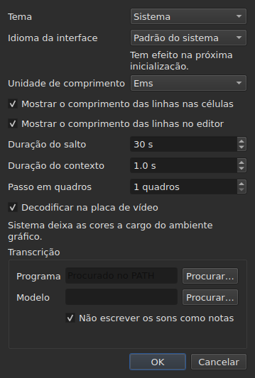

# As preferências

<!-- machine-translated -->
> Esta página é uma tradução automática e ainda não foi revisada por um leitor do idioma.

A janela lembra o que se define com o mouse — **onde ela estava**, **se
estava maximizada**, **a largura de suas colunas**, **a posição da
alça** entre o filme e a tabela — e **onde se trabalha**, de modo que
`Open…` abra no lugar certo. Nada disso é definido por uma caixa de diálogo:
move-se, arrasta-se, e fica lembrado.

**Seis preferências têm uma caixa de diálogo própria**, `Editar ▸ Preferências…`, e esse é o
critério: uma preferência que já tem um gesto não precisa de um campo. O
tema não tem nenhum, nem a unidade dos comprimentos de linha, nem as duas caixas de seleção que
os mostram, nem o salto e a antecedência do reprodutor. Veja [O tema](#o-tema),
[Comprimentos de linha](#comprimentos-de-linha) e [O reprodutor](#o-reprodutor).

**O idioma da interface está na mesma caixa de diálogo, e é o que espera**: ele vale a partir da
próxima inicialização, não de imediato. Veja [O idioma da interface](#o-idioma-da-interface).

**O volume não tem nenhuma**: a barra sob a imagem e dois gestos o definem, e ele é lembrado.

**Outra é definida onde é usada**: o lado em que `Insert Subtitles…` coloca suas
linhas é um campo dessa caixa de diálogo, e a última escolha é lembrada. Veja
[Inserir, remover, unir e dividir linhas](lines.md#o-lado-é-lembrado).

**As duas opções de pesquisa também**: `Regular expression` e
`Ignore case` permanecem marcadas ou desmarcadas de uma abertura da caixa de diálogo para a
seguinte, e de uma sessão para a outra. Veja
[Localizar e substituir](find-and-replace.md#as-duas-opções).

**Assim como as configurações de `Adjust Durations…`**: a velocidade de leitura, seus dois
sentidos, e as três durações com suas caixas de seleção — cada uma conserva seu valor, marcada
ou não. Veja [`Adjust Durations…`](operations.md#adjust-durations).

**E a última codificação escolhida em `Save As…`**, com sua marca de ordem de
bytes. Veja [o arquivo](#o-arquivo).

**E o que o assistente `Correct Texts…` e `Spell-Check Settings…` definem**: as
tarefas marcadas e seu código, as caixas de seleção dos padrões, as configurações de quebra de linha, o idioma,
o alvo da verificação e o sublinhado durante a digitação. Veja [Corrigir textos…](correct-texts.md) e
[Verificar ortografia…](check-spelling.md#configurações-da-verificação-ortográfica). **O alvo e o
documento de `Correct Texts…` não são lembrados.**

**O que não é lembrado:** o último arquivo aberto — veja
[O diretório lembrado](#o-diretório-lembrado).

## O reprodutor

Quatro campos. **Seek length** e **Context length** são do Gaupol e têm seus valores; **Frame step** e **Decode on the graphics card** são próprios do subedit:

| Campo | O que define | Padrão | Limites |
| :---- | :----------- | ------: | :----- |
| `Seek length` | o salto de `Seek Backward` e `Seek Forward` | 30 s | de 1 s a uma hora |
| `Context length` | a antecedência antes da seleção, para `Seek Selection Start`, `Seek Selection End` e `Play Selection` | 1 s | de 0 a 60 s, ao décimo |
| `Frame step` | o passo, **em quadros**, de `Step Backward` e `Step Forward`, e do ajuste fino de uma extremidade | 1 quadro | de 1 a 1000 quadros |
| `Decode on the graphics card` | permite que a placa de vídeo decodifique o filme quando a máquina tem uma; sem placa, nada muda | marcada | marcada ou não |

Elas valem **de imediato**, sem esperar uma reinicialização, e são lembradas de uma sessão para a outra
sob `video.seek-length` (em segundos), `video.context-length-ms` (em milissegundos), `video.step-frames` (em quadros) e `video.hardware-decoding` (`true` ou `false`).
**Um valor fora dos limites, ou que não é um número**, não impede a janela de abrir: ele
é ignorado, o padrão permanece, e a janela o diz na abertura. **O passo em quadros nunca é em milissegundos**: um passo de N quadros é sempre N quadros, seja qual for a taxa de quadros do filme — veja [Sincronizar a partir do vídeo](timing.md#quadro-a-quadro). O volume é lembrado em `video.volume`,
de 0 a 100, com a mesma tolerância.

## O arquivo

```
~/.config/subedit/settings.conf
```

Mais exatamente `$XDG_CONFIG_HOME/subedit/settings.conf` quando essa variável
está definida. Ele é escrito **quando a janela fecha**, e lido quando ela abre.
Um programa interrompido — morto, ou parado por uma falha — não escreve nada, e a
próxima sessão encontra o que a anterior havia deixado.

O arquivo é texto, e pode ser editado à mão. Isso é uma propriedade e não
um efeito colateral: é o que torna uma configuração corrigível quando a interface
que a define é justamente a que está quebrada.

### Dois blocos, um deles compartilhado com a linha de comando

O arquivo é escrito em **dois blocos**, cada um sob um comentário de cabeçalho:

| Bloco | Chaves | Lido por |
| :---- | :--- | :------ |
| `# Operation settings: shared by the window and the command line` | as chaves `duration-adjust.*` e `correction.*` | a janela **e** o `subedit-cli` |
| `# Display preferences: the window's own` | todas as outras chaves — geometria, colunas, tema, idioma da interface, pesquisa, verificação ortográfica, editor, vídeo, último diretório, codificação de escrita | somente a janela |

**O `subedit-cli` lê o bloco de operações por padrão**: o que `Adjust Durations…` e
`Correct Texts…` lembram aqui é também aquilo de que [`subedit-cli adjust`](../subedit-cli/adjust.md)
e parte de [`subedit-cli correct`](../subedit-cli/correct.md) partem, a menos que uma opção da
linha de comando diga o contrário. **Ele nunca lê as preferências de exibição.** Seu
comando [`config`](../subedit-cli/config.md) lista as chaves de operação, mostra seus valores e
os altera — `subedit-cli config set duration-adjust.speed 12` — e a janela vê a mudança
em sua próxima abertura. **Uma mudança feita com a janela aberta não sobrevive ao seu fechamento**: a
janela reescreve o arquivo inteiro com o que mantém. `--no-config` faz uma linha de comando ignorar o
arquivo. Veja
[O arquivo de configurações](../subedit-cli/invocation.md#o-arquivo-de-configurações).

O leitor aceita as chaves em qualquer ordem, com ou sem os cabeçalhos: um arquivo escrito antes que os
dois blocos existissem é lido sem alteração, e reescrito em dois blocos no próximo
fechamento.

| Opção | O que contém | Padrão |
| :----- | :------------ | :------ |
| `window.geometry` | `x,y,width,height`, em pixels; largura e altura diferentes de zero | a janela se dimensiona sozinha |
| `window.maximised` | `true` ou `false` | `false` |
| `table.columns` | quatro larguras em pixels, separadas por vírgulas — `#`, `Start`, `End`, `Duration`, mesmo ocultas | a tabela se dimensiona sozinha |
| `table.order` | as seis colunas, **cada uma uma vez**, na ordem em que a tabela as mostra: `number`, `start`, `end`, `duration`, `text`, `translation` | `number,start,end,duration,text,translation` |
| `table.hidden` | as colunas removidas, entre `number`, `start`, `end` e `duration`; vazio, nenhuma | nenhuma |
| `window.table-share` | a parte da altura dada à tabela, em por cento, de 1 a 99 | a janela reparte como sempre repartiu |
| `file.directory` | um caminho de diretório **absoluto** | nenhum: `Open…` abre onde o programa foi iniciado |
| `general.theme` | `system`, `light` ou `dark` | `system` |
| `interface.language` | `system`, ou o nome de um idioma como seu catálogo é nomeado: duas ou três letras minúsculas, depois opcionalmente `_` e duas maiúsculas — `fr`, `pt_BR`; `en` para o inglês | `system` |
| `edit.insert-placement` | `above` ou `below` | `below` |
| `file.write-encoding` | o nome de uma codificação que o ICU saiba escrever, e cujo conversor não escreva a sua própria marca | nenhum |
| `file.write-bom` | `true` ou `false` | `false` |
| `search.regex` | `true` ou `false` — o padrão é uma expressão regular | `false` |
| `search.ignore-case` | `true` ou `false` — maiúsculas e minúsculas são ignoradas | `true` |
| `duration-adjust.speed` | a velocidade de leitura, em caracteres por segundo, estritamente positiva; um número decimal é escrito o mais curto possível (`15`, `12.5`) | `15` |
| `duration-adjust.lengthen` | `true` ou `false` — alongar o que é curto demais para ser lido | `true` |
| `duration-adjust.shorten` | `true` ou `false` — encurtar o que permanece exibido por mais tempo que o necessário | `false` |
| `duration-adjust.minimum-enabled` | `true` ou `false` — a duração mínima é pedida | `true` |
| `duration-adjust.minimum-ms` | a duração mínima, em milissegundos, inteira e não negativa | `1500` |
| `duration-adjust.maximum-enabled` | `true` ou `false` — a duração máxima é pedida | `false` |
| `duration-adjust.maximum-ms` | a duração máxima, em milissegundos, inteira e não negativa | `6000` |
| `duration-adjust.gap-enabled` | `true` ou `false` — o intervalo até a legenda seguinte é pedido | `true` |
| `duration-adjust.gap-ms` | o intervalo, em milissegundos, inteiro e não negativo | `0` |
| `correction.mentions.enabled`, `correction.common-errors.enabled`, `correction.capitalization.enabled`, `correction.line-break.enabled` | `true` ou `false` — a tarefa está marcada na primeira página de `Correct Texts…` | `false`, `true`, `true`, `false` |
| `correction.mentions.code`, `correction.common-errors.code`, `correction.capitalization.code`, `correction.line-break.code` | o código dos padrões da tarefa: `Zyyy`, ou `Script[-language[-COUNTRY]]` — `Latn-en-US`; não vazio | `Zyyy` |
| `correction.human`, `correction.ocr` | `true` ou `false` — as classes de erros comuns | `true`, `true` |
| `correction.sound-in-brackets`, `correction.sound-in-parentheses` | `true` ou `false` — as duas caixas de seleção da página `Mentions` | `false`, `false` |
| `correction.line-break.max-length` | o comprimento máximo de uma linha, decimal; a caixa de diálogo o limita de 1 a 1000 | `24` |
| `correction.line-break.max-lines` | o número máximo de linhas, inteiro; a caixa de diálogo o limita de 1 a 100 | `3` |
| `correction.line-break.in-ems` | `true`: o comprimento é medido em *ems*; `false`: em caracteres | `true` |
| `correction.line-break.skip-on-length`, `correction.line-break.skip-on-lines` | `true` ou `false` — as duas condições de exclusão são pedidas | `true`, `true` |
| `correction.line-break.skip-max-length`, `correction.line-break.skip-max-lines` | os dois limiares de exclusão, na unidade escolhida | `24`, `3` |
| `correction.join-split.enabled` | `true` ou `false` — a tarefa `Join or Split Words` está marcada | `false` |
| `correction.join-split.join`, `correction.join-split.split` | `true` ou `false` — unir, dividir | `true`, `false` |
| `correction.join-split.language` | um código de localidade — `fr`, `en_US`, `sr@Latn` —; vazio: o idioma do sistema | vazio |
| `correction.remove-blank` | `true` ou `false` — `Remove all blank subtitles` | `true` |
| `transcription.engine` | o nome do motor: letras minúsculas, algarismos, `.`, `-` e `_` | `whisper.cpp` |
| `transcription.executable`, `transcription.model` | um caminho absoluto; vazio: o motor é procurado no `PATH`, e nenhum modelo é definido | vazio |
| `transcription.language` | duas letras minúsculas, um código ISO 639-1; vazio: o idioma é detectado | vazio |
| `transcription.suppress-notes` | `true` ou `false` — `Do not write sounds as notes` | `true` |
| `transcription.merge-gap-ms` | os pedaços de uma mesma frase mais próximos do que este valor são unidos, em milissegundos, inteiro e não negativo | `400` |
| `transcription.max-duration-ms` | o tempo máximo que uma legenda transcrita fica na tela, em milissegundos, de 1 a 3600000 | `7000` |
| `transcription.max-characters` | o número máximo de caracteres de uma legenda transcrita, de 1 a 1000 | `84` |
| `correction.activations` | as caixas de seleção de padrões que o usuário alterou, `<type>:<code>:<name>:<0\|1>`, separadas por vírgulas; **uma vírgula ou uma barra invertida em um nome é escrita precedida de uma barra invertida** (`\,` e `\\`), e uma entrada ilegível perde apenas a sua própria configuração — ela é relatada, as outras são conservadas | vazio |
| `spell-check.language` | um código de localidade, como `fr_FR`; vazio: o idioma do sistema | vazio |
| `spell-check.target` | `selection`, `current-project` ou `all-projects` | `current-project` |
| `spell-check.document` | `main` ou `translation` | `main` |
| `spell-check.inline` | `true` ou `false` — sublinhar palavras desconhecidas durante a digitação no editor de uma célula | `false` |
| `editor.length-unit` | `em` ou `characters` — a unidade dos comprimentos de linha mostrados pela tabela e pelo editor | `em` |
| `editor.show-lengths-cell` | `true` ou `false` — cada linha de uma célula de texto é seguida de seu comprimento | `true` |
| `editor.show-lengths-edit` | `true` ou `false` — o editor de uma célula mostra o comprimento de cada linha em uma margem | `true` |

**O arquivo aceita mais que a caixa de diálogo.** O leitor aceita qualquer velocidade estritamente
positiva e qualquer duração não negativa; a caixa de diálogo `Adjust
Durations…`, por sua vez, limita a velocidade de 1 a 99 caracteres por segundo e cada
duração de 0 a 99 s. Um valor do arquivo fora desses limites é trazido de volta ao
limite quando a caixa de diálogo abre, e o arquivo o conserva assim depois que a
caixa de diálogo é aceita e a janela fechada. Uma caixa de diálogo cancelada não altera nada do que
é lembrado.

**`file.write-encoding` lembra a última codificação escolhida em `Save As…`, e
nunca se impõe a um arquivo.** Um documento aberto traz sua própria codificação,
e é essa que a caixa propõe: reescrevê-lo em outra porque uma
configuração de três semanas atrás o diz perderia o que a leitura conservou.
O que essa configuração lembra serve ao documento que não tem arquivo — o recém-
criado.

**É um “não” deliberado e não um esquecimento.** Quem entrega sempre na
mesma codificação e abre arquivos herdados em outra a escolhe de novo para
cada arquivo; a caixa a propõe a essa pessoa, e a garantia de ida e volta vale
para todos.

**`file.write-bom` traz a marca da mesma codificação**, e duas
linhas são de fato necessárias: o nome de uma codificação não diz se ela é precedida de sua marca, assim como
`--encoding` não diz o que `--bom` diz. Ambas são lidas juntas, em
qualquer ordem, e um `file.write-bom` sem codificação lembrada não define nada.

**Uma parte e não alturas para a alça**, e é isso que a torna
útil: três alturas em pixels não significam mais nada assim que a janela
abre em outro tamanho, e uma janela com frequência abre em outro tamanho.
A parte se aplica em qualquer lugar. Ela é **trazida de volta ao que a janela aceita** se
for pequena demais — a faixa do filme tem uma altura mínima.

**Quatro larguras para seis colunas**, e isso não é um esquecimento: são as
de `#`, `Start`, `End` e `Duration`, nessa ordem seja qual for a da
tabela, e **uma coluna oculta conserva a sua** — ela a reencontra quando é
mostrada de novo. A última coluna mostrada toma o que as outras deixam, e dar-lhe
uma largura não faria nada; as do texto e da tradução, portanto, não
são lembradas.

## O que acontece quando o arquivo não diz o que se espera

Uma configuração é uma comodidade. **Sua falha custa a comodidade e nada
mais**: a janela abre em todos os casos.

| Caso | O que acontece |
| :--- | :----------- |
| o arquivo não existe | todos os padrões, e nada é dito — é a primeira inicialização |
| o arquivo existe e não pode ser lido | todos os padrões, e a razão é escrita no fluxo de erro |
| uma opção está ausente | seu padrão |
| uma chave é desconhecida | ignorada, sem uma palavra, e ausente do arquivo reescrito |
| um valor não pode ser lido | seu padrão é conservado, e a opção é nomeada no fluxo de erro |

```console
$ subedit-gui film.srt
subedit-gui: /home/vous/.config/subedit/settings.conf: window.geometry: "plus tard" cannot be read, keeping the default
```

**A mensagem vai para o fluxo de erro e para nenhum outro lugar.** Uma janela
modal na inicialização por uma preferência ilegível pararia o usuário por
uma falha que não o impede de nada, e antes que ele tenha pedido qualquer coisa.

## As opções comentadas

O arquivo reescrito contém **todas** as opções conhecidas, e as deixadas em seu
padrão são escritas como comentários:

```
#window.geometry = 0,0,1280,800
#window.maximised = false
#table.columns = 60,110,110,110
#table.order = number,start,end,duration,text,translation
#table.hidden = start,end
```

Não é uma afetação. Sem isso, uma opção nunca tocada permaneceria
congelada no valor do dia em que foi escrita, e **um padrão melhorado
nunca chegaria a ninguém**. Com isso, mudar um padrão muda o
comportamento de todos os que não o sobrescreveram — que é exatamente
o que um padrão deve fazer.

Para sobrescrever uma opção: remova o `#` e mude o valor. Para voltar
ao padrão: apague a linha, ou comente-a de novo.

A geometria, as larguras e as colunas removidas mostram uma **forma** e
não um valor em vigor: o padrão da geometria e o das larguras são
“o que a janela escolhe”, que não se escreve em números, e o de
`table.hidden` é “nenhuma”, que não pode ser lido. O cabeçalho do arquivo o diz
também. `table.order`, por sua vez, mostra de fato a ordem padrão.

## O diretório lembrado

`Open…` abre no diretório do **último arquivo aberto ou salvo**,
e não no de uma caixa que você cancelou: o que conta é onde você
trabalha, não onde olhou.

**O último arquivo, por sua vez, não é lembrado.** Lembrá-lo seria
reabrir na inicialização um documento que ninguém pediu. Lembrar um diretório
*aponta* uma caixa de diálogo; lembrar um arquivo abriria um.

## O tema

`Editar ▸ Preferências…` abre com o tema, uma preferência sem gesto, acima dos
[comprimentos de linha](#comprimentos-de-linha).

| Valor | O que faz |
| :---- | :----------- |
| `System` | **nada** — as cores continuam as da área de trabalho |
| `Light` | define uma paleta clara |
| `Dark` | define uma paleta escura |

O tema escolhido vale **imediatamente**, sem reiniciar.

**“System” não faz nada, e isso não é uma falta.** A versão do Qt sobre a
qual o subedit é compilado não tem como perguntar à área de trabalho se ela quer ser
clara ou escura, nem ser notificada quando ela muda de ideia. Em vez de
inventar uma leitura que não sabemos fazer, a ferramenta distribui os dois temas
que podem ser pedidos e deixa o toolkit decidir pelo terceiro —
que é o que o Gaupol faz nas mesmas condições.

Sob uma área de trabalho cujo tema já é escuro, `System` dá portanto uma
janela escura; sob uma área de trabalho clara, uma janela clara. `Light` e `Dark` a
sobrepõem, qualquer que seja a área de trabalho.

**As cores das anomalias permanecem legíveis nas duas paletas** — veja
[A tabela](table.md#as-anomalias). Não é uma suposição: o contraste
do texto sobre cada uma das cores é verificado por um teste, sobre os dois fundos.

## Transcrição

O grupo **`Transcription`** da caixa de diálogo contém os dois dados sobre a máquina de que
[`Transcribe Audio…`](video.md#transcrever-o-áudio) precisa: **o programa** do motor (whisper.cpp,
`whisper-cli`) e **o modelo** que ele lê. Cada um tem um botão `Browse…`. Se ficar vazio, o programa é procurado
no `PATH`; o modelo não tem valor padrão.

Sob os campos, **a caixa diz o que existe**: se o motor foi encontrado e onde, se o `ffmpeg`
foi encontrado, e o modelo — não definido, não encontrado, não é um modelo, só para inglês ou multilingue. Quando falta
algo, acrescenta o link para
[Instalar as ferramentas de transcrição](../subedit-cli/install-transcription.md), que diz onde encontrar
cada um. Os dois campos são as configurações `transcription.executable` e `transcription.model`.

Uma caixa, **“Não escrever os sons como notas”**, é a configuração `transcription.suppress-notes` (marcada por preconfiguração): o motor recebe a ordem de não escrever os sons
como notas, como `(phone ringing)`. Desmarque-a para os conservar, para legendas para surdos e ensurdecidos. A caixa de diálogo de `Transcribe Audio…` oferece a mesma caixa para a transcrição de cada vez.

## O idioma da interface

`Editar ▸ Preferências…` escolhe o idioma da janela, sob o tema.

| Campo | Valores | Padrão |
| :---- | :----- | :------ |
| `Interface language` | `System default`; `English`; depois cada idioma instalado com o programa, por seu próprio nome — `Français` | `System default` |

**Ele entra em vigor na próxima inicialização**, e a caixa de diálogo o diz sob o campo: a janela é
traduzida à medida que é construída, e uma janela em execução conserva o idioma em que iniciou. A escolha é
guardada no arquivo de configurações, sob `interface.language`, e lida quando a janela abre da vez seguinte.

| Escolha | A janela inicia em |
| :----- | :------------------- |
| `System default` | o idioma do ambiente, como antes de qualquer escolha — `LANGUAGE`, `LC_ALL`, `LC_MESSAGES`, `LANG`; veja [Idioma](invocation.md#idioma) |
| `English` | inglês, diga o que disser o ambiente |
| um idioma instalado | esse idioma, **diga o que disser o ambiente**, `LC_ALL=C` inclusive: uma escolha feita aqui é explícita |

A lista contém os idiomas cujo catálogo está instalado em `<prefix>/share/subedit/locale`;
o inglês está sempre presente, já que é o idioma em que o programa é escrito. Um idioma é mostrado
por seu próprio nome, que nenhum catálogo traduz, de modo que o leitor encontre aquele que lê.

**Um valor que o programa não pode honrar custa apenas a escolha:**

| O que o arquivo diz | O que acontece |
| :----------------- | :----------- |
| o nome de um idioma sem catálogo instalado — um arquivo trazido de outra máquina | a janela segue o ambiente, sem uma palavra; `Preferences…` mostra esse idioma, por seu nome ou seu código, e o conserva a menos que outro seja escolhido |
| algo que não é o nome de um idioma — `French`, `fr_FR.UTF-8` | `system`, o padrão, e a opção é nomeada no fluxo de erro, como qualquer valor ilegível |

```console
$ subedit-gui film.srt
subedit-gui: /home/vous/.config/subedit/settings.conf: interface.language: "French" cannot be read, keeping the default
```

**A linha de comando nunca o lê**: o `subedit-cli` escolhe seu idioma somente pelo
ambiente, e `subedit-cli config set interface.language fr` é recusado como preferência de exibição.

## Comprimentos de linha




`Editar ▸ Preferências…` também define **o que a tabela e o editor mostram do
comprimento das linhas** — a régua e a margem do Gaupol.

| Campo | O que faz | Padrão |
| :---- | :----------- | :------ |
| `Length unit` | a unidade dos comprimentos: `Ems` ou `Characters` | `Ems` |
| `Show line lengths in cells` | cada linha de uma célula de texto é seguida de seu comprimento | marcada |
| `Show line lengths in the editor` | o editor de uma célula mostra o comprimento de cada linha em uma margem à direita | marcada |

**`Length unit` fica esmaecido quando nenhuma das duas caixas de seleção está marcada**: sem
comprimento a mostrar, a unidade não define nada. A escolha vale **de imediato** para a
tabela, e os editores que abrirem depois a seguem. Os três valores são
lembrados de uma sessão para a outra: `editor.length-unit`, `editor.show-lengths-cell`
e `editor.show-lengths-edit`, na tabela [do arquivo](#o-arquivo). Veja
[O comprimento das linhas](table.md#o-comprimento-das-linhas) e
[no editor](editing.md#o-comprimento-das-linhas).

**Não é o limite do assistente.** A unidade de `Correct Texts…` — o
comprimento a partir do qual ele quebra linhas — é uma configuração separada, em seu
assistente: pode-se ler em ems na tabela e quebrar em caracteres.

## O que não pode ser configurado

**Nove configurações lembradas são escolhidas em uma caixa de diálogo** — sem contar as do
assistente de correção e da verificação ortográfica, que têm cada uma
a sua —, e cada uma naquela em que é usada: o tema e as três configurações de comprimento de linha, aqui; o lado de uma inserção, na caixa de inserção;
as duas opções de pesquisa, na caixa de pesquisa; a codificação e
a marca de ordem de bytes, em `Save As…`; a velocidade de leitura, as durações
e o intervalo do ajuste de durações, em sua própria caixa de diálogo. Não há
outra: nada pode ser definido para os diagnósticos, o volume do reprodutor,
nem o formato de salvamento padrão — esse vem do arquivo aberto.

E **nenhum número que pertence a um documento é conservado de uma sessão para
a outra**: um valor de deslocamento, dois marcadores de transformação são verdadeiros para um
arquivo e falsos para o seguinte. As caixas de diálogo os pedem de novo a cada inicialização,
deliberadamente. As configurações de `Adjust Durations…` são uma exceção do mesmo modo que
as duas opções de pesquisa: uma velocidade de leitura, uma duração mínima ou
um intervalo são escolhas de método e não medidas de um arquivo, e
persistem de uma sessão para a outra por essa razão.

Este manual descreve o que existe: o que virá está no
[roteiro](../../../../feuille-de-route.md).
