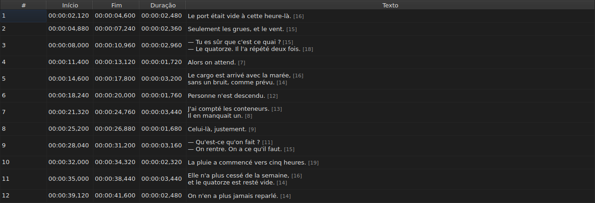
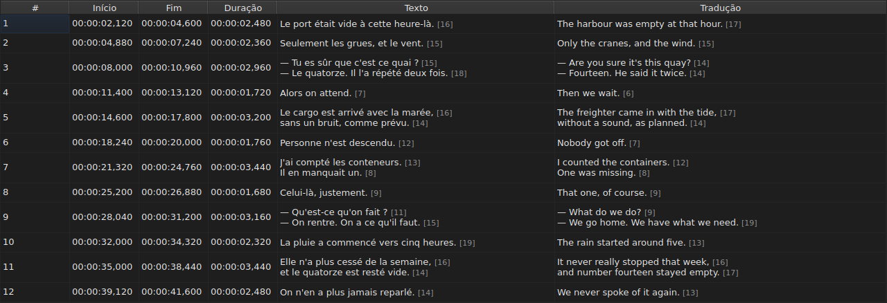
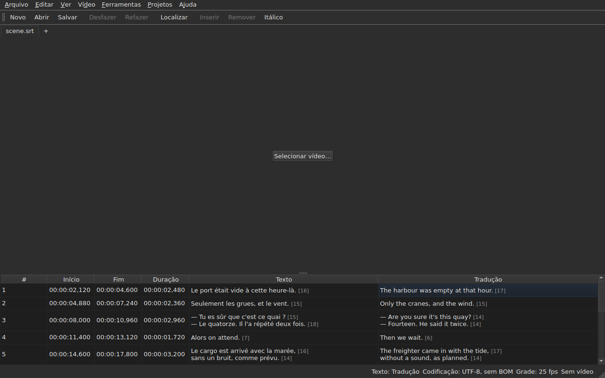

# A tabela

<!-- machine-translated -->
> Esta página é uma tradução automática e ainda não foi revisada por um leitor do idioma.

A janela mostra as legendas do arquivo aberto, uma por linha, em cinco
colunas — seis quando o projeto contém uma tradução.

**Este manual cita os cabeçalhos da janela tal como a janela em inglês os exibe**, como faz para a linha de comando; a janela em português do Brasil e suas capturas de tela os mostram em português do Brasil.

| Coluna | O que mostra |
| :----- | :----------- |
| `#` | a posição da legenda na ordem, a partir de 1 |
| `Start` | a posição em que aparece, `HH:MM:SS,mmm` |
| `End` | a posição em que desaparece |
| `Duration` | `End − Start` |
| `Text` | o texto da legenda |
| `Translation` | a tradução da legenda — **ausente enquanto o projeto não tiver nenhuma** |




## O comprimento das linhas


**Cada linha de uma célula de texto é seguida de seu comprimento**, `[N]`, menor
e mais pálido — na coluna `Text` como na coluna `Translation`.
É o que o Gaupol faz.

| O que conta | O que a tabela faz |
| :---------- | :----------------- |
| **marcações** | não contam: `<i>Bonjour</i>` dá `[7]`, como `Bonjour` |
| **arredondamento** | para baixo: uma linha de 12,9 ems é exibida `[12]` |
| **uma linha vazia** | não tem comprimento; um texto vazio também não |
| **a unidade** | *ems* por padrão, ou caracteres — `Editar ▸ Preferências…` |
| **uma linha longa demais para a coluna** | é cortada por `…` **antes** do número, que permanece visível |

**O *em* é o do Gaupol, não o da tipografia**: o alfabeto minúsculo
vale 0,55 em por letra, na fonte da tabela. Um comprimento em *ems*
depende, portanto, da fonte; um comprimento em caracteres conta pontos de código, um
acento valendo um.

**A tabela não marca uma linha longa demais.** Ela mostra o número, e cabe
ao olho compará-lo com o limite que cada um definiu para si — como o Gaupol. Não é
o limite do assistente `Correct Texts…`, que tem sua própria configuração.

**Para não vê-los:** desmarque `Show line lengths in cells` em
`Editar ▸ Preferências…`. Veja [Comprimentos de linha](preferences.md#comprimentos-de-linha).

## Ocultar e mover colunas

**`Ver ▸ Colunas`** contém um item marcável por coluna, **exceto `Text`**:
sem o texto principal, não restaria nada para editar.

| Item | Coluna |
| :--- | :----- |
| `Ver ▸ Colunas ▸ Num.` | `#` |
| `Ver ▸ Colunas ▸ Início` | `Start` |
| `Ver ▸ Colunas ▸ Fim` | `End` |
| `Ver ▸ Colunas ▸ Duração` | `Duration` |
| `Ver ▸ Colunas ▸ Tradução` | `Translation` — veja [A coluna de tradução](#a-coluna-de-tradução) |

Desmarcar um item remove sua coluna, marcá-lo de novo a recoloca, na largura
que tinha. **A configuração vale para a janela inteira**, todas as abas
incluídas: há uma única tabela, cujo projeto muda com a aba.

**A célula atual sai da coluna que está sendo removida**: ela passa para `Text`,
na mesma linha, e a seleção não se move. Uma célula atual em uma
coluna que ninguém vê seria uma célula que uma tecla pressionada editaria
às cegas.

**As colunas são movidas arrastando seu cabeçalho**, qualquer uma, `Text`
inclusive. A última coluna exibida ocupa o espaço que as outras deixam.

**A ordem e as colunas removidas são lembradas de uma sessão para a seguinte**, com
as larguras, no [arquivo de preferências](preferences.md) — `table.order`
e `table.hidden`. A coluna de tradução não está ali: ela segue sua própria
regra, e volta a cada tradução aberta.

**O número não é um dado do arquivo**, e sim a posição da linha. Uma
inserção ou uma remoção renumera, portanto, tudo o que vem depois, sem que nada
seja reescrito.

**O separador decimal segue o formato do arquivo**: uma vírgula para SubRip,
um ponto para os outros oito. SubRip é o único dos nove que escreve uma vírgula.

**É o separador que segue, não toda a grafia.** A tabela sempre escreve
as horas e sempre três casas decimais; um arquivo WebVTT omite as
horas abaixo de uma hora, SubViewer 2 e os dois Sub Station Alpha contam em
centésimos, MPL2 em décimos, TMPlayer em segundos, MicroDVD em quadros. Uma
coluna cuja largura seguisse o formato seria mais cansativa de ler do que uma
coluna que simplesmente não é a grafia exata do arquivo.

O que a tabela garante é, portanto, **o valor e o separador**, não o número
de casas decimais. O que um formato de destino arredondaria é dito no momento de
salvar — veja
[O que um formato não preservará, dito antes de escrever](files.md#o-que-um-formato-não-preservará-dito-antes-de-escrever).

**A duração (`Duration`) é calculada**, nunca armazenada: digitá-la move o
fim. Uma legenda cujo fim precede o
início exibe uma duração negativa em vez de zero: é uma anomalia do
arquivo, e escondê-la tornaria impossível encontrá-la.

**O início, o fim, a duração, o texto e a tradução são editados no próprio lugar**; o
número não. Veja [Editar uma célula](editing.md).

**A seleção designa aquilo em que uma operação age** — veja
[As operações](operations.md).

**A altura de uma linha segue a legenda que ela contém**: uma legenda de
duas linhas ocupa duas, uma de três ocupa três. O texto é mostrado
por inteiro, tal como será escrito.

**O que continua cortado é uma linha longa demais para sua coluna**, e ela então
termina com reticências. Alargar a coluna `Text`, ou a janela, mostra-a
por inteiro; abrir a célula também. As linhas do texto nunca são
quebradas automaticamente: apenas uma quebra de linha real forma uma linha, de modo que a altura
de uma linha da tabela não muda quando se arrasta a borda de uma coluna.

## Posições em quadros

**`Ver ▸ Posições em quadros`** — um item marcável, uma única configuração para a janela — mostra as
colunas `Start` e `End` **como números de quadro** em vez de marcas de tempo, e **aceita um número de quadro como entrada**. Os
cabeçalhos o dizem: `Start (frames)` e `End (frames)`.

| O que muda | O que não muda |
| :--------- | :------------- |
| o que `Start` e `End` escrevem, e o que aceitam | a coluna `Duration`, que continua sendo um tempo |
| os cabeçalhos dessas duas colunas | o documento: nada é modificado, o histórico não ganha entrada nova, e **o que o arquivo escreve é o que escrevia** |

**A taxa de quadros que conta os quadros** é, nesta ordem:

1. **a do arquivo**, quando ele é contado em quadros — MicroDVD, que guarda números e nenhuma taxa
   de quadros: **a janela mostra então os números de seu arquivo**, seja qual for o vídeo;
2. **a que o vídeo associado declara**;
3. **a grade que as posições desenham**, quando desenham uma.

A dica de ferramenta do item diz qual foi a retida: *Positions are frame numbers, counted at 25 fps, the rate the
video declares*. **Sem nenhuma das três, o item fica desativado, e sua dica de ferramenta diz por quê**: o arquivo não
é contado em quadros, o vídeo não declara taxa de quadros, e as posições não caem em nenhuma grade.

- **Um número é o número do quadro em que a posição cai**, arredondado para o quadro mais próximo. **Digitado, ele
  dá o instante em que esse quadro começa**, arredondado **uma única vez** a partir da razão exata
  ([ADR 0013](../../../../adr/0013-mise-a-l-echelle-exacte-des-positions.md)): o quadro 37 a 23,976 quadros por segundo
  começa em 1543,04 ms, ou seja, `00:00:01,543`.
- **Só números inteiros são aceitos** — com o sinal de menos, já que um início pode preceder o filme. Uma
  marca de tempo digitada no modo de quadros, ou um número que não seja um, deixa a célula como estava.
- **A barra de reprodução segue a mesma configuração**: a posição e a duração de cada lado do controle deslizante
  são escritas como números de quadro, como `Start` e `End`, no mesmo instante — veja
  [A barra de reprodução](player.md#a-barra-de-reprodução). O relógio desenhado no alto da imagem continua sendo uma
  marca de tempo.
- **Esta configuração não é lembrada** de uma sessão para a seguinte: é uma configuração da janela, não de um
  documento, e é reativada em um único gesto.

## As anomalias

Uma legenda cujas posições não são coerentes entre si é **colorida nas suas
colunas de tempo**, e passar o mouse sobre ela diz o que está errado.

| Cor | O que indica | O que fazer |
| :-- | :----------- | :---------- |
| vermelho | `ends before it starts` | corrigir seu fim, ou seu início |
| azul | `starts before the previous one starts` | recolocá-la em seu lugar na ordem |
| âmbar | `starts before the previous one ends` | ajustar sua sincronização |


Apenas as colunas `Start`, `End` e `Duration` são coloridas: uma anomalia
fala só de tempo, e colorir o texto sugeriria que ele tivesse algo
a ver com isso.

**Uma legenda pode ter várias**, e a dica de ferramenta as nomeia todas. A
cor é a da primeira a reparar: uma legenda com defeito em si mesma
está com defeito faça o que fizerem suas vizinhas; uma legenda fora de lugar é recolocada,
e sua sobreposição desaparece com isso.

> Não é por acaso que a desordem quase sempre prevalece sobre a
> sobreposição: começar antes que a anterior comece é começar
> antes que ela termine — a menos que a anterior esteja ela mesma com defeito.

**A marcação é recalculada após cada mudança de posição**, venha ela
de uma célula editada, de uma operação ou de um desfazer. Diz o que o
arquivo é agora, não o que era na abertura.

Ela não se apoia em nenhuma grade de quadros: assim que uma posição é corrigida
à mão, ela sai da grade, e uma marcação baseada nela
relataria o trabalho do usuário.

## A coluna de tradução

Uma legenda contém **dois textos e um único par de posições**: a
tradução não tem sincronização própria, está ligada à da legenda.
A tabela a mostra em uma sexta coluna, `Translation`, à direita de `Text`.




**A coluna só existe se o projeto tiver uma tradução.** Sem ela, a tabela
mantém suas cinco colunas, e a janela se comporta como se a tradução
não existisse — nada é desativado nem acrescentado. `Arquivo ▸ Abrir tradução…` abre
uma: veja [Abrir uma tradução](files.md#abrir-uma-tradução).

**Um item do menu `View` a mostra ou a remove**:

| Item | O que faz |
| :--- | :-------- |
| `Ver ▸ Colunas ▸ Tradução` | marcado: a coluna é mostrada; desmarcado: é removida |

O item fica **desativado quando o projeto não tem tradução** — não há nada a
mostrar — e marcado na inicialização. **A escolha de removê-la é do
usuário**: vale de um arquivo para o seguinte, até que seja marcada
de novo. Remover a coluna não remove a tradução: ela permanece no
projeto, e volta com o item. Abrir um arquivo que não contém nenhuma remove a
coluna.

**As células da tradução são digitadas como as do texto** — veja
[Editar uma célula](editing.md).

### O texto sobre o qual as operações atuam

Com dois textos em uma linha, as operações de texto precisam saber qual deles
reescrevem. **É o da coluna da célula atual**: a
tradução se a célula atual está na coluna `Translation`, o texto
principal em todos os outros casos — em uma coluna de tempo como em `Text`.

| Operação | O que visa |
| :------- | :--------- |
| `Italic`, `Case`, `Dialogue`, `Remove Hearing-Impaired Mentions…` | o texto da coluna atual |
| `Cut Texts`, `Copy Texts`, `Paste Texts` | o texto da coluna atual |
| `Find and Replace…` | o texto da coluna atual — veja [Localizar e substituir](find-and-replace.md#em-qual-texto) |
| as operações de posição, inserção, remoção, mesclagem, divisão | **os dois textos**: uma legenda é um todo |

**A barra de status o diz quando há dois textos**, à esquerda das outras
indicações:

```text
Text: Translation
```

ou `Text: Main` para o texto principal. Ela se cala quando a coluna não é
mostrada: há então um único texto, e não adianta dizê-lo.




**A linha desenhada na imagem segue a mesma regra**: é o texto da
coluna atual. Veja [O reprodutor](player.md#a-linha-desenhada).

**Nada é desativado.** As operações de texto continuam disponíveis seja qual for
a coluna atual, e sem coluna de tradução visam o texto
principal, como antes.

## Acrescentar e remover linhas

`Editar ▸ Inserir legendas…` e `Editar ▸ Remover legendas` acrescentam e removem
linhas, `Editar ▸ Mesclar legendas` e `Editar ▸ Dividir legenda` as mesclam e
as dividem; a tabela se renumera sozinha. Veja
[Inserir, remover, unir, dividir, ordenar e tornar disjuntas as legendas](lines.md).

## O que a tabela não faz

**Ordenar por coluna não existe.** A ordem exibida é a do arquivo, e
é a única que faz sentido para legendas: a posição de uma linha na ordem *é*
seu lugar no tempo.
