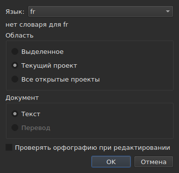
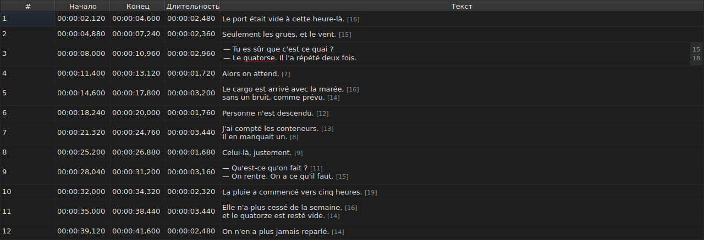
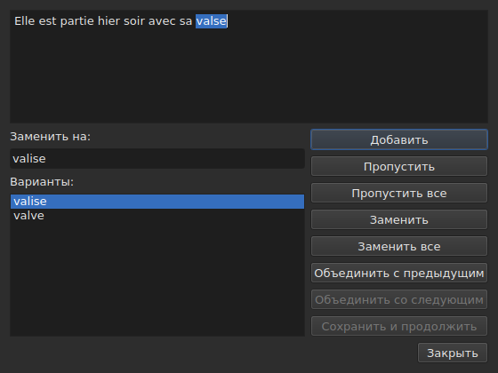

# Проверка орфографии…

<!-- machine-translated -->
> Эта страница переведена машинным способом и ещё не проверена носителем языка.

`Сервис ▸ Проверить орфографию…` проходит по словам, которых нет в словаре,
одно за другим по образцу проверки орфографии в Gaupol. У неё есть спутник,
`Сервис ▸ Настройки проверки орфографии…`, который задаёт язык, область, документ и подчёркивание при вводе.
Оба опираются на системные словари через Enchant.

Метка первого пункта в английском тексте записана как `Chec&k Spelling…`: `C` уже
ускоритель у `Correct Texts…`, а `k` в меню `Tools` свободна. В русском окне ускорители другие.
Ни у одного из двух пунктов нет комбинации клавиш.

**Оба недоступны в документе без субтитров**, как и
[`Correct Texts…`](correct-texts.md): проверять нечего. `Check Spelling…`
недоступен также при отсутствии словаря для заданного языка, см.
[Без словаря](#без-словаря).

## Настройки проверки орфографии…




| Группа | Варианты | По умолчанию |
| :---- | :------ | :------ |
| `Language` | коды языков, которые предлагает система, и уже выбранный | язык системы, если он среди них |
| `Target` | `Selection`, `Current Project`, `All Open Projects` | `Current Project` |
| `Document` | `Text`, `Translation` | `Text` |
| `Check spelling while editing` | флажок, см. [Подчёркивание при вводе](#подчёркивание-при-вводе) | снят |

`Selection` недоступен, если во вкладке, которая показана, не выбрано ни одной строки; `Translation`
недоступен, пока ни один открытый проект не содержит перевода. Запомненная
настройка, которая больше недоступна, — пустое выделение, отсутствующий перевод, —
открывается как `Current Project` или `Text`. `OK` сохраняет настройки, `Cancel` ничего
не меняет.

**Это окно не зависит от словаря**: оно остаётся доступным, пока в
документе есть субтитры, даже при отсутствии словаря для заданного языка, и именно
оно позволяет отказаться от языка, для которого словаря нет. Язык, для которого нет
словаря, остаётся редактируемым и присутствует в списке, а под
ним стоит фраза `no dictionary for` и его код.

**Четыре настройки запоминаются** от сеанса к сеансу в
файле настроек `subedit` — о его расположении см. [Параметры](preferences.md):

| Ключ | Значения | По умолчанию |
| :-- | :----- | :------ |
| `spell-check.language` | код языка, например `fr_FR`; пусто: язык системы | пусто |
| `spell-check.target` | `selection`, `current-project`, `all-projects` | `current-project` |
| `spell-check.document` | `main`, `translation` | `main` |
| `spell-check.inline` | `true` или `false` — подчёркивать неизвестные слова в редакторе ячейки | `false` |

Значение, которое ключ не принимает, игнорируется, применяется значение по умолчанию, а параметр
называется в потоке ошибок при открытии окна — см.
[Параметры](preferences.md#что-происходит-когда-файл-говорит-не-то-что-ожидается).

## Подчёркивание при вводе




Флажок `Check spelling while editing` в `Spell-Check Settings…` подчёркивает
**красной волнистой линией, пока вы печатаете**, каждое неизвестное слово в редакторе
текстовой ячейки — как в столбце `Text`, так и в столбце
`Translation`. Подчёркивание следует за вводом: оно появляется, перемещается и
исчезает вместе со словом. **По умолчанию флажок снят**, как в Gaupol: без
него в редакторе ничего не меняется.

**Язык — тот, что указан в `Language:`** в том же окне, а неизвестные слова —
те, что нашла бы `Check Spelling…`: те же случаи разговорного английского
(`goin'`, `we'd`, `1st`), то же разделение на слова. Подчёркнутое слово не исправляется
из меню: флажок только показывает его.

**Если для заданного языка нет словаря, редактор молчит**: ничто не
подчёркивается, ничто не даёт сбоя, а фраза окна `no dictionary for` объясняет
почему. Флажок действует на редакторы, открытые после него; уже
открытый редактор сохраняет прежнее состояние.

## Проход по тексту




Окно показывает текст субтитра там, где остановилось, а неизвестное слово в нём
выделено. **На каждом неизвестном слове возвращается вкладка проекта, а в таблице
выделяется строка субтитра.** Проход идёт от субтитра
к субтитру, а затем от проекта к проекту, если область указывает на несколько.

Под текстом — поле `Replace with:`, заполненное первым предложением, и
список `Suggestions:`. Выбор предложения копирует его в поле; ввод в
поле обновляет список.

| Кнопка | Что делает |
| :----- | :----------- |
| `Add` | добавляет слово в личный словарь пользователя и переходит к следующему |
| `Ignore` | пропускает это слово и переходит к следующему |
| `Ignore All` | пропускает это слово и все другие его вхождения во время этого прохода |
| `Replace` | заменяет слово содержимым `Replace with:`; недоступна, пока поле пусто |
| `Replace All` | делает то же для других его вхождений; недоступна, пока поле пусто |
| `Join with Previous` | присоединяет слово к предыдущему; недоступна, если предыдущего нет или если они не разделены пробелом |
| `Join with Next` | присоединяет слово к следующему на тех же условиях |
| `Save and Resume` | сохраняет текст в том виде, в каком его несёт текстовое поле, и возобновляет чтение **этого текста с начала** |
| `Close` | закрывает окно |

**Текстовое поле редактируемо.** Как только вы начинаете в нём печатать, доступной
остаётся только `Save and Resume`: остальные действия относятся к выбранному слову, которое больше не
то, что в тексте.

**Проход заканчивается сам**, когда неизвестных слов не остаётся: кнопки
становятся недоступными, текст очищается. Область, в которой нет ни одного
неизвестного слова, не показывает никакого окна.

### Закрытие посреди прохода

`Close` или крестик окна **применяют сделанное**, как и конец
прохода: уже обработанные тексты **и** действия — замена,
замена всех, объединение — уже выполненные над текущим текстом. Это отличие от
Gaupol, который теряет текущий текст. Не учитывается то, что остаётся от прохода, и
правки, набранные в текстовом поле, которые `Save and Resume` не
подтвердила.

**Одна запись в истории на каждый затронутый проект** независимо от числа
замен: `Undo` отменяет сразу все исправления этого проекта.
Меню называет её `Undo: correcting texts`. Строка состояния затем даёт
счёт:

```text
Edited 2 and removed 0 subtitles
```

**Список замен** — что пользователь заменил и на что —
записывается при закрытии в `spell-check/<language>.repl` в каталоге конфигурации
`subedit`, а не в каталог Gaupol, который никогда не читается.
Он затем относится к предложениям проверки орфографии, здесь, как и в
[`Correct Texts…`](correct-texts.md#объединить-или-разделить-слова--повторное-объединение-и-разделение-проверкой-орфографии).
Если записать его не удаётся, окно ошибки сообщает об этом: `Could not save the
replacements for` и далее язык и причина, не отменяя
исправлений.

## Без словаря

Когда у заданного языка — системного, если никакой не выбран, — нет
словаря, **`Check Spelling…` недоступен**, а его подсказка, как и строка
состояния при наведении на пункт, объясняют почему:

```text
no dictionary for fr
```

Остаётся `Spell-Check Settings…`, чтобы выбрать язык, у которого он есть. Окно,
собранное без какого-либо поставщика словарей, говорит то же самое и ничего
не проверяет.

## Сообщения

| Сообщение | Где | Что её вызывает |
| :------ | :---- | :--------------- |
| `no dictionary for fr` | подсказка и строка состояния | нет словаря для заданного языка |
| `Nothing to check.` | строка состояния | область не указывает ни на какой текст — например, пустое выделение |
| `Edited N and removed M subtitles` | строка состояния | в конце или при закрытии; `M` остаётся равным `0` |
| `Could not save the replacements for fr: …` | окно ошибки | список замен не был записан |

## Пример

В открытом файле есть `Elle est partie hier soir avec sa valse`. Французский
словарь есть: `Сервис ▸ Проверить орфографию…` останавливается на `valse`, выделяет
строку в таблице и предлагает `valise`, уже подставленное в `Replace with:`. `Replace`,
затем `Close`: строка становится `Elle est partie hier soir avec sa valise`, а
строка состояния сообщает:

```text
Edited 1 and removed 0 subtitles
```
