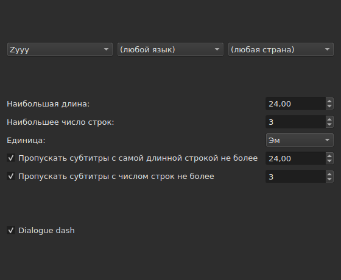
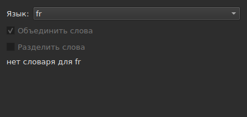
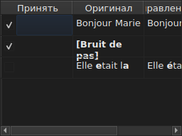

# Исправить текст…

<!-- machine-translated -->
> Эта страница переведена машинным способом и ещё не проверена носителем языка.

`Сервис ▸ Исправить тексты…` открывает многостраничный мастер по образцу
мастера Gaupol: страница с целью и задачами, по одной странице на каждую отмеченную задачу,
страница хода выполнения и страница подтверждения, которая предлагает
изменения, но никогда их не навязывает.

**Недоступно в пустом документе**: исправлять нечего.

**То же самое делает командная строка** для всех задач: [`subedit-cli correct`](../subedit-cli/correct.md), с теми же
шаблонами и теми же счётчиками — только в символах там, где окно измеряет в em.
**По умолчанию она читает четыре из запомненных настроек этого мастера** — два класса
распространённых ошибок (`Human`, `OCR`), `Remove all blank subtitles` и максимальное число строк
в `Line Break` — а всё остальное (задачи, их код, длину строки, язык,
поля шаблонов) берёт из своей командной строки. См.
[Два блока, один из них общий с командной строкой](preferences.md#два-блока-один-из-них-общий-с-командной-строкой)
и [`subedit-cli config`](../subedit-cli/config.md).

## Задачи и область — первая страница

| Группа | Варианты | По умолчанию |
| :---- | :------ | :------ |
| `Target` | `Selection`, `Current Project`, `All Open Projects` | `Current Project` |
| `Document` | `Text`, `Translation` | `Text` |
| `Tasks` | `Mentions`, `Join or Split Words`, `Common Errors`, `Capitalization`, `Line Break` — отметьте одну или несколько | отмечены `Common Errors` и `Capitalization`, остальные три — нет |

`Selection` недоступен, если во вкладке, которая показана, не выбрано ни одной строки; `Translation`
недоступен, пока ни один открытый проект не содержит перевода.

**Область и документ не запоминаются**: мастер всегда открывается
с `Current Project` и `Text`. Отмеченные же задачи запоминаются.

**Что обозначает каждая область**:

| Область | Действует на |
| :----- | :------ |
| `Selection` | строки, выбранные в показанной вкладке |
| `Current Project` | весь файл показанной вкладки |
| `All Open Projects` | весь файл каждой открытой вкладки |

**`All Open Projects` с `Translation` пропускает проекты без перевода**:
проекту, в котором его нет, нечего предложить в пустом столбце, и
мастер его не учитывает.

**Далее идут страницы задач в порядке Gaupol — `Mentions`,
`Join or Split Words`, `Common Errors`, `Capitalization`, `Line Break` — а не в том порядке, в котором флажки
были отмечены.** У неотмеченной задачи страницы нет; её запомненные
настройки при этом не меняются. **Ни на одной странице задачи нет собственного
флажка «включено»**: именно флажок первой страницы, и только он,
решает, выполняется ли задача.

## Страницы задач

На каждой из четырёх страниц с шаблонами — на всех, кроме `Join or Split Words`, где их нет, — один и тот же набор: три каскадных
раскрывающихся списка — письменность, язык, страна — для выбора кода применяемых шаблонов,
затем список шаблонов этого кода, по одному флажку на имя. **Три
списка предлагают только то, что действительно есть в
каталоге шаблонов**, — поставляемые с программой и те, что
положил туда пользователь (см. [Отброшенные шаблоны](#отброшенные-шаблоны)), — но не список
языков или стран, взятый откуда-то ещё. `Zyyy` («любая письменность») — начальный
код `Common Errors`, дающий шаблоны, годные везде. **У трёх остальных
типов шаблоны есть только для определённой письменности**: их страница открывается на
первом коде, который предлагает каталог, — `Latn` с поставляемыми шаблонами, — а не на `Zyyy`.

**Описание каждого шаблона — это подсказка его флажка.** Названия и описания следуют
языку окна для шаблонов, поставляемых с программой; собственный шаблон показан
так, как его пишет файл ([Язык](invocation.md#язык)).

**Снятый флажок шаблона остаётся снятым, пока его не отметят снова**, в том числе при
смене кода и возвращении к нему, и этот выбор запоминается от одного открытия
мастера к другому. Отмеченный снова, он просто возвращается к своей исходной
настройке, а запомненный выбор исчезает.

| Страница | Что добавляется к основе |
| :--- | :----------------------- |
| `Mentions` | два флажка, `Sound in brackets` и `Sound in parentheses`, по умолчанию сняты |
| `Common Errors` | два флажка, `Human` и `OCR`, по умолчанию отмечены |
| `Capitalization` | ничего |
| `Line Break` | максимальная длина (по умолчанию `24`), максимальное число строк (`3`), единица — `Characters` или `Ems`, по умолчанию `Ems` — и два условия пропуска, описанные ниже |

**Два флажка `Mentions` не называют никакого скомпилированного шаблона**: они
запускают просмотр текста в ядре, тот самый, который
[`Remove Hearing-Impaired Mentions…`](operations.md#remove-hearing-impaired-mentions)
уже выполняет прямым действием. Для запуска достаточно отметить один флажок **или** другой. **Список шаблонов страницы их не повторяет**: эти два имени встречаются там лишь один раз, как флажки.

**`Common Errors` фильтрует по классу**: шаблон, принадлежащий обоим классам,
применяется, как только отмечен хотя бы один из двух флажков; три остальные страницы
этого различия не знают.

### Line Break — единица измерения и пропуск




| Настройка | Что делает | По умолчанию |
| :------ | :----------- | :------ |
| `Maximum length` | длина строки в выбранной единице; от `1` до `1000` | `24` |
| `Maximum lines` | число строк, к которому стремятся; от `1` до `100` | `3` |
| `Unit` | `Characters` считает символы; `Ems` измеряет ширину шрифтом окна, где средняя строчная буква равна `0.55` — это единица Gaupol | `Ems` |
| `Skip subtitles with maximum line length of` | оставляет как есть субтитр, самая длинная строка которого укладывается в эту длину в выбранной единице | отмечен, `24` |
| `Skip subtitles with maximum line amount of` | оставляет как есть субтитр, число строк которого укладывается в это число | отмечен, `3` |

**У пропуска собственные пороги**, отличные от целевых пределов: таково
правило Gaupol. Субтитр остаётся как есть, если он укладывается во **все
пороги, флажок которых отмечен**; иначе он разбивается, и разбиение
сохраняется, только если приближает субтитр к превышенному порогу — меньшая
длина или меньше строк. Если не отмечен ни один флажок, разбивается каждый субтитр,
независимо от того, укладывается он уже или нет.

**Смена единицы меняет то, что предлагается**: длина каждой строки
измеряется при каждом вычислении, в единице страницы на этот момент, и от
предыдущего измерения ничего не остаётся. Текст из двадцати девяти символов, половина
которых — узкие буквы, превышает `24` в `Characters` и легко укладывается
в `Ems`.

**Семь настроек запоминаются** от сеанса к сеансу, единица тоже.

### Объединить или разделить слова — повторное объединение и разделение проверкой орфографии




Отдельная страница между `Mentions` и `Common Errors`, чтобы исправлять то, что
программы распознавания текста делают с пробелами. Списка
шаблонов на ней нет: она опирается на системные словари через Enchant.

| Настройка | Что делает | По умолчанию |
| :------ | :----------- | :------ |
| `Language` | язык словаря; коды, которые предлагает система, и уже выбранный | язык системы, если он среди них |
| `Join words` | присоединяет слово с ошибкой к соседнему слову | отмечен |
| `Split words` | разрезает слово с ошибкой надвое | снят |

**Объединение**: слово с ошибкой присоединяется к слову перед ним или к слову
после него, **только если лишь одно из двух направлений даёт слово, написанное
правильно**. Если правильно оба или ни одно, ничего не делается.
`bon jour` становится `bonjour`; два пробела подряд сначала сводятся к
одному, но текст, в котором ничего не объединено, возвращается как был, пробелы
включая.

**Разделение**: слово с ошибкой разрезается, если среди предложений
проверки орфографии **лишь одно** — это же слово с пробелом внутри — те же
буквы в том же порядке. Если таких предложений два или нет ни одного, ничего
не делается. Слово, у которого заглавная только первая буква (`Bonjourtous`), не
разрезается никогда: это часто имя, а в словарях их нет.

**Пользовательский список замен** (`spell-check/<language>.repl`
в каталоге конфигурации программы) относится к предложениям
проверки орфографии; мастер его читает и не записывает.

**Если для выбранного языка нет словаря, страница остаётся, но затенена**: оба
флажка недоступны, и страница сообщает `no dictionary for` и код
языка. Язык остаётся редактируемым — словарь для другого языка может
найтись — а задача, отмеченная или нет на первой странице, при этом ничего не делает
и не сообщает об ошибке.

**Язык, оба флажка и флажок первой страницы запоминаются** от одного
открытия мастера к другому.

### Отброшенные шаблоны

Шаблон, который пользователь положил в собственный каталог шаблонов,
добавляется к поставляемым с программой, в тот же каталог и в те же
списки — после загрузки их ничто не различает.

| Шаблоны | Где |
| :------- | :---- |
| поставляемые | `<prefix>/share/subedit/patterns`, рядом с `<prefix>/bin` |
| пользовательские | `$XDG_DATA_HOME/subedit/patterns` или `~/.local/share/subedit/patterns`, если переменная не задана или не является абсолютным путём |

**Формат — формат Gaupol, читаемый как есть**: по одному файлу `<Code>.<type>` на письменность,
язык и страну — `Latn-en.common-error` — и файл включения `.conf` рядом с ним. Типы —
`common-error`, `capitalization`, `hearing-impaired` и `line-break`. Поставляемые
файлы служат образцом. **Шаблоны читаются один раз, при запуске**: файл,
положенный при открытом окне, виден только при следующем запуске.

## Ход выполнения

Когда с последней страницы отмеченной задачи (или с
первой страницы, если не отмечено ни одной задачи) нажата `Next`, мастер вычисляет предлагаемые
исправления в фоновом потоке, а на экране показан неопределённый индикатор хода выполнения. Когда вычисление завершено, страница подтверждения открывается сама.

**`Cancel` на этом шаге отказывается от вычисления, не прерывая его**: ничего
не применяется, но перед закрытием мастер ждёт завершения
идущего вычисления — это ожидание ограничено предельным временем, которое движок шаблонов
накладывает на каждый поиск.

**`Back` на этом шаге возвращает на предыдущую страницу, не ожидая**: вычисление
завершается в фоне, а его результат отбрасывается — мастер не переходит
сам к подтверждению. `Next` запускает новое вычисление.

## Подтверждение — последняя страница




По одной строке на каждый текст, который мастер изменил бы, — но никогда строки для
текста, оставленного задачей как есть.

| Столбец | Что показывает |
| :----- | :------------ |
| `Accept` | флажок, по умолчанию отмеченный: исправление будет применено или нет |
| `Original` | текст как он есть, **жирным** — часть, которая изменилась бы |
| `Corrected Text` | предлагаемый текст, изменённая часть жирным, **редактируемый** — правка меняет то, что будет записано, не меняя флажок `Accept` |

**Изменение отмечено жирным шрифтом, а не цветом**: одно и то же различие читается
в обеих палитрах и не зависит от какого-либо оттенка.

**У строки, предложение которой — удаление** (у субтитра не осталось бы
текста), столбец `Corrected Text` пуст, а весь `Original` показан
жирным.

| Кнопка | Что делает |
| :----- | :----------- |
| `Mark All` | отмечает `Accept` во всех строках |
| `Unmark All` | снимает `Accept` во всех строках |
| `Preview` | ставит встроенный проигрыватель на субтитр выбранной строки, если у проекта есть фильм, — иначе ничего |
| `Finish` | применяет отмеченные строки и закрывает мастер |

`Remove all blank subtitles`, по умолчанию отмеченный, удаляет субтитры,
у которых после исправления вообще не остаётся текста, вместо того чтобы оставлять их пустыми.

**Шаблон, который вычисление не смогло применить, назван под таблицей** с
указанием причины:

```text
Not applied: some pattern (will not compile)
```

Такой шаблон назван **один раз на каждую причину**, сколько бы
текстов или проектов ни завершились для него неудачей: экран не сообщает, на каких именно.

| Причина | Что её вызывает |
| :--------------- | :--------------- |
| `cannot be translated` | выражение использует то, что трансляция синтаксиса Python отвергает |
| `will not compile` | движок отвергает выражение |
| `has an invalid replacement` | замена не читается так, как её читает Python |
| `timed out` | поиск превысил время, которое движок выделяет ему на текст |
| `never settled` | `Repeat` продолжал менять текст и после ста проходов |
| `grew the text too long` | текст превысил 16 384 байта, пока шаблон над ним работал |

**Шаблон, завершившийся на тексте неудачей, оставляет его таким, каким он был до него**: наполовину
выполненная замена хуже, чем никакой. Остальные шаблоны применяются.

**Строка файла шаблонов, которую невозможно прочитать, названа в том же
месте** — своим файлом, строкой и причиной — при каждом открытии
мастера, поскольку шаблоны читаются только один раз, при запуске:

```text
Could not be read: Zyyy.common-error, line 8 (malformed line)
```

| Причина | Что её вызывает |
| :--------------- | :--------------- |
| `directory cannot be read` | не удалось обойти каталог поставляемых шаблонов |
| `file cannot be read` | не удалось прочитать файл шаблонов |
| `malformed line` | строка, которая не является ни заголовком, ни комментарием, ни `Key=Value` |
| `field outside any pattern` | `Key=Value` перед первым заголовком шаблона |
| `unknown field` | ключ, который этому типу шаблона не нужен, — шаблон сохраняется |
| `missing field` | ключ, без которого этот тип шаблона ничего не может сделать, — шаблон отбрасывается |
| `invalid value` | значение, которое ключ не принимает, — шаблон отбрасывается |
| `malformed activation` | элемент `<pattern>` в `.conf`, который ничего не называет |

Остальных шаблонов, прочитанных и применённых без ошибок, это не
касается.

## Что говорит отмена и чего `Cancel` не делает никогда

**`Finish` создаёт одну запись в истории на каждый затронутый проект**, а не по одной на
исправление: `Undo` отменяет разом все принятые исправления этого
проекта, возвращая каждому его прежний текст. Меню называет её
`Undo: correcting texts`.

Строка состояния даёт счёт: сначала изменённые тексты, затем удалённые
субтитры:

```text
Edited 3 and removed 1 subtitles
```

**`Cancel` на любой странице ничего не применяет и ничего не запоминает** — ни
настроек, выбранных при этом открытии, ни малейшего исправления. При
следующем открытии мастер начинает с прежних настроек.

## Пример

В открытом файле между двумя словами строки стоят два пробела, а в квадратных скобках —
пометка без другого текста. `Сервис ▸ Исправить тексты…`,
`Common Errors` уже отмечено, `Next` до подтверждения: строка с двумя пробелами
показывает слева `Bonjour  Marie`, справа `Bonjour Marie`, исправление
жирным и уже принято. `Finish` применяет его, и строка состояния сообщает:

```text
Edited 1 and removed 0 subtitles
```
