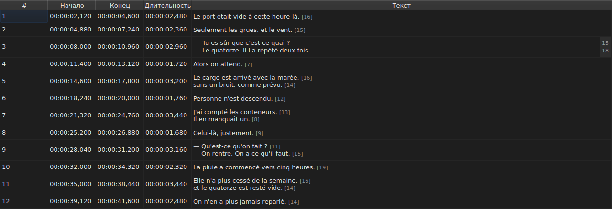
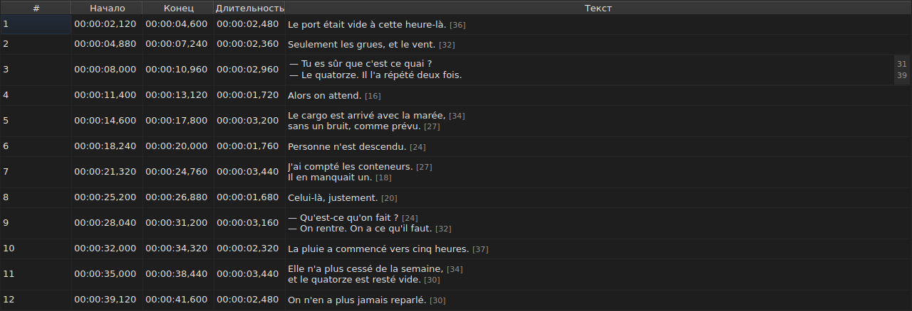

# Редактирование ячейки

<!-- machine-translated -->
> Эта страница переведена машинным способом и ещё не проверена носителем языка.

Четыре столбца редактируются прямо в таблице: `Start`, `End`, `Duration` и `Text`, а
если у проекта есть перевод, то и пятый — `Translation`. Столбец `#` редактировать
нельзя: номер — это порядковое место строки, а не данные файла.

**Открытие редактора ячейки:** дважды щёлкните по ней или выделите её
и нажмите `F2`.

## Текст

**Перевод редактируется так же, как текст**, в том же многострочном поле и по тем
же правилам; меняется только ячейка, а основной текст остаётся
прежним. Подтверждение, ничего не меняющее, ничего и не делает — как для одного, так и для
другого: см. [ниже](#подтверждение-которое-ничего-не-меняет-ничего-не-делает).

Редактор — **многострочное** поле, и он открывается на высоте субтитра:
двухстрочный субтитр набирается в нём в том виде, в каком будет записан, обе строки
видны, и полосы прокрутки нет. `Shift+Enter`, добавляющий строку, увеличивает
редактор; строка таблицы подстраивается при подтверждении.

| Клавиша | Действие |
| :------ | :------- |
| `Enter` | подтверждает и закрывает редактор |
| `Shift+Enter` | вставляет в текст перенос строки |
| `Esc` | закрывает редактор; ячейка сохраняет прежнее значение |
| `Tab` | подтверждает и переходит к следующей ячейке |

Щелчок в другом месте тоже подтверждает: потеря фокуса равносильна `Enter`.

**Одиннадцать жестов без диалога подтверждают ввод так же** — перед вычислением своей цели:
`Italic`, `Регистр ▸ …`, `Dialogue`, `Merge Subtitles`, `Split Subtitle`,
`Cut Texts`, `Paste Texts`, `Copy Texts`, `Remove Subtitles`, `Undo` и `Redo`.
Запущенные из меню, панели инструментов или комбинацией клавиш окна, они
берут текст в том виде, в каком его только что подтвердил редактор, как после щелчка
в другом месте. `Ctrl+X`, `Ctrl+C` и `Ctrl+V`, однако, остаются за редактором, пока
он открыт, — см. [Вырезание, копирование и вставка](clipboard.md): тогда именно
меню запускает `Cut Texts`, `Copy Texts` и `Paste Texts`.

`Undo` и `Redo` читают историю, а не документ: см.
[Отмена и повтор](undo.md). Жесту, открывающему диалог, это правило
не нужно, так как диалог забирает фокус при открытии, а это
уже подтверждает ввод.

### Теги — те, что в файле

Показанный и набираемый текст — **тот, что в файле, вместе с тегами**: тег
`<i>…</i>` в SubRip записывается именно так, как и `{\i1}…{\i0}` в Advanced SSA.
Для показа ничего не переводится — таблица
[`Italic`](operations.md#italic) говорит, что пишет каждый формат.

С курсивом, таким образом, ничего не нужно знать: `Ctrl+I` ставит нужный тег
для открытого документа, а формат, у которого его нет, — TMPlayer, LRC —
делает пункт недоступным, не заставляя вас искать. Полужирный и подчёркивание
набираются вручную, как в Gaupol.

**И теги не следуют за операциями над текстом**: перевод субтитра
в нижний регистр не превращает его `<I>` в `<i>`, а тире диалога
ставится перед текстом, а не перед открывающим тегом. См.
[`Case` и `Dialogue`](operations.md#case-и-dialogue).

## Длина строк

**Текстовый редактор показывает в поле справа длину каждой
строки** на уровне первой строки этой строки текста. Поле имеет ширину
наибольшего числа, обновляется **по мере набора** и следует за прокруткой.
Пустой текст ничего не показывает. Длины — те же, что в таблице: без
тегов, с округлением вниз, в заданной единице; они отключаются
флажком `Show line lengths in the editor` в `Правка ▸ Настройки…`. См.
[Длины строк](preferences.md#длины-строк).

## Начало и конец

Редактор — однострочное поле, **ограниченное формой тайм-кода**:
оно отклоняет при наборе то, что никогда не могло бы им быть.

Допустимые формы — те, которые уже принимает чтение файла:

| Элемент | Что допускается |
| :------ | :-------------- |
| поля | `MM:SS` или `HH:MM:SS`, в каждом одна или две цифры |
| десятичные знаки | от одного до трёх после запятой или точки, либо ни одного |
| знак | ведущий `-` для позиции до начала видео |
| границы | минуты и секунды меньше 60 |

Поэтому `00:01:02,500`, `1:02.5` и `-0:01,000` — три допустимых ввода.

**Ввод, который чтение отклоняет, оставляет ячейку без изменений.** Так
для `00:70:00,000`: форма верна, но минуты выходят за границы;
редактор закрывается, и ничего не сдвинулось. Никакая позиция не придумывается:
неверная позиция остаётся незамеченной, ничто на экране не отличает
неверно поставленный по времени субтитр от поставленного верно.

Изменение начала или конца сразу обновляет `Duration`.

## Длительность

**Ввод длительности двигает конец, но никогда не начало**: конец становится
`Start + Duration`. Перемещение начала сдвинуло бы весь субтитр, а это
задача [`Shift Positions…`](operations.md), и в столбец `Start` уже
можно вводить значения.

Длительность вводится **в форме тайм-кода**, той, что показывает
столбец, и действуют формы из таблицы выше — с одним отличием:

| Элемент | Начало, конец | Длительность |
| :------ | :------------ | :----------- |
| форма | форма тайм-кода | та же |
| ведущий знак `-` | допускается | **отклоняется при наборе** |

Поэтому `0:02.5` и `00:00:02,500` — два допустимых ввода длительности в две
с половиной секунды; `-0:01,000` набрать нельзя. Нулевая длительность допускается:
тогда субтитр исчезает в тот же миг, в который появляется.

**Конец, заходящий на следующий субтитр, допускается.**
Перекрытие подкрашивается в таблице, с подсказкой — см.
[Таблица](table.md#аномалии), — это предупреждение, а не отказ: возможно, именно этого вы
и хотели. [Список диагностических сообщений](files.md#диагностические-сообщения-чтения)
тоже содержит его и убирает, когда вы исправили.

**Конец, введённый за концом фильма, не сообщается**, в отличие от
операции меню `Tools`, которая вытолкнула бы его туда, — см.
[Операции](operations.md#за-концом-фильма). Ячейка уже показывает
только что введённое значение.

Нечитаемый ввод оставляет ячейку без изменений, как и для позиции, а
длительность, совпадающая с показанной, не попадает в историю.

## Подтверждение, которое ничего не меняет, ничего не делает

Откройте ячейку, ничего не вводите, нажмите `Enter`: ничего не происходит.
Никакое изменение не записывается, и файл по-прежнему считается совпадающим с
файлом на диске.

Сравнение идёт по **позиции**, а не по строке: ввод `0:01.0`
в ячейке, показывающей `00:00:01,000`, обозначает тот же момент и
поэтому тоже ничего не меняет.

## Что происходит с отредактированной ячейкой

Её **можно отменить** — одна ячейка, одна запись. См.
[Отмена и повтор](undo.md).

Она **сохраняется**, а закрытие окна без сохранения запрашивает
подтверждение. См. [Открытие и сохранение](files.md).
