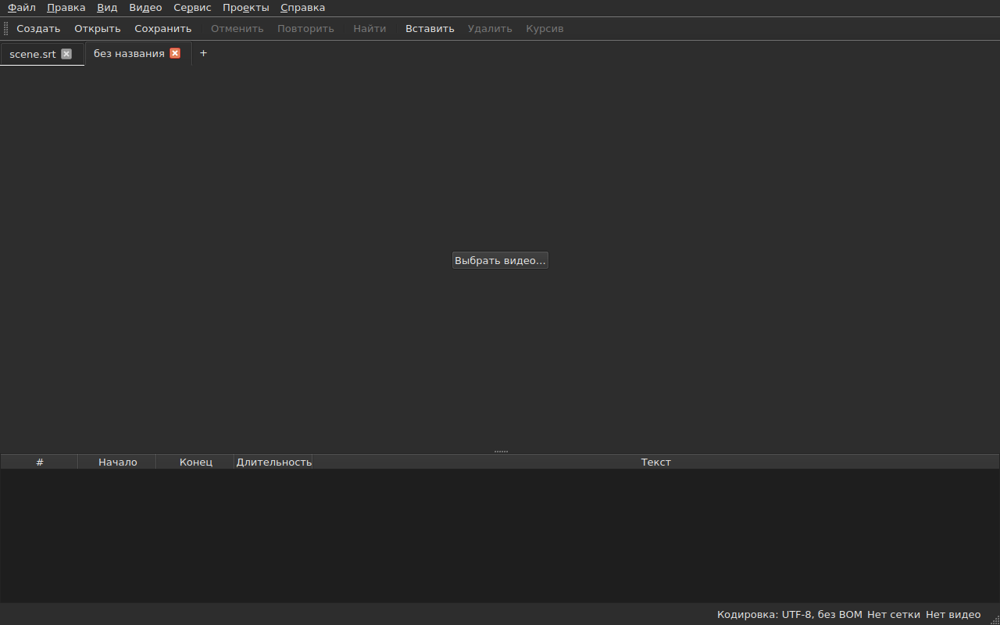
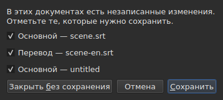
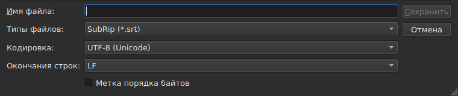
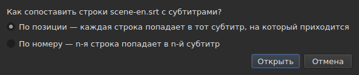
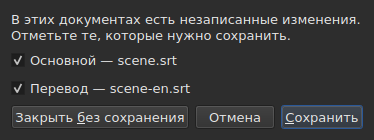

# Открытие и сохранение

<!-- machine-translated -->
> Эта страница переведена машинным способом и ещё не проверена носителем языка.

В меню **Файл** три команды, две для вкладок и ещё три
для перевода; меню **Проекты** действует сразу на все вкладки.

| Команда | Комбинация клавиш | Что делает |
| :------ | :------- | :----------- |
| Новый проект | `Ctrl+N` | пустой проект в новой вкладке — то же делает кнопка `+` после последней вкладки |
| Открыть… | `Ctrl+O` | выбирает файл и открывает его в новой вкладке — или вместо пустого проекта |
| Открыть перевод… | — | выбирает файл перевода и сопоставляет его с основным файлом текущей вкладки |
| Сохранить | `Ctrl+S` | перезаписывает открытый файл |
| Сохранить как… | `Ctrl+Shift+S` | выбирает путь и формат, затем записывает |
| Сохранить перевод | — | перезаписывает файл перевода |
| Сохранить перевод как… | — | выбирает путь и формат для перевода, затем записывает |
| Закрыть | `Ctrl+W` | закрывает текущую вкладку — недоступна, если вкладка одна |

`New Project`, `Open…` и `Save` есть и на
[панели инструментов](index.md#панель-инструментов) под словами `New`, `Open` и
`Save`. **Трёх пунктов перевода
на панели нет**: они нужны только тем, у кого есть
перевод, а панель — для всех.

## Несколько проектов во вкладках

**У каждого открытого проекта своя вкладка** над изображением и таблицей:
её подпись — имя файла или `untitled` для проекта, у которого его
ещё нет. Щелчок по вкладке переключает на неё; `Ctrl+PageDown` и `Ctrl+PageUp`
делают то же без мыши и после последней вкладки возвращают к первой.
**Кнопка `+` сразу после последней вкладки** открывает пустой проект в
новой вкладке, как `New Project`.




**`Open…` никогда их не трогает.** Открытие файла больше не заменяет то, что
показывало окно: файл попадает в новую вкладку рядом, а вкладка, на которую вы
смотрели раньше, сохраняет всё, что у неё было, — историю, выделение, связанное
видео. Поэтому открытие больше ничего и не спрашивает: терять
нечего, ведь нечего заменять.

**Одно исключение: пустой проект уступает своё место.** Если окно запущено без файла или
после `New Project`, оно показывает проект `untitled`, в котором ничего нет.
Открытый файл — через `Open…`, как и через перетаскивание — **тогда занимает его вкладку
на том же месте панели**, а не открывает ещё одну рядом с
бесполезным проектом. Проект пуст, если у него **нет файла, нет субтитров,
нечего отменять и повторять, нет фильма и он никогда не изменялся**: достаточно
любого из этих обстоятельств, чтобы он сохранил свою вкладку. Пустой проект, который не является
текущей вкладкой, не затрагивается.

**Уже открытый файл второй раз не открывается.** `Open…` для
файла, который уже держит другая вкладка, возвращает фокус на эту вкладку и сообщает об этом
в строке состояния:

```text
premier.srt: already open
```

**Каждая вкладка — целый проект, независимый от других**: её
история, её выделение, её связанное видео и то, что обнаружило её последнее
чтение, показываются, только когда эта вкладка текущая, и не
меняются, пока текущая другая. **Одно исключение, и оно описано в ADR
0033**: проигрыватель видео один на всё окно — единственный
процесс mpv — и его фильм меняется вместе с вкладкой; **каждая вкладка запоминает, где остановился её
фильм**, и возобновляет его с этого места, на паузе, когда вы к ней возвращаетесь. Буфер обмена же принадлежит окну: копирование
на одной вкладке и вставка на другой — то, ради чего открывают две.

**`Close` закрывает текущую вкладку**, при необходимости задавая
[вопрос о несохранённых изменениях](#несохранённые-изменения) —
только по этой вкладке, остальных он не касается. **Недоступна, если вкладка
одна**: окно всегда сохраняет хотя бы одну, а её закрытие
было бы закрытием окна — что уже делает системная кнопка.

**На каждой вкладке есть и крестик**, который закрывает **её** проект с тем же
вопросом. Крестик вкладки, не являющейся текущей, закрывает именно её, и
вкладка, на которую вы смотрите, остаётся на экране; если в том проекте есть изменения, его
вкладка выходит на передний план на время вопроса. **Крестика нет, когда осталась только
одна вкладка**, по той же причине, по которой `Close` недоступна.

**Вкладка сообщает, что изменена**: за её именем следует звёздочка, `premier.srt*`,
пока хотя бы один из её документов отличается от своего файла — как заголовок окна
говорит о проекте, на который вы смотрите. Она пропадает при сохранении.

## Меню «Проект»

Две команды действуют на все проекты сразу.

| Команда | Комбинация клавиш | Что делает |
| :------ | :------- | :----------- |
| Сохранить все | `Ctrl+Shift+L` | записывает каждый изменённый документ, вкладка за вкладкой |
| Закрыть все | `Ctrl+Shift+W` | закрывает все проекты — то есть окно |

**`Save All` идёт в порядке вкладок**, основной документ перед переводом.
Документ, у которого есть файл, перезаписывается в нём **без выхода его вкладки на передний план**;
**документ, у которого его нет, открывает `Save As…`, по одному**, на своей вкладке —
единственный случай, когда `Save All` меняет вкладку, чтобы окно показывало, о каком
проекте идёт речь. **Отмена `Save As…` или
неудачная запись останавливает остальное**: следующие проекты не
затрагиваются, а окно сообщает, что было записано.

```text
Save All stopped: 1 of 3 documents saved
```

Когда всё записано, строка состояния сообщает об этом — `2 documents saved` или
`Nothing to save`, если ничего не было изменено. Если `Save As…` вывело
вкладку на передний план, окно затем возвращается к той, где команда была
запущена.

**`Close All` и крестик окна — одно и то же**: окно
всегда сохраняет проект, и закрыть их все — значит закрыть его. Поэтому они задают
**один вопрос для всех проектов**, тот же, что и при
[двух изменённых документах](#закрытие-с-двумя-изменёнными-документами), с одним флажком
на каждый изменённый документ каждой вкладки:




**`Cancel` ничего не закрывает** и ничего не оставляет записанным. `Save` записывает
отмеченные документы, как `Save All`: за их вкладкой, кроме документа без
имени, вкладка которого выходит на передний план для его `Save As…`. Если изменён всего один документ
на все проекты, это простой вопрос, который мы задавали всегда,
на его вкладке. `Save All As…` не существует: это последовательность
`Save As…`, которую `Save All` уже задаёт, по одному, для документов без имени.

## Открытие

Диалог фильтрует **девять читаемых форматов**, по одной записи на каждый, и первую
запись, которая показывает все. Формат затем распознаётся **по содержимому, а не по
расширению**: `.txt`, содержащий SubRip, открывается, а фильтр ничего
не решает — он только скрывает файлы.

| Запись фильтра | Расширение |
| :----------- | :-------- |
| `SubRip` | `.srt` |
| `WebVTT` | `.vtt` |
| `SubViewer 2` | `.sub` |
| `Sub Station Alpha` | `.ssa` |
| `Advanced SSA` | `.ass` |
| `MicroDVD` | `.sub` |
| `MPL2` | `.txt` |
| `TMPlayer` | `.txt` |
| `LRC` | `.lrc` |

**Два расширения означают по два формата** — `.sub` это SubViewer 2 и
MicroDVD, `.txt` это MPL2 и TMPlayer. На открытие это не влияет,
поскольку решает содержимое; при сохранении формат определяет **название**
выбранной записи, но никогда не её шаблон.

**Нечитаемый файл ничего не открывает.** Отсутствует, отклонён системой, записан
в кодировке, в которой его байты не декодируются, или не относится ни к одному известному
формату: модальное окно **называет причину**, вкладка не открывается, а уже
открытые не сдвигаются.

| Сообщение | Что произошло |
| :------ | :------------ |
| `does not exist` | путь не указывает ни на какой файл |
| `cannot be opened: permission denied` | система отказывает в открытии |
| `cannot be read` | система отказала по другой причине |
| `cannot be decoded in the chosen encoding` | байты не читаются в выбранной кодировке |
| `is in no format this tool knows` | содержимое не распознаёт ни один формат |
| `holds nothing recognisable as a subtitle` | формат распознан, но в файле нет ничего, что было бы субтитром |

Сообщению предшествует путь: `notes.txt: is in no format this tool knows`.
Это слова командной строки, и не случайно — обе
программы читают файл по одному и тому же рецепту.

### Перетаскивание файлов в окно

**Файлы, перетащенные в любое место окна, открываются**; их перетаскивают из
файлового менеджера: на таблицу, на панель вкладок, на
кнопку `Select Video…` и **на само изображение фильма**, как во время воспроизведения, так и на остановке.
Изображение — отдельное окно, которое рисует проигрыватель, и ничто не гарантировало,
что оно передаст дальше перетаскивание; это проверено вручную на настоящем рабочем столе
в сеансе Wayland. `subedit-gui` запускается там под X11, чтобы уметь показывать
фильм, поэтому перетаскивание идёт по протоколу X11 — того же, что и в сеансе
X11, где отдельно оно не проверялось.

- **Каждый файл субтитров открывает свою вкладку**, в том порядке, в котором их
  перетащили, — точно как `Open…`. **Уже открытый** файл не
  читается заново: его вкладка выходит на передний план, и строка состояния сообщает об этом
  (`premier.srt: already open`).
- **Перетащенное видео связывается с текущей вкладкой**, как через
  `Select Video…`. Перетащенное вместе с субтитрами, оно достаётся последней вкладке,
  которую они открыли, каким бы ни был порядок перетаскивания. Видео распознаётся по
  расширению — по тому же списку, что предлагает фильм рядом с
  файлом.
- **Два видео и больше за раз не открываются**: проект следит за одним
  фильмом. Субтитры из того же перетаскивания открываются.
- **Файл, который не открывается, не останавливает остальные.** Тогда одно окно сообщает,
  что не удалось сделать, по строке на файл, словами
  из `Open…`:

  ```text
  /films/notes.txt: is in no format this tool knows
  /films/absent.srt: does not exist
  ```

Принимаются только локальные файлы: ссылка, перетащенная из браузера,
не указывает ни на что, что окно могло бы прочитать.

Открытие из командной строки по-прежнему работает: `subedit-gui film.srt`.
Там та же причина записывается в поток ошибок, а окно открывается
пустым — см. [Запуск](invocation.md#когда-открытие-не-удаётся).

## Диагностические сообщения чтения

Настоящий файл редко бывает идеален, и чтение исправляет, а не
сдаётся: пропущенный номер, строка, которая никуда не ведёт, смешанные окончания
строк. **То, с чем оно столкнулось, умещается на кнопке строки состояния**
— `2 diagnostics`, слева от того, что строка уже говорит о документе —, и **список открывается щелчком
в плавающем окне** над кнопкой. Ни одна строка окна под него не отводится:
таблица сохраняет всю свою высоту, было ли что сказать при чтении или нет. Список
закрывается щелчком в другом месте или клавишей `Esc`.

```
a SubRip block without its number, settled by the reader: 5
```

**Каждая строка считает**: с чем столкнулись, что с этим сделали и
сколько раз. Плохо сделанный файл даёт сотни таких случаев, и знание
того, сколько каждого вида, позволяет действовать; номер строки каждого случая в
файле читается в командной строке, на уровне подробности `-vvv`.
Кнопка считает эти строки — по одной на вид —, а не случаи.

**Угаданная кодировка тоже появляется здесь**, один раз: её предложили, взвесив
байты, до того, как возникла хоть одна строка файла.

```
an encoding nothing declared, settled by the reader: 1
```

Она показывается, только когда кодировка была **угадана и не
UTF-8** — файл UTF-8, прочитанный как таковой, не событие, и сообщать об этом при
каждом открытии значило бы вешать кнопку в строку состояния каждого обычного
документа. Файл с меткой порядка байтов её тоже
не вызывает: он сам объявил свою кодировку, ничего не угадывалось.

**Тот же список считает и то, что не так в самих субтитрах**: субтитр,
который начинается до окончания предыдущего, конец раньше своего
начала, начало раньше начала вышестоящего субтитра. Таблица подкрашивает их, но
подкрашенное находят прокруткой, а в файле из двух тысяч строк
одно легко пропустить; здесь все виды собраны вместе, **по одному на
строку и с их числом**, словами отчёта `inspect`:

```
subtitle starts before the previous one ends: 12
subtitle starts before the previous one starts: 3
```

**Щелчок по строке ведёт к первому из затронутых субтитров**, выделенному в
таблице. Эти строки **следуют за исправлениями** — сортировка или исправление длительности
убирает некоторые или уменьшает их число — без закрытия списка, который вы
читаете. Субтитр может быть сосчитан дважды: начало до конца
предыдущего и до его начала — это два обнаружения, исправляемые двумя
способами. Чтобы назвать их по одному, есть `subedit-cli inspect --detail`.

Кнопка **не появляется**, когда сообщать нечего ни при чтении, ни
в субтитрах, и **она следует за вкладкой**: каждый проект хранит
диагностические сообщения собственного чтения, а кнопка показывает сообщения отображаемого проекта.

## Кодировка в строке состояния

**Строка состояния всегда показывает кодировку открытого документа**, слева от того, что
она говорит о [сетке кадров](frame-grid.md) и
[связанном видео](video.md):

| Ситуация | Что записывается |
| :-------- | :-------------- |
| файл прочитан как UTF-8, без метки | `Encoding: UTF-8, no BOM` |
| … с меткой | `Encoding: UTF-8, BOM` |
| файл в Latin-1 | `Encoding: ISO-8859-1, no BOM` |

**Диагностическое сообщение и эта строка отвечают на разные вопросы**, и поэтому
существуют обе. Диагностическое сообщение говорит, что чтение **сделало** — оно
угадало, и вы, возможно, захотите проверить; поэтому оно показывается, только когда
было угадывание. Строка состояния говорит, чем документ **является**,
постоянно, в том числе для файла, который сам объявляет свою кодировку и о
котором чтению нечего сообщить.

**Откуда взялся ответ, здесь не показывается.** Его даёт `inspect` — `detected`,
`from its byte order mark`, `as asked for` — потому что в отчёте есть место, чтобы
это сказать; в строке состояния его нет, а список диагностических сообщений уже содержит это, когда
это важно.

## Сохранение

`Save` перезаписывает открытый файл **в его исходной форме**: его формат,
кодировку, окончания строк, метку порядка байтов и заголовок. Файл,
открытый и затем сохранённый без изменений, не сдвигается ни на байт — см.
точную гарантию ниже.

Запись **атомарна**: она идёт через временный файл, переименовываемый
поверх. Сохранение, прерванное в любой момент, оставляет прежнюю версию
нетронутой.

Сохранение документа, которого никогда не было на диске, равносильно `Save As…`.

**Запись, которая не удалась, сообщает об этом и ничего не теряет**: переполненный диск,
файл только для чтения, отсутствующий каталог — или **символ, который кодировка файла
не может записать**, `ł` в файле Latin-1. Сообщение
тогда такое: `holds a character the chosen encoding cannot write`, и ничего не
записывается: замена символа на `?` теряла бы текст на глазах у того, кто
его только что набрал. Сообщение называет файл и причину, окно сохраняет
свои изменения, а пометка в заголовке остаётся.

## Сохранение под другим именем

`Save As…` спрашивает путь, формат **и форму записываемых байтов**:
кодировку, окончания строк, метку порядка байтов. Документ **затем живёт
там**: заголовок меняется, `Save` направляется на новый файл и пишет в
выбранной форме, а исходный файл остаётся таким, каким был.

**Предлагаются девять форматов**, а запись, выбранная при открытии
окна, — **формат документа**. Сохранение под другим именем без изменения
фильтра поэтому формат не меняет.




**На изображениях видна только нижняя часть окна**, а не список файлов
выше: он зависит от машины — её каталогов, дат, боковых
ярлыков, — поэтому его снимок никогда не повторялся бы.
Эта полоса — повторяется, и именно в ней всё происходит.

| Поле | Что предлагает | По умолчанию |
| :---- | :------------- | :------ |
| `Encoding` | четырнадцать кодировок, которые на практике встречаются в файлах субтитров, и `Other…` | **кодировка прочитанного файла** |
| `Other…` | поле для ввода любой кодировки, которую ICU умеет записывать, **с дополнением** — `cp1257`, `EUC-KR` | — |
| `Line endings` | `LF`, `CRLF` или `CR` | как у прочитанного файла |
| `Byte order mark` | метка, **недоступная для кодировки, которая её не несёт** | как у прочитанного файла |

**Значения по умолчанию — это значения прочитанного файла, и это гарантия, а не
удобство**: файл, открытый и сохранённый снова без изменения этих трёх
полей, даёт те же байты.

**Список короток, и это не предел.** ICU знает двести
двадцать одну; меню предлагает то, что на практике встречается в файлах субтитров,
потому что меню из двухсот пунктов никому не помогает. `Other…`
открывает остальные.

**Поле дополняет по всем двумстам двадцати одной**, так что точное название
знать не нужно: набрав `1252`, получите предложение `windows-1252`, набрав `koi`,
получите `KOI8-R` и `KOI8-U`. Дополнение идёт по тому, что название **содержит**,
а не по тому, с чего оно начинается: каноническое название Windows Western —
`windows-1252`, а `cp1252` — то, которое люди имеют в виду. Оба можно
и написать целиком, без дополнения: ICU принимает свои псевдонимы.

**Название, которого никто не знает, ничего не записывает.** Ввод `klingon-1` не
сводится к UTF-8: ничего не записывается, и сообщение об этом говорит.

**Не записывает и название, не указывающее порядок байтов.** `UTF-16` и `UTF-32` —
названия, которые ICU знает и преобразователь которых записывает **собственную метку**:
флажок `Byte order mark` тогда перестал бы что-либо решать. Оба
отклоняются, а сообщение указывает на `UTF-16LE` или `UTF-16BE`, которые записывают
те же байты под управлением флажка. Это тот же отказ, теми же
словами, что и в командной строке.

**Символ, который выбранная кодировка не может записать, останавливает сохранение**
— `ł` в Latin-1. Сообщение —
`holds a character the chosen encoding cannot write`, окно сохраняет свои
изменения, а целевой файл не затрагивается.

**Документ тоже не сдвигается**: он остаётся на своём файле, в своём
формате и своей кодировке, а следующее `Save` перезапишет тот, что был открыт.
Сохранение, которое не состоялось, не меняет ничего — ни на диске,
ни в окне.

Смена формата меняет то, что показывает таблица: десятичный разделитель следует
формату — запятая для SubRip, точка для WebVTT — а **теги переписываются
словарём целевого формата**: `<i>` становится `{\i1}` в Sub
Station Alpha, `{Y:i}` в MicroDVD, `/` в начале строки в MPL2. Документ
**стал** этим файлом, поэтому таблица показывает то, что несёт файл.

**Это не команда, и `Ctrl+Z` её не отменяет.** Документ, формат
которого говорил LRC, а тексты по-прежнему говорили `<i>`, был бы
несогласованным документом; половины, которую можно отменить, нет.

## Что формат не сохранит, сообщается перед записью

**Модальное окно предупреждает, и вы всё ещё можете ответить «нет».** Оно перечисляет, чего
целевой формат не вместит, по пунктам, теми словами, которыми
командная строка пишет после:

```
ends are not carried by LRC, line breaks were joined in 2 subtitles, 1 tag dropped
```

| Кнопка | Действие |
| :----- | :----- |
| `Save` | всё равно записывает, потеря принята |
| `Cancel` | ничего не записывает; документ не сдвигается, ни файл, ни формат |

`Cancel` — кнопка по умолчанию: нажатая без чтения клавиша Enter оставляет
файл как есть.

**Ничего не спрашивается, когда ничего не теряется.** Окно, объявившее «ничего
не будет потеряно», приучило бы вас закрывать то, что важно.

Что может быть объявлено:

| Пункт | Когда |
| :--- | :--- |
| концы | целевой формат их не несёт — TMPlayer, LRC |
| переносы строк | целевой формат их не несёт — LRC |
| теги | у тега источника нет эквивалента в целевом формате или промежуточное представление его не знает |
| заголовок | прочитанный файл нёс его, и он не переходит |
| объявленные поля | порядок столбцов SSA, форма времени TMPlayer |
| точность | целевой формат считает грубее — десятая доля секунды в MPL2, секунда в TMPlayer |

**То, что принадлежит другому формату, остаётся в стороне.** Файл WebVTT
несёт идентификаторы реплик и параметры размещения; SubRip несёт координаты
отображения. Запись в другом формате их игнорирует, а не
переводит наугад, — но они при этом не потеряны, просто
не записаны.

## Гарантия двойного преобразования туда и обратно

У неё две половины, и нужны обе:

- **побайтовая точность** для файла, уже имеющего раскладку, которую
  пишет `subedit`, — раскладку Gaupol, включая последнюю пустую строку —, и **в любой
  кодировке**: файл в CP1252 или в UTF-16 переписывается в
  своей, включая метку;
- **идемпотентность** в остальных случаях: первое сохранение приводит раскладку к норме,
  а последующие уже ничего не затрагивают.

Конкретно: файл, последний блок которого не сопровождается пустой строкой,
получает её один раз. Это единственное изменение, которое может внести сохранение без
изменений.

## Открытие перевода

`Файл ▸ Открыть перевод…` задаёт **второй файл** рядом с основным.
Пункт недоступен, пока нет ни одного субтитра, которому можно отдать строки
перевода.

**Два вопроса, один за другим.** Выбор файла, тот же, что у
`Open…` — тот же фильтр, тот же начальный каталог, кодировка определяется как для
основного файла — затем **способ сопоставления**:




| Способ | Что делает |
| :----- | :----------- |
| `By position` (по умолчанию) | каждая строка попадает к субтитру, на который приходится её середина |
| `By number` | n-я строка попадает к n-му субтитру, без учёта позиций |

**По умолчанию — позиция**, потому что единственная пропущенная строка посередине заставляет
*все* следующие сползти при сопоставлении по номеру, тогда как по позиции только один
субтитр остаётся без перевода.

**Что делается, что записывается:**

- тексты привязанных строк попадают в столбец `Translation`, который
  появляется;
- **строка, не нашедшая субтитра, порождает его**, с **позициями
  этой строки** — любым из двух способов;
- **ничего не сортируется**, ни файл, ни документ: строки обходятся
  в порядке времени, а число тех, которые в нём не стояли, сообщается;
- **уже открытый перевод заменяется**, все его тексты сначала стираются.

**Что произошло, об этом сказано.** Когда каждая строка нашла свой субтитр и
ни один не остался один, строка состояния пишет об этом; иначе — **окно, которое нужно закрыть**,
как для любого действия, которому есть что сказать:

```text
translation: 3 lines attached
translation: 2 lines attached; 1 subtitle left without a translation
translation: 3 lines attached; 1 subtitle born of a line; 2 lines out of order
```

Пункты пишутся, только если они не равны нулю: привязанные строки,
субтитры, порождённые строкой, те, до которых не дошла ни одна строка, строки
не по порядку. Файл без единой строки говорит об этом
(`translation: the file holds no line`), а не винит в этом
субтитры.

**Сдвинутый перевод распознаётся и открывается заново со сдвигом.** Перевод, отстающий на две
секунды, привязывается не к тем субтитрам, и ничто не отличает это от
правильной привязки. Когда открытие **по позиции** выходит нечистым, окно ищет
**постоянный сдвиг**: разности между началом каждой строки и началом окружающих её
субтитров дают кандидатов, сгруппированных с точностью до десяти миллисекунд, и **каждого
оценивают той самой привязкой, что при открытии**. Если единственный сдвиг делает открытие
чистым, окно говорит об этом после своего подсчёта и **предлагает открыть заново со сдвигом**:

```text
translation: 4 subtitles born of a line; 4 subtitles left without a translation
the lines sit 2.000 s later than the subtitles; moved back, 4 lines would attach instead of 0
```

`Yes` отменяет открытие и повторяет его со строками, возвращёнными этим сдвигом; `No`, ответ
по умолчанию, оставляет открытие как есть. **Результат — одна запись истории**:
её отмена возвращает всё, как для любого открытия.

**Ничего не предлагается, когда сдвиг непостоянен** — дрейф, сдвиг, который
затрагивает лишь часть файла —, когда два сдвига сделали бы открытие одинаково
чистым или когда ни один его чистым не делает: тогда фраза не говорит, что он есть. Не предлагается и
при сопоставлении по номеру, где позиции не рассматриваются. **Командной строки** для
этого нет.

**Открытие перевода — одна запись истории**, `Undo: opening a translation`,
и её отмена возвращает всё: тексты, порождённые субтитры удаляются,
файл перевода отсоединяется — вместе с ним уходит и столбец. Чтобы открыть его
другим способом, сначала отмените.

**Только что открытый перевод не изменён**: ничего не вводилось, и его
закрытие не предлагает сохранить его. Если порождены субтитры, изменён
основной документ.

**Изменённый перевод предлагается сохранить перед
заменой**, с тремя исходами из раздела о
[несохранённых изменениях](#несохранённые-изменения).

| Сообщение | Что произошло |
| :------ | :------------ |
| `the file is already open as the main document` | выбранный файл — это сам основной документ, как бы ни был записан его путь |
| `does not exist`, `cannot be decoded in the chosen encoding`, … | те же причины, что и для `Open…` |

Сообщению предшествует путь, и **ничего не меняется**: окно сохраняет свою
историю и свои изменения.

**Проблемы, с которыми столкнулось чтение**, если они были — исправленная строка,
проигнорированное поле —, попадают в список диагностических сообщений, в тот, что относится к
[последнему чтению](#диагностические-сообщения-чтения).

**Чего перевод не сохраняет**: настройки **отдельных субтитров** его
файла — стиль SSA, позицию субтитра WebVTT. Субтитр
несёт только один набор, набор основного документа; они ни читаются обратно, ни переписываются.

## Сохранение перевода

**Каждый документ сохраняется отдельно**, в своём файле, своём формате, своей
кодировке и со своими окончаниями строк: перевод в `.ass` при основном файле в
`.srt`, в Windows-1252 при основном файле в UTF-8 возвращается таким, каков он есть.

| Пункт | Что делает |
| :---- | :----------- |
| `Save Translation` | перезаписывает файл перевода — тот, из которого он получен |
| `Save Translation As…` | выбор файла из `Save As…`, открытый на файле **перевода**, с его форматом и его кодировкой |

Оба **недоступны, пока в проекте нет перевода**.
`Save Translation As…` — это `Save As…` для другого документа: те же поля, то же
[предупреждение о потерях](#что-формат-не-сохранит-сообщается-перед-записью), которое
считает **что потеряет записанный файл** — теги основного текста
не те же, что у перевода, а формат, не записывающий курсив,
жалуется на это, только если он есть в переводе.

**У каждого документа своё состояние изменённости.** Сохранение основного документа оставляет
перевод изменённым, и наоборот; **заголовок окна помечен как изменённый, если изменён любой из
двух**, и звёздочка в нём одна.

**Ничто одного не затрагивает другой**: сохранение перевода не записывает
основной документ и не меняет ни его файл, ни его формат, ни его тексты.

## Закрытие с двумя изменёнными документами

Закрытие текущей вкладки или окна, когда **два документа** и более
отличаются от своих файлов, задаёт **один вопрос**, по одному флажку на
документ:




| Кнопка | Что происходит |
| :----- | :----------- |
| `Save` | записывает документы, чьи флажки отмечены, затем продолжает — недоступна, когда не отмечен ни один |
| `Close Without Saving` | теряет оба, независимо от флажков |
| `Cancel` | ничего не происходит; окно остаётся как было |

**Снять отметку с документа значит потерять его**: `Save` записывает остальные и продолжает.
**Если сохранение не удаётся, действие не продолжается.** Закрытие
диалога без ответа равносильно `Cancel`.

**При единственном изменённом документе вопрос тот, что мы задавали всегда**,
он описан ниже, и фраза говорит, какой именно: `The translation has changes that were never written.`
или `The document has …`.

**Файл, исчезнувший с диска, считается изменённым**, и список говорит об этом —
`(file is gone from the disk)`: то, что держит окно, тогда **единственная
копия**, и закрытие без записи уничтожило бы её. Для единственного документа в этом случае
фраза такая: `The document is no longer where it was read from.`

## Несохранённые изменения

Закрытие окна, текущей вкладки или открытие перевода, который заменил бы
уже имеющийся, пока документ отличается от дискового, **требует
подтверждения** с тремя исходами:

| Ответ | Что происходит |
| :----- | :----------- |
| `Save` | документ записывается, затем действие продолжается |
| `Discard` | изменения теряются, и действие продолжается |
| `Cancel` | ничего не происходит; окно остаётся как было |

Закрытие диалога без ответа равносильно `Cancel`.

**Если сохранение не удаётся**, действие не продолжается: работа не
записана и не потеряна.
