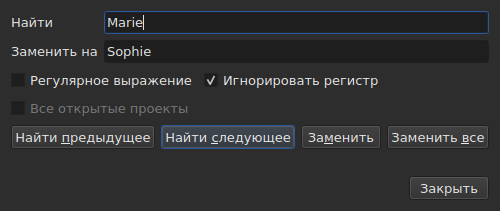
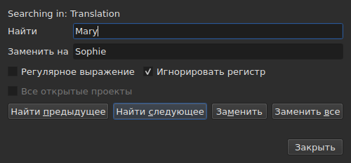

# Поиск и замена

<!-- machine-translated -->
> Эта страница переведена машинным способом и ещё не проверена носителем языка.

`Правка ▸ Найти и заменить…` или `Ctrl+F` открывает диалог поиска.




**Диалог не модальный**: он остаётся открытым, пока вы смотрите на таблицу,
редактируете ячейку, ищете снова. `Close` закрывает его; при повторном открытии
он возвращается в том виде, в каком вы его оставили, вместе с шаблоном и заменой.

| Поле | Что содержит |
| :---- | :-------------- |
| `Find` | искомый шаблон |
| `Replace with` | чем его заменяют |
| `Regular expression` | шаблон — регулярное выражение, а не простой текст |
| `Ignore case` | «marie» находит «Marie» |
| `All open projects` | поиск идёт по всем вкладкам — [см. ниже](#во-всех-открытых-проектах) |

Пункт недоступен в пустом документе: искать нечего.

## Четыре действия

| Кнопка | Что делает |
| :----- | :----------- |
| `Find Previous` | находит предыдущее совпадение, и таблица переходит к нему |
| `Find Next` | находит следующее — это кнопка, которую нажимает `Enter` |
| `Replace` | заменяет найденное совпадение, затем находит следующее |
| `Replace All` | заменяет все совпадения в области |

Все четыре недоступны, пока `Find` пуст.

**Таблица переходит к совпадению**, выделяя его строку. Дойдя до
последнего, `Find Next` начинает снова с первого; `Find Previous` делает то же в
обратную сторону.

**`Replace` при ненайденном совпадении сначала ищет**: первое нажатие
показывает, что будет заменено, следующее заменяет. Так поступает
Gaupol.

## Что охватывает поиск

**Выделение или весь документ, если ничего не выделено** — правило
меню `Tools`. См. [Операции](operations.md#на-что-они-действуют).

**Область определяется при первом действии и сохраняется**, пока
идёт поиск: `Find Next` выделяет строку совпадения, и это
выделение не сужает область. **Если вы сами выделите другие строки, область
изменится** для следующего действия.

Поиск охватывает текст субтитров; ни позиции, ни номер
не ищутся.

### Во всех открытых проектах

Флажок **`All open projects`** расширяет область до всех вкладок. **Он недоступен, когда открыт
один проект** — расширять нечего, — становится доступным, как только открывается
вторая вкладка, и сам снимается, когда остаётся только одна.

**Когда он отмечен, выделение больше не учитывается**: каждый проект просматривается целиком
в **целевом документе** — документе текущего столбца, основном или
переводе, как и для одного проекта.

- **`Find Next` и `Find Previous` переходят от вкладки к вкладке в порядке
  вкладок.** Сначала показанный проект; когда в нём совпадений больше нет, —
  следующий, вкладку которого окно выводит на экран и строку которого оно выделяет.
- **Круг заканчивается там, где начался**: когда поиск проходит последнюю
  вкладку и возвращается к первой — или наоборот при движении вверх, — строка диалога
  сообщает об этом, а не начинает снова молча:

  ```text
  Search wrapped around
  ```

  Следующий шаг — обычный шаг, и строка очищается.
- **`Replace` заменяет там, где находится поиск**, затем переходит к следующему
  совпадению, которое может быть в другой вкладке.
- **`Replace All` проходит по всем проектам** и **создаёт одну запись в истории
  на каждый затронутый проект**: отмена в вкладке отменяет только то, что эта
  вкладка получила. Счёт сообщает, сколько проектов изменилось, а не только сколько
  было замен:

  ```text
  replaced 4 matches in 3 projects
  ```

  Проект, в котором шаблона нет, не затрагивается, и отменять в нём нечего.
  **Ни одна вкладка не выходит на передний план**: каждый проект получает свои замены
  за своей вкладкой, которая получает звёздочку, а вкладка, с которой началось
  действие, остаётся на экране вместе со своим фильмом.

### В каком тексте

**При наличии перевода поиск охватывает только один из двух текстов: текст
столбца текущей ячейки** — перевод, если текущая ячейка находится
в столбце `Translation`, и основной текст во всех остальных случаях. Это
правило всех текстовых операций, и дополнительной настройки нет:
см. [Текст, на который действуют операции](table.md#текст-на-который-действуют-операции).

**Диалог сообщает, в каком тексте он ищет**, в строке над
`Find`, и меняет её, когда меняется текущий столбец, — даже при открытом диалоге:




| Текущая ячейка находится в | Что сообщает строка |
| :--------------------- | :------------ |
| столбце `Translation` | `Searching in: Translation` |
| любом другом столбце | `Searching in: Main` |
| — у проекта нет перевода или столбец убран | ничего: строки нет |

**Замена записывается в этот текст и только в него.** `Replace` и `Replace
All` для перевода оставляют основной текст как был, и
наоборот; `Undo` возвращает записанное. **Теги — это теги формата
файла этого текста**: перевод в Advanced SSA читается с его
`{\i1}`, даже если основной текст в SubRip. `Replace with` записывается там
теми же тегами.

**Таблица остаётся в том столбце, где была.** `Find Next` выделяет строку
совпадения, не перемещая текущую ячейку из одного столбца в другой:
поиск, начатый в переводе, продолжается в переводе.

**Поиска сразу по обоим текстам не существует**: каждое совпадение
было бы парой (субтитр, текст), и таблице, переходящей к нему, было бы
неясно, куда идти. Вы ищете в одном, затем меняете столбец.

**Что начинается заново с нуля**:

| Действие | Что забывается |
| :------ | :---------------- |
| изменение `Find`, `Replace with` или параметра | текущее совпадение и строка состояния |
| самостоятельное выделение других строк | область и совпадение |
| перемещение текущей ячейки из одного текста в другой — из `Text` в `Translation` или наоборот | совпадение: это место в тексте |
| открытие другого файла | область и совпадение; диалог остаётся открытым вместе с шаблоном |

## Поиск идёт по видимому тексту

**Теги — не текст.** Поиск `<i>` ничего не находит, а поиск
`Bonjour` находит `<i>Bon</i>jour`, разрезанное тегом.

**Замена выполняется в тексте файла, не нарушая теги**:

| Текст | Ищется → ставится на его место | Что записывается |
| :--- | :-------------------------- | :-------------- |
| `<i>Bonjour</i>` | `Bonjour` → `Salut` | `<i>Salut</i>` |
| `<i>Bon</i>jour` | `Bonjour` → `Salut` | `<i>Salut</i>` |
| `<i>Bonjour</i> Marie` | `Bonjour Marie` → `Salut Sophie` | `<i>Salut Sophie</i>` |

Тег, разрезающий слово, охватывает слово целиком, а любой стиль, затрагивающий
совпадение, покрывает замену. **Теги, которых совпадение не
касается, остаются на месте**, даже тот, что разрезает другое слово того же
субтитра: замена `Marie` в `<i>Bon</i>jour Marie` даёт
`<i>Bon</i>jour Sophie`. Слово состоит из букв и цифр — неразрывный
пробел или кавычка в него не входят. **`Replace with` читается с тегами
целевого текста**: ввод там `<b>Salut</b>` в SubRip делает слово полужирным.

## Два параметра

| Параметр | По умолчанию | Что меняет |
| :----- | :------ | :-------------- |
| `Regular expression` | снят | `.` больше не ищет точку, а ищет любой символ |
| `Ignore case` | отмечен | регистр не учитывается, включая буквы с диакритическими знаками: `élise` находит `Élise` |

Таковы значения по умолчанию в Gaupol. **Оба запоминаются** от одного открытия к
другому и от сеанса к сеансу в параметрах `search.regex` и
`search.ignore-case` [файла параметров](preferences.md#файл).

### Регулярное выражение

Шаблон читает ICU. Как и в Gaupol, `.` пересекает перевод строки, а `^`
и `$` действуют в начале и в конце **каждой строки** субтитра:
замена `^` на `- ` ставит тире перед каждой строкой.

В `Replace with` и только для регулярного выражения:

| Записано | Что подставляется |
| :------ | :----------- |
| от `$1` до `$9` | группа с этим номером; отсутствующая группа ничего не подставляет |
| `$0` | всё совпадение |
| `\n` | перевод строки |
| `\$`, `\\` | `$`, обратная косая черта |
| `\` и любой другой символ | этот символ: `\t` подставляет `t` |

**`\1` — не группа** и подставляет `1`. Таков синтаксис Gaupol, который читает
свои выражения в Python; здесь же синтаксис ICU, который читает шаблон.

## Что говорит диалог

Под кнопками строка сообщает, чего поиск не смог сделать или что сделал
`Replace All`:

| Ситуация | Что показывается |
| :-------- | :------------ |
| в области нет совпадений | `"Sophie" not found` |
| регулярное выражение, которое не читается | `not a regular expression (U_REGEX_MISMATCHED_PAREN)` |
| `Replace All` выполнил замены | `replaced 3 matches` |
| `Replace All` нашёл шаблон, но замена не меняет ни одного текста | `nothing to change` |

**Поиск, ничего не нашедший, ничего не трогает**: выделение остаётся там,
где было, и в историю ничего не попадает.

**`not found` и `nothing to change` говорят не одно и то же.** `not found`
сообщает, что шаблона нет нигде в области. `nothing to change` сообщает, что он
есть, но замена оставляет каждый текст как был — например, замена
`Marie` на `Marie`. В обоих случаях в историю
ничего не попадает. Число в `replaced N matches` считает совпадения в
субтитрах, текст которых изменился.

## Что об этом говорит действие отмены

| Действие | Что считывает `Undo` |
| :------ | :---------------- |
| `Replace` | `Undo: replacing` — по одной записи на замену |
| `Replace All` | `Undo: replacing all` — **одна запись** независимо от числа совпадений |

См. [Отмена и повтор](undo.md).
