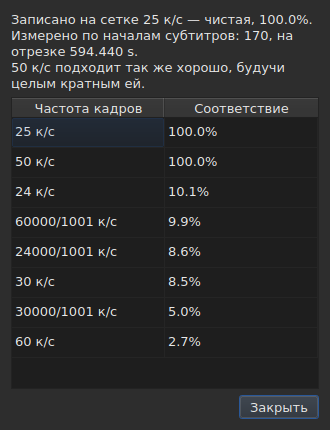

# Сетка кадров

<!-- machine-translated -->
> Эта страница переведена машинным способом и ещё не проверена носителем языка.

Файл субтитров **не сообщает**, для какой частоты кадров рассчитаны его
позиции: у SubRip нет заголовка, а заголовок WebVTT — свободный текст. Окно
**выводит** частоту из самих позиций при открытии файла и показывает результат
в двух местах, которые отвечают на разные вопросы.

| Интерфейс | Что он даёт |
| :-------- | :---------- |
| строка состояния | **ответ** — постоянно и без запроса |
| `Сервис ▸ Анализ частоты кадров…` | **обоснование** — когда вы хотите его увидеть |

## Что показывает строка состояния

Справа, между сведениями о [кодировке](files.md#кодировка-в-строке-состояния)
прочитанного файла и сведениями о [связанном видео](video.md#что-показывает-строка-состояния):

| Ситуация | Что написано |
| :------- | :----------- |
| позиции лежат на сетке | `Grid: 24 fps` |
| только некоторые из них | `Grid: 29.97 fps (partial)` |
| ни одна известная сетка не подходит | `No grid` |

**`No grid` не называет частоту кадров, и так задумано.** Набор
кандидатов закрыт — это восемь частот, которые предлагает диалог преобразования, — и
назвать наименее неверную из них значило бы дать неверный ответ там, где
правильный ответ — «не знаю».

**У `No grid` две причины, и ответы на них разные.** Либо ни одна
сетка не подходит, либо в файле слишком мало субтитров, чтобы
о нём можно было что-то сказать: два начала всегда выглядят идеально
выровненными, а это ничего не доказывает. Строка состояния сообщает одно и то же в обоих случаях;
**анализ их различает** и в первом случае указывает, насколько
лучший кандидат не дотягивает.

Строка **обновляется после каждой операции**. Выравнивание файла по другой
частоте кадров меняет сетку, и строка состояния не должна продолжать
сообщать прежнюю.

### У документа, считаемого в кадрах, нет сетки, у него есть частота кадров

**MicroDVD — единственный из девяти форматов, который считает в кадрах.** Каждая его строка
содержит два номера кадров и больше ничего, а файл **не говорит**, по какой
частоте кадров их читать. Тогда в том же месте строки состояния написано:

| Ситуация | Что написано |
| :------- | :----------- |
| документ считается в кадрах | `Frames: 24000/1001 fps` |

**Это не сетка, и сетка здесь была бы замкнутым кругом.** Позиции
документа MicroDVD вычислены *из* его кадров именно по этой
частоте; вывод сетки из них вернул бы это же число, то есть исходное значение,
выданное за результат измерения.

**Откуда оно взялось, сообщается один раз** — при чтении, в
[списке диагностических сообщений](files.md#диагностические-сообщения-чтения):
`counts in frames and states no rate; it was read at ("24000/1001")`. Строка
состояния, в свою очередь, постоянно показывает то, что есть.

**Неверная частота кадров сдвигает весь файл**, и исправить её можно в диалоге
[`Convert Frame Rate…`](operations.md#convert-frame-rate):
он открывается на частоте, по которой файл прочитан, и говорит об этом.

## Что показывает анализ

`Сервис ▸ Анализ частоты кадров…` **ничего не изменяет.** Он открывается со сводкой и
рейтингом восьми кандидатов с их оценкой.




Сводка даёт ответ, а затем то, что его уточняет; каждая фраза появляется
только тогда, когда ей есть что сказать:

| Что там можно прочитать | Когда |
| :---------------------- | :---- |
| по скольким началам и на каком промежутке времени сделан вывод | всегда |
| насколько файл смещён относительно своей сетки | его позиции лежат на ней с точностью до константы |
| что другая частота кадров подходит так же хорошо | она в целое число раз больше выбранной |
| что промежуток не позволяет отличить две частоты кадров друг от друга | файл слишком короткий, чтобы их разделить |
| сколько начал не попадает на сетку, **и в скольких сериях** | файл лежит на сетке лишь частично |

**Число серий отличает две истории**, которые один процент
смешивает. Много серий из одного начала — это позиции, исправленные
вручную по одной. Несколько длинных серий — это сдвинутый по времени
фрагмент или файл, склеенный из двух других.

**Показан весь рейтинг, а не единственный ответ.** Файл, который
на сто процентов подходит и под 25, и под 50, говорит о том, что один
вердикт скрыл бы.

## Когда преобразование было выполнено неверно

Файл, не попадающий ни на одну сетку, иногда оказывается файлом, **преобразованным по
неверной частоте кадров**: тогда он лежит на вполне реальной сетке, но смещён на отношение,
которое не совпадает ни с одним из восьми. Когда вывод даёт `none` или `partial`, анализ перебирает
**пятьдесят шесть упорядоченных пар из восьми стандартных частот кадров** — этот набор закрыт, — ища ту,
преобразование по которой возвращает позиции на сетку. Каждое отношение применяется к позициям, и
**результат оценивает сам вывод сетки**: уверенность — это то, что он сказал бы, а не
выдуманное число. Две пары с одинаковым отношением, например 30 к 25 и 60 к 50, считаются одним
преобразованием.

В сводку добавляется фраза:

```text
converting from 24 to 25 fps puts the positions on a 24 fps grid: 99.9%, against 11.8% as they are and 14.9% for the next best conversion
```

В ней названы преобразование, сетка, на которую попали бы позиции, и степень совпадения,
**затем разница с позициями в их нынешнем виде и с лучшим из прочих
преобразований.** Кнопка `Convert Frame Rate…` закрывает анализ и открывает [диалог
преобразования](operations.md#convert-frame-rate) **с заполненной найденной парой**: ничего не применяется,
пока диалог не принят, а чтобы вернуться, достаточно отменить его. Видео, открытое рядом,
позволяет по картинке судить, верен ли ответ.

**Когда две пары одинаково хороши, ни одна не предлагается, и фраза об этом говорит:**

```text
converting from 30 to 25 fps and converting from 25 to 24 fps fit equally well (99.7% and 99.6%), so none is proposed
```

Это скорее обычный случай, чем исключение: сетка в 28,8 кадра в секунду возвращается
на 24 так же, как на 30, а файл, все времена в котором удвоены, остаётся на сетке 25.
Однозначное исправление есть лишь у жеста «преобразовать файл, который **уже** имеет целевую частоту кадров». При
равенстве решает видео: вы сами открываете `Convert Frame Rate…` на одной из двух пар.

**Ничего не сообщается** о файле, уже лежащем на сетке, о файле, слишком коротком для
осмысленного вывода, и о файле, который ни одно преобразование из набора не возвращает на сетку, — это
дрейф, отношение вне восьми частот кадров, позиции без структуры.

## Чего таблица не показывает

**Ни одна строка таблицы не помечается из-за сетки** — никогда.

Как только вы исправляете позицию вручную, она перестаёт лежать на сетке. Автоматическая
пометка выдавала бы работу пользователя за
аномалию — в файле, который он как раз исправляет. Вывод
относится к **документу**, и анализ — единственное исключение, потому что вы
открыли его именно для этого.

Пометки таблицы, в свою очередь, касаются того, что не сходится: конца
раньше начала, перекрытия, нарушенного порядка. См. [Таблица](table.md).
