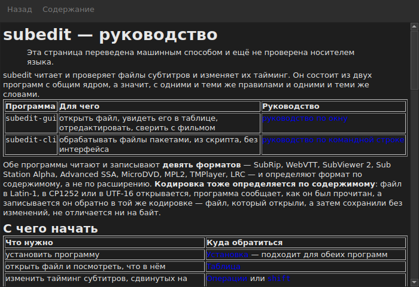

# Руководство в окне

<!-- machine-translated -->
> Эта страница переведена машинным способом и ещё не проверена носителем языка.

`Справка ▸ Руководство`, или `F1`, открывает **это самое руководство** в отдельном окне.




## Что оно открывает и почему не адрес

**Руководство, установленное рядом с программой**, а не страница в Интернете.

Адрес описывал бы версию, которая разрабатывается, а не ту, что под рукой.
Пользователю, читающему руководство версии, которой у него нет, приходится хуже,
чем тому, у кого руководства нет вовсе, — поэтому окно читает файлы, положенные
установкой, в `<prefix>/share/subedit/manual`. См.
[Установка](../subedit-cli/installation.md).

Оно открывается на [главной странице](../index.md), той, что подсказывает, с чего начать.

## На каком языке

**На языке окна.** Руководство открывается на том языке, на котором говорит
интерфейс: выбранном в `Правка ▸ Настройки…` или, иначе, заданном
окружением — см.
[Язык интерфейса](preferences.md#язык-интерфейса).

| Окно говорит на | Руководство открывается на |
| :---------------- | :------------------ |
| английском | английском |
| языке, руководство на котором установлено, — каталанском, чешском, немецком, испанском, финском, французском, галисийском, иврите, венгерском, интерлингве, исландском, итальянском, нидерландском, польском, португальском, бразильском португальском, русском, сербском, турецком, китайском (упрощённом) | этом языке |
| языке, руководство на котором не установлено | английском |

**Страница за страницей, а не всё или ничего**: страница, которой нет в переводе,
открывается на английском, а все остальные страницы остаются на языке окна. Ссылка
ведёт от одной к другой точно так же.

Переводы устанавливаются рядом с английским руководством, каждый в каталог,
названный по его языку: `<prefix>/share/subedit/manual/fr` для французского. Язык —
тот, на котором окно было запущено, поэтому язык, выбранный в
параметрах, применяется к руководству тоже, при следующем запуске.

## Навигация

| Что вы делаете | Что происходит |
| :---------- | :----------- |
| щёлкаете ссылку руководства | страница открывается в том же окне |
| щёлкаете ссылку на раздел | страница открывается, и окно прокручивается до него |
| щёлкаете ссылку только на раздел | окно прокручивается до него, не меняя страницу |
| `Back` | возвращает на предыдущую страницу; недоступна на первой |
| `Contents` | возвращает на главную страницу; недоступна, когда вы на ней |

Окно **не модальное**: оно остаётся открытым, пока вы работаете, — в этом весь
смысл руководства под рукой. Повторный выбор пункта не создаёт
второе окно, а выводит это на передний план.

## Что оно не может открыть, и говорит об этом

Руководство иногда ссылается на **дорожную карту** или на **решение
об архитектуре**. Это документы репозитория, а не пакета: они
не устанавливаются, и окно прямо об этом сообщает, а не оставляет
щелчок без последствий.

```
../../feuille-de-route.md is not part of the installed manual;
it lives in the project's repository.
```

Их можно прочитать в репозитории, адрес которого указан в `Справка ▸ О программе subedit`.

## Когда пункт недоступен

**`Справка ▸ Руководство` недоступен, если рядом с программой нет руководства.** Два
случая, и ни один не является неисправностью:

| Случай | Почему |
| :--- | :-- |
| исполняемый файл запущен из дерева сборки | там ничего не устанавливалось, поэтому читать нечего |
| установка неполная | руководство удалили или никогда не копировали |

Наведение указателя на пункт сообщает, какой из двух случаев: «Руководство рядом с этой
программой не установлено».

Отсутствие страницы при наличии руководства — файл, удалённый вручную, — не
закрывает окно: оно называет файл, который не удалось прочитать, и сохраняет на экране то,
что показывало.

## Где ищется руководство

**Рядом с исполняемым файлом**, в `../share/subedit/manual` — раскладка, которую создаёт любая
установка, каким бы ни был префикс. Благодаря этому установка
в `~/.local` находит своё руководство так же, как пакет, установленный в `/usr`.
