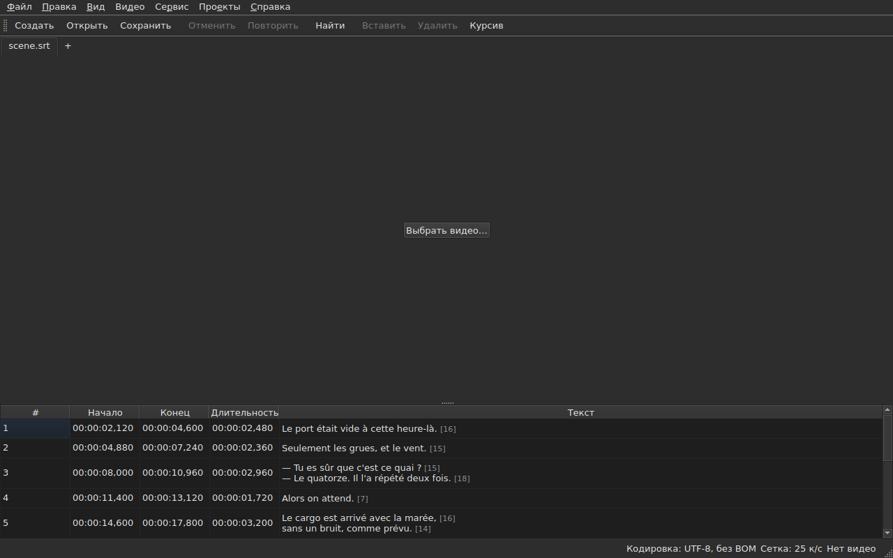

# subedit-gui — руководство

<!-- machine-translated -->
> Эта страница переведена машинным способом и ещё не проверена носителем языка.

Окно subedit: откройте файл субтитров и увидите его в таблице. О другой
программе и о том, с чего начать, см. в [руководстве](../index.md).

> **Текущее состояние.** Окно **открывает несколько файлов, по одной вкладке на
> каждый**, в любой кодировке — через `Open…` или перетаскиванием файлов в него —,
> **показывает** их, **редактирует их ячейки**, **вставляет и удаляет строки**,
> **отменяет действия**, **сохраняет — с выбором кодировки, окончаний строк и
> метки порядка байтов** —, а также **отмечает субтитры, позиции которых
> не согласуются между собой**. Оно **объединяет и разделяет** строки, **вырезает,
> копирует и вставляет** тексты, а также **ищет и заменяет** в видимом тексте,
> не нарушая теги, в одном проекте или во всех. Оно **открывает перевод
> рядом с основным файлом**, сопоставляя по позиции или по номеру, в ещё одном столбце,
> и сохраняет его отдельно. В меню `Tools` шестнадцать операций и два пункта проверки орфографии —
> сдвиг, преобразование, преобразование частоты кадров, подгонка длительностей,
> **добавление файла, разделение проекта надвое**, выделение
> курсивом, добавление тире в диалогах, смена регистра четырьмя способами,
> удаление пометок для слабослышащих, **исправление текстов с помощью
> многостраничного мастера**, **проверка орфографии слово за словом**, выравнивание по частоте кадров, возвращение на
> сетку — и анализ сетки, который ничего не изменяет. Меню `Projects`
> **сохраняет и закрывает всё** одним действием. Оно **связывает видео
> с документом**, выбранное или угаданное, и **воспроизводит его в окне**, рисуя на изображении текущую
> строку; оно **задаёт начало, конец или
> субтитр по позиции фильма**, **переходит по кадрам** и **сдвигает границу на один кадр**. Полоса воспроизведения **перематывает, задаёт
> громкость и позицию**, таблица **следует за воспроизведением**, не отменяя ручную прокрутку, позиции
> можно показывать **в кадрах**, а меню `Video` **выбирает звуковую дорожку**. Два обнаружения
> **предлагают, но никогда не применяют**: перевод, сдвинутый на постоянную величину, который можно **открыть заново
> со сдвигом**, и преобразование частоты кадров, возвращающее файл на сетку. Оно **запоминает геометрию окна, порядок, ширину и наличие
> столбцов, а также настройки** от одного
> сеанса к другому и бывает **светлым или тёмным** по вашему выбору. `Справка ▸ Руководство`
> открывает **это руководство** в окне. Руководство описывает то, что существует, а не
> то, что планируется; дальнейшие планы изложены в
> [дорожной карте](../../../../feuille-de-route.md).

> **Изображения в этом руководстве создаются автоматически, текст — нет.** Примеры
> `subedit-cli` создаются запуском команды; снимки экрана
> создаются построением настоящего окна и его фотографированием — `make
> manual` делает и то и другое. Поэтому изображение не может описывать интерфейс, которого
> больше нет, а изменение интерфейса видно в
> разнице версий репозитория. Без страховки остаётся текст вокруг них, чья
> точность держится на проверке людьми.

**Каждый экран показан дважды, в двух палитрах, которые устанавливает
приложение**, — `Light` и `Dark`, предлагаемых
[параметрами](preferences.md#тема). В рабочей среде, где
правит тема, `System` даёт одну или другую в зависимости от выбора среды.

## Меню

`File`, `Edit`, `View`, `Video`, `Tools`, `Projects`, `Help` — в том порядке,
в каком ими пользуются: документ, что с ним делают, как на него смотрят, что
к нему прилагается, что его проверяет, что относится ко всем открытым проектам, что
его объясняет.

В меню `View` есть подменю `Columns` с одним пунктом-флажком на каждый столбец, кроме `Text`
— см. [Таблица](table.md#скрытие-и-перемещение-столбцов) — и настройка `Positions in Frames`, которая показывает
`Start` и `End` в виде номеров кадров — см. [Позиции в кадрах](table.md#позиции-в-кадрах).

В меню `Projects` два пункта, `Save All` и `Close All` — см.
[Меню «Проект»](files.md#меню-проект).

В меню `Edit` пять блоков, каждый отделён разделителем: отмена
действий; буфер обмена — вырезание, копирование и вставка текстов; `Find and Replace…`;
вставка, удаление, объединение и разделение строк; наконец
`Preferences…`. Отмена — это то, что делают *с* правкой, перемещение текста
не добавляет и не удаляет строки, четыре пункта следующего блока меняют число
строк, а выбор темы вообще не является правкой.

**Клавиши названы так, как их показывает меню**, по-английски, как и остальной
интерфейс: `Ins`, `Del`, `Ctrl+Shift+Z`. Клавиша, которую вы нажимаете и
которую не называет ни одно меню, сохраняет английское название: `Enter`, `Esc`, `Shift`.

В меню `Help` два пункта, в том порядке, в каком их показывает меню. `Manual`, или
`F1`, открывает это руководство в окне — см.
[Руководство в окне](help.md). `About subedit` показывает версию,
лицензию и библиотеки, с которыми работает окно, с их версиями — см.
[`--version`](invocation.md#--version).

## Панель инструментов

Под меню находится панель, на которой в группах собраны **самые частые
действия**. На каждой кнопке — короткое слово; меню хранит пункт целиком, а
комбинация клавиш та же.

| Кнопка | Пункт меню | Комбинация клавиш |
| :----- | :--------- | :------- |
| Создать | Файл ▸ Новый проект | `Ctrl+N` |
| Открыть | Файл ▸ Открыть… | `Ctrl+O` |
| Сохранить | Файл ▸ Сохранить | `Ctrl+S` |
| Отменить | Правка ▸ Отменить | `Ctrl+Z` |
| Повторить | Правка ▸ Повторить | `Ctrl+Shift+Z` |
| Найти | Правка ▸ Найти и заменить… | `Ctrl+F` |
| Вставить | Правка ▸ Вставить субтитры… | `Ins` |
| Удалить | Правка ▸ Удалить субтитры | `Del` |
| Курсив | Сервис ▸ Курсив | `Ctrl+I` |

**Кнопка недоступна по той же причине, что и её пункт**: `Undo` — когда нечего
отменять, `Remove` — когда не выбрана ни одна строка. Пункты перевода
и операции меню `Tools`, кроме `Italic`, остаются в своих
меню: ими пользуются реже или не все.

## Разделы

| Раздел | Содержание |
| :------ | :------- |
| [Установка](../subedit-cli/installation.md) | сборка и установка — страница относится к обеим программам |
| [Запуск](invocation.md) | запуск окна, аргументы, коды завершения |
| [Открытие и сохранение](files.md) | команды, вкладки, меню `Projects`, перетаскивание файлов, перевод и его повторное открытие со сдвигом, диагностические сообщения, кодировка в строке состояния, двойное преобразование туда и обратно, закрытие |
| [Таблица](table.md) | что показывает каждый столбец, их скрытие и перемещение, позиции в кадрах, столбец перевода и текст, на который действуют операции |
| [Редактирование ячейки](editing.md) | какие ячейки можно редактировать и как |
| [Вырезание, копирование и вставка текстов](clipboard.md) | три пункта, что переносится, добавляемые строки, преобразованные теги |
| [Поиск и замена](find-and-replace.md) | диалог, четыре действия, два параметра, что охватывает поиск, во всех открытых проектах |
| [Вставка, удаление, объединение, разделение и сортировка субтитров, устранение их перекрытий](lines.md) | четыре пункта, их комбинации клавиш, куда попадают новые строки |
| [Отмена и повтор](undo.md) | история, два действия, пометка об изменении |
| [Сетка кадров](frame-grid.md) | частота кадров, выведенная из позиций, анализ и преобразование, возвращающее файл на сетку |
| [Операции](operations.md) | сдвиг, преобразование, преобразование частоты кадров, подгонка длительностей, добавление файла, разделение проекта, выделение курсивом, регистр, тире, удаление пометок, выравнивание, возвращение на сетку и то, что выходит за конец фильма |
| [Исправить текст…](correct-texts.md) | мастер исправления: цель и задачи, страница каждой задачи, ход выполнения, подтверждение |
| [Проверка орфографии…](check-spelling.md) | проверка орфографии: её настройки, обход, закрытие посередине, отсутствие словаря |
| [Связанное видео](video.md) | выбор видео, автоматическое предложение, звуковая дорожка, строка состояния, `ffmpeg` |
| [Проигрыватель](player.md) | окно видео, полоса воспроизведения, воспроизведение, перемещение, громкость, следующая за ним таблица, нарисованная линия |
| [Тайминг по видео](timing.md) | задание начала или конца субтитра, вставка, выбор по позиции фильма, переход по кадрам, сдвиг границы |
| [Параметры](preferences.md) | тема, файл параметров, его параметры и то, что происходит с нечитаемым значением |
| [Руководство в окне](help.md) | `Справка ▸ Руководство`, что оно открывает и как в нём перемещаться |
