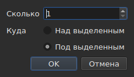

# Вставка, удаление, объединение, разделение и сортировка субтитров, устранение их перекрытий

<!-- machine-translated -->
> Эта страница переведена машинным способом и ещё не проверена носителем языка.

Восемь пунктов меню `Edit`, отделённых разделителем от пункта
`Find and Replace…`. Четыре из них объединяет то, что они меняют число строк, тогда как
вырезание, копирование и вставка, описанные выше, перемещают тексты; `Sort Subtitles` меняет
только **порядок** строк, `Join Repeated Subtitles` снова собирает в один
субтитр идущие подряд части одного и того же текста, а `Make Ranges Disjoint…`
заново разрезает субтитры там, где они перекрываются.

| Пункт | Комбинация клавиш | Что делает |
| :---- | :------- | :----------- |
| Вставить субтитры… | `Ins` | открывает диалог, затем добавляет пустые строки |
| Удалить субтитры | `Del` | удаляет выделенное, ничего не спрашивая |
| Объединить субтитры | нет | собирает блок соседних строк в одну строку |
| Разделить субтитр | нет | разрезает строку надвое посередине её длительности |
| Объединить повторяющиеся субтитры | нет | собирает в один субтитр идущие подряд части одного и того же текста |
| Упорядочить субтитры | нет | возвращает строки в порядок их начала, во всём проекте |
| Устранить пересечения интервалов… | нет | разрезает перекрывающиеся строки так, чтобы ни один диапазон больше не перекрывал другой |
| Восстановить субтитры… | нет | выполняет три предыдущих пункта подряд — объединение повторов, сортировку, разрезание диапазонов — за один раз |

Все восемь попадают в историю: `Ctrl+Z` отменяет их, как и всё остальное.

## Вставка

| Поле | Что содержит | По умолчанию |
| :---- | :------------ | :------ |
| `How many` | целое число от 1 до 99 999 | `1` |
| `Where` | `Above the selection` или `Below the selection` | последний выбор, `Below` при первом запуске |

`OK` добавляет строки, `Cancel` ничего не добавляет.

### Куда они попадают

**К последней из выделенных строк**, а не к первой. Если выделить строки 1 и 3,
а затем вставить ниже, новая строка встанет на позицию 4, а не на
позицию 2. Так Gaupol работает уже двадцать лет, и этого ожидает рука,
которая провела выделение сверху вниз.

`Above the selection` ставит строку непосредственно перед этой же строкой.

### Сколько они длятся

У пустой строки нет текста, но есть позиции. Их выводят
из имеющегося свободного места:

| Ситуация | Начало | Длительность |
| :-------- | :---- | :------- |
| между двумя субтитрами | конец предыдущего | свободное место до следующего, поделённое поровну |
| после последнего | конец последнего | по три секунды каждая |
| в начале файла | начало отсчёта | свободное место до первого, поделённое поровну |
| в пустом файле | начало отсчёта | по три секунды каждая |

Если в выбранном месте файл перекрывается, **делить нечего**:
строки получают нулевую длительность, которую показывает таблица, вместо
выдуманной длительности, которая заходила бы на соседний субтитр.

### Пустой документ

**Выделение не требуется**, и это единственный способ начать
новый файл: строки попадают на индекс ноль. Выбор стороны в диалоге
при этом недоступен — не к чему привязывать вставку.

Как только в документе появляется строка, пункт `Insert Subtitles…` **недоступен, пока
ничего не выделено**: без выделения индекс пришлось бы угадывать.

### Потом

Добавленные строки **выделяются**, и таблица прокручивается к ним. Поэтому повторное нажатие
`Ins` вставляет строки после них, и между двумя вставками не нужно
щёлкать мышью.

### Сторона запоминается

`Above` или `Below` запоминается **от одной вставки к другой и от одного сеанса к
другому**: это параметр `edit.insert-placement` в
[файле параметров](preferences.md#файл). Вы вставляете не одну строку,
а десять подряд, и всегда с одной и той же стороны.

## Удаление

`Remove Subtitles` (или `Del`) удаляет выделенные строки, в том числе при
прерывистом выделении, и при отмене каждая строка возвращается на своё место.

**Подтверждение не запрашивается**, и это не недосмотр:
операция отменяется клавишами `Ctrl+Z`. Модальный диалог перед отменяемым действием
стоил бы лишнего щелчка каждый раз ради того, чтобы изредка избавить от `Ctrl+Z`.

**Пункт недоступен, когда ничего не выделено.** В остальных местах окна
«ничего не выделено» означает «весь файл» — именно это позволяет
выполнить сдвиг, не выделяя четыре тысячи строк. Здесь такое прочтение
опустошило бы документ одним неловким `Del`, поэтому оно не предлагается.

После удаления **выделяется строка, занявшая место первой из удалённых**, —
или последняя из оставшихся, если удалён конец
файла. Поэтому несколько нажатий `Del` подряд удаляют строки одну
за другой.

Полностью опустошённый файл оставляет окно работоспособным: `Insert Subtitles…`
снова становится доступным, поскольку в пустой документ вставляют без выделения.

## Объединение

`Merge Subtitles` собирает выделенные строки в **одну строку**:

| Что получает объединённая строка | Откуда это берётся |
| :---------------------------- | :------------------ |
| начало | начало первой |
| конец | конец последней |
| текст | тексты всех строк по порядку, между двумя — перевод строки |
| перевод | переводы, соединённые так же |
| всё остальное, что несёт формат, — стиль, слой, координаты | от первой |

**Пустой текст не оставляет пустой строки**: объединение `Un.`, строки без
текста и `Trois.` даёт две строки текста, а не три.

Объединённые строки исчезают, а заменяющая их строка занимает место
первой.

**Пункт недоступен**, пока выделение не является **блоком как минимум из
двух соседних строк**. Одной строке не с чем объединяться; строки
1 и 3 без 2 тоже нельзя, так как результат зашёл бы на 2 и
накрыл бы её.

После объединения **объединённая строка выделяется**: `Split Subtitle`
готов снова её разрезать.

## Разделение

`Split Subtitle` разрезает выделенную строку **посередине её длительности**, с точностью до
миллисекунды:

| Половина | Начало | Конец | Текст |
| :--- | :---- | :-- | :--- |
| первая | исходное начало | середина | **весь** текст и перевод |
| вторая | середина | исходный конец | пустой |

**Текст не разрезается по переводу строки.** Это было бы верно для
субтитра из двух строк и неверно для субтитра из одной или из трёх;
весь текст остаётся в первой половине, а то, что должно попасть
во вторую, вы переносите сами.

Первая половина сохраняет всё, что формат нёс помимо текста; вторая
создаётся как вставленная строка, без всего этого.

**Пункт недоступен**, пока выделена не **ровно одна
строка**. «Ничего не выделено» здесь не означает «весь файл».

После разделения **выделяются обе половины** — так Gaupol
поступает после любой вставки, и `Merge Subtitles` затем готов отменить это
действие.

## Сортировка

`Sort Subtitles` возвращает **весь проект** в порядок начал. Никогда не
выделение: порядок — свойство документа, а сортировка половины
файла лишена смысла. Сортировка **устойчивая**: два субтитра,
которые начинаются одновременно, сохраняют порядок, заданный файлом.

**Во время сортировки в строке состояния идёт индикатор, а курсор превращается в
песочные часы**: в длинном файле окно на некоторое время перестаёт отвечать — таблица
перестраивается строка за строкой, — и без этого не понять, идёт ли
работа. Индикатор не показывает доли: сортировка их не сообщает,
и он исчезает вместе с ней.

Строка состояния сообщает, сколько строк поменялись местами, — `3 subtitles moved`
— или, если всё уже было по порядку, `already in order`. **Проект, уже находящийся в порядке,
не попадает в историю**: операция, ничего не меняющая, не является
операцией, которую можно отменять. Для проекта из одного субтитра пункт недоступен.

Файл, **требующий исправления при открытии**, предлагает его сам,
[в одном окне](#при-открытии--одно-поле): см. ниже. Субтитры
не на своих местах также [учитываются вместе с диагностическими сообщениями](files.md#диагностические-сообщения-чтения),
чтобы вы нашли их, не прокручивая таблицу.

В командной строке то же самое с файлами делает [`sort`](../subedit-cli/sort.md), а
`--sort` делает это попутно в подкомандах
[`convert`](../subedit-cli/convert.md#сортировка-при-записи),
[`append`](../subedit-cli/append.md#сортировка-результата) и
[`split-file`](../subedit-cli/split-file.md#разрезание-в-порядке-времени).

## Объединение повторяющихся субтитров

`Join Repeated Subtitles` собирает в **один субтитр** субтитры, которые подряд показывают
одно и то же: текст, разрезанный на идущие подряд части, как его
оставляют некоторые средства сегментации. Пункт действует на **весь проект**.

**Повтор** — это субтитр с тем же текстом, тем же переводом и теми же параметрами формата
(стиль, позиция, параметры реплики), что и у другого, **и начинающийся не позже
конца того**. Цепочка повторов превращается в тот субтитр, который начинается
первым, с наибольшим концом цепочки; остальные исчезают.
`Alpha [1, 2]`, `Alpha [2, 4]` и `Alpha [4, 6]` дают `Alpha [1, 6]`.

- **Порядок файла здесь ничего не определяет и не меняется**: сохраняется субтитр,
  который начинается первым, где бы ни находились остальные.
- **Ничего не объединяется по ошибке**: другой текст, другие параметры, промежуток
  между двумя частями, субтитр без текста или с концом раньше начала
  остаются отдельными.
- Строка состояния сообщает, что было сделано, — `2 repeated subtitles joined` или
  `no repeated subtitles`.

**Выполнять до сортировки и разрезания**, которые лучше читают чистую цепочку:
текст из трёх частей плюс другой текст на всём диапазоне, расположенные
не по порядку, сортируются и разрезаются на строки, переключающиеся с одной части на другую; если же объединить
их сначала, они встают по порядку и объединяются чисто. Окно при открытии, описанное ниже, делает
все три действия в этом порядке.

## Устранение перекрытий диапазонов

`Make Ranges Disjoint…` разрезает перекрывающиеся субтитры так, чтобы **ни один
диапазон `[start, end]` больше не перекрывал другой**. Пункт действует на **весь
проект**, а не на выделение: группа перекрывающихся субтитров
разрезается там, где они перекрываются, а половина группы лишена смысла.

**Ничто не укорачивается и не удлиняется.** В каждый момент окно показывает
те же тексты, что и прежде. Меняется лишь то, как разрезана временная шкала:
она разрезается в каждом начале и каждом конце группы; интервал, покрытый
одним субтитром, остаётся этим субтитром; интервал, покрытый несколькими,
становится **одним** субтитром, строки которого — их строки, **самый ранний — в строке 1**.
`A [0, 5]` и `B [3, 8]` дают `[0, 3] A`, `[3, 5] A / B`, `[5, 8] B`.

Диалог запрашивает три настройки, которые запоминаются от раза к разу:

| Поле | Что содержит | По умолчанию |
| :---- | :------------ | :------ |
| `Shortest interval kept` | от 0 до 10 000 мс: более короткий интервал поглощается соседним | `80 ms` (около двух кадров) |
| `Most lines in a subtitle` | от 0 до 10; `No limit` при 0 | `2` |
| `Put a dash before each subtitle's text` | тире перед тем, что каждый субтитр вносит в объединённый субтитр | флажок снят |

`OK` разрезает, `Cancel` ничего не делает. **Записанные строки после этого
выделяются**, а строка состояния сообщает, что было сделано: `2 subtitles split, 1 merged`.
Второй проход ничего не меняет и сообщает об этом: `already disjoint`.

- **Строка никогда не дублируется.** Два субтитра с одним текстом дают
  одну строку там, где они перекрываются, а две соседние части, показывающие
  одно и то же, образуют лишь один субтитр. Текст субтитра, разрезанного на несколько
  частей, в остальном повторяется в каждой: это то, что на экране в данный момент.
- **Очень короткий интервал поглощается соседним**: тот, чьи строки
  уже содержат его собственные, а иначе самый длинный, расширяет свой диапазон, чтобы его покрыть.
  Целый субтитр короче порога никогда не поглощается.
- **Строк больше, чем допускает предел: окна.** Три строки на три секунды
  превращаются в две половины, первые две строки, затем последние две;
  четыре строки — в три трети и так далее. Ничто не усекается.
- Перевод следует тем же разрезам; стиль и позиция первого
  покрывающего субтитра сохраняются.

**То, что не удалось выполнить полностью, сообщается в окне с кнопкой закрытия**, а не в
строке состояния: окна, поглощённые интервалы, слишком короткие субтитры,
оставленные целыми, различающиеся стили, субтитры, конец которых раньше
начала (остаются на месте).

**Пункт отклоняется с указанием причины, когда субтитры идут не в
порядке начала**: группы — это цепочки соседей, а ядро никогда
не сортирует само. Сначала `Sort Subtitles` — или окно при открытии, которое
делает и то и другое в этом порядке.

### Всё сразу: `Repair Subtitles…`

`Repair Subtitles…` выполняет три предыдущих пункта **один за другим** в единственном порядке, который работает: повторы
объединяются, субтитры упорядочиваются по началу, затем диапазоны делаются непересекающимися. Это пункт
для файла, плохо сегментированного, неупорядоченного и перекрывающегося, когда вы знаете, что нужны все три действия. Диалог запрашивает
настройки разрезания (те же, что у `Make Ranges Disjoint…`, запоминаемые от раза к разу) и сообщает, что сначала объединяет и сортирует. Строка состояния — или окно с кнопкой закрытия, когда что-то не удалось выполнить полностью — даёт **единый отчёт**
обо всех трёх действиях: `2 repeated subtitles joined; already in order; 2 subtitles split, 1 merged`. Каждое исправление — отдельная
запись в истории: `Ctrl+Z` отменяет их по одному. В командной строке: [`repair`](../subedit-cli/repair.md).

### При открытии — одно поле

Файл, который открывается с чем-то, что мы умеем исправлять, **предлагает это в
одном окне**, `Problems found in this file`, а не открывает по одному окну на
каждую проблему. Каждая найденная проблема — строка с флажком, который установлен:

- `Join the repeated subtitles` — субтитры повторяют другой, к которому
  примыкают, с указанием их номера;
- `Sort the subtitles` — субтитры идут не в порядке начала,
  с указанием их номера;
- `Make the ranges disjoint` — субтитры начинаются раньше конца предыдущего,
  их число считается **после приведения файла в порядок**, так как именно там они исправляются.

**Каждая проблема считается там, где исправляется**, на копии, к которой уже применены
предшествующие ей исправления: разрезанный на части текст —
причина некоторого беспорядка, и его объединение в первую очередь может не оставить ничего, — тогда окно
не предложит сортировку.

У не найденной проблемы строки нет. Если снять флажок сортировки, другой флажок **становится серым
и снимается**: диапазоны делаются непересекающимися только по порядку.
`Fix` применяет отмеченное — объединение, затем сортировку, затем разрезание, с
настройками последнего `Make Ranges Disjoint…` — и даёт **единый отчёт**;
`Keep as is` ничего не трогает. **Ничего не делается без согласия**, каждое исправление
попадает в историю, а файл, в котором нечего исправлять, не вызывает
никакого вопроса.

В командной строке то же самое с файлами делает [`disjoint`](../subedit-cli/disjoint.md), а `--disjoint`
делает это попутно в подкомандах [`convert`](../subedit-cli/convert.md#устранение-перекрытий-диапазонов),
[`append`](../subedit-cli/append.md#устранение-перекрытий-диапазонов) и
[`split-file`](../subedit-cli/split-file.md#устранение-перекрытий-диапазонов).

### Почему не комбинации клавиш Gaupol

В Gaupol объединение выполняется клавишей `M`, а разделение — клавишей `S`. Отдельную букву
перехватила бы таблица, прежде чем она дошла бы до редактируемой ячейки, а `Ctrl+S`
уже сохраняет: эти два пункта вызываются через меню.

## Что об этом говорит действие отмены

**Одна запись в истории на одно действие.** Объединение пяти строк отменяется одним
нажатием `Ctrl+Z` и возвращает пять строк такими, какими они были, — позиции, тексты и
всё, что нёс формат.

| Операция | Что считывает `Undo` |
| :-------- | :---------------- |
| вставка | `Undo: inserting` |
| удаление | `Undo: removing` |
| объединение | `Undo: merging` |
| разделение | `Undo: splitting` |
| объединение повторов | `Undo: joining repeated subtitles` |
| разрезание диапазонов | `Undo: making the ranges disjoint` |

Исправление, предложенное при открытии, — это по одной записи в истории на каждое исправление: объединение, сортировка и разрезание отменяются одно за другим.

См. [Отмена и повтор](undo.md).

## Комбинации клавиш при открытой ячейке

`Ins` и `Del` принадлежат полю ввода, пока открыт редактор
ячейки: клавиша удаления стирает там символ, а не
субтитр. Закрытие редактора — `Enter` или `Esc` — возвращает им прежний смысл. При вызове
из меню `Remove Subtitles` сначала подтверждает ввод, как и другие
действия из раздела [Редактирование ячейки](editing.md).

В этом руководстве клавиши названы так, как их показывает меню, — см.
[Меню](index.md#меню).
