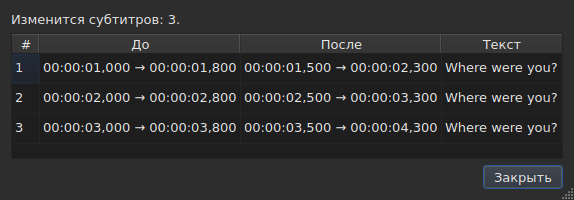
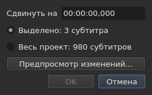
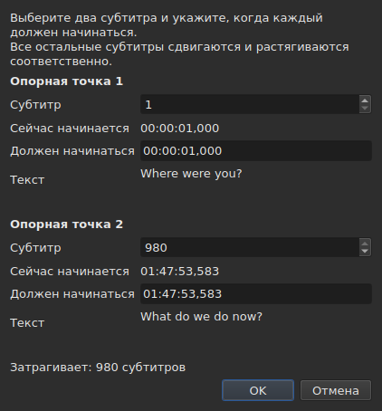
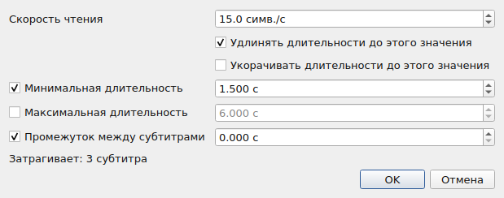
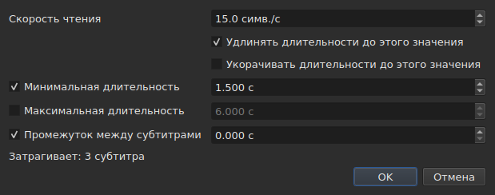
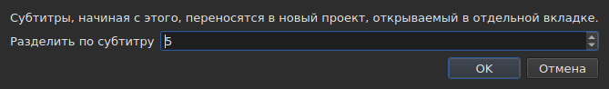

# Операции

<!-- machine-translated -->
> Эта страница переведена машинным способом и ещё не проверена носителем языка.

В меню **Сервис** шестнадцать операций, один анализ и два пункта проверки орфографии. Каждая из
шестнадцати отменяется клавишами `Ctrl+Z`; анализ ничего не изменяет. `Check Spelling…` тоже отменяется, а `Spell-Check Settings…` не затрагивает ни одного текста.

| Пункт | Диалог | Что делает |
| :---- | :----- | :----------- |
| `Shift Positions…` | да | сдвигает область на заданную длительность |
| `Transform Positions…` | да | исправляет область по двум маркерам |
| `Convert Frame Rate…` | да | пересчитывает время области с одной частоты кадров на другую |
| `Adjust Durations…` | да | сдвигает концы так, чтобы выдержать скорость чтения, длительности и промежуток |
| `Append File…` | выбор файла | добавляет файл в конец проекта |
| `Split Project…` | да | разрезает проект надвое, остальное попадает в новую вкладку |
| `Italic` | **нет** | выделяет область курсивом или снимает курсив |
| `Dialogue` | **нет** | ставит тире диалога в начало каждой строки или убирает его |
| `Регистр ▸ Как в заголовке` | **нет** | каждое слово получает заглавную букву |
| `Регистр ▸ Как в предложении` | **нет** | первая буква текста, и только она |
| `Регистр ▸ ВЕРХНИЙ РЕГИСТР` | **нет** | всё заглавными буквами |
| `Регистр ▸ нижний регистр` | **нет** | всё строчными буквами |
| `Remove Hearing-Impaired Mentions…` | да, без настроек | удаляет пометки для слабослышащих |
| `Correct Texts…` | да, многостраничный мастер | предлагает исправления — пометки, объединение и разделение слов, частые ошибки, заглавные буквы, разбиение на строки — и применяет их после принятия, см. [Исправить текст…](correct-texts.md) |
| `Check Spelling…` | да, обход слово за словом | проходит по словам, которых нет в словаре, и применяет исправленное, см. [Проверка орфографии…](check-spelling.md) |
| `Spell-Check Settings…` | да | выбирает язык, область и документ проверки и подчёркивание при вводе, см. [Проверка орфографии…](check-spelling.md#настройки-проверки-орфографии) |
| `Snap to Frame Rate…` | да | возвращает каждую метку времени на ближайший кадр |
| `Shift Whole File onto Grid (…)` | **нет** | возвращает весь файл на его сетку |
| `Frame Rate Analysis…` | да, без настроек | **ничего не изменяет** — см. [Сетка кадров](frame-grid.md) |

**О том, что сделала операция, сообщает информационное окно, которое нужно
закрыть, кроме `Italic`, `Case` и `Dialogue`**: эти три не открывают
диалога, а их отчёт — включая «нечего менять» — показывается
в строке состояния, и закрывать нечего. `Split Project…` тоже выдаёт свой отчёт
в строке состояния: его результат уже перед вами, в новой вкладке. Сообщения приведены в
разделе каждой операции.

Вставка, удаление, объединение и разделение строк находятся не здесь, а в меню
`Edit`, потому что они меняют число строк. См.
[Вставка, удаление, объединение, разделение и сортировка субтитров, устранение их перекрытий](lines.md).

## На что они действуют

**На выделенные строки или на весь файл, если ничего не выделено.** Это одно и то же
правило для всех, и диалоги, когда он есть, напоминают о нём простыми
словами:

```
Applies to: 4 subtitles
```

Выделить все строки — то же, что не выделить ни одной.

**Когда выделена только часть строк, диалог спрашивает,
на что действовать.** Показываются два варианта с их числом, а **выделение
выбрано по умолчанию**:

```
(•) Selected: 2 subtitles
( ) Whole project: 4 subtitles
```

Выбор `Whole project` распространяет операцию на весь файл, не требуя сначала
менять выделение. Когда выбирать не из чего — ничего не
выделено или выделено всё —, строка `Applies to:` выше остаётся единственной.

Этот выбор предлагают диалоги `Shift Positions…`, `Transform Positions…`,
`Convert Frame Rate…`, `Adjust Durations…`, `Snap to Frame Rate…` и
`Remove Hearing-Impaired Mentions…`.

### Просмотр перед применением

В `Shift Positions…`, `Transform Positions…`, `Convert Frame Rate…`,
`Adjust Durations…` и `Snap to Frame Rate…` есть кнопка **`Preview changes…`**.
Она открывает небольшое окно, которое сообщает, сколько субтитров
изменила бы операция **с тем, что набрано в этот момент, на выбранной области**, и
перечисляет первые двенадцать: их номер, их позицию до, их позицию
после и первую строку их текста. **Ничего не применяется**: закрытие
окна возвращает в диалог, где можно изменить значение и посмотреть
снова.




Оно открывается достаточно большим, чтобы показать все столбцы, и его размер можно менять
вручную.

Если операция ничего не изменит, окно сообщает об этом (`Nothing would change.`).
Пока набранное не определяет операцию — нечитаемая длительность, два
маркера на одном субтитре —, просмотр пуст по той же причине, по которой
кнопка `OK` затенена. У `Remove Hearing-Impaired Mentions…` просмотра нет: то, что
она меняет, — текст, а отчёт, который она выдаёт потом,
об этом сообщает.

**А если есть перевод, то какой текст?** Операции над позициями и структурой
действуют на весь субтитр — оба его текста следуют за ним. Те, что
переписывают текст, — `Italic`, `Case`, `Dialogue`,
`Remove Hearing-Impaired Mentions…` — нацелены на **текст столбца текущей ячейки**: на
перевод в его столбце, на основной текст в остальных. Другой остаётся нетронутым, а
строка состояния сообщает, какой из них выбран. См. [Таблица](table.md#текст-на-который-действуют-операции).

**Одно исключение, и его несёт название**: `Shift Whole File onto Grid`
игнорирует выделение. Сетка — свойство документа, а у половины
документа собственной сетки нет; поэтому пункт говорит об этом в своём названии, а не
только в этом руководстве.

**`Append File…` тоже игнорирует выделение**, по другой причине: он
переписывает не область, а отодвигает конец. См. его
[отдельный раздел](#append-file). **Так же `Split Project…`**: он разрезает там, где ему
скажут. См. [его раздел](#split-project).

**`Correct Texts…` выбирает область на своей странице**, а не следуя
текущему выделению: выделение, текущий проект или все открытые
проекты. См. [Исправить текст…](correct-texts.md). **`Check Spelling…` выбирает её в
`Spell-Check Settings…`** и запоминает: см. [Проверка орфографии…](check-spelling.md).

**Две операции с сеткой говорят не о том же, что и сетка.**
Операция действует на выделение; анализ и строка состояния говорят обо всём
**документе**. Выравнивание пяти строк из ста семидесяти шести действительно меняет эти
пять — таблица это показывает — при том, что ни анализ, ни строка состояния не сдвигаются, а это
выглядит как пропущенное обновление. Но это не оно: им нечего
сказать. См. [`Snap to Frame Rate…`](#snap-to-frame-rate) и
[Сетка кадров](frame-grid.md).

### Что значит «ничего не выделено», пункт за пунктом

Правило относится к меню `Tools` и к поиску. Пункты меню
`Edit`, которые затрагивают строки или опустошают их, читают его иначе — иначе неудачное
нажатие `Del` или `Ctrl+X` опустошило бы документ.

| Пункт | Без выделения | Что требуется |
| :---- | :------------------ | :--------------- |
| операции меню `Tools` | весь файл | непустой документ |
| `Shift Whole File onto Grid` | весь файл, **всегда** | найденная сетка |
| `Find and Replace…` | весь файл | непустой документ |
| `Cut Texts`, `Copy Texts`, `Paste Texts` | **недоступны** | хотя бы одна выделенная строка |
| `Remove Subtitles` | **недоступен** | хотя бы одна выделенная строка |
| `Merge Subtitles` | **недоступен** | блок хотя бы из двух соседних строк |
| `Split Subtitle` | **недоступен** | ровно одна строка |
| `Insert Subtitles…` | недоступен, кроме пустого документа | строка, рядом с которой их размещают |

Причину называет каждая страница: [буфер обмена](clipboard.md#на-что-они-действуют),
[строки](lines.md), [поиск](find-and-replace.md#что-охватывает-поиск).

Пункты **недоступны в пустом файле**: сдвигать было бы нечего. У `Italic`
есть второе условие, которое описывает его раздел: открытый
формат должен уметь записывать стиль. У регистра и тире его нет — текст
остаётся текстом во всех девяти форматах.

## `Shift Positions…`

Сдвигает область на длительность вперёд или назад. Обе границы
каждого субтитра сдвигаются на одну и ту же величину: ни один не остаётся на экране ни дольше, ни короче,
чем прежде.

Длительность записывается **как тайм-код, со знаком** — `00:00:02,500` сдвигает вперёд,
`-0:01,250` сдвигает назад. Допустимые формы — те же, что у ячейки позиции.




| Отказ | Почему |
| :------ | :-- |
| нечитаемая длительность | кнопка остаётся недоступной; ничего не сдвигается наугад |
| нулевой сдвиг | нет операции, которую можно записать |
| субтитр оказался бы раньше начала видео | **ни один файл не может нести такую позицию** |

Третий случай называет виновника — «subtitle 1 would start before the origin» —
и именно на него нужно смотреть, чтобы понять, насколько вы ошиблись. Ничего
не применяется.

## `Transform Positions…`

Исправление файла, синхронизированного с другой версией фильма. Вы указываете, где **два**
субтитра начинаются на самом деле, а всё остальное следует за ними пропорционально.

Диалог дважды спрашивает одно и то же: номер субтитра и
позицию, где его начало должно находиться. Для каждого маркера он показывает, **на что
указывает этот номер**, — его текст (`Text`) и время, в которое он начинается
**сейчас** (`Now starts`), в виде простых надписей, — и они следуют за номером,
пока вы его меняете. Для текста всегда оставлено **три строки места**, что бы ни
говорил субтитр: более длинный текст или длинный адрес прокручивается внутри него,
а размер диалога при смене маркера не меняется. **Для каждого маркера набирается одно поле:
`Should start`**, время, в которое этот субтитр должен начинаться. Искать в таблице, какая строка имеет номер `980`, не нужно.

`Should start` **предлагается с текущим значением**: пока вы его не
трогаете, маркер говорит «этот субтитр уже там, где должен быть». Вы меняете только
то, что хотите изменить. Второй маркер заранее ставится на последний
субтитр файла — два далёких маркера дают более надёжное исправление,
чем два соседних.




**Оба маркера попадают точно туда, куда их поставили.** Это не
приближение: вычисление устроено так, чтобы это было верно.

| Отказ | Почему |
| :------ | :-- |
| два маркера на одном субтитре | они не задают никакого исправления |
| нечитаемая позиция | та же причина, что и для сдвига |

Номер за пределами файла набрать нельзя: поле ограничено числом
субтитров.

## `Convert Frame Rate…`

Пересчитывает время области, когда позиции вычислены для одной частоты
кадров, а должны быть для другой.

Оба списка предлагают восемь стандартных частот кадров.

> **Ошибка в исходной частоте кадров сдвигает весь файл, ничего
> не сообщая.** Это худший способ отказа этой операции, и поэтому
> диалог говорит, откуда берутся предлагаемые им значения, а не
> задаёт их молча.

### Два источника и то, на что они отвечают

В диалоге может быть ещё до двух строк, каждая появляется, когда ей есть
что сказать:

| Строка | Что она сообщает | Что подставляет |
| :--- | :----------- | :---------------- |
| `The positions say` | [сетку кадров](frame-grid.md), выведенную из позиций файла | `Timed against` |
| `The video declares` | частоту кадров, которую объявляет контейнер, например `24000/1001` | `Should play at` |
| `The file was read at` | частоту кадров, с которой был прочитан файл, **считаемый в кадрах** | `Timed against` |

**Каждое предложение попадает в то поле, на которое отвечает.** Сетка говорит, под какую
частоту файл был *написан*, — это верхний список. То, что объявляет контейнер, —
частота кадров, с которой фильм *идёт*, а значит, та, с которой должны
подходить субтитры, — это нижний список.

**Входные данные подставляет только чистая сетка.** Частичная сетка — это
намёк, который сам вывод называет частичным, а это поле решает судьбу
операции над всем файлом. [Строка состояния](frame-grid.md) и анализ
учитывают этот случай; этот диалог — нет.

**Файл, считаемый в кадрах, заменяет сетку, а не дополняет её.**
MicroDVD несёт номера кадров, а позиции документа были
вычислены из них по частоте кадров чтения: сетка, выведенная из этих позиций,
способна найти только это же число. Поэтому `The positions say` пропадает, а
`The file was read at` занимает его место — это тот же выбор, что делает
[строка состояния](frame-grid.md#у-документа-считаемого-в-кадрах-нет-сетки-у-него-есть-частота-кадров).

**Так меняют частоту кадров файла MicroDVD.** Если задать прочитанную
частоту кадров как входную, а истинную как выходную, каждая позиция пересчитывается из кадров
файла — ничего не читая заново, и операция отменяется так же, как
остальные.

### Расхождение — не противоречие

Обе строки могут показываться вместе и сообщать разные числа.
**Это не ошибка, которую нужно разрешать**: фильм идёт с одной частотой кадров,
файл написан под другую сетку. Файл на 24 для фильма на 25 — это
как раз тот случай, для которого существует выравнивание — `snap` в командной строке.

Поэтому за пользователя ничего не выбирается: оба списка остаются
редактируемыми, и это сделано намеренно. Источник, который навязывает себя, мешает перекрёстной проверке.

Строки не появляются, когда сказать нечего: нет связанного видео,
нет `ffprobe` или нет чистой сетки. Тогда диалог такой, как
описан выше, и **ни одна операция из-за этого не отказывает** —
частоту кадров задаёт пользователь. См.
[Связанное видео](video.md#ffmpeg-не-обязателен).

Частота кадров, которую объявляет фильм, но которой нет среди восьми стандартных,
**показывается, но не выбирается**: информация в том, что фильм идёт с
необычной частотой кадров, а преобразовывать её здесь не во что.

Преобразование частоты кадров в саму себя ничего не меняет: кнопка остаётся недоступной.

## `Adjust Durations…`

Удлиняет или укорачивает длительность субтитров области, **сдвигая их
конец, но не начало**. Сдвиг начала сдвинул бы сам субтитр, а это
дело [`Shift Positions…`](#shift-positions).





### Четыре ограничения

| Поле | Чего требует | Значения | По умолчанию |
| :---- | :--------------- | :----- | :------ |
| `Reading speed` | время, необходимое для чтения текста | от 1 до 99 символов в секунду, с точностью до десятой | 15 символов/с |
| `Lengthen durations to match it` | удлинить то, что слишком коротко, чтобы его прочесть | отмечен или нет | отмечен |
| `Shorten durations to match it` | укоротить то, что остаётся на экране дольше нужного | отмечен или нет | не отмечен |
| `Minimum duration` | нижняя граница длительности | от 0 до 99 с, с точностью до миллисекунды | отмечен, 1,5 с |
| `Maximum duration` | верхняя граница длительности | от 0 до 99 с, с точностью до миллисекунды | не отмечен, 6 с |
| `Gap between subtitles` | промежуток, который нужно оставить до следующего субтитра | от 0 до 99 с, с точностью до миллисекунды | отмечен, 0 с |

Это значения по умолчанию из Gaupol.

**Неотмеченное ограничение отсутствует**: его поле затенено и не читается.
Ограничение, отмеченное на нуле, равно нулю — промежуток 0 с запрещает
субтитру перекрывать следующий. Скорость чтения читается, только если
отмечен `Lengthen` или `Shorten`.

**Когда не отмечено ничего, `OK` недоступна**: просить не о чем.

Диалог открывается снова со значениями последней подгонки **и хранит их от одного
сеанса к другому** — как два параметра поиска. **Неотмеченный флажок
сохраняет своё значение**: если снять `Minimum duration` после того, как задано 2 с, 1,5 с
не вернётся, а при повторной отметке будет найдено 2 с. Девять настроек находятся в
[файле параметров](preferences.md#файл) под `duration-adjust.`.

**Командная строка пользуется ими совместно.** [`subedit-cli adjust`](../subedit-cli/adjust.md) читает
те же девять настроек по умолчанию, так что заданная здесь скорость — та, которую она использует, если только её собственные параметры
не говорят иное; [`subedit-cli config`](../subedit-cli/config.md) показывает и меняет их. См.
[Два блока, один из них общий с командной строкой](preferences.md#два-блока-один-из-них-общий-с-командной-строкой).

### В каком порядке и какое побеждает

Каждый субтитр области проходит через четыре ограничения **в таком порядке**, и
каждое по очереди задаёт конец:

| Порядок | Ограничение | Что задаёт |
| ---: | :--------- | :----------- |
| 1 | скорость чтения | `end = start + length ÷ speed`, если субтитр слишком короток (`Lengthen`) или слишком длинен (`Shorten`) |
| 2 | минимальная длительность | `end = start + minimum`, если длительность короче |
| 3 | максимальная длительность | `end = start + maximum`, если длительность длиннее |
| 4 | промежуток | `end = next start − gap`, если конец слишком близок к нему — но не раньше начала |

**Побеждает применённое последним.** Промежуток идёт последним и может вернуть
длительность ниже только что заданного минимума: два субтитра на экране
одновременно — недочёт, который заметит зритель, а слегка короткий субтитр —
нет.

**Длина текста считается без тегов**, в символах, включая
переносы строк: `<i>été</i>` — это три символа. Скорость чтения говорит о том,
что читает зритель.

**Следующий — это следующий субтитр файла**, находится ли он в области или
нет. **У последнего субтитра файла следующего нет**: промежуток его
не ограничивает.

### О том, чего не может обеспечить никакой конец, сообщается

Когда подгонка выполнена, окно сообщает, сколько концов сдвинулось и **что
не удалось выдержать** — ограничение появляется, только если им
пожертвовали хотя бы для одного субтитра:

```text
adjusted the durations of 12 subtitles; could not satisfy the reading speed in 9 subtitles, the minimum duration in 4 subtitles
```

Три возможных упоминания — `the reading speed`, `the minimum duration` и
`the gap`. **Максимальная длительность выдерживается всегда**: она идёт после скорости
и минимума, а за ней следует только промежуток, который может лишь укоротить. Минимум,
превышающий максимум, уступает ему, и считается именно минимум. Промежуток
нарушается, только когда следующий субтитр начинается раньше начала самого
субтитра.

Подсчёт охватывает всю область, **включая субтитры, конец которых
не сдвинулся**: субтитр, уже поставленный вплотную к следующему и слишком короткий для
минимума, учитывается. Когда ни один конец не сдвигается, окно сообщает об этом —
`no duration to adjust` — и в историю ничего не записывается.

## `Append File…`

Добавляет файл в конец открытого проекта. **Между ними ничего не
вставляется**: выбранный файл сдвигается на конец последнего субтитра
проекта, точно так, как это делает Gaupol.

**Недоступно в пустом документе**: не было бы конца, от которого сдвигать. Открывается
выбор файла без выбора кодировки — как у `Open…`.

**Добавляемый файл проходит преобразование**, словами `Save As…` и
[вставки из другого формата](clipboard.md#теги-другого-формата-преобразуются):
его теги преобразуются в формат проекта, а то, что этот формат не может
записать, сообщается:

```text
appended 12 subtitles; Advanced SSA into SubRip: 1 tag dropped
```

**То, что нёс добавляемый файл, сохраняется не целиком.** Его позиции
следуют, теги тоже; его заголовок, поля, специфичные для формата, — название
стиля, поля — и то, чем тег не может стать в формате проекта, не
следуют и сообщают об этом. **Перевода у него нет**: перевод остаётся
принадлежностью документа, который его получил, а добавляемый файл приходит один.

**Выделяется потом**, как строки, которые вставка записала за
концом. Когда ничего не теряется, число показывается в строке состояния, а не
в окне, которое нужно закрыть, — то же правило, что у
[открытия перевода](files.md#открытие-перевода).

**Одна запись истории**, сколько бы субтитров ни было
добавлено: `Ctrl+Z` убирает их все сразу.

**Уже открытый файл можно добавить к самому себе**: ничто этого не запрещает, как
и в Gaupol.

**В командной строке** [`append`](../subedit-cli/append.md) делает то же самое для нескольких файлов
сразу, с одним результатом.

## `Split Project…`

Разрезает проект надвое: **точная обратная операция к `Append File…`**. Окно
спрашивает, с какого субтитра резать, — со второго до последнего, с нумерацией
как в таблице, — и открывается на текущей строке.

**Таблица показывает, где вы режете, до того, как вы режете**: каждый номер, который
принимает окно, выделяет свою строку. `Cancel` возвращает прежнее выделение.




**Недоступно при числе субтитров меньше двух**: для разреза нужен субтитр с каждой
стороны.

**Остальное копируется в новый проект, открытый в новой вкладке, и
удаляется из исходного проекта.** Новый проект **сдвигается на минус конец
последнего оставшегося субтитра**: разделение с последующим добавлением возвращает исходный проект.
Его два текста, основной и перевод, следуют за своими субтитрами, и он
сохраняет формат и кодировку исходного — **без пути**: ни один файл
его ещё не держит. Поэтому его вкладка называется `untitled*` с самого рождения, а
закрытие без сохранения задаёт вопрос, задаваемый обо всём, что не
записано.

**Строка состояния сообщает, сколько субтитров ушло**, без окна, которое нужно
закрыть, — новая вкладка уже показывает результат:

```text
split 12 subtitles into a new project
```

**Одна запись истории** в исходном проекте:
`Undo: splitting the project` возвращает ему остаток. У нового проекта своя
история, пустая; отмена её не затрагивает, и он остаётся открытым.

**Отказ, когда ни один файл не мог бы записать результат.** Если две
половины перекрываются в месте разреза, сдвиг привёл бы субтитр раньше
начала видео — к отрицательной позиции, которую не записывает ни один формат. Окно,
которое отказывает, **называет субтитр** и предлагает резать в другом месте:

```text
Cannot split at subtitle 3: subtitle 3 would fall before the start of the video. Cut somewhere else.
```

Попадание точно в начало разрешено: нуль — это позиция.

**В командной строке** [`split-file`](../subedit-cli/split-file.md) разрезает файл так же, на два
именованных файла.

## `Snap to Frame Rate…`

Ставит **каждую метку времени** — начало и конец — на ближайший кадр
выбранной частоты кадров. Один список, и в этом вся разница с
преобразованием: преобразованию нужны две частоты кадров, потому что оно масштабирует
файл от одной к другой; выравниванию нужна только
сетка, на которую попадать.

| | `Convert Frame Rate…` | `Snap to Frame Rate…` |
| :--- | :-------------------- | :-------------------- |
| сдвиг | пропорционален времени — **несколько секунд** на полнометражном фильме | не более половины кадра, **везде** |
| для какого файла | файл, у которого **неверный тайминг** | файл, у которого тайминг **верный**, а сетка неверная |

**Сценарий использования**, прописанный явно: фильм на 25 кадрах в секунду,
субтитры написаны на сетке 24, строки уже примерно на своих
местах с точностью до нескольких миллисекунд. Пересчитывать время нечего — нужно только
вернуть метки времени на правильные кадры.

Список **открывается на том, что объявляет видео**, а не на том, что говорят
позиции: цель в том, чтобы присоединиться к сетке фильма, а вывод
называет ту, которую покидают. Без видео или без `ffprobe` он открывается
на частоте кадров проекта.

Выравнивание файла по сетке, на которой он уже находится, ничего не меняет, и это не
ошибка: операция применяется, ничего не сдвигает и отменяется, как
любая другая.

**Выравнивание части файла сообщает об этом после выполнения.** Уведомление показывается,
когда выделение охватывает не всё, а документ по-прежнему читается на другой
сетке:

```
5 of 176 subtitles aligned to 25 fps; the document is still read on a 24 fps grid
```

Оно связывает жест с его последствием и объясняет, почему строка состояния и
анализ не сдвинулись: они говорят о документе, а операция действовала на
пять строк. Ничто не запрещается — выравнивание части файла может быть
намеренным.

**Это почти всегда непреднамеренно, и это измерено.** На восьми файлах
репозитория с сеткой выравнивание всего файла приводит выведенную частоту кадров к
целевой, а её концентрацию — к 100 %; выравнивание пяти строк никогда не сдвигает
выведенную частоту кадров и **снижает** концентрацию в семи случаях из восьми — выровненные
строки покинули сетку, на которой живёт остальной файл. Восьмой случай —
от 50 к 25, где целевая сетка делит сетку файла и где позиции уже
были на ней.

Уведомление не показывается, когда выделение охватывает весь файл, когда
сетка не выведена или когда документ теперь читается на
запрошенной частоте кадров — тогда выравнивание сделало то, что от него требовалось.

## `Shift Whole File onto Grid`

Сдвигает **весь файл** на величину, которая возвращает его позиции на сетку,
которую они покинули. Файл, позиции которого лежат на сетке с точностью до
константы, был сдвинут, и эту константу можно измерить.

**Пункт меню несёт величину и область действия** —
`Shift Whole File onto Grid (+0.001 s)`. Диалога нет:
у операции нет параметров, а пункт, который собирается сдвинуть целый
файл, должен до выбора сказать, на сколько, и что он сделает это целиком.
Это единственная операция меню, которая игнорирует выделение.

**Он недоступен, когда сетка не найдена.** Тогда не к чему
присоединяться, а фаза, измеренная на шуме, сдвинула бы файл наугад.
«Нечего присоединять» и «присоединить на нуль» — не одно и то же: второй
вариант остаётся доступным, потому что файл, уже лежащий на своей сетке, —
обычный его случай.

**Это не `Snap to Frame Rate…`.** Этот пункт сдвигает всё на одну и ту же величину
и **точно** сохраняет относительный тайминг; выравнивание перемещает каждую
позицию независимо и заодно поглощает те, что были исправлены
вручную. На чистом файле результат одинаков; на частичном
— нет, и [подробности анализа](frame-grid.md) скажут, какой из
двух случаев перед вами.

## `Italic`

Выделяет область курсивом, записывая теги **открытого формата**, или
снимает их, если курсив уже есть. Диалога нет: у операции нет настроек, и
она отменяется клавишами `Ctrl+Z`, как остальные.

| Действие | Комбинация клавиш | Где |
| :----- | :------- | :---- |
| Курсив | `Ctrl+I` | меню **Сервис**, панель инструментов |

Это единственная операция меню `Tools`, у которой есть кнопка на
[панели инструментов](index.md#панель-инструментов).

### Что записывается, формат за форматом

Текст субтитра — это текст его файла, включая теги — см.
[Редактирование ячейки](editing.md). У каждого формата свои, и именно от
необходимости их знать этот пункт вас избавляет:

| Формат | Что записывается |
| :----- | :-------------- |
| SubRip, WebVTT, SubViewer 2 | `<i>text</i>` |
| Sub Station Alpha, Advanced SSA | `{\i1}text{\i0}` |
| MicroDVD | `{Y:i}text` — тег действует до конца субтитра, закрывать нечего |
| MPL2 | `/` в начале **каждой** строки, маркер действует только на свою |
| TMPlayer, LRC | ничего: эти два формата не записывают стиль |

**Для TMPlayer и LRC пункт недоступен, а не скрыт.** Отсутствующий
пункт ничему не учит; затенённый отвечает на вопрос «почему мне
нельзя?».

**Читается формат нацеленного текста.** При наличии перевода основной текст
может быть в SubRip, а перевод в Advanced SSA: `Italic` запишет `<i>` в
первом и `{\i1}` во втором. Пункт точно так же недоступен, когда
нацеленный текст в формате, не записывающем стиль, даже если другой его записывает.

### В какую сторону

Один пункт для обоих направлений, и решает область:

- **достаточно одного субтитра без курсива**, чтобы вся область стала курсивной;
- область выходит из курсива, только когда она **целиком** в нём.

Это правило Gaupol, и только оно делает единственную кнопку
пригодной: смешанное выделение идёт как один блок, а не инвертируется
строка за строкой, и двойное нажатие возвращает всё как было.

Отчёт сообщает, что было сделано, в том направлении, в котором оно сделано:

```
2 subtitles put in italics
2 subtitles taken out of italics
```

**Пустая строка никогда не получает теги** — `<i></i>` вокруг пустоты
было бы видно в таблице. Область, содержащая только такие строки, поэтому ничего не меняет и
сообщает об этом: «нечего менять». В историю тогда ничего не записывается.

### Чего он не трогает

**Остальные теги остаются ровно там, где были**: цвет,
шрифт, `{\pos(x,y)}` из Advanced SSA проходят через операцию, не сдвигаясь.
Устанавливаются и снимаются только теги курсива.

Тег, говорящий сразу о нескольких вещах, не снимается целиком:
`{\b1\i1}` превращается в `{\b1}`, а `{Y:bi}` — в `{Y:b}`. Полужирный остаётся, а
текст действительно выходит из курсива.

## `Case` и `Dialogue`

Два преобразования **видимого текста**, теги не затрагиваются: субтитр,
переведённый в нижний регистр, сохраняет свой `<I>` как есть, а тире ставится
перед текстом, а не перед открывающим тегом. **Ни один тег не меняет
места**: `<i>bon</i>jour` заглавными даёт `<i>BON</i>JOUR`, тогда как
[замена](find-and-replace.md#поиск-идёт-по-видимому-тексту) распространила бы
курсив на всё слово.

| Пункт | Комбинация клавиш | Что делает |
| :---- | :------- | :----------- |
| Регистр ▸ Как в заголовке | — | `bonjour marie` становится `Bonjour Marie` |
| Регистр ▸ Как в предложении | — | `BONJOUR MARIE` становится `Bonjour marie` |
| Регистр ▸ ВЕРХНИЙ РЕГИСТР | — | всё заглавными буквами |
| Регистр ▸ нижний регистр | — | всё строчными буквами |
| Диалог | — | добавляет или убирает тире |

### Чего не трогает регистр

**То, что предшествует первой букве или первой цифре, остаётся как есть.**
Тире диалога, открывающая кавычка, скобка сохраняются:
`- bonjour` в виде «как в предложении» даёт `- Bonjour`, а не `- bonjour` с
заглавным тире, что не имело бы смысла.

**«Как в предложении» возвращает остальное в нижний регистр.** `BONJOUR MARIE` становится
`Bonjour marie`: так делает Gaupol, и именно это позволяет смягчить
субтитр, набранный заглавными буквами.

**Диакритические знаки и нелатинские алфавиты обрабатываются правильно.** `éléonore`
даёт `ÉLÉONORE`, а апостроф не разрывает слово: `l'été` в виде «как в заголовке»
даёт `L'été`, а не `L'Été`. Буква, меняющая длину, сохраняет
теги вокруг себя: `fi <i>x</i>` заглавными даёт `FI <i>X</i>`.

**Регистр не зависит от языка системы.** Он следует правилам, общим
для всех языков: `istanbul` заглавными даёт `ISTANBUL`, настроена ли машина
на французский или на турецкий.

### В какую сторону идёт `Dialogue`

Один пункт для обоих направлений, и решает область:

- **достаточно одной строки без тире**, чтобы вся область его получила;
- область теряет их, только когда тире есть у **всех** её строк.

Двойное нажатие возвращает область как была. Это правило
[`Italic`](#italic) и единственное, которое делает одну кнопку пригодной.

**Распознаются три вида тире** — дефис клавиатуры и два типографских
тире, `–` и `—`, — а записывается дефис.
Лишние пробелы после тире исчезают. Пустая строка не получает
ничего.

### Что они сообщают

```
2 subtitles recased
2 subtitles dashed
2 subtitles undashed
```

А когда ничего не меняется — область уже в запрошенном регистре — «нечего
менять», и в историю ничего не записывается.

## `Remove Hearing-Impaired Mentions…`

Удаляет пометки, предназначенные для глухих и слабослышащих зрителей, —
описания звуков в квадратных скобках. **Круглые скобки остаются**: они служат и для
реплик шёпотом, и удаляет их `Correct Texts…` через флажок `Sound in parentheses`.
**Больше ничего**: тексты песен
между знаками решётки и имя говорящего перед двоеточием удаляются только через
[`Correct Texts…`](correct-texts.md), страница `Mentions`.

Диалог ничего не спрашивает: у операции нет настроек, и диалог служит только для
подтверждения и напоминания о том, на что она действует.

**Это единственная операция меню `Tools`, которая заставляет строки исчезать**, и единственная
во всей программе, которая делает это, не спрашивая. Субтитр,
который был *только* пометкой, после очистки остаётся без текста, а
субтитру без текста незачем существовать: он удаляется из файла. Остальные
переписываются без своей пометки.

**Теги формата не считаются текстом**: `<i>[SOUPIR]</i>` из
SubRip и `{\i1}[SOUPIR]{\i0}` из Advanced SSA удаляются одинаково.
`<i>` в TMPlayer или LRC, не записывающих теги, — это текст.

**Нацеленная на перевод, она не удаляет ни одной строки.** Перевод, который
правило опустошает, — текст, бывший только пометкой, — **опустошается**, а субтитр
остаётся: у него есть основной текст, на который операция не действовала, и его удаление
уничтожило бы его. Отчёт считает его очищенным:

```text
1 subtitle cleaned, 0 removed
```

Читаются теги формата перевода, который может не совпадать с форматом
основного файла.

Отчёт сообщает об обоих:

```
1 subtitle cleaned, 1 removed
```

**Когда ничего не находится, ничего не происходит** — и диалог говорит об этом: «no mention
to remove». В историю ничего не записывается, потому что операция, которая
ничего не меняет, не та операция, которую нужно отменять.

**Отмена возвращает всё**: и удалённые субтитры, и переписанные
тексты, каждый с тем текстом, который у него был. Субтитр, который правило опустошило,
никогда не переписывается перед удалением — именно для того, чтобы он вернулся
целым.

> **Выделение при этом теряется**: удаление строк меняет
> структуру таблицы, которая перестраивается. Все остальные операции меню
> `Tools` сохраняют его, включая `Italic`, `Case` и `Dialogue`. Четыре
> пункта структуры меню `Edit` — вставка, удаление, объединение, разделение —
> тоже меняют структуру, но возвращают выделение вместо того, которое
> убрали, — см.
> [Вставка, удаление, объединение, разделение и сортировка субтитров, устранение их перекрытий](lines.md).

Чисто числовая ссылка — «See [1] the note» — не является пометкой
и остаётся как есть.

## За концом фильма

Когда открыто видео, операция, которая **сдвигает субтитры за
конец фильма**, сообщает об этом после выполнения:

```
shifting leaves 3 subtitles past the end of the video, by 4.200 s at most
```

Фраза называет операцию — `shifting`, `transforming`,
`converting the frame rate`, `adjusting durations`,
`aligning on the frame rate` —, число субтитров, выходящих за конец, и на сколько
выходит самый дальний. `Shift Whole File onto Grid` — это сдвиг, и называется
`shifting`.

| Что считается | Что не считается |
| :-------------- | :---------- |
| то, чего операция только что коснулась, то есть область | субтитр, который никто не двигал |
| субтитр, который заканчивается **после** конца | субтитр, который заканчивается ровно вместе с ним |

**Это предупреждение и ничего больше.** Ничто не отклоняется, ничто не
исправляется: субтитр, оказавшийся после финальных титров, может быть
именно тем, что вам нужно, а ошибочный отказ стоит дороже, чем
предупреждение, которое вы игнорируете. Операция записана в истории, и `Undo`
отменяет её как любую другую.

**Одно окно на операцию.** У `Adjust Durations…` и `Align` уже есть
что сказать — чего подгонка не смогла выдержать, что частичное
выравнивание оставило в стороне. Когда они ещё и выталкивают субтитр за конец,
окно несёт обе фразы, одну под другой, сначала фразу операции:

```
adjusted the durations of 2 subtitles
adjusting durations leaves 1 subtitle past the end of the video, by 1.000 s at most
```

Сообщение не появляется, если видео не открыто: длительность берётся из
проигрывателя, а без фильма нет конца, за который можно выйти. Касается это только пяти операций,
названных выше, — включая `Adjust Durations…`, которая может
удлинить конец за пределы фильма. Остальных оно не касается: тех операций меню
`Tools`, которые переписывают текст, а в меню `Edit` — вставки,
объединения, разделения, вставки из буфера, замены и редактирования ячеек — конец,
набранный вручную за пределами фильма, не сообщается.
