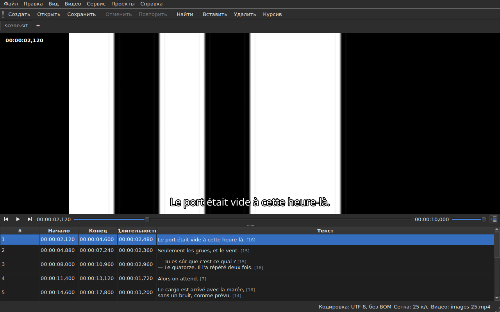

# Проигрыватель

<!-- machine-translated -->
> Эта страница переведена машинным способом и ещё не проверена носителем языка.

Связанное видео смотрят **в самом окне**, а текущая строка
рисуется поверх него. Именно это позволяет проверить на фильме результат
сдвига, преобразования или преобразования частоты кадров.

О том, как связать фильм, см. [Связанное видео](video.md); эта
страница описывает, что происходит после этого.

## Окно видео

| Ситуация | Что показывает окно |
| :-------- | :-------------------- |
| видео связано и открывается | изображение занимает верхнюю часть, таблица — нижнюю |
| видео не связано | изображения нет, таблица занимает всё окно |
| видео не открывается | изображения нет, выводится сообщение, окно остаётся работоспособным |

Разделитель между изображением и таблицей **перемещается мышью**. Высота изображения
не опускается ниже 180 пикселей. При увеличении окна выигранное место
достаётся таблице, а не изображению: при редактировании не хватает строк.

Под изображением — **полоса воспроизведения**: где находится фильм, сколько он длится,
воспроизведение и пауза, громкость. См. [Полоса воспроизведения](#полоса-воспроизведения).

## Воспроизведение и остановка

| Команда | Комбинация клавиш | Что делает |
| :------ | :------- | :----------- |
| Видео ▸ Воспроизведение / пауза | `Ctrl+P` | воспроизводит, если воспроизведение остановлено, и останавливает в противном случае |

Команда **недоступна, пока не открыто ни одно видео**. Только что
связанное видео открывается **остановленным**: открыть фильм — не значит
смотреть его.

`Ctrl+P` там, где в Gaupol просто `P`: комбинация из одной буквы на уровне
окна перехватывается раньше, чем её увидит виджет в фокусе,
так что `P` терялась бы по пути к редактору ячейки. Здесь
эта комбинация ничем не занята.

## Полоса воспроизведения

Под изображением, слева направо; три кнопки — **значки**: из темы рабочего стола, если они в ней есть, и из стиля Qt в противном случае:

| Элемент | Что делает |
| :------ | :----------- |
| две кнопки шага | перемещают фильм назад и вперёд **на один шаг в кадрах** — см. [Кадр за кадром](timing.md#кадр-за-кадром) |
| воспроизведение / пауза | воспроизводит или останавливает, как `Ctrl+P` — кнопка показывает **то, что она сделает**: треугольник, когда воспроизведение остановлено, две полоски, когда идёт; подсказка говорит об этом словами |
| позиция | `HH:MM:SS,mmm`, записанная так, как таблица записывает позицию, — **в виде номера кадра**, когда отмечен пункт [`Вид ▸ Позиции в кадрах`](table.md#позиции-в-кадрах) |
| ползунок | **показывает и перемещает**: его можно перетаскивать, щёлкать по желобу, управлять стрелками |
| длительность | та, что объявляет видео, записанная как позиция |
| громкость | от 0 до 100, см. [Громкость](#громкость) |
| следование таблицы | нажата, пока таблица следует за воспроизведением, а при нажатии возвращает её к воспроизводимой строке — см. [Таблица следует за воспроизведением](#таблица-следует-за-воспроизведением) |

**Ползунок не передаёт значение на каждом пикселе.** Перетаскивание запрашивает десятки
позиций в секунду, и каждая стоит декодированного кадра: первая позиция уходит сразу,
следующие ждут двадцатую долю секунды, а **последняя запрошенная позиция
всегда достигается** — самое позднее при отпускании ползунка. Изображение поэтому не
отстаёт от руки и не начинает рисовать путь, на который никто не смотрит.

**Во время воспроизведения ползунок перемещается сам**, и это не считается действием:
фильм перемещает только то, что делаете вы. Пока вы держите ползунок, воспроизведение его не забирает.

## Тайм-код

**Позиция записана на изображении** в левом верхнем углу, на полупрозрачном фоне, благодаря которому её
видно на любой сцене. Её рисует окно своим шрифтом, и она не требует
от проигрывателя ничего, кроме позиции, которую он и так даёт; она обновляется при каждом действии,
не дожидаясь очередного опроса.

## Перемещение по фильму

В меню **Видео** находятся **действия Gaupol** под его названиями. Все они **недоступны без видео**, как и
воспроизведение; три действия, работающие с выделением, недоступны также, пока ничего не выделено.

| Команда | Комбинация клавиш | Что делает |
| :------ | :------- | :----------- |
| Видео ▸ Воспроизвести выделенное | `Ctrl+Shift+P` | воспроизводит с момента **чуть раньше начала** выделения **до конца его последнего субтитра** и останавливается на изображении |
| Видео ▸ К предыдущему | `Ctrl+Left` | ставит воспроизведение на начало последнего субтитра, **закончившегося** до этой позиции |
| Видео ▸ К следующему | `Ctrl+Right` | ставит воспроизведение на начало первого субтитра, который **начинается** после этой позиции |
| Видео ▸ Перемотать назад | `Ctrl+Shift+Left` | возвращается на один скачок — по умолчанию тридцать секунд |
| Видео ▸ Перемотать вперёд | `Ctrl+Shift+Right` | переходит вперёд на один скачок |
| Видео ▸ К началу выделения | `Ctrl+Up` | ставит воспроизведение на начало выделения, **с упреждением перед ним** |
| Видео ▸ К концу выделения | `Ctrl+Down` | ставит воспроизведение на конец выделения, **с упреждением перед ним** |

**Комбинации клавиш — те же, что в Gaupol**, кроме одной: `Play Selection` там — `O`, а
отдельную букву окно перехватывает раньше, чем её увидит редактируемая ячейка, — ввод
буквы `o` в тексте запускал бы фильм. `Ctrl+P` — ответ для воспроизведения, `Ctrl+Shift+P` — для
выделения. Стрелки на клавиатуре остаются за редактором ячейки, когда он
открыт: `Ctrl+Left` перемещает там курсор на одно слово, а не воспроизведение.

- **Скачок** — 30 секунд, его можно настроить от 1 секунды до одного часа — см.
  [Параметры](preferences.md#проигрыватель). Он не выходит ни за начало фильма, ни за его конец.
- **Упреждение** — одна секунда: смотрят чуть-чуть **до** субтитра, чтобы увидеть его приближение.
  Его можно настроить от 0 до 60 секунд, и воспроизведение не опускается ниже нуля.
- **Несуществующий сосед** — ничего перед первым субтитром, ничего после последнего —
  не вызывает действия и ничего не сообщает: воспроизведение остаётся на месте.
- **Каждое действие видно сразу**: полоса, тайм-код и нарисованная строка
  обновлены к его завершению, не дожидаясь очередного опроса.

## Громкость

Это громкость **проигрывателя**, от 0 до 100, а не системная. Её задают ползунком
полосы или двумя действиями в подменю `Видео ▸ Аудио` шагами по пять:

| Команда | Комбинация клавиш | Что делает |
| :------ | :------- | :----------- |
| Видео ▸ Аудио ▸ Уменьшить громкость | `Ctrl+-` | уменьшает громкость на пять |
| Видео ▸ Аудио ▸ Увеличить громкость | `Ctrl++` или `Ctrl+=` | увеличивает её на пять — вторая комбинация для клавиатур, где плюс требует клавиши Shift |

**Она запоминается от сеанса к сеансу** и передаётся каждому открываемому видео. Значение вне
диапазона от 0 до 100 в файле настроек не нарушает открытие: оно игнорируется, и окно сообщает об этом.
**Звуковая дорожка, напротив, не запоминается**: номер дорожки относится к её файлу; см.
[Звуковая дорожка](video.md#звуковая-дорожка).

## Выделение и воспроизведение

Оба действуют в обе стороны.

| Что вы делаете | Что происходит |
| :---------- | :----------- |
| выделяете строку | воспроизведение переходит **к началу этого субтитра** |
| расширяете выделение вниз | больше ничего: учитывается первая строка выделения |
| воспроизведение идёт дальше | **текущая строка** следует за субтитром на экране, **подкрашенная**, а таблица **центрирует** её — см. [Таблица следует за воспроизведением](#таблица-следует-за-воспроизведением) |

Текущая строка и выделение — две разные вещи. Воспроизведение
перемещает первую и **никогда не трогает второе**: выделение — это то, к чему
применяется операция, и фильму, идущему в углу, незачем
переписывать строку, выбранную пользователем, строка за строкой.

Подкраска подчиняется тому же правилу: это пометка, а не выделение. **Аномалия
главнее неё** — строка, у которой есть и то и другое, сохраняет цвет
своего дефекта: дефект существует, чтобы его исправили, а показываемая строка показывается лишь
на время одной реплики диалога. См. [Таблица](table.md).

### Таблица следует за воспроизведением

**Таблица центрирует воспроизводимую строку** — посередине того, что она показывает, а не у края, где хватило бы
сделать её видимой. Она делает это **при смене строки**, а не при каждом такте отслеживания: реплика диалога длится
секунды, и центрирование каждую десятую долю секунды было бы прокруткой без всякой пользы.

**Ручная прокрутка приостанавливает следование.** Колесо, полоса прокрутки и щелчок в таблице
приостанавливают его: таблица остаётся там, где вы её оставили, а текущая строка, нарисованная строка и полоса
продолжают следовать за фильмом. Кнопка следования — **значок строк таблицы, одна из них отмечена стрелкой**, справа на полосе
воспроизведения; её подсказка начинается словами «Следовать за воспроизведением» — **нажата, пока таблица следует**, а затем отжимается.

**Следование возобновляется по действию с проигрывателем**: запуск воспроизведения, скачок, шаг, установка метки,
вставка в позиции или перемещение полосы — тогда таблица сразу центрируется на
воспроизводимой строке, даже если это уже та же строка. **Или по требованию**: нажатие кнопки возобновляет его, а
отпускание приостанавливает. Таймера нет: следование всегда возобновляет какое-то действие.

Переход на другую вкладку возобновляет следование за фильмом этой вкладки.

**Редактирование в процессе не прерывается.** Пока открыт редактор ячейки,
текущая строка остаётся на месте; строка, нарисованная на
изображении, продолжает следовать, так как никому не мешает.

## Нарисованная линия

То, что показано на изображении, берётся из **открытого документа**, а не из файла:
**на изображении то, что вы только что набрали**, без обращения к
диску. Текст выводится по центру, внизу изображения, и исчезает между двумя
субтитрами.

**При наличии перевода строка берётся из целевого текста**: это перевод, когда
текущая ячейка находится в столбце `Translation`, и основной текст
во всех остальных случаях. Это правило всех текстовых операций — см. [Текст,
на который действуют операции](table.md#текст-на-который-действуют-операции) —
и **настройки для него нет**: переход от одного столбца к другому меняет то, что
показывает изображение, самое большее через десятую долю секунды. Без перевода или
при удалённом столбце ничего не меняется: это основной текст.

Субтитр, до которого перевод ещё не дошёл, не показывает **ничего**, пока
текущий столбец — перевод: его место не занимает основной текст.

**Теги формата понимаются, но никогда не рисуются как есть.** Модель хранит
текст в том виде, в каком его пишет файл, и именно опорное представление тегов — то же, что используется при преобразовании
форматов, — читает его, прежде чем передать изображению:

| В файле | На изображении |
| :---------- | :------------- |
| полужирный, курсив, подчёркивание | применяются: `<i>no</i>` отображается как *no*, без тегов |
| цвет | применяется |
| шрифт, размер | удаляются, текст остаётся |
| позиция, выравнивание, говорящий, всё, что не имеет экранного эквивалента | удаляется, текст остаётся |
| `{` и `}` в тексте | рисуются: «{laughs}» отображается как «{laughs}» |

Файл Advanced SSA читается так же: его `{\i1}` применяются, а его
`{\an8}` удаляется — строка остаётся внизу изображения. Каждый текст читается **в формате
своего файла**, как перевод, так и основной текст.

**Соседний файл субтитров проигрывателем не загружается**, даже если он носит имя
фильма. Это был бы редактируемый файл, и тогда изображение показывало бы состояние диска,
в то время как таблица показывает другое.

## Предварительный просмотр изменения

**Ничего особенного делать не нужно**: вы применяете операцию, смотрите
фильм и выбираете `Undo: shifting` — или соответствующую операцию, — если
результат не подходит. См. [Отмена и повтор](undo.md).

Отдельного режима предварительного просмотра нет, и это сделано намеренно: вы
смотрите документ таким, какой он есть, а не невидимое промежуточное состояние.

## Когда изображение не появляется

Возможны два сообщения, оба начинаются с пути к файлу:

| Сообщение | Что произошло |
| :------ | :------------ |
| `<file>: <reason>` | проигрыватель отказался от файла — неизвестный формат, отсутствующий файл, каталог |
| `<file>: no video player is available` | не удалось создать ни одного проигрывателя |

В обоих случаях **видео остаётся связанным** — нужно ведь видеть, какой
это файл, чтобы выбрать другой — и **окно остаётся работоспособным**:
документ открыт, операции работают, сохранение тоже.

**Изображение рисуется в самом окне**: `libmpv` заполняет буфер размером
с окно просмотра, в реальных пикселях, а окно его отображает. Ничто в этом не зависит от
графической платформы — одно и то же изображение под X11, под Wayland и без дисплея, — и оно
следует за изменением размера: соотношение сторон фильма сохраняется, остальная часть
окна просмотра чёрная.

Второе сообщение поэтому появляется только если библиотека `libmpv` отказывается запускаться,
хотя она обязательна при сборке.

Отрисовка идёт через процессор, но **декодирование может выполняться на видеокарте**: она
декодирует, изображение копируется обратно в память, а затем рисуется, как прежде. Машина без
пригодной карты декодирует на процессоре, без сообщения. На фильме 1080p в H.264 воспроизведение идёт
в реальном времени с запасом. **Фильм 4K в тяжёлом HEVC может не справиться**: на двух
ядрах без карты он декодируется на уровне 0,6 реального времени, и шаг на один кадр там занимает несколько
секунд, когда ключевой кадр далеко. Карта сокращает это время — на треть или на две трети в зависимости от фильма, —
не устраняя его. **Она не меняет отображаемое изображение**: шаг или перемотка приходят на
тот же кадр с картой и без неё. Чтобы отключить её, снимите флажок `Decode on the graphics card` в
[`Preferences…`](preferences.md#проигрыватель).

## Чего здесь нет

**Установка метки, покадровый шаг и сдвиг границы на один кадр** описаны в
разделе [Тайминг по видео](timing.md), а не здесь. Чего не существует и что бессмысленно искать:

- формы волны;
- автоматического воспроизведения при открытии фильма;
- стиля нарисованной строки (шрифт, цвет, позиция, фон): она сохраняет стиль окна;
- аппаратного декодирования без копирования: см. «Когда изображение не появляется» выше.

Это руководство описывает то, что существует; что появится и в каком порядке, изложено в
[дорожной карте](../../../../feuille-de-route.md).
