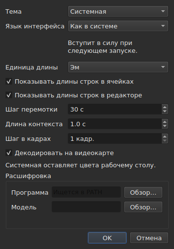

# Параметры

<!-- machine-translated -->
> Эта страница переведена машинным способом и ещё не проверена носителем языка.

Окно запоминает то, что вы задаёте мышью, — **где оно находилось**, **было ли оно
развёрнуто**, **ширину его столбцов**, **положение
границы** между фильмом и таблицей — а также **где вы работаете**, чтобы
`Open…` открывался в нужном месте. Ничто из этого не задаётся через диалог:
вы перемещаете, перетаскиваете, и это запоминается.

**У шести параметров есть собственный диалог**, `Правка ▸ Настройки…`, и в этом
критерий: параметру, для которого уже есть жест, поле не нужно. У
темы его нет, как и у единицы длины строк, и у двух флажков, которые
их показывают, и у скачка и упреждения проигрывателя. См. [Тема](#тема),
[Длины строк](#длины-строк) и [Проигрыватель](#проигрыватель).

**Язык интерфейса находится в том же диалоге, и он единственный, который ждёт**: он применяется при
следующем запуске, а не сразу. См. [Язык интерфейса](#язык-интерфейса).

**У громкости его нет**: её задают полоса под изображением и два жеста, и она запоминается.

**Другой параметр задаётся там, где используется**: сторона, на которую `Insert Subtitles…` помещает
свои строки, — поле этого диалога, и последний выбор запоминается. См.
[Вставка, удаление, объединение, разделение и сортировка субтитров, устранение их перекрытий](lines.md#сторона-запоминается).

**То же с двумя параметрами поиска**: `Regular expression` и
`Ignore case` остаются отмеченными или нет от одного открытия диалога к
другому и от одного сеанса к другому. См.
[Поиск и замена](find-and-replace.md#два-параметра).

**То же с настройками `Adjust Durations…`**: скоростью чтения, двумя её
направлениями и тремя длительностями с их флажками — каждая сохраняет своё значение, отмеченное
или нет. См. [`Adjust Durations…`](operations.md#adjust-durations).

**И последняя кодировка, выбранная в `Save As…`**, с меткой порядка
байтов. См. [Файл](#файл).

**И то, что задают мастер `Correct Texts…` и `Spell-Check Settings…`**:
отмеченные задачи и их код, флажки шаблонов, настройки разбиения на строки, язык,
область проверки и подчёркивание при вводе. См. [Исправить текст…](correct-texts.md) и
[Проверка орфографии…](check-spelling.md#настройки-проверки-орфографии). **Область и
документ в `Correct Texts…` не запоминаются.**

**Что не запоминается:** последний открытый файл — см.
[Запомненный каталог](#запомненный-каталог).

## Проигрыватель

Четыре поля. **Seek length** и **Context length** взяты из Gaupol и имеют его значения; **Frame step** и **Decode on the graphics card** — собственные поля subedit:

| Поле | Что задаёт | По умолчанию | Границы |
| :---- | :----------- | ------: | :----- |
| `Seek length` | скачок `Seek Backward` и `Seek Forward` | 30 с | от 1 с до одного часа |
| `Context length` | упреждение перед выделением для `Seek Selection Start`, `Seek Selection End` и `Play Selection` | 1 с | от 0 до 60 с, с точностью до десятой |
| `Frame step` | шаг **в кадрах** для `Step Backward` и `Step Forward` и для сдвига границы | 1 кадр | от 1 до 1000 кадров |
| `Decode on the graphics card` | позволяет видеокарте декодировать фильм, если она есть на машине; без карты ничего не меняется | отмечен | отмечен или нет |

Они применяются **сразу**, без ожидания перезапуска, и запоминаются от одного сеанса к другому
под ключами `video.seek-length` (в секундах), `video.context-length-ms` (в миллисекундах), `video.step-frames` (в кадрах) и `video.hardware-decoding` (`true` или `false`).
**Значение вне границ или не являющееся числом** не мешает окну открыться: оно
игнорируется, остаётся значение по умолчанию, и окно сообщает об этом при открытии. **Шаг в кадрах никогда не задаётся в миллисекундах**: шаг в N кадров — всегда N кадров, какой бы ни была частота кадров фильма — см. [Тайминг по видео](timing.md#кадр-за-кадром). Громкость запоминается в `video.volume`,
от 0 до 100, с тем же допуском.

## Файл

```
~/.config/subedit/settings.conf
```

Точнее, `$XDG_CONFIG_HOME/subedit/settings.conf`, когда эта переменная
задана. Он записывается **при закрытии окна** и читается при его открытии.
Прерванная программа — убитая или остановленная сбоем — ничего не записывает, и
следующий сеанс находит то, что оставил предыдущий.

Файл текстовый, и его можно править вручную. Это свойство, а не
побочный эффект: благодаря ему настройку можно исправить, когда интерфейс,
который её задаёт, как раз и сломан.

### Два блока, один из них общий с командной строкой

Файл записывается в **два блока**, каждый под комментарием-заголовком:

| Блок | Ключи | Кто читает |
| :---- | :--- | :------ |
| `# Operation settings: shared by the window and the command line` | ключи `duration-adjust.*` и `correction.*` | окно **и** `subedit-cli` |
| `# Display preferences: the window's own` | все остальные ключи — геометрия, столбцы, тема, язык интерфейса, поиск, проверка орфографии, редактор, видео, последний каталог, кодировка записи | только окно |

**`subedit-cli` по умолчанию читает блок операций**: то, что `Adjust Durations…` и
`Correct Texts…` запоминают здесь, служит отправной точкой и для [`subedit-cli adjust`](../subedit-cli/adjust.md)
и для части [`subedit-cli correct`](../subedit-cli/correct.md), если только параметр
командной строки не говорит иное. **Параметры отображения он не читает никогда.** Его команда
[`config`](../subedit-cli/config.md) перечисляет ключи операций, показывает их значения и
меняет их — `subedit-cli config set duration-adjust.speed 12` — и окно видит изменение
при следующем открытии. **Изменение, сделанное при открытом окне, не переживёт его закрытия**: окно
переписывает весь файл тем, что держит. `--no-config` заставляет командную строку игнорировать
файл. См.
[Файл настроек](../subedit-cli/invocation.md#файл-настроек).

Читатель принимает ключи в любом порядке, с заголовками или без них: файл, записанный до появления
двух блоков, читается без изменений и переписывается в двух блоках при следующем закрытии.

| Параметр | Что содержит | По умолчанию |
| :----- | :------------ | :------ |
| `window.geometry` | `x,y,width,height` в пикселях; ширина и высота ненулевые | окно выбирает размер само |
| `window.maximised` | `true` или `false` | `false` |
| `table.columns` | четыре ширины в пикселях через запятую — `#`, `Start`, `End`, `Duration`, даже у скрытых | таблица выбирает размер сама |
| `table.order` | шесть столбцов, **каждый по одному разу**, в том порядке, в каком их показывает таблица: `number`, `start`, `end`, `duration`, `text`, `translation` | `number,start,end,duration,text,translation` |
| `table.hidden` | убранные столбцы из числа `number`, `start`, `end` и `duration`; пусто — никаких | нет |
| `window.table-share` | доля высоты, отданная таблице, в процентах, от 1 до 99 | окно делит высоту так, как делило всегда |
| `file.directory` | **абсолютный** путь к каталогу | нет: `Open…` открывается там, где была запущена программа |
| `general.theme` | `system`, `light` или `dark` | `system` |
| `interface.language` | `system` или название языка так, как назван его каталог: две или три строчные буквы, затем необязательно `_` и две заглавные — `fr`, `pt_BR`; `en` для английского | `system` |
| `edit.insert-placement` | `above` или `below` | `below` |
| `file.write-encoding` | название кодировки, которую ICU умеет записывать и преобразователь которой не пишет собственную метку | нет |
| `file.write-bom` | `true` или `false` | `false` |
| `search.regex` | `true` или `false` — шаблон является регулярным выражением | `false` |
| `search.ignore-case` | `true` или `false` — регистр игнорируется | `true` |
| `duration-adjust.speed` | скорость чтения в символах в секунду, строго положительная; десятичное число записывается как можно короче (`15`, `12.5`) | `15` |
| `duration-adjust.lengthen` | `true` или `false` — удлинять то, что слишком коротко, чтобы его прочесть | `true` |
| `duration-adjust.shorten` | `true` или `false` — укорачивать то, что остаётся на экране дольше нужного | `false` |
| `duration-adjust.minimum-enabled` | `true` или `false` — минимальная длительность запрошена | `true` |
| `duration-adjust.minimum-ms` | минимальная длительность в миллисекундах, целая и неотрицательная | `1500` |
| `duration-adjust.maximum-enabled` | `true` или `false` — максимальная длительность запрошена | `false` |
| `duration-adjust.maximum-ms` | максимальная длительность в миллисекундах, целая и неотрицательная | `6000` |
| `duration-adjust.gap-enabled` | `true` или `false` — промежуток до следующего субтитра запрошен | `true` |
| `duration-adjust.gap-ms` | промежуток в миллисекундах, целый и неотрицательный | `0` |
| `correction.mentions.enabled`, `correction.common-errors.enabled`, `correction.capitalization.enabled`, `correction.line-break.enabled` | `true` или `false` — задача отмечена на первой странице `Correct Texts…` | `false`, `true`, `true`, `false` |
| `correction.mentions.code`, `correction.common-errors.code`, `correction.capitalization.code`, `correction.line-break.code` | код шаблонов задачи: `Zyyy` или `Script[-language[-COUNTRY]]` — `Latn-en-US`; не пустой | `Zyyy` |
| `correction.human`, `correction.ocr` | `true` или `false` — классы частых ошибок | `true`, `true` |
| `correction.sound-in-brackets`, `correction.sound-in-parentheses` | `true` или `false` — два флажка страницы `Mentions` | `false`, `false` |
| `correction.line-break.max-length` | максимальная длина строки, десятичная; диалог ограничивает её от 1 до 1000 | `24` |
| `correction.line-break.max-lines` | максимальное число строк, целое; диалог ограничивает его от 1 до 100 | `3` |
| `correction.line-break.in-ems` | `true`: длина измеряется в *эмах*; `false`: в символах | `true` |
| `correction.line-break.skip-on-length`, `correction.line-break.skip-on-lines` | `true` или `false` — оба условия пропуска запрошены | `true`, `true` |
| `correction.line-break.skip-max-length`, `correction.line-break.skip-max-lines` | два порога пропуска в выбранной единице | `24`, `3` |
| `correction.join-split.enabled` | `true` или `false` — задача `Join or Split Words` отмечена | `false` |
| `correction.join-split.join`, `correction.join-split.split` | `true` или `false` — объединять, разделять | `true`, `false` |
| `correction.join-split.language` | код локали — `fr`, `en_US`, `sr@Latn` —; пусто: язык системы | пусто |
| `correction.remove-blank` | `true` или `false` — `Remove all blank subtitles` | `true` |
| `transcription.engine` | название движка: строчные буквы, цифры, `.`, `-` и `_` | `whisper.cpp` |
| `transcription.executable`, `transcription.model` | абсолютный путь; пусто: движок ищется в `PATH`, а модель не задана | пусто |
| `transcription.language` | две строчные буквы, код ISO 639-1; пусто: язык определяется автоматически | пусто |
| `transcription.merge-gap-ms` | части одного предложения, расстояние между которыми меньше этого значения, объединяются; в миллисекундах, целое неотрицательное число | `400` |
| `transcription.max-duration-ms` | наибольшая длительность показа расшифрованного субтитра на экране, в миллисекундах, от 1 до 3600000 | `7000` |
| `transcription.max-characters` | наибольшее число символов в расшифрованном субтитре, от 1 до 1000 | `84` |
| `correction.activations` | флажки шаблонов, которые изменил пользователь, `<type>:<code>:<name>:<0\|1>`, через запятую; **запятая или обратная косая черта в названии записывается с обратной косой чертой перед ней** (`\,` и `\\`), а нечитаемая запись теряет только свою настройку — о ней сообщается, остальные сохраняются | пусто |
| `spell-check.language` | код локали, например `fr_FR`; пусто: язык системы | пусто |
| `spell-check.target` | `selection`, `current-project` или `all-projects` | `current-project` |
| `spell-check.document` | `main` или `translation` | `main` |
| `spell-check.inline` | `true` или `false` — подчёркивать неизвестные слова при вводе в редакторе ячейки | `false` |
| `editor.length-unit` | `em` или `characters` — единица длин строк, показываемых таблицей и редактором | `em` |
| `editor.show-lengths-cell` | `true` или `false` — за каждой строкой текстовой ячейки следует её длина | `true` |
| `editor.show-lengths-edit` | `true` или `false` — редактор ячейки показывает длину каждой строки на поле | `true` |

**Файл принимает больше, чем диалог.** Читатель принимает любую строго
положительную скорость и любую неотрицательную длительность; диалог `Adjust
Durations…`, со своей стороны, ограничивает скорость от 1 до 99 символов в секунду, а каждую
длительность — от 0 до 99 с. Значение из файла за этими границами возвращается к
границе при открытии диалога, и файл хранит его таким, когда
диалог принят, а окно закрыто. Отменённый диалог не меняет ничего в том, что
запоминается.

**`file.write-encoding` запоминает последнюю кодировку, выбранную в `Save As…`, и
никогда не навязывается файлу.** У открытого документа своя кодировка,
и именно её предлагает окно: переписывать его в другой потому, что
настройка трёхнедельной давности так говорит, значило бы потерять то, что сохранило чтение.
То, что запоминает эта настройка, служит документу, у которого нет файла, — только что
созданному.

**Это намеренное «нет», а не недосмотр.** Тот, кто всегда сдаёт работу в
одной кодировке, а унаследованные файлы открывает в другой, выбирает её заново для
каждого файла; окно предлагает её ему, а гарантия двойного преобразования туда и обратно действует
для всех.

**`file.write-bom` несёт метку той же кодировки**, и две
строки действительно нужны: название кодировки не говорит, предшествует ли ей метка, так же
как `--encoding` не говорит того, что говорит `--bom`. Обе читаются вместе, в
любом порядке, а `file.write-bom` без запомненной кодировки ничего не задаёт.

**Доля, а не высоты для границы**, и именно это делает её
полезной: три высоты в пикселях ничего не значат, как только окно
открывается в другом размере, а окно часто открывается в другом размере.
Доля воспроизводится где угодно. Она **приводится к тому, что окно принимает**, если
слишком мала — у полосы фильма есть минимальная высота.

**Четыре ширины на шесть столбцов**, и это не недосмотр: это ширины
`#`, `Start`, `End` и `Duration` в этом порядке, каким бы ни был порядок
таблицы, и **скрытый столбец сохраняет свою** — он находит её снова, когда
показывается вновь. Последний показанный столбец берёт то, что оставляют остальные, и задавать
ему ширину было бы бессмысленно; ширины текста и перевода поэтому
не запоминаются.

## Что происходит, когда файл говорит не то, что ожидается

Конфигурация — это удобство. **Её сбой стоит удобства и ничего
больше**: окно открывается в любом случае.

| Случай | Что происходит |
| :--- | :----------- |
| файла нет | все значения по умолчанию, и ничего не сообщается — это первый запуск |
| файл есть, но его нельзя прочитать | все значения по умолчанию, а причина записывается в поток ошибок |
| параметр отсутствует | его значение по умолчанию |
| ключ неизвестен | игнорируется без единого слова и отсутствует в переписанном файле |
| значение нельзя прочитать | сохраняется его значение по умолчанию, а параметр называется в потоке ошибок |

```console
$ subedit-gui film.srt
subedit-gui: /home/vous/.config/subedit/settings.conf: window.geometry: "plus tard" cannot be read, keeping the default
```

**Сообщение идёт в поток ошибок и больше никуда.** Модальное
окно при запуске из-за нечитаемого параметра остановило бы пользователя из-за
неисправности, которая ему ничему не мешает, и до того, как он о чём-либо попросил.

## Закомментированные параметры

Переписанный файл содержит **все** известные параметры, а оставленные
по умолчанию записываются как комментарии:

```
#window.geometry = 0,0,1280,800
#window.maximised = false
#table.columns = 60,110,110,110
#table.order = number,start,end,duration,text,translation
#table.hidden = start,end
```

Это не причуда. Без этого параметр, которого никогда не касались, оставался бы
замороженным на значении того дня, когда он был записан, и **улучшенное значение по умолчанию
никогда ни до кого не дошло бы**. С этим изменение значения по умолчанию меняет
поведение всех, кто его не переопределил, — что и должно делать значение по
умолчанию.

Чтобы переопределить параметр: уберите `#` и измените значение. Чтобы вернуться
к значению по умолчанию: удалите строку или закомментируйте её снова.

Геометрия, ширины и убранные столбцы показывают **форму**, а не
действующее значение: значения по умолчанию у геометрии и у ширин —
«то, что выберет окно», а оно не записывается числами, и у
`table.hidden` оно — «никаких», что прочитать нельзя. Заголовок файла говорит об этом
тоже. `table.order`, со своей стороны, показывает порядок по умолчанию.

## Запомненный каталог

`Open…` открывается в каталоге **последнего открытого или сохранённого файла**,
а не того окна, которое вы отменили: важно, где вы
работаете, а не где вы смотрели.

**Сам последний файл не запоминается.** Запомнить его значило бы
открывать при запуске документ, о котором никто не просил. Запоминание каталога
*указывает* диалогу, запоминание файла открыло бы его.

## Тема

`Правка ▸ Настройки…` открывается с темы — параметра без жеста — над
[длинами строк](#длины-строк).

| Значение | Что делает |
| :---- | :----------- |
| `System` | **ничего** — цвета остаются цветами рабочей среды |
| `Light` | устанавливает светлую палитру |
| `Dark` | устанавливает тёмную палитру |

Выбранная тема применяется **немедленно**, без перезапуска.

**«System» ничего не делает, и это не недостаток.** В версии Qt, на
которой собран subedit, нет способа спросить у рабочей среды, хочет ли она быть
светлой или тёмной, и получать уведомление, когда она передумает. Вместо того чтобы
выдумывать чтение, которое мы не умеем делать, программа поставляет две темы,
которые можно запросить, и оставляет решение для третьей инструментарию —
как делает Gaupol в тех же условиях.

В рабочей среде, где тема уже тёмная, `System` поэтому даёт тёмное
окно; в светлой — светлое. `Light` и `Dark` переопределяют
её, какой бы ни была среда.

**Подкраска аномалий остаётся читаемой в обеих палитрах** — см.
[Таблица](table.md#аномалии). Это не предположение: контрастность
текста на каждой из подкрасок проверяется тестом на обоих фонах.

## Расшифровка

Группа **`Transcription`** диалога содержит два сведения о машине, которые нужны команде
[`Transcribe Audio…`](video.md#расшифровка-звука): **программа** движка (whisper.cpp,
`whisper-cli`) и **модель**, которую он читает. У каждого есть кнопка `Browse…`. Если оставить программу пустой, она
ищется в `PATH`; у модели значения по умолчанию нет.

Под полями **диалог сообщает, что есть**: найден ли движок и где, найден ли `ffmpeg`,
и модель — не задана, не найдена, не является моделью, только для английского или многоязычная. Если чего-то
не хватает, он добавляет ссылку на страницу
[Установка инструментов расшифровки](../subedit-cli/install-transcription.md), где сказано, где
что найти. Эти два поля — настройки `transcription.executable` и `transcription.model`.

## Язык интерфейса

`Правка ▸ Настройки…` выбирает язык окна под темой.

| Поле | Значения | По умолчанию |
| :---- | :----- | :------ |
| `Interface language` | `System default`; `English`; затем каждый язык, установленный вместе с программой, под его собственным названием — `Français` | `System default` |

**Он вступает в силу при следующем запуске**, и диалог говорит об этом под полем: окно
переводится в момент построения, а работающее окно сохраняет язык, на котором оно запущено. Выбор
хранится в файле настроек под ключом `interface.language` и читается при следующем открытии окна.

| Выбор | Окно запускается на |
| :----- | :------------------- |
| `System default` | языке окружения, как до любого выбора — `LANGUAGE`, `LC_ALL`, `LC_MESSAGES`, `LANG`; см. [Язык](invocation.md#язык) |
| `English` | английском, что бы ни говорило окружение |
| установленный язык | этом языке, **что бы ни говорило окружение**, включая `LC_ALL=C`: сделанный здесь выбор явный |

В списке — языки, каталог которых установлен в `<prefix>/share/subedit/locale`;
английский присутствует всегда, поскольку на нём написана программа. Язык показывается
под своим собственным названием, которое не переводит ни один каталог, чтобы каждый находил тот, на котором читает.

**Значение, которое программа не может выполнить, стоит только выбора:**

| Что говорит файл | Что происходит |
| :----------------- | :----------- |
| название языка, для которого не установлен каталог, — файл, принесённый с другой машины | окно следует окружению без единого слова; `Preferences…` показывает этот язык под его названием или кодом и сохраняет его, пока не выбран другой |
| нечто, не являющееся названием языка, — `French`, `fr_FR.UTF-8` | `system`, значение по умолчанию, а параметр называется в потоке ошибок, как любое нечитаемое значение |

```console
$ subedit-gui film.srt
subedit-gui: /home/vous/.config/subedit/settings.conf: interface.language: "French" cannot be read, keeping the default
```

**Командная строка его не читает никогда**: `subedit-cli` выбирает язык только из окружения,
а `subedit-cli config set interface.language fr` отклоняется как параметр отображения.

## Длины строк




`Правка ▸ Настройки…` задаёт также **то, что таблица и редактор показывают о
длине строк** — линейку и поле Gaupol.

| Поле | Что делает | По умолчанию |
| :---- | :----------- | :------ |
| `Length unit` | единица длин: `Ems` или `Characters` | `Ems` |
| `Show line lengths in cells` | за каждой строкой текстовой ячейки следует её длина | отмечен |
| `Show line lengths in the editor` | редактор ячейки показывает длину каждой строки на поле справа | отмечен |

**`Length unit` затенён, когда не отмечен ни один флажок**: когда нечего
показывать, единица ничего не задаёт. Выбор применяется **сразу** к
таблице, а редакторы, открываемые после, следуют ему. Три значения
запоминаются от одного сеанса к другому: `editor.length-unit`, `editor.show-lengths-cell`
и `editor.show-lengths-edit`, в таблице [файла](#файл). См.
[Длина строк](table.md#длина-строк) и
[в редакторе](editing.md#длина-строк).

**Это не предел мастера.** Единица `Correct Texts…` — длина,
на которой он разбивает строки, — отдельная настройка в его
мастере: в таблице можно читать эмы, а разбивать — по символам.

## Что нельзя настроить

**Девять запоминаемых настроек выбираются в диалоге** — не считая настроек
мастера исправления и проверки орфографии, у которых свои, —
и каждая в том диалоге, где используется: тема и три настройки длин строк — здесь; сторона вставки — в диалоге вставки;
два параметра поиска — в диалоге поиска; кодировка и
метка порядка байтов — в `Save As…`; скорость чтения, длительности
и промежуток подгонки длительностей — в её собственном диалоге. Других нет:
для диагностических сообщений, громкости проигрывателя и
формата сохранения по умолчанию ничего задать нельзя — последний берётся из открытого файла.

И **никакое число, относящееся к документу, не хранится от одного сеанса к
другому**: величина сдвига, два маркера преобразования верны для одного
файла и неверны для следующего. Диалоги запрашивают их заново при каждом запуске,
намеренно. Настройки `Adjust Durations…` — исключение, как и
два параметра поиска: скорость чтения, минимальная длительность или
промежуток — это выбор метода, а не измерения файла, и
по этой причине они сохраняются от одного сеанса к другому.

Это руководство описывает то, что существует: дальнейшие планы изложены в
[дорожной карте](../../../../feuille-de-route.md).
