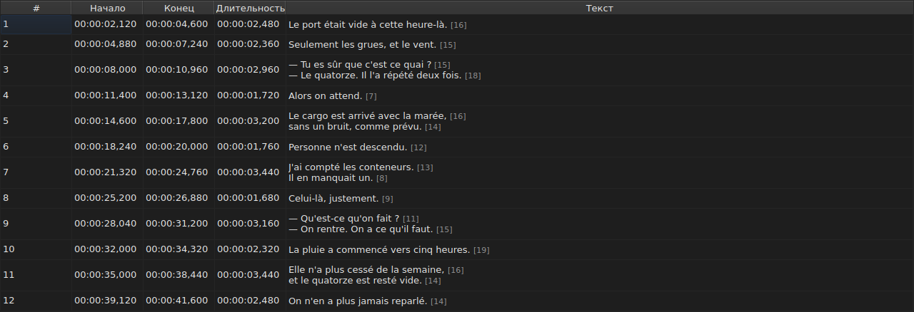
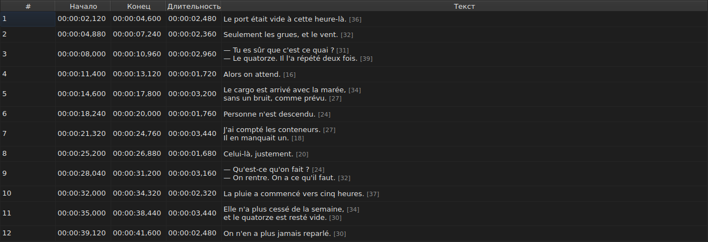
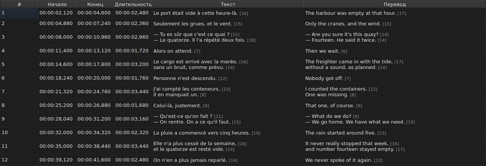
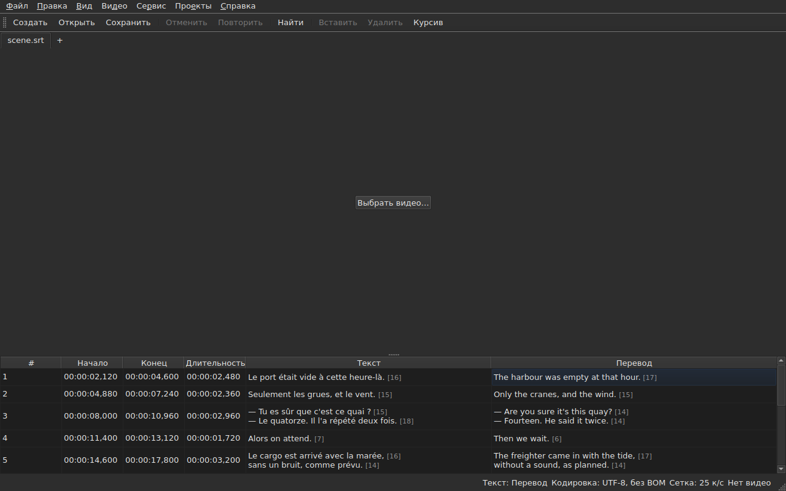

# Таблица

<!-- machine-translated -->
> Эта страница переведена машинным способом и ещё не проверена носителем языка.

Окно показывает субтитры открытого файла, по одному в строке, в пяти
столбцах — в шести, если у проекта есть перевод.

**В этом руководстве заголовки окна приводятся так, как их показывает английское
окно**, как и в руководстве по командной строке; окно с переводом показывает их
на своём языке.

| Столбец | Что показывает |
| :----- | :------------ |
| `#` | порядковый номер субтитра, начиная с 1 |
| `Start` | позиция, в которой он появляется, `HH:MM:SS,mmm` |
| `End` | позиция, в которой он исчезает |
| `Duration` | `End − Start` |
| `Text` | текст субтитра |
| `Translation` | перевод субтитра — **отсутствует, пока у проекта его нет** |




## Длина строк




**За каждой строкой текстовой ячейки следует её длина**, `[N]`, более мелкая
и бледная, — как в столбце `Text`, так и в столбце `Translation`.
Так делает Gaupol.

| Что считается | Что делает таблица |
| :---------- | :------------------ |
| **теги** | не считаются: `<i>Bonjour</i>` даёт `[7]`, как и `Bonjour` |
| **округление** | вниз: строка в 12,9 em отображается как `[12]` |
| **пустая строка** | длины не имеет; как и пустой текст |
| **единица** | по умолчанию *em*, либо символы — `Правка ▸ Настройки…` |
| **строка, слишком длинная для столбца** | обрезается знаком `…` **перед** числом, которое остаётся видимым |

**Единица *em* — это единица Gaupol, а не типографская**: строчный алфавит
стоит 0,55 em на букву при шрифте таблицы. Длина в *em* поэтому
зависит от шрифта; длина в символах считает кодовые точки, причём
символ с диакритикой — за один.

**Таблица не отмечает слишком длинную строку.** Она показывает число, а сравнить его с
заданным вами пределом предстоит глазу — как в Gaupol. Это не
предел мастера `Correct Texts…`, у которого есть собственная настройка.

**Чтобы их не видеть**, снимите флажок `Show line lengths in cells` в
`Правка ▸ Настройки…`. См. [Длины строк](preferences.md#длины-строк).

## Скрытие и перемещение столбцов

**`Вид ▸ Столбцы`** содержит по одному отмечаемому пункту на каждый столбец, **кроме `Text`**:
без основного текста редактировать было бы нечего.

| Пункт | Столбец |
| :---- | :----- |
| `Вид ▸ Столбцы ▸ Номер` | `#` |
| `Вид ▸ Столбцы ▸ Начало` | `Start` |
| `Вид ▸ Столбцы ▸ Конец` | `End` |
| `Вид ▸ Столбцы ▸ Длительность` | `Duration` |
| `Вид ▸ Столбцы ▸ Перевод` | `Translation` — см. [Столбец перевода](#столбец-перевода) |

Снятие флажка убирает столбец, повторная отметка возвращает его с прежней
шириной. **Настройка действует на всё окно**, включая все вкладки:
таблица одна, а её проект меняется вместе с вкладкой.

**Текущая ячейка покидает убираемый столбец**: она переходит в `Text`
на той же строке, а выделение не сдвигается. Текущая ячейка в
столбце, которого никто не видит, была бы ячейкой, которую нажатие клавиши
редактировало бы вслепую.

**Столбцы перемещают перетаскиванием заголовка**, любого из них, `Text`
включая. Последний показанный столбец занимает место, которое оставляют остальные.

**Порядок и убранные столбцы запоминаются от сеанса к сеансу** вместе
с ширинами в [файле параметров](preferences.md) — `table.order`
и `table.hidden`. Столбца перевода там нет: он подчиняется своему
правилу и возвращается с каждым открытым переводом.

**Номер — не данные файла**, а порядковый номер строки. Вставка или удаление
поэтому перенумеровывает всё, что идёт дальше, ничего
не переписывая.

**Десятичный разделитель следует формату файла**: запятая для SubRip,
точка для остальных восьми. SubRip — единственный из девяти, кто пишет запятую.

**Следует разделитель, а не вся запись.** Таблица всегда пишет
часы и всегда три десятичных знака; файл WebVTT опускает
часы, когда нет часа, SubViewer 2 и два Sub Station Alpha считают в
сотых долях, MPL2 — в десятых, TMPlayer — в секундах, MicroDVD — в кадрах. Столбец,
ширина которого следовала бы за форматом, читался бы тяжелее, чем
столбец, который просто не является точной записью файла.

Таблица гарантирует поэтому **значение и разделитель**, а не число
десятичных знаков. О том, что целевой формат округлил бы, сообщается в момент
сохранения — см.
[Что формат не сохранит](files.md#что-формат-не-сохранит-сообщается-перед-записью).

**Длительность (`Duration`) вычисляется** и не хранится: её ввод сдвигает
конец. Субтитр, конец которого предшествует
началу, показывает отрицательную длительность, а не нуль: это аномалия
файла, и скрыть её значило бы лишить возможности её найти.

**Начало, конец, длительность, текст и перевод редактируются на месте**;
номер — нет. См. [Редактирование ячейки](editing.md).

**Выделение указывает, на что действует операция** — см.
[Операции](operations.md).

**Высота строки следует за субтитром, который она несёт**: субтитр из
двух строк занимает две, из трёх — три. Текст показывается
целиком, в том виде, в каком будет записан.

**Обрезанной остаётся строка, слишком длинная для своего столбца**, и тогда она
заканчивается многоточием. Расширение столбца `Text` или окна показывает её
целиком; то же делает открытие ячейки. Строки текста никогда
не переносятся: строку образует только настоящий перевод строки, чтобы высота
строки таблицы не менялась при перетаскивании границы столбца.

## Позиции в кадрах

**`Вид ▸ Позиции в кадрах`** — отмечаемый пункт, единая настройка окна — показывает
столбцы `Start` и `End` **как номера кадров** вместо тайм-кодов и **принимает номер кадра при вводе**. Заголовки
говорят об этом: `Start (frames)` и `End (frames)`.

| Что меняется | Что не меняется |
| :----------- | :------------------- |
| то, что `Start` и `End` пишут и принимают | столбец `Duration`, остающийся временем |
| заголовки этих двух столбцов | документ: ничего не изменяется, в истории нет новой записи, и **файл пишет то, что писал** |

**Частота кадров, по которой считаются кадры**, определяется в таком порядке:

1. **частота файла**, когда он считается в кадрах — MicroDVD, который несёт номера и не несёт
   частоты кадров: **окно тогда показывает числа его файла** независимо от видео;
2. **частота, которую объявляет связанное видео**;
3. **сетка, которую рисуют позиции**, если они её рисуют.

Подсказка пункта говорит, какая из них выбрана: «Позиции — номера кадров, счёт при 25 к/с (частота, объявленная
видео)». **Если нет ни одной из трёх, пункт недоступен, а подсказка объясняет почему**: файл
не считается в кадрах, видео не объявляет частоты кадров, а позиции не ложатся ни на какую сетку.

- **Номер — это номер кадра, в который попадает позиция**, округлённый до ближайшего кадра. **При вводе
  он даёт момент, с которого этот кадр начинается**, и округление выполняется **лишь один раз** по точному отношению
  ([ADR 0013](../../../../adr/0013-mise-a-l-echelle-exacte-des-positions.md)): кадр 37 при 23,976 кадра в секунду
  начинается в момент 1543,04 мс, то есть `00:00:01,543`.
- **Принимаются только целые числа** — со знаком «минус», поскольку начало может предшествовать фильму. Тайм-код,
  введённый в режиме кадров, или число, не являющееся числом, оставляет ячейку как была.
- **Полоса воспроизведения следует той же настройке**: позиция и длительность по обе стороны от ползунка
  записываются как номера кадров, подобно `Start` и `End`, в тот же момент — см.
  [Полоса воспроизведения](player.md#полоса-воспроизведения). Часы, нарисованные вверху изображения, остаются
  тайм-кодом.
- **Эта настройка не запоминается** от сеанса к сеансу: это настройка окна, а не
  документа, и снова включить её можно одним действием.

## Аномалии

Субтитр, позиции которого не согласуются друг с другом, **подкрашивается в
столбцах времени**, а при наведении сообщается, что не так.

| Оттенок | О чём сообщает | Что делать |
| :--- | :-------------- | :--------- |
| красный | `ends before it starts` | исправьте его конец или его начало |
| синий | `starts before the previous one starts` | верните его на своё место в порядке |
| янтарный | `starts before the previous one ends` | подправьте его тайминг |


Подкрашиваются только столбцы `Start`, `End` и `Duration`: аномалия
говорит только о времени, а подкраска текста наводила бы на мысль, что она имеет к нему
отношение.

**У субтитра может быть несколько аномалий**, и подсказка называет все. Оттенок —
у той, которую надо исправлять первой: субтитр, сломанный сам по себе,
сломан независимо от соседей; субтитр не на своём месте возвращают на место,
и его перекрытие уходит вместе с этим.

> Не случайно, что беспорядок почти всегда главнее
> перекрытия: начать раньше, чем начинается предыдущий, значит начать
> раньше, чем он заканчивается, — если только сам предыдущий не сломан.

**Отметка пересчитывается после каждого изменения позиции**, будь то
правка ячейки, операция или отмена. Она говорит о том, каков файл
сейчас, а не каким был при открытии.

Она не опирается ни на какую сетку кадров: как только позиция исправлена
вручную, она с неё уходит, и отметка, основанная на ней, сообщала бы о
работе пользователя.

## Столбец перевода

У субтитра **два текста и одна пара позиций**: у
перевода нет собственного тайминга, он привязан к тайм-коду субтитра.
Таблица показывает его в шестом столбце, `Translation`, справа от `Text`.




**Столбец есть, только если у проекта есть перевод.** Без него таблица
сохраняет свои пять столбцов, а окно ведёт себя так, будто перевода
не существует, — ничто не затеняется и не добавляется. `Файл ▸ Открыть перевод…` открывает
его: см. [Открытие перевода](files.md#открытие-перевода).

**Пункт меню `View` показывает или убирает его**:

| Пункт | Что делает |
| :---- | :----------- |
| `Вид ▸ Столбцы ▸ Перевод` | отмечен: столбец показан; снят: он убран |

Пункт **недоступен, если у проекта нет перевода**, — показывать
нечего — и отмечен при запуске. **Решение убрать его принадлежит
пользователю**: оно сохраняется от файла к файлу, пока пункт не отмечен
снова. Удаление столбца не удаляет перевод: он остаётся в
проекте и возвращается вместе с пунктом. Открытие файла без перевода убирает
столбец.

**В ячейки перевода вводят текст так же, как в ячейки текста** — см.
[Редактирование ячейки](editing.md).

### Текст, на который действуют операции

Когда в строке два текста, текстовые операции должны знать, какой из них
они переписывают. **Это текст столбца текущей ячейки**:
перевод, если текущая ячейка в столбце `Translation`, и основной
текст во всех остальных случаях — как в столбце времени, так и в `Text`.

| Операция | На что действует |
| :-------- | :-------------- |
| `Italic`, `Case`, `Dialogue`, `Remove Hearing-Impaired Mentions…` | текст текущего столбца |
| `Cut Texts`, `Copy Texts`, `Paste Texts` | текст текущего столбца |
| `Find and Replace…` | текст текущего столбца — см. [Поиск и замена](find-and-replace.md#в-каком-тексте) |
| операции с позициями, вставка, удаление, объединение, разделение | **оба текста**: субтитр — единое целое |

**Строка состояния сообщает об этом, когда текстов два**, слева от остальных
сведений:

```text
Text: Translation
```

или `Text: Main` для основного текста. Она молчит, когда столбец не
показан: тогда текст только один, и говорить об этом незачем.




**Строка, нарисованная на изображении, подчиняется тому же правилу**: это текст
текущего столбца. См. [Проигрыватель](player.md#нарисованная-линия).

**Ничто не затеняется.** Текстовые операции остаются доступными в любом
текущем столбце, а при отсутствии столбца перевода действуют на основной
текст, как и прежде.

## Добавление и удаление строк

`Правка ▸ Вставить субтитры…` и `Правка ▸ Удалить субтитры` добавляют и удаляют
строки, `Правка ▸ Объединить субтитры` и `Правка ▸ Разделить субтитр` объединяют и
разделяют их; таблица нумеруется заново. См.
[Вставка, удаление, объединение и разделение субтитров](lines.md).

## Чего таблица не делает

**Сортировки по столбцу не существует.** Показан порядок файла, и
он единственный, который имеет смысл для субтитров: порядковый номер строки *есть*
её место во времени.
