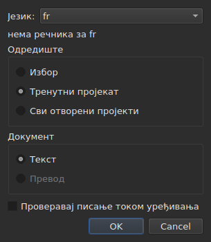
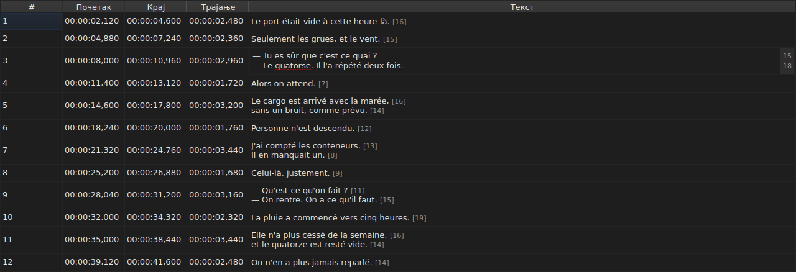
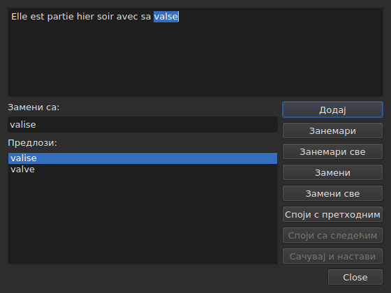

# Провера писања…

<!-- machine-translated -->
> Ова страница је машински превод који још није прегледао читалац језика.

`Алати ▸ Провера писања…` пролази кроз речи које речник не познаје,
једну по једну, по узору на проверу писања у Gaupol-у. Има пратиоца,
`Алати ▸ Поставке провере писања…`, који поставља језик, одредиште и документ, као и подвлачење током куцања.
Обоје се ослањају на системске речнике, преко Enchant-а.

У прозору на енглеском, назив прве ставке пише се `Chec&k Spelling…`: `C` је већ
тастер за приступ ставке `Correct Texts…`, а `k` је слободно у менију `Tools`.
Ниједна од две нема пречицу.

**Обе су онемогућене на документу без титлова**, као и
[`Correct Texts…`](correct-texts.md): нема шта да се проверава. `Check Spelling…`
је такође онемогућена кад за постављени језик нема речника, видети
[Без речника](#без-речника).

## Spell-Check Settings…




| Група | Избори | Подразумевано |
| :---- | :----- | :------------ |
| `Language` | кодови језика које систем нуди, и онај који је већ изабран | језик система, ако је међу њима |
| `Target` | `Selection`, `Current Project`, `All Open Projects` | `Current Project` |
| `Document` | `Text`, `Translation` | `Text` |
| `Check spelling while editing` | поље за потврду, видети [Подвлачење током куцања](#подвлачење-током-куцања) | није означено |

`Selection` је онемогућено кад у приказаном језичку није изабран ниједан ред; `Translation`
је онемогућено све док ниједан отворени пројекат нема превод. Запамћена
поставка која више није доступна — празан избор, одсутан превод —
отвара се на `Current Project` или `Text`. `OK` задржава поставке, `Cancel` не мења
ништа.

**Овај прозор не зависи од речника**: остаје омогућен све док
документ има титлове, чак и без речника за постављени језик, и он је
тај који омогућава да се напусти језик који га нема. Језик за који не постоји
речник остаје изабирљив и приказан у листи, са реченицом
`no dictionary for` испод, иза које следи његов код.

**Четири поставке се памте** од једне сесије до друге, у
датотеци поставки програма `subedit` — њена локација је у поглављу [Поставке](preferences.md):

| Кључ | Вредности | Подразумевано |
| :--- | :-------- | :------------ |
| `spell-check.language` | код језика, као `fr_FR`; празно: језик система | празно |
| `spell-check.target` | `selection`, `current-project`, `all-projects` | `current-project` |
| `spell-check.document` | `main`, `translation` | `main` |
| `spell-check.inline` | `true` или `false` — подвлачи непознате речи у уређивачу ћелије | `false` |

Вредност коју кључ не прихвата се занемарује, важи подразумевана, а опција
се именује на току грешака при отварању прозора — видети
[Поставке](preferences.md#шта-се-дешава-када-датотека-не-каже-оно-што-се-очекује).

## Подвлачење током куцања




Поље за потврду `Check spelling while editing` из `Spell-Check Settings…` подвлачи,
**црвеном таласастом линијом и током куцања**, сваку непознату реч у уређивачу
ћелије са текстом — оном из ступца `Text` као и оном из ступца
`Translation`. Подвлачење прати куцање: појављује се, помера и
нестаје са речју. **Подразумевано није означено**, као у Gaupol-у: без
њега се у уређивачу ништа не мења.

**Језик је онај из `Language:`**, у истом прозору, а непознате речи
су оне које би `Check Spelling…` нашла: исти случајеви разговорног енглеског
(`goin'`, `we'd`, `1st`), иста подела на речи. Подвучена реч се не исправља
из менија: поље за потврду је само показује.

**Без речника за постављени језик уређивач ћути**: ништа се не
подвлачи и ништа не отказује, а реченица `no dictionary for` у прозору
каже зашто. Поље за потврду важи за уређиваче отворене после њега; већ
отворен уређивач задржава оно што је имао.

## Пролаз




Прозор приказује текст титла на коме се зауставио, са непознатом речи
изабраном у њему. **На свакој непознатој речи враћа се језичак пројекта и
у табели се бира ред титла.** Пролаз иде титл
за титлом, затим пројекат за пројектом када одредиште обухвата више њих.

Испод текста: поље `Replace with:`, попуњено првим предлогом, и листа
`Suggestions:`. Избор предлога копира га у поље; куцање у
пољу обнавља листу.

| Дугме | Шта ради |
| :---- | :------- |
| `Add` | додаје реч у лични речник корисника и прелази на следећу |
| `Ignore` | пушта ову реч и прелази на следећу |
| `Ignore All` | пушта ову реч, и све њене остале појаве током овог пролаза |
| `Replace` | замењује реч садржајем поља `Replace with:`; онемогућено све док је поље празно |
| `Replace All` | ради исто за њене остале појаве; онемогућено све док је поље празно |
| `Join with Previous` | спаја реч са претходном речју; онемогућено ако је нема, или ако их не раздваја размак |
| `Join with Next` | спаја реч са речју која следи, под истим условима |
| `Save and Resume` | задржава текст онако како га носи област текста и наставља читање **овог текста од његовог почетка** |
| `Close` | затвара прозор |

**Област текста је уредива.** Чим се у њој откуца, само `Save and Resume`
остаје омогућено: остале радње делују на изабрану реч, која више није
она из текста.

**Пролаз се завршава сам** када не остане ниједна непозната реч:
дугмад се онемогућавају, текст се празни. Одредиште без иједне непознате речи
не приказује прозор.

### Затварање усред пролаза

`Close`, или крстић прозора, **примењује оно што је урађено**, као и крај
пролаза: већ завршене текстове, **и** радње — замени,
замени све, спој — већ учињене на текућем тексту. То је одступање од
Gaupol-а, који губи текући текст. Не рачуна се оно што је остало од пролаза, нити
дотеривања откуцана у области текста која `Save and Resume` није
потврдило.

**Једна ставка историје по додирнутом пројекту**, ма колико било
замена: `Undo` опозива све исправке тог пројекта одједном.
Мени је именује `Undo: correcting texts`. Статусна трака тада даје
број:

```text
Edited 2 and removed 0 subtitles
```

**Листа замена** — шта је корисник заменио и чиме —
уписује се при затварању у `spell-check/<language>.repl`, у директоријуму
подешавања програма `subedit`, а не у директоријуму Gaupol-а, који се никада не чита.
Она се тада рачуна међу предлоге провере писања, овде као и у
[`Correct Texts…`](correct-texts.md#споји-или-подели-речи--поновно-спајање-и-дељење-помоћу-провере-писања).
Ако не може да се упише, оквир са грешком то каже, `Could not save the
replacements for`, иза чега следе језик и разлог, без поништавања
исправки.

## Без речника

Када постављени језик — системски, ако ниједан није изабран — нема
речника, **`Check Spelling…` је онемогућена**, а њен облачић са саветом као и статусна
трака, при задржавању миша изнад ставке, кажу зашто:

```text
no dictionary for fr
```

`Spell-Check Settings…` остаје, да би се изабрао језик који га има. Прозор
изграђен без иједног добављача речника каже исто и не проверава
ништа.

## Поруке

| Порука | Где | Шта је изазива |
| :----- | :-- | :------------- |
| `no dictionary for fr` | облачић са саветом и статусна трака | нема речника за постављени језик |
| `Nothing to check.` | статусна трака | одредиште не обухвата ниједан текст — на пример празан избор |
| `Edited N and removed M subtitles` | статусна трака | на крају или при затварању; `M` остаје `0` |
| `Could not save the replacements for fr: …` | оквир са грешком | листа замена није уписана |

## Пример

Отворена датотека носи `Elle est partie hier soir avec sa valse`. Француски
речник је ту: `Алати ▸ Провера писања…` се зауставља на `valse`, бира
ред у табели и предлаже `valise`, већ у `Replace with:`. `Replace`
па `Close`: ред постаје `Elle est partie hier soir avec sa valise`, а
статусна трака каже:

```text
Edited 1 and removed 0 subtitles
```
