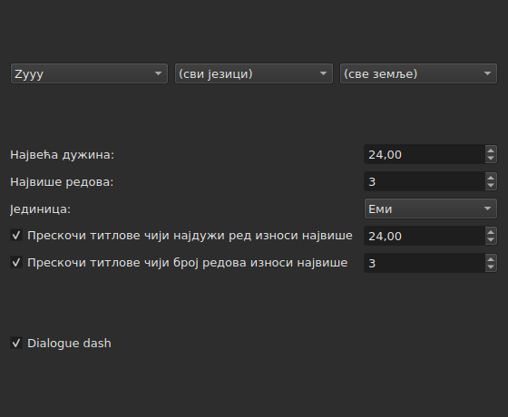
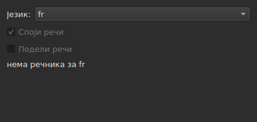
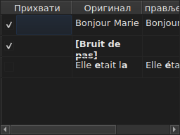

# Исправи текстове…

<!-- machine-translated -->
> Ова страница је машински превод који још није прегледао читалац језика.

`Алати ▸ Исправи текстове…` отвара асистент од више страница, по узору на
Gaupol-ов: страница са одредиштем и задацима, по једна страница за сваки означени задатак,
страница напретка и страница потврде која предлаже
измене не намећући их никада.

**Онемогућено на празном документу**: нема шта да се исправља.

**Командна линија ради исто** за све задатке: [`subedit-cli correct`](../subedit-cli/correct.md), са
истим обрасцима и истим бројевима — и у знаковима тамо где прозор мери у емовима.
**Подразумевано чита четири запамћене поставке овог асистента** — две класе
уобичајених грешака (`Human`, `OCR`), `Remove all blank subtitles` и највећи број редова
задатка `Line Break` — а све остало (задатке, њихов код, дужину реда, језик,
поља образаца) узима из свог реда. Видети
[Два блока, један дељен са командном линијом](preferences.md#два-блока-један-дељен-са-командном-линијом)
и [`subedit-cli config`](../subedit-cli/config.md).

## Задаци и одредиште — прва страница

| Група | Избори | Подразумевано |
| :---- | :----- | :------------ |
| `Target` | `Selection`, `Current Project`, `All Open Projects` | `Current Project` |
| `Document` | `Text`, `Translation` | `Text` |
| `Tasks` | `Mentions`, `Join or Split Words`, `Common Errors`, `Capitalization`, `Line Break` — за проверу, један или више | означени `Common Errors` и `Capitalization`, остала три не |

`Selection` је онемогућено када у приказаном језичку није изабран ниједан ред; `Translation`
је онемогућено све док ниједан отворени пројекат нема превод.

**Одредиште и документ се не памте**: асистент се увек поново отвара
на `Current Project` и `Text`. Означени задаци се, са своје стране, памте.

**Шта означава свако одредиште**:

| Одредиште | Делује на |
| :-------- | :-------- |
| `Selection` | изабране редове у приказаном језичку |
| `Current Project` | целу датотеку приказаног језичка |
| `All Open Projects` | целу датотеку сваког отвореног језичка |

**`All Open Projects` на `Translation` прескаче пројекте без превода**:
пројекат који га нема нема шта да предложи у празном ступцу, а
асистент га не рачуна.

**Странице задатака следе Gaupol-овим редоследом — `Mentions`,
`Join or Split Words`, `Common Errors`, `Capitalization`, `Line Break` — никада оним којим су поља
означавана.** Неозначен задатак нема страницу; његове запамћене
поставке се зато не мењају. **Ниједна страница задатка нема сопствено поље
„активно“**: оно са ове прве странице, и само оно,
одлучује да ли се задатак извршава.

## Странице задатака

Свака од четири странице са обрасцима — све осим `Join or Split Words`, која их нема — носи исту основу: три каскадна
падајућа менија — писмо, језик, земља — за избор кода образаца који се
примењују, затим листу образаца тог кода, један за потврду по имену. **Та
три менија нуде само оно што каталог образаца заиста
носи** — оне испоручене са програмом и оне које је корисник
ту ставио (видети [Одбачени обрасци](#одбачени-обрасци)) — никада листу
језика или земаља прочитану негде другде. `Zyyy` („било које писмо“) је почетни
код задатка `Common Errors`, који даје обрасце важеће свуда. **Остала
три типа имају обрасце само под писмом**: њихова страница се отвара на
првом који каталог нуди, `Latn` са испорученим обрасцима, а не на `Zyyy`.

**Опис сваког обрасца је облачић са саветом његовог поља.** Имена и описи прате
језик прозора за обрасце испоручене са програмом; корисников образац се приказује онако
како га његова датотека пише ([Језик](invocation.md#језик)).

**Неозначен образац остаје неозначен док се поново не означи**, укључујући и
промену кода и повратак на њега, а тај избор се памти од једног отварања
асистента до следећег. Поново означен, једноставно налази своју првобитну
поставку, а запамћени избор нестаје.

| Страница | Шта додаје основи |
| :------- | :---------------- |
| `Mentions` | два поља за потврду, `Sound in brackets` и `Sound in parentheses`, подразумевано неозначена |
| `Common Errors` | два поља за потврду, `Human` и `OCR`, подразумевано означена |
| `Capitalization` | ништа више |
| `Line Break` | највећа дужина (`24`, подразумевано), највећи број редова (`3`), јединица — `Characters` или `Ems`, подразумевано `Ems` — и два услова прескакања, описана испод |

**Два поља задатка `Mentions` не именују ниједан преведени образац**: она
покрећу претрагу текста у језгру, ону коју
[`Remove Hearing-Impaired Mentions…`](operations.md#remove-hearing-impaired-mentions)
већ ради непосредном радњом. Довољно је означити једно **или** друго да се покрене. **Листа образаца на страници их не понавља**: та два имена ту се појављују само једном, као поља за потврду.

**`Common Errors` филтрира по класи**: образац који носи обе класе
примењује се чим је означено једно од два поља; остале три странице не
знају за ту разлику.

### Line Break — јединица и прескакање




| Поставка | Шта ради | Подразумевано |
| :------- | :------- | :------------ |
| `Maximum length` | дужина реда, у изабраној јединици; од `1` до `1000` | `24` |
| `Maximum lines` | број редова коме се тежи; од `1` до `100` | `3` |
| `Unit` | `Characters` броји знакове; `Ems` мери ширину фонтом прозора, где просечно мало слово вреди `0.55` — Gaupol-ова јединица | `Ems` |
| `Skip subtitles with maximum line length of` | оставља какав јесте титл чији најдужи ред стаје у ову дужину, у изабраној јединици | означено, `24` |
| `Skip subtitles with maximum line amount of` | оставља какав јесте титл чији број редова стаје у овај број | означено, `3` |

**Прескакање има своје прагове**, различите од граница којима се тежи: то је
Gaupol-ово правило. Титл се оставља какав јесте ако стаје у **све
прагове чије је поље означено**; иначе се ломи, а ломљење се
задржава само ако приближава титл прагу који је премашио — краћа
дужина или мање редова. Ако није означено ниједно поље: сваки титл се ломи,
стао већ или не.

**Промена јединице мења оно што се предлаже**: дужина сваког реда се
мери при сваком израчунавању, у јединици странице у том тренутку, и ништа
не остаје од претходног мерења. Текст од двадесет девет знакова, од којих је половина
уских слова, премашује `24` у `Characters`, а у `Ems`
стаје са лакоћом.

**Свих седам поставки се памти** од једне сесије до друге, укључујући јединицу.

### Споји или подели речи — поновно спајање и дељење помоћу провере писања




Посебна страница, између `Mentions` и `Common Errors`, за поправку онога што
софтвер за препознавање текста ради размацима. Нема листу
образаца: ослања се на системске речнике, преко Enchant-а.

| Поставка | Шта ради | Подразумевано |
| :------- | :------- | :------------ |
| `Language` | језик речника; кодови које систем нуди, и онај који је већ изабран | језик система, ако је међу њима |
| `Join words` | спаја погрешно написану реч са суседном речју | означено |
| `Split words` | сече погрешно написану реч на две | неозначено |

**Спајање**: погрешно написана реч спаја се са речју пре ње или оном
после ње **ако, и само ако само један од два смера даје исправно
написану реч**. Када оба дају исправну, или ниједан, не ради се ништа.
`bon jour` постаје `bonjour`; два размака заредом се прво своде на
један, али се текст у коме ништа није спојено враћа какав је био, са
размацима.

**Дељење**: погрешно написана реч се сече ако је, међу предлозима
провере писања, **само један** та реч са размаком у њој — иста
слова, истим редом. Два таква предлога, или ниједан: не ради се
ништа. Реч чије је само почетно слово велико (`Bonjourtous`) се
никада не дели: често је име, а речници их немају.

**Корисникова листа замена** (`spell-check/<language>.repl`,
у директоријуму подешавања програма) рачуна се међу предлоге
провере писања; асистент је чита, а не пише.

**Без речника за изабрани језик, страница остаје и засивљена је**: оба
поља су онемогућена, а страница каже `no dictionary for`, иза чега следи код
језика. Језик остаје изабирљив — речник за неки други може
постојати — а задатак, означен или не на првој страници, тада не ради ништа и
не јавља грешку.

**Језик, оба поља и поље прве странице памте се** од једног
отварања асистента до следећег.

### Одбачени обрасци

Образац који је корисник одбацио у свој директоријум образаца
додаје се онима испорученим са програмом, у исти каталог и под исте
меније — ништа их не разликује када се учитају.

| Обрасци | Где |
| :------ | :-- |
| испоручени | `<prefix>/share/subedit/patterns`, поред `<prefix>/bin` |
| корисникови | `$XDG_DATA_HOME/subedit/patterns`, или `~/.local/share/subedit/patterns` ако променљива није постављена или није апсолутна путања |

**Формат је Gaupol-ов, читан какав јесте**: једна датотека `<Code>.<type>` по писму,
језику и земљи — `Latn-en.common-error` —, са својом активацијом `.conf` поред ње. Типови
су `common-error`, `capitalization`, `hearing-impaired` и `line-break`. Испоручене
датотеке служе као узор. **Обрасци се читају једном, при покретању**: датотека
одбачена док је прозор отворен види се тек при следећем покретању.

## Напредак

Када се притисне `Next` са последње означене странице задатка (или са
прве странице ако ниједан задатак није означен), асистент израчунава предложене
исправке у нити у позадини, уз неодређену траку напретка на
екрану. Када се израчунавање заврши, страница потврде се отвара сама.

**`Cancel` у овом кораку напушта израчунавање без прекидања**: ништа
се не примењује, али асистент, пре затварања, чека да се израчунавање
у току заврши — чекање ограничено временом које механизам образаца
намеће свакој претрази.

**`Back` у овом кораку враћа на претходну страницу без чекања**: израчунавање
се завршава у позадини, а његов резултат се одбацује — асистент сам не прелази
на потврду. `Next` покреће ново израчунавање.

## Потврда — последња страница




Један ред по тексту који би асистент променио — никада ред за
текст који је задатак оставио какав јесте.

| Ступац | Шта приказује |
| :----- | :------------ |
| `Accept` | поље за потврду, подразумевано означено: исправка ће бити примењена или не |
| `Original` | текст какав јесте, део који би се променио **подебљан** |
| `Corrected Text` | предложени текст, измењени део подебљан, **уредив** — дотеривање мења оно што ће бити написано, не мењајући поље `Accept` |

**Измена се обележава подебљањем, никада бојом**: иста разлика чита се
у обе палете без зависности од икакве нијансе.

**Ред чији је предлог уклањање** — титл не би имао више
текста — приказује ступац `Corrected Text` празан, а цео његов `Original`
подебљан.

| Дугме | Шта ради |
| :---- | :------- |
| `Mark All` | означава `Accept` на свим редовима |
| `Unmark All` | искључује `Accept` на свим редовима |
| `Preview` | поставља уграђени плејер на титл изабраног реда, ако пројекат има филм — ништа ако га нема |
| `Finish` | примењује означене редове и затвара асистент |

`Remove all blank subtitles`, подразумевано означено, уклања титлове
које би исправка оставила без иједног текста уместо да их задржи празне.

**Образац који израчунавање није могло да примени именује се испод табеле**, са
разлогом:

```text
Not applied: some pattern (will not compile)
```

Образац именован на овај начин именује се **једном по разлогу**, ма на колико
текстова или пројеката није успео: екран не каже на којима.

| Разлог | Шта га изазива |
| :----- | :------------- |
| `cannot be translated` | израз користи оно што превод Python синтаксе одбија |
| `will not compile` | механизам одбија израз |
| `has an invalid replacement` | замена се не чита онако како је чита Python |
| `timed out` | претрага је премашила време које јој механизам даје на једном тексту |
| `never settled` | `Repeat` је и после стотину пролаза још мењао текст |
| `grew the text too long` | текст је премашио 16.384 бајта док је образац радио на њему |

**Образац који не успе на тексту оставља га какав је био пре њега**: замена
напола урађена вреди мање од ниједне замене. Остали обрасци се примењују.

**Ред датотеке образаца који не може да се прочита именује се на истом
месту**, својом датотеком, својим редом и разлогом — при сваком отварању
асистента, пошто се обрасци читају само једном, при покретању:

```text
Could not be read: Zyyy.common-error, line 8 (malformed line)
```

| Разлог | Шта га изазива |
| :----- | :------------- |
| `directory cannot be read` | директоријум испоручених образаца није могао да се обиђе |
| `file cannot be read` | датотека образаца није могла да се прочита |
| `malformed line` | ред који није ни заглавље, ни коментар, ни `Key=Value` |
| `field outside any pattern` | `Key=Value` пре првог заглавља обрасца |
| `unknown field` | кључ који овај тип обрасца не користи — образац се задржава |
| `missing field` | кључ без кога овај тип обрасца не може ништа — образац се одбацује |
| `invalid value` | вредност коју кључ не прихвата — образац се одбацује |
| `malformed activation` | елемент `<pattern>` датотеке `.conf` који не именује ништа |

Остали обрасци, они који су прочитани и исправно примењени, нису
обухваћени.

## Шта опозив каже, и шта `Cancel` никада не ради

**`Finish` прави једну ставку историје по додирнутом пројекту**, никада по
једну за сваку исправку: `Undo` одједном опозива све исправке прихваћене на том
пројекту, свака са текстом који је имала. Мени је именује
`Undo: correcting texts`.

Статусна трака даје број, прво измењене текстове, затим
уклоњене титлове:

```text
Edited 3 and removed 1 subtitles
```

**`Cancel`, на било којој страници, не примењује ништа и не памти ништа** — ни
поставке изабране током овог отварања, ни најмању исправку.
Следеће отварање асистента почиње поново од поставки од раније.

## Пример

Отворена датотека носи два размака између две речи реда и
напомену у заградама без другог текста. `Алати ▸ Исправи текстове…`,
`Common Errors` већ означено, `Next` до потврде: ред са два размака
приказује `Bonjour  Marie` лево, `Bonjour Marie` десно, исправка
подебљана и већ прихваћена. `Finish` је примењује, а статусна трака каже:

```text
Edited 1 and removed 0 subtitles
```
