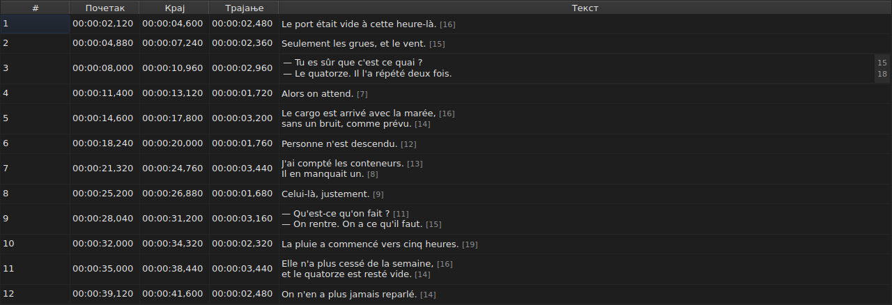

# Уређивање ћелије

<!-- machine-translated -->
> Ова страница је машински превод који још није прегледао читалац језика.

Четири ступца се уређују на месту: `Start`, `End`, `Duration` и `Text` — пет
са ступцем `Translation`, када пројекат има превод. `#` се не може
уређивати — број је ранг реда, а не податак датотеке.

**Отварање уређивача ћелије:** двоклик на њу, или избор
и притисак на `F2`.

## Текст

**Превод се уређује као текст**, истим вишередним пољем и истим
правилима; мења се само ћелија, а главни текст остаје какав
је био. Потврда која ништа не мења ништа не ради, за један као и за
други — види [испод](#потврда-која-ништа-не-мења-ништа-не-ради).

Уређивач је **вишередно** поље и отвара се висине титла:
у њему се дворедни титл куца онако како ће бити записан, са два реда
читљива и без траке за померање. `Shift+Enter` који додаје ред увећава
уређивач; ред табеле се прилагођава при потврди.

| Тастер | Дејство |
| :----- | :------ |
| `Enter` | потврђује и затвара уређивач |
| `Shift+Enter` | умеће прелом реда у текст |
| `Esc` | затвара уређивач; ћелија задржава оно што је имала |
| `Tab` | потврђује и прелази на следећу ћелију |

Потврђује и клик на друго место: губитак фокуса вреди колико и `Enter`.

**Једанаест покрета без дијалога потврђује на исти начин** пре израчунавања свог циља:
`Italic`, `Величина слова ▸ …`, `Dialogue`, `Merge Subtitles`, `Split Subtitle`,
`Cut Texts`, `Paste Texts`, `Copy Texts`, `Remove Subtitles`, `Undo` и `Redo`.
Покренути из менија, са траке са алаткама или пречицом прозора,
узимају текст онакав какав га је уређивач управо потврдио, као после клика
на друго место. `Ctrl+X`, `Ctrl+C` и `Ctrl+V` ипак остају уређивачу све док је
отворен — види [Исецање, копирање и лепљење](clipboard.md): тада мени
покреће `Cut Texts`, `Copy Texts` и `Paste Texts`.

`Undo` и `Redo` читају историју, а не документ: види
[Опозив и понављање](undo.md). Покрету који отвара дијалог није
потребно ово правило, јер дијалог узима фокус чим се отвори, што
већ потврђује унос.

### Ознаке су оне из датотеке

Приказани и укуцани текст је **онај из датотеке, са ознакама**: ознака
`<i>…</i>` формата SubRip пише се тако, а `{\i1}…{\i0}` формата Advanced SSA
такође. Ништа се не преводи за приказ — табела наредбе
[`Italic`](operations.md#italic) каже шта сваки формат пише.

За искошено писмо зато нема шта да се зна: `Ctrl+I` поставља праву ознаку
за отворени документ, а формат који је нема — TMPlayer, LRC —
искључује ставку уместо да вас пушта да је тражите. Подебљано и подвучено
куцају се, као у Gaupolу.

**А ознаке не прате операције над текстом**: стављање титла
у мала слова не претвара његово `<I>` у `<i>`, а цртица разговора се
ставља пре текста, а не пре почетне ознаке. Види
[`Case` и `Dialogue`](operations.md#case-и-dialogue).

## Дужина редова

**Уређивач текста показује, у маргини са десне стране, дужину сваког
реда**, поравнату са првим редом тог реда. Маргина је широка
колико највећи број, ажурира се **током куцања** и прати померање.
Празан текст не показује ништа. Дужине су оне из табеле — без
ознака, заокружене наниже, у подешеној јединици — а уклањају се
пољем за потврду `Show line lengths in the editor` у `Уређивање ▸ Поставке…`. Види
[Дужине редова](preferences.md#дужине-редова).

## Почетак и крај

Уређивач је једноредно поље, **ограничено на облик временске ознаке**:
током куцања одбија оно што никада не би могло бити једна.

Прихваћени облици су они које читање датотеке већ прихвата:

| Елемент | Шта пролази |
| :------ | :---------- |
| поља | `MM:SS` или `HH:MM:SS`, једна или две цифре свако |
| децимале | једна до три, после зареза или тачке, или ниједна |
| знак | водеће `-`, за положај пре почетка филма |
| границе | минути и секунде испод 60 |

`00:01:02,500`, `1:02.5` и `-0:01,000` су дакле три исправна уноса.

**Унос који читање одбија оставља ћелију непромењену.** То је случај
уноса `00:70:00,000`, чији је облик исправан, а минути ван
граница: уређивач се затвара и ништа се није померило. Ниједан положај се не измишља
— погрешан положај је тих, ништа на екрану не разликује
лоше темпиран титл од добро темпираног.

Промена почетка или краја одмах ажурира `Duration`.

## Трајање

**Куцање трајања помера крај, а никада почетак**: крај постаје
`Start + Duration`. Померање почетка померило би цео титл, што је
посао наредбе [`Shift Positions…`](operations.md), а у ступац `Start` се
већ може куцати.

Трајање се куца **у облику временске ознаке**, оном који ступац
приказује, и важе облици из претходне табеле — уз једну разлику:

| Елемент | Почетак, крај | Трајање |
| :------ | :------------ | :------ |
| облик | облик временске ознаке | исти |
| водећи знак `-` | прихваћен | **одбијен током куцања** |

`0:02.5` и `00:00:02,500` су дакле два исправна уноса трајања од две
и по секунде; `-0:01,000` се не може укуцати. Нулто трајање се прихвата:
титл тада нестаје у тренутку када се појављује.

**Крај који залази преко следећег титла је дозвољен.**
Преклапање је обојено у табели, са својом напоменом — види
[Табела](table.md#аномалије) — обавештење, а не одбијање: можда је то управо
оно што сте хтели. [Списак дијагностике](files.md#дијагностика-читања)
га такође носи, и уклања када га исправите.

**Крај укуцан иза краја филма се не јавља**, за разлику од
операције менија `Tools` која би га тамо гурнула — види
[Операције](operations.md#иза-краја-филма). Ћелија већ показује
вредност коју сте управо укуцали.

Нечитљив унос оставља ћелију непромењеном, као код положаја, а
трајање једнако приказаном не улази у историју.

## Потврда која ништа не мења ништа не ради

Отвори се ћелија, не укуца се ништа, притисне се `Enter`: ништа се не дешава.
Ниједна измена није забележена, а датотека се и даље сматра истом као
она на диску.

Поређење је по **положају**, а не по низу знакова: куцање `0:01.0`
у ћелији која приказује `00:00:01,000` означава исти тренутак, па
према томе такође ништа не мења.

## Шта бива са уређеном ћелијом

Може се **опозвати** — једна ћелија, један унос. Види
[Опозив и понављање](undo.md).

**Чува се**, а затварање прозора без чувања тражи
потврду. Види [Отварање и чување](files.md).
