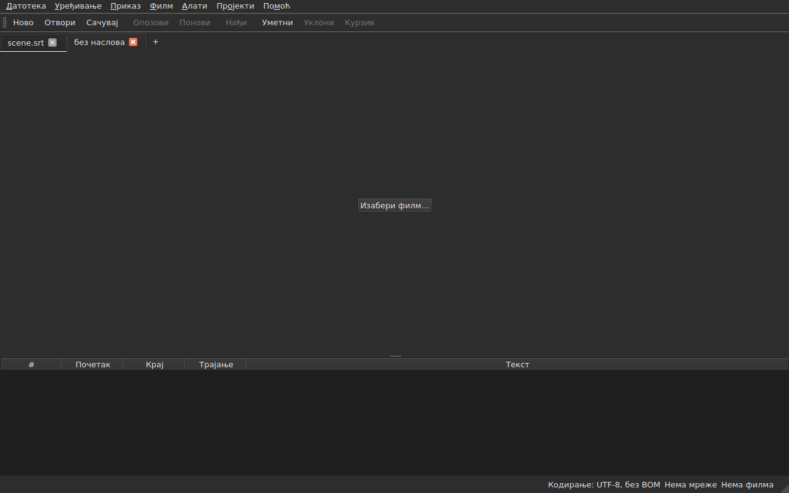
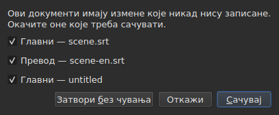
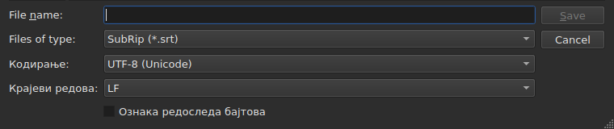
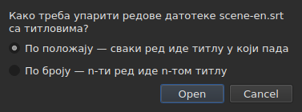
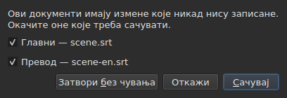

# Отварање и чување

<!-- machine-translated -->
> Ова страница је машински превод који још није прегледао читалац језика.

Мени **Датотека** садржи три команде, две за језичке и још три
за превод; мени **Пројекти** делује на све језичке одједном.

| Команда | Пречица | Шта ради |
| :------ | :------ | :------- |
| Нови пројекат | `Ctrl+N` | празан пројекат, у новом језичку — такође дугме `+` после последњег језичка |
| Отвори… | `Ctrl+O` | бира датотеку и отвара је у новом језичку — или на месту празног пројекта |
| Отвори превод… | — | бира датотеку превода и поравнава је са главном датотеком текућег језичка |
| Сачувај | `Ctrl+S` | преписује отворену датотеку |
| Сачувај као… | `Ctrl+Shift+S` | бира путању и формат, затим пише |
| Сачувај превод | — | преписује датотеку превода |
| Сачувај превод као… | — | бира путању и формат за превод, затим пише |
| Затвори | `Ctrl+W` | затвара текући језичак — онемогућено ако постоји само један |

`New Project`, `Open…` и `Save` налазе се и на
[траци са алаткама](index.md#трака-са-алаткама), под речима `New`, `Open` и
`Save`. **Три ставке за превод нису на траци**: служе само
онима који имају превод, а трака је свачија.

## Више пројеката, у језичцима

**Сваки отворени пројекат има свој језичак**, изнад слике и табеле:
његова ознака је име датотеке, или `untitled` за пројекат који га још
нема. Клик на језичак пребацује на њега; `Ctrl+PageDown` и `Ctrl+PageUp` раде
исто, без миша, и после последњег језичка враћају на први.
**Дугме `+`, одмах иза последњег језичка**, отвара празан пројекат у
новом језичку, као `New Project`.




**`Open…` их никада не дира.** Отварање датотеке више не замењује оно што је
прозор приказивао: она стиже у нови језичак, поред, а језичак који је
био гледан задржава све што је имао — своју историју, свој избор, свој
придружени филм. Зато отварање више ништа и не пита: нема
шта да се изгуби, пошто нема шта да се замени.

**Један изузетак: празан пројекат уступа своје место.** Покренут без датотеке, или
после `New Project`, прозор приказује пројекат `untitled` у коме нема ничега.
Отворена датотека — преко `Open…` као и превлачењем — **тада заузима његов језичак,
на истом месту у траци**, уместо да отвара још један поред
бескорисног пројекта. Пројекат је празан када нема **ни датотеку, ни титл,
ништа за опозивање или понављање, ни филм, и никада није мењан**: довољно је
било шта од тога да задржи свој језичак. Празан пројекат који није
текући језичак остаје недирнут.

**Датотека која је већ отворена не отвара се други пут.** `Open…` над
датотеком коју већ држи неки други језичак враћа фокус на тај језичак, и то каже
у статусној траци:

```text
premier.srt: already open
```

**Сваки језичак је цео пројекат, независан од осталих**: његова
историја, његов избор, његов придружени филм и оно што је његово последње читање
наишло приказују се само када је тај језичак текући, и не
мењају се док је други. **Један изузетак, а он је у ADR
0033**: плејер филма је јединствен за цео прозор — један једини mpv
процес — и његов филм се мења са језичком; **сваки језичак памти докле је његов филм
стигао**, и наставља га ту, паузираног, када му се врати. Привремена меморија, са своје стране, припада прозору: копирање
у једном језичку и лепљење у другом је разлог због кога се отварају два.

**`Close` затвара текући језичак**, постављајући по потреби
[питање о несачуваним изменама](#несачуване-измене) —
само за овај језичак, јер остали нису у питању. **Онемогућено када
постоји само један језичак**: прозор увек задржава бар један, а његово затварање
значило би затварање прозора — што већ чини системско дугме.

**Сваки језичак носи и крстић**, који затвара **његов** пројекат, са истим
питањем. Крстић језичка који није текући затвара тај, а
језичак који се гледа остаје приказан; ако тај пројекат има измене, његов
језичак излази у први план за време питања. **Нема крстића када је остао
само један језичак**, из истог разлога због кога је `Close` онемогућено.

**Језичак каже да је измењен**: звездица прати његово име, `premier.srt*`,
све док се један од његових докумената разликује од своје датотеке — као што наслов
прозора каже за пројекат који се гледа. Нестаје при чувању.

## Мени „Пројекти“

Две команде делују на све пројекте одједном.

| Команда | Пречица | Шта ради |
| :------ | :------ | :------- |
| Сачувај све | `Ctrl+Shift+L` | пише сваки измењени документ, језичак по језичак |
| Затвори све | `Ctrl+Shift+W` | затвара све пројекте — то јест, прозор |

**`Save All` иде редом језичака**, главни документ пре превода.
Документ који има датотеку преписује се ту **без изласка његовог језичка у први план**;
**документ који је нема отвара `Save As…`, један по један**, на свом језичку —
једини случај где `Save All` мења језичак, да би оквир показао о ком
пројекту је реч. **Отказивање једног `Save As…`, или чување које
не успе, зауставља остатак**: следећи пројекти нису
дирнути, а дијалог каже шта је записано.

```text
Save All stopped: 1 of 3 documents saved
```

Када је све записано, статусна трака то каже — `2 documents saved`, или
`Nothing to save` када ништа није било измењено. Ако је неки `Save As…` извео
један језичак у први план, прозор се затим враћа на онај са кога је команда
покренута.

**`Close All` и крстић прозора су једно те исто**: прозор
увек задржава један пројекат, а затварање свих је његово затварање. Зато постављају
**једно једино питање за све пројекте**, исто као код
[два измењена документа](#затварање-са-два-измењена-документа), са једним пољем за потврду
по измењеном документу сваког језичка:




**`Cancel` не затвара ништа**, и не оставља ништа записано. `Save` пише
означене документе као `Save All`: иза њиховог језичка, осим документа без
имена, чији језичак излази у први план ради његовог `Save As…`. Са једним једним документом
измењеним у свим пројектима, то је једноставно питање какво смо одувек
имали, постављено на његовом језичку. `Save All As…` не постоји: то је низ
`Save As…`, који `Save All` већ поставља, један по један, за документе без имена.

## Отварање

Дијалог филтрира **девет формата који се читају**, по једна ставка за сваки, и једна
прва ставка која их показује све. Формат се затим препознаје **по садржају, а не по
наставку**: `.txt` који садржи SubRip се отвара, а филтер не одлучује
ништа — само сакрива датотеке.

| Ставка филтера | Наставак |
| :------------- | :------- |
| `SubRip` | `.srt` |
| `WebVTT` | `.vtt` |
| `SubViewer 2` | `.sub` |
| `Sub Station Alpha` | `.ssa` |
| `Advanced SSA` | `.ass` |
| `MicroDVD` | `.sub` |
| `MPL2` | `.txt` |
| `TMPlayer` | `.txt` |
| `LRC` | `.lrc` |

**Два наставка означавају по два формата** — `.sub` је SubViewer 2 и
MicroDVD, `.txt` је MPL2 и TMPlayer. То нема последице при отварању,
јер садржај одлучује; при чувању, формат даје **име**
изабране ставке, никада њен образац.

**Нечитљива датотека не отвара ништа.** Недостајућа, одбијена од система, написана
у кодирању у коме се њени бајтови не декодирају, или без познатог
формата: модални дијалог **именује узрок**, ниједан језичак се не отвара, а они који
су били не померају се.

| Порука | Шта се догодило |
| :----- | :-------------- |
| `does not exist` | путања не означава ниједну датотеку |
| `cannot be opened: permission denied` | систем одбија да је отвори |
| `cannot be read` | систем је одбио из другог разлога |
| `cannot be decoded in the chosen encoding` | бајтови се не читају у задржаном кодирању |
| `is in no format this tool knows` | ниједан формат не препознаје садржај |
| `holds nothing recognisable as a subtitle` | формат је препознат, али ништа у њему није титл |

Поруци претходи путања: `notes.txt: is in no format this tool knows`.
То су речи командне линије, и није случајно — обе
површине читају датотеку по истом рецепту.

### Превлачење датотека на прозор

**Пуштање датотека било где на прозору отвара их**, из
менаџера датотека: табела, трака језичака,
дугме `Select Video…`, и **сама слика филма**, док се пушта као и када стоји.
Слика је посебан прозор који црта плејер, за који ништа није
гарантовало да ће пропустити пуштање; то је проверено ручно на правој радној површини,
у Wayland сесији. `subedit-gui` се ту покреће под X11 да би могао да прикаже
филм, тако да пуштање пролази кроз X11 протокол — онај из
X11 сесије, где није посебно испробано.

- **Свака датотека титлова отвара свој језичак**, редом којим су
  пуштене — потпуно као `Open…`. Датотека која је **већ отворена** не
  чита се поново: њен језичак излази у први план, а статусна трака то каже
  (`premier.srt: already open`).
- **Пуштен филм се придружује текућем језичку**, као преко
  `Select Video…`. Пуштен заједно са титловима, иде на последњи језичак
  који су отворили, ма којим редом било пуштање. Филм се препознаје по
  свом наставку — исти списак као онај који предлаже филм поред
  датотеке.
- **Два филма или више одједном не отварају се**: пројекат прати само
  један филм. Титлови истог пуштања се, са своје стране, отварају.
- **Датотека која се не отвара не зауставља остале.** Један дијалог тада каже
  шта није могло да се уради, по један ред за сваку датотеку, речима
  из `Open…`:

  ```text
  /films/notes.txt: is in no format this tool knows
  /films/absent.srt: does not exist
  ```

Примају се само локалне датотеке: веза превучена из прегледача
не означава ништа што прозор може да прочита.

Отварање из командне линије и даље ради: `subedit-gui film.srt`.
Ту се исти разлог пише на ток грешака, а прозор се отвара
празан — види [Покретање](invocation.md#када-отварање-не-успе).

## Дијагностика читања

Права датотека је ретко савршена, а читање се опоравља уместо да
одустане: недостајући број, ред који не води никуда, измешани завршеци
редова. **Оно на шта је наишло стаје у једно дугме статусне траке**
— `2 diagnostics`, лево од онога што трака већ каже о документу —, а **списак се отвара кликом
у плутајућем прозору** изнад дугмета. Ниједан ред прозора се за то не заузима:
табела задржава пуну висину, било да је читање имало шта да каже или не. Списак
се затвара кликом на другом месту или са `Esc`.

```
a SubRip block without its number, settled by the reader: 5
```

**Сваки ред броји**: шта је нађено, шта је учињено поводом тога, и
колико пута. Лоше направљена датотека наиђе на стотине, а знати
колико их има од сваке врсте омогућава да се делује; број реда сваког појављивања у
датотеци чита се, са своје стране, у командној линији, на нивоу опширности
`-vvv`. Дугме
броји ове редове — по један за сваку врсту —, а не појављивања.

**Погођено кодирање се ту такође појављује**, једном: предложено је вагањем
бајтова, пре него што је постојао иједан ред датотеке.

```
an encoding nothing declared, settled by the reader: 1
```

Приказује се само када је кодирање **погођено и није
UTF-8** — UTF-8 датотека прочитана као таква није догађај, а наводити то при
сваком отварању ставило би дугме у статусну траку сваког обичног
документа. Датотека која носи ознаку редоследа бајтова га такође не покреће:
она је сама навела своје кодирање, ништа није погађано.

**Исти списак броји и оно што није у реду у самим титловима**: титл
који почиње пре него што је претходни завршен, крај пре свог
почетка, почетак пре почетка титла изнад. Табела их боји,
али боја се налази померањем, а у датотеци од две хиљаде редова
једну је лако пропустити; овде су све врсте заједно, **по једна у
реду и са својим бројем**, речима извештаја `inspect`:

```
subtitle starts before the previous one ends: 12
subtitle starts before the previous one starts: 3
```

**Клик на један води до првог титла у питању**, изабраног у
табели. Ови редови **прате исправке** — ређање или исправљање трајања
уклања неке, или смањује њихов број —, не затварајући списак који
се чита. Титл може бити пребројан двапут: почетак пре краја
претходног и пре његовог почетка су два налаза, исправљана на два
начина. За њихово именовање један по један, `subedit-cli inspect --detail`.

Дугме **се не појављује** када нема шта да се јави, ни у читању ни
у титловима, и **прати језичак**: сваки пројекат држи
дијагностику свог читања, а дугме показује ону пројекта који је приказан.

## Кодирање у статусној траци

**Статусна трака увек даје кодирање отвореног документа**, лево од онога што
каже о [мрежи кадрова](frame-grid.md) и
[придруженом филму](video.md):

| Ситуација | Шта је написано |
| :-------- | :-------------- |
| датотека је прочитана као UTF-8, без ознаке | `Encoding: UTF-8, no BOM` |
| … са ознаком | `Encoding: UTF-8, BOM` |
| датотека у Latin-1 | `Encoding: ISO-8859-1, no BOM` |

**Дијагностика и овај ред не одговарају на исто питање**, и зато
оба постоје. Дијагностика каже шта је читање **учинило** — 
погодило је, па провера може имати смисла; зато се приказује само када је
било погађања. Статусна трака каже шта документ **јесте**,
стално, укључујући и за датотеку која сама објављује своје кодирање и
о којој читање нема шта да каже.

**Одакле одговор долази, ту се не види.** `inspect` то даје — `detected`,
`from its byte order mark`, `as asked for` — јер извештај има места да
то каже; ред статусне траке нема, а списак дијагностике га већ носи када
је то важно.

## Чување

`Save` преписује отворену датотеку **у њеном изворном облику**: њен формат,
њено кодирање, њене завршетке редова, њену ознаку редоследа бајтова и њено заглавље. Датотека
отворена па сачувана без измене не помера се ни за један бајт — види
тачну гаранцију испод.

Писање је **атомско**: пролази кроз привремену датотеку која се преименује
преко ње. Чување прекинуто у ма ком тренутку оставља претходну верзију
нетакнуту.

Чување документа који никада није био на диску своди се на `Save As…`.

**Писање које не успе то каже и не губи ништа**: пун диск, датотека
само за читање, недостајући директоријум — или **знак који кодирање датотеке
не може да запише**, `ł` у Latin-1 датотеци. Порука је
тада `holds a character the chosen encoding cannot write`, и ништа се не
пише: замена знака са `?` изгубила би текст пред очима онога ко
га је управо унео. Порука именује датотеку и разлог, прозор задржава
своје измене, а ознака у наслову остаје.

## Чување као

`Save As…` тражи путању, формат, **и облик записаних бајтова**:
кодирање, завршетке редова, ознаку редоследа бајтова. Документ **тада живи
ту**: наслов се мења, `Save` циља нову датотеку и пише у
изабраном облику, а првобитна датотека остаје каква је била.

**Нуди се свих девет формата**, а ставка изабрана при отварању
оквира је **она документа**. Чување под другим именом без дирања
филтера стога не мења формат.




**Слике показују само доњи део оквира**, не и списак датотека
изнад: он зависи од машине — њених директоријума, њених датума, њених
бочних пречица —, па његова фотографија никада не би била иста двапут.
Ова трака јесте, и у њој се све дешава.

| Поље | Шта нуди | Подразумевано |
| :--- | :------- | :------------ |
| `Encoding` | четрнаест кодирања која датотека титлова у пракси носи, плус `Other…` | **оно прочитане датотеке** |
| `Other…` | поље за куцање било ког кодирања које ICU може да пише, **са допуњавањем** — `cp1257`, `EUC-KR` | — |
| `Line endings` | `LF`, `CRLF` или `CR` | они прочитане датотеке |
| `Byte order mark` | ознака, **онемогућена за кодирање које је не носи** | она прочитане датотеке |

**Подразумеване вредности су оне прочитане датотеке, и то је гаранција, а не
погодност**: датотека отворена па поново сачувана без дирања ова три
поља даје исте бајтове.

**Списак је кратак, и није таваница.** ICU познаје двеста
двадесет једно; оно што мени нуди је оно што датотека титлова носи
у пракси, јер мени од две стотине ставки никоме не помаже. `Other…`
отвара остало.

**Поље допуњава преко двеста двадесет једног**, тако да није потребно
знати тачно име: куцање `1252` предлаже `windows-1252`, куцање `koi`
предлаже `KOI8-R` и `KOI8-U`. Допуњавање је по ономе што име **садржи**,
а не по ономе са чим почиње — канонско име Windows Western је
`windows-1252`, а `cp1252` је оно које људи имају на уму. Оба се могу
написати и у целини без допуњавања: ICU прихвата своје алијасе.

**Име које нико не познаје не пише ништа.** Куцање `klingon-1` не
враћа се на UTF-8: ништа се не пише, а порука то каже.

**Ни име које не одређује редослед бајтова.** `UTF-16` и `UTF-32` су
имена која ICU познаје, а чији претварач пише **своју ознаку**:
поље за потврду `Byte order mark` тада не би више ништа одлучивало. Оба
су одбијена, а порука упућује на `UTF-16LE` или `UTF-16BE`, који пишу
исте бајтове под контролом поља за потврду. То је иста одбијеница, истим
речима, као она командне линије.

**Знак који изабрано кодирање не може да запише зауставља чување**
— `ł` у Latin-1. Порука је
`holds a character the chosen encoding cannot write`, прозор задржава своје
измене, а циљна датотека се не дира.

**Ни документ се не помера**: остаје на својој датотеци, у свом
формату и свом кодирању, а следеће `Save` преписује ону која је отворена.
Чување које није обављено не мења ништа — ни на диску,
ни у прозору.

Промена формата мења оно што табела показује — децимални сепаратор прати
формат, зарез за SubRip, тачка за WebVTT, а **ознаке се преписују
речником циљног формата**: `<i>` постаје `{\i1}` у Sub
Station Alpha, `{Y:i}` у MicroDVD, `/` на челу реда у MPL2. Документ је
**постао** та датотека, па табела показује оно што датотека носи.

**То није команда, и `Ctrl+Z` је не опозива.** Документ чији је
формат говорио LRC а текстови још `<i>` био би
неусаглашен документ; нема половине коју би требало опозвати.

## Оно што формат неће понети, речено пре писања

**Модални дијалог упозорава, а одговор може и даље бити не.** Наводи оно што
циљни формат неће задржати, ставку по ставку, речима које командна
линија пише после:

```
ends are not carried by LRC, line breaks were joined in 2 subtitles, 1 tag dropped
```

| Дугме | Дејство |
| :---- | :------ |
| `Save` | ипак пише, губитак је прихваћен |
| `Cancel` | не пише ништа; документ се не помера, ни датотека ни формат |

`Cancel` је подразумевано дугме: тастер Enter притиснут без читања оставља
датотеку каква је.

**Ништа се не пита када се ништа не губи.** Оквир који би објавио „ништа
се неће изгубити“ научио би да се одбаци онај који је важан.

Оно што се може објавити:

| Ставка | Када |
| :----- | :--- |
| крајеви | циљни формат их не носи — TMPlayer, LRC |
| прекиди редова | циљни формат их не носи — LRC |
| ознаке | ознака извора нема еквивалент у циљу, или је стожерни формат не познаје |
| заглавље | прочитана датотека га је носила, а оно не прелази |
| објављена поља | редослед SSA ступаца, облик TMPlayer времена |
| прецизност | циљни формат броји грубље — десетинка у MPL2, секунда у TMPlayer |

**Оно што припада другом формату остаје по страни.** WebVTT датотека
носи идентификаторе cue-ова и поставке положаја; SubRip носи координате
приказа. Писање у другом формату их игнорише уместо да их
преводи насумице — због тога нису изгубљени, једноставно
нису записани.

## Гаранција повратног пута

Има две половине, и обе су потребне:

- **верна бајт за бајт** на датотеци која је већ у распореду који
  `subedit` пише — Gaupol-овом, са завршним празним редом —, и **ма које
  кодирање**: датотека у CP1252 или у UTF-16 преписује се у
  свом, укључујући ознаку;
- **идемпотентна** иначе: прво чување нормализује распоред,
  ниједно после више ништа не дира.

Конкретно, датотека чији последњи блок није праћен празним редом
добија један, једном. То је једина измена коју чување без
измене може да произведе.

## Отварање превода

`File ▸ Open Translation…` поставља **другу датотеку** поред главне.
Ставка је онемогућена докле год нема титла коме би се дали редови
превода.

**Два питања, једно за другим.** Бирач датотеке, онај из
`Open…` — исти филтер, исти почетни директоријум, кодирање препознато као за
главну датотеку — затим **начин поравнања**:




| Начин | Шта ради |
| :---- | :------- |
| `By position` (подразумевано) | сваки ред иде титлу у који пада његова средина |
| `By number` | n-ти ред иде n-том титлу, не гледајући положаје |

**Положај је подразумеван**, јер један једини недостајући ред усред датотеке чини да
*сви* следећи склизну по броју, док по положају један једини
титл остаје без превода.

**Шта се ради, шта се пише:**

- текстови прикачених редова улазе у ступац `Translation`, који
  се појављује;
- **ред који не нађе титл рађа један**, са **положајима тог
  реда** — оба начина;
- **ништа се не ређа**, ни датотека ни документ: редови се обилазе
  по временском редоследу, и даје се број оних који нису били у њему;
- **превод који је већ отворен се замењује**, сви његови текстови претходно обрисани.

**Оно што се догодило се каже.** Када је сваки ред нашао свој титл а
ниједан није остао сам, статусна трака то пише; иначе **дијалог који треба затворити**,
као за сваки покрет који има нешто да каже:

```text
translation: 3 lines attached
translation: 2 lines attached; 1 subtitle left without a translation
translation: 3 lines attached; 1 subtitle born of a line; 2 lines out of order
```

Ставке се пишу само ако нису нула: прикачени редови,
титлови рођени из реда, они до којих ниједан ред није стигао, редови
ван редоследа. Датотека без иједног реда то каже
(`translation: the file holds no line`) уместо да за то криви
титлове.

**Померен превод се препознаје, и поново отвара померен.** Превод темпиран две
секунде прекасно поравнава се на погрешне титлове а да га ништа не разликује од
исправног прикачивања. Када отварање **по положају** није чисто, прозор тражи
**сталан померај**: размаци између почетка сваког реда и почетка титлова
око њега дају кандидате, груписане на десет милисекунди, а **сваки
се суди самим прикачивањем при отварању**. Ако један једини померај чини отварање
чистим, дијалог то каже после свог збира и **нуди да поново отвори померено**:

```text
translation: 4 subtitles born of a line; 4 subtitles left without a translation
the lines sit 2.000 s later than the subtitles; moved back, 4 lines would attach instead of 0
```

`Yes` поништава отварање и понавља га са редовима враћеним за тај померај; `No`, подразумевани
одговор, оставља отварање какво јесте. **Резултат је једна једина ставка историје**:
њено опозивање враћа све, као за свако отварање.

**Ништа се не предлаже када померај није сталан** — клизање, померај који
дира само део датотеке —, када би два помераја учинила отварање подједнако
чистим, или када га ниједан не чини чистим: реченица тада не каже да га има. Ни
по броју, где се положаји не гледају. За то **не постоји командна линија**.

**Отварање превода је једна ставка историје**, `Undo: opening a translation`,
а њено опозивање враћа све: текстове, рођене титлове уклоњене,
датотеку превода откачену — ступац нестаје с њом. Да би се отворио
другим начином, прво се опозове.

**Управо отворен превод није измењен**: ништа није откуцано, а
његово затварање не нуди чување. Ако су рођени титлови, измењен је
главни документ.

**Измењен превод се нуди за чување пре него што
буде замењен**, са три исхода из одељка о
[несачуваним изменама](#несачуване-измене).

| Порука | Шта се догодило |
| :----- | :-------------- |
| `the file is already open as the main document` | изабрана датотека је сам главни документ, ма како била написана њена путања |
| `does not exist`, `cannot be decoded in the chosen encoding`, … | исти узроци као за `Open…` |

Поруци претходи путања, и **ништа се не мења**: прозор задржава своју
историју и своје измене.

**Проблеми на које је читање наишло**, ако их има — поправљен ред,
занемарено поље —, иду у списак дијагностике, онај из
[последњег читања](#дијагностика-читања).

**Оно што превод не задржава**: поставке **по титлу** његове
датотеке — SSA стил, положај WebVTT титла. Титл носи
само један скуп, онај главног документа; нису ни поново прочитане ни преписане.

## Чување превода

**Сваки документ се чува одвојено**, у својој датотеци, свом формату, свом
кодирању и својим завршецима редова: превод у `.ass` испод главне датотеке у
`.srt`, у Windows-1252 испод главне у UTF-8, враћа се какав јесте.

| Ставка | Шта ради |
| :----- | :------- |
| `Save Translation` | преписује датотеку превода — ону из које долази |
| `Save Translation As…` | бирач из `Save As…`, отворен на датотеци **превода**, са његовим форматом и његовим кодирањем |

Обе су **онемогућене докле год пројекат нема превод**.
`Save Translation As…` је `Save As…` на другом документу: иста поља, исто
[упозорење о губитку](#оно-што-формат-неће-понети-речено-пре-писања), које
броји **шта би записана датотека изгубила** — ознаке главног текста
нису ознаке превода, а формат који не пише искошено писмо
жали се на то само ако га превод има.

**Сваки документ има своје стање измене.** Чување главног документа оставља
превод измењеним, и обратно; **наслов прозора је измењен ако је било који од
два**, и има само једну звездицу.

**Ништа једног не дира друго**: чување превода не пише
главни документ, и не мења ни његову датотеку, ни његов формат, ни његове текстове.

## Затварање са два измењена документа

Затварање текућег језичка, или прозора, док се **два документа** или више
разликују од својих датотека поставља **једно једино питање**, једно поље за потврду по
документу:




| Дугме | Шта се дешава |
| :---- | :------------ |
| `Save` | пише документе чије је поље за потврду означено, затим наставља — онемогућено када ниједно није |
| `Close Without Saving` | губи оба, без обзира на поља за потврду |
| `Cancel` | ништа се не дешава; прозор остаје какав је био |

**Скидање ознаке са документа значи његов губитак**: `Save` пише остале и
наставља. **Ако чување не успе, радња се не наставља.** Затварање
дијалога без одговора вреди `Cancel`.

**Са једним једним измењеним документом, питање је оно какво смо одувек имали**,
описано испод, а реченица каже о ком је реч: `The translation has changes that were never written.`
или `The document has …`.

**Датотека нестала са диска сматра се измењеном**, а списак то каже —
`(file is gone from the disk)`: оно што прозор држи тада је **једина
копија**, а затварање без писања уништило би је. Са једним документом у том случају,
реченица је `The document is no longer where it was read from.`

## Несачуване измене

Затварање прозора, текућег језичка, или отварање превода који би заменио
онај који је већ ту, док се документ разликује од оног на диску, **тражи
потврду**, са три исхода:

| Одговор | Шта се дешава |
| :------ | :------------ |
| `Save` | документ се пише, затим се радња наставља |
| `Discard` | измене се губе, а радња се наставља |
| `Cancel` | ништа се не дешава; прозор остаје какав је био |

Затварање дијалога без одговора вреди `Cancel`.

**Ако чување не успе**, радња се не наставља: рад није
ни записан ни изгубљен.
