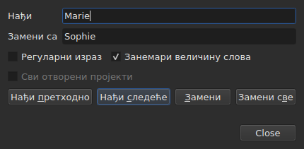
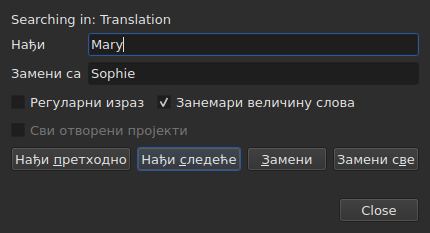

# Налажење и замена

<!-- machine-translated -->
> Ова страница је машински превод који још није прегледао читалац језика.

`Уређивање ▸ Нађи и замени…`, или `Ctrl+F`, отвара дијалог за претрагу.




**Дијалог није модалан**: остаје отворен док се гледа табела,
уређује ћелија, поново претражује. `Close` га затвара; поновно отварање
враћа га онаквог какав је остављен, заједно са обрасцем и заменом.

| Поље | Шта носи |
| :--- | :------- |
| `Find` | образац који се тражи |
| `Replace with` | оно чиме се замењује |
| `Regular expression` | образац је регуларни израз, а не обичан текст |
| `Ignore case` | „marie“ налази „Marie“ |
| `All open projects` | претрага пролази кроз све језичке — [видети испод](#у-свим-отвореним-пројектима) |

Ставка је онемогућена на празном документу: нема шта да се претражује.

## Четири радње

| Дугме | Шта ради |
| :---- | :------- |
| `Find Previous` | налази претходно поклапање, а табела прелази на њега |
| `Find Next` | налази следеће — то је дугме које притиска `Enter` |
| `Replace` | замењује нађено поклапање, па налази следеће |
| `Replace All` | замењује сва поклапања из одредишта |

Сва четири су онемогућена све док је `Find` празно.

**Табела прелази на поклапање** бирањем његовог реда. Када се дође до
последњег, `Find Next` почиње поново од првог; `Find Previous` ради исто у
супротном смеру.

**`Replace` без нађеног поклапања прво претражује**: први притисак
показује шта ће бити замењено, следећи то замењује. Тако ради
Gaupol.

## Шта претрага обухвата

**Избор, или цео документ ако ништа није изабрано** — правило менија
`Tools`. Видети [Операције](operations.md#на-шта-делују).

**Одредиште се узима при првој радњи и задржава** све док претрага
траје: `Find Next` бира ред поклапања, а тај
избор не сужава одредиште. **Самостално бирање других редова
мења одредиште** за следећу радњу.

Претрага обухвата текст титлова; ни положаји ни број
се не претражују.

### У свим отвореним пројектима

Поље за потврду **`All open projects`** проширује опсег на све језичке. **Онемогућено са
једним отвореним пројектом** — нема шта да се прошири —, постаје омогућено чим се
отвори други језичак, и само се искључује када остане само један.

**Када је означено, избор се више не рачуна**: сваки пројекат се претражује у целини,
у **циљном документу** — оном из текућег ступца, главном или
преводу, као код једног пројекта.

- **`Find Next` и `Find Previous` иду од језичка до језичка, по редоследу
  језичака.** Прво пројекат који је приказан; када у њему нема више поклапања,
  следећи, чији језичак прозор приказује и чији ред бира.
- **Круг се завршава тамо где је почео**: када претрага прође последњи
  језичак да би се вратила на први — или обрнуто идући навише —, ред
  дијалога то каже, уместо да поново почне без речи:

  ```text
  Search wrapped around
  ```

  Следећи корак је обичан корак, а ред се брише.
- **`Replace` замењује тамо где је претрага**, па прелази на следеће
  поклапање, које може бити у другом језичку.
- **`Replace All` пролази кроз све пројекте**, и **прави једну ставку историје
  по додирнутом пројекту**: опозив у једном језичку опозива само оно што је тај
  језичак примио. Број каже колико је пројеката промењено, а не само колико је
  замена:

  ```text
  replaced 4 matches in 3 projects
  ```

  Пројекат у коме образца нема се не дира и нема шта да се опозове.
  **Ниједан језичак не излази у први план**: сваки пројекат прима своје замене
  иза свог језичка, који добија звездицу, а језичак из кога је радња
  покренута остаје приказан, са својим филмом.

### У ком тексту

**Уз превод, претрага обухвата само један од два текста: онај из
ступца текуће ћелије** — превод ако је текућа ћелија
у ступцу `Translation`, главни текст свуда другде. То је
правило свих текстуалних операција, и нема додатне поставке:
видети [Текст на који операције циљају](table.md#текст-на-који-операције-циљају).

**Дијалог каже у ком тексту претражује**, у реду изнад
`Find`, и мења га када се текући ступац промени — чак и док је отворен:




| Текућа ћелија је у | Ред каже |
| :----------------- | :------- |
| ступцу `Translation` | `Searching in: Translation` |
| било ком другом ступцу | `Searching in: Main` |
| — пројекат нема превод, или је ступац уклоњен | ништа: реда нема |

**Замена пише у тај текст, и само у њега.** `Replace` и `Replace
All` на преводу остављају главни текст какав је био, и
обрнуто; `Undo` враћа оно што су написали. **Ознаке су оне из формата
датотеке тог текста**: превод у формату Advanced SSA чита се са својим
`{\i1}`, чак и када је главни текст SubRip. `Replace with` се ту пише
истим ознакама.

**Табела остаје у ступцу у коме је била.** `Find Next` бира ред
поклапања без померања текуће ћелије из једног ступца у други:
претрага започета у преводу наставља се у преводу.

**Претрага оба текста одједном не постоји**: свако поклапање
било би пар (титл, текст), а табела која прелази на њега не би имала
јасно место на које иде. Претражује се у једном, па се промени ступац.

**Шта почиње испочетка**:

| Радња | Шта се заборавља |
| :---- | :--------------- |
| промена `Find`, `Replace with` или опције | текуће поклапање и ред стања |
| самостално бирање других редова | одредиште и поклапање |
| премештање текуће ћелије из једног текста у други — са `Text` на `Translation`, или обрнуто | поклапање: оно је место у тексту |
| отварање друге датотеке | одредиште и поклапање; дијалог остаје отворен, заједно са обрасцем |

## Претражује се видљиви текст

**Ознаке нису текст.** Претрага за `<i>` не налази ништа, а претрага за
`Bonjour` налази `<i>Bon</i>jour` прекинут ознаком.

**Замена се врши у тексту датотеке, без кварења ознака**:

| Текст | Тражено → стављено уместо | Шта се пише |
| :---- | :------------------------ | :---------- |
| `<i>Bonjour</i>` | `Bonjour` → `Salut` | `<i>Salut</i>` |
| `<i>Bon</i>jour` | `Bonjour` → `Salut` | `<i>Salut</i>` |
| `<i>Bonjour</i> Marie` | `Bonjour Marie` → `Salut Sophie` | `<i>Salut Sophie</i>` |

Ознака која прекида реч обухвата целу реч, а сваки стил који додирује
поклапање покрива замену. **Ознаке које поклапање не
додирује остају где јесу**, чак и она која прекида другу реч истог
титла: замена `Marie` у `<i>Bon</i>jour Marie` даје
`<i>Bon</i>jour Sophie`. Реч се састоји од слова и цифара — неломљиви
размак или наводник нису њен део. **`Replace with` се чита у ознакама
циљаног текста**: куцање `<b>Salut</b>` ту у SubRip-у чини реч подебљаном.

## Две опције

| Опција | Подразумевано | Шта мења |
| :----- | :------------ | :------- |
| `Regular expression` | није означено | `.` више не тражи тачку већ било који знак |
| `Ignore case` | означено | величина слова се не рачуна, укључујући слова са дијакритицима: `élise` налази `Élise` |

То су подразумеване вредности из Gaupol-а. **Обе се памте** од једног отварања до
следећег и од једне сесије до друге, у опцијама `search.regex` и
`search.ignore-case` [датотеке поставки](preferences.md#датотека).

### Регуларни израз

Образац чита ICU. Као у Gaupol-у, `.` прелази преко прелома реда, а `^`
и `$` важе на почетку и крају **сваког реда** титла:
замена `^` са `- ` ставља цртицу пред сваки ред.

У `Replace with`, и само за регуларни израз:

| Написано | Шта ставља |
| :------- | :--------- |
| `$1` до `$9` | групу тог броја; одсутна група не ставља ништа |
| `$0` | цело поклапање |
| `\n` | прелом реда |
| `\$`, `\\` | знак `$`, обрнуту косу црту |
| `\` иза кога стоји било који други знак | тај знак: `\t` ставља `t` |

**`\1` није група**, и ставља `1`. То је синтакса Gaupol-а, који чита
своје изразе у Python-у; овде је ICU-ова, која чита образац.

## Шта дијалог каже

Испод дугмади, један ред каже шта претрага није могла да уради, или шта је
урадила `Replace All`:

| Ситуација | Шта се приказује |
| :-------- | :--------------- |
| нема поклапања у одредишту | `"Sophie" not found` |
| регуларни израз који се не може прочитати | `not a regular expression (U_REGEX_MISMATCHED_PAREN)` |
| `Replace All` је заменио | `replaced 3 matches` |
| `Replace All` је нашао образац, али замена не мења ниједан текст | `nothing to change` |

**Претрага која ништа не нађе ништа не дира**: избор остаје где је
био, и ништа не улази у историју.

**`not found` и `nothing to change` не говоре исто.** `not found`
каже да обрасца нема нигде у одредишту. `nothing to change` каже да
га има, али замена оставља сваки текст какав је био — замена
`Marie` са `Marie`, на пример. У оба случаја ништа не улази у
историју. Број у `replaced N matches` броји поклапања у
титловима чији се текст променио.

## Шта о томе каже радња опозива

| Радња | Шта пише `Undo` |
| :---- | :-------------- |
| `Replace` | `Undo: replacing` — једна по замени |
| `Replace All` | `Undo: replacing all` — **једна ставка**, ма колико било поклапања |

Видети [Опозив и понављање](undo.md).
