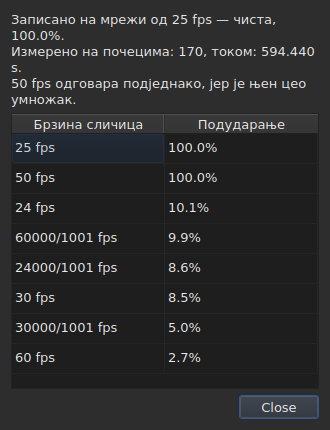

# Мрежа кадрова

<!-- machine-translated -->
> Ова страница је машински превод који још није прегледао читалац језика.

Датотека титлова **не наводи** брзину кадрова према којој су њени
положаји израчунати: SubRip нема заглавље, а оно у формату
WebVTT је слободан текст. Прозор је **закључује** из самих положаја,
при отварању, и приказује је на два места која не одговарају на исто
питање.

| Површина | Шта даје |
| :------- | :------- |
| статусна трака | **одговор**, стално и без питања |
| `Алати ▸ Анализа брзине сличица…` | **образложење**, када се жели видети |

## Шта приказује статусна трака

Десно, између онога што каже о [кодирању](files.md#кодирање-у-статусној-траци)
прочитане датотеке и онога што каже о
[придруженом филму](video.md#шта-приказује-статусна-трака):

| Ситуација | Шта је написано |
| :-------- | :-------------- |
| положаји су на мрежи | `Grid: 24 fps` |
| само неки од њих | `Grid: 29.97 fps (partial)` |
| ниједна позната мрежа не одговара | `No grid` |

**`No grid` не именује ниједну брзину кадрова, и то је намерно.** Скуп
кандидата је затворен — осам оних које нуди дијалог за претварање — а
јављање најмање погрешног међу њима значило би дати погрешан одговор тамо где је
„не знам“ прави одговор.

**`No grid` има два узрока, и они нису исти одговор.** Или ниједна
мрежа не одговара, или датотека има премало титлова да би се о њој
нешто могло рећи — два почетка увек изгледају савршено поравнато, а то не
доказује ништа. Статусна трака о оба случаја каже исто;
**анализа их разликује**, а у првом случају наводи за колико
најбољи кандидат не успева.

Ред се **ажурира после сваке операције**. Поравнање датотеке на другу
брзину кадрова мења мрежу, а статусна трака не сме да наставља
да објављује стару.

### Документ бројан у кадровима нема мрежу, има брзину кадрова

**MicroDVD је једини од девет који броји у кадровима.** Сваки његов ред
носи два броја кадра и ништа више, а датотека **не каже** којом
брзином кадрова их треба читати. Исто место статусне траке тада пише:

| Ситуација | Шта је написано |
| :-------- | :-------------- |
| документ је бројан у кадровима | `Frames: 24000/1001 fps` |

**Ово није мрежа, а мрежа би овде била кружна.** Положаји
документа MicroDVD израчунати су *из* његових кадрова управо том
брзином кадрова; закључивање мреже из њих вратило би тај исти број, то јест податак
обучен у мерење.

**Одакле потиче, речено је једном**, при читању, у
[списку дијагностике](files.md#дијагностика-читања):
`counts in frames and states no rate; it was read at ("24000/1001")`. Ред
статусне траке, са своје стране, каже оно што јесте, стално.

**Погрешна брзина кадрова помера целу датотеку**, а дијалог
[`Convert Frame Rate…`](operations.md#convert-frame-rate) је место где се то исправља:
отвара се на брзини кадрова читања и каже да је то она.

## Шта приказује анализа

`Алати ▸ Анализа брзине сличица…` **не мења ништа.** Отвара се на сажетку и
ранг-листи осам кандидата са њиховом оценом.




Сажетак даје одговор, па оно што га ограничава — свака реченица се појављује
само ако има шта да каже:

| Шта се ту може прочитати | Када |
| :----------------------- | :--- |
| преко колико почетака и на ком распону | увек |
| за колико је датотека померена у односу на своју мрежу | њени положаји су на њој осим за константу |
| да једнако добро одговара и друга брзина кадрова | она је цели умножак задржане |
| да распон не дозвољава да се две брзине кадрова разликују | датотека је прекратка да би их раздвојила |
| колико почетака излази са мреже, **и у колико низова** | датотека је делимична |

**Број низова је оно што разликује две приче** које сам
проценат меша. Много низова од једног почетка су положаји
исправљени ручно, један по један. Неколико дугих низова је поново
темпиран одељак или датотека састављена од две друге.

**Приказује се цела ранг-листа, а не један одговор.** Датотека која
се на 25 поклапа сто посто и на 50 сто посто говори нешто што би сама
пресуда сакрила.

## Када је претварање било погрешно

Датотека која не пада ни на једну мрежу понекад је датотека која је **претворена
погрешном брзином кадрова**: она је тада на сасвим стварној мрежи, али померена за однос који није однос
ниједне од осам. Када закључивање врати `none` или `partial`, анализа тражи **међу
педесет шест уређених парова осам стандардних брзина кадрова** — то је скуп, затворен — онај
чије претварање враћа положаје на мрежу. Сваки однос се примењује на положаје, а
**само закључивање суди о резултату**: поузданост је оно што би оно рекло, никада
измишљен број. Два пара који дају исти однос, као 30 према 25 и 60 према 50, су једно
претварање.

Реченица се додаје сажетку:

```text
converting from 24 to 25 fps puts the positions on a 24 fps grid: 99.9%, against 11.8% as they are and 14.9% for the next best conversion
```

Она наводи претварање, мрежу на коју би положаји пали и колико добро падају на њу,
**затим разлику у односу на положаје какви јесу и на најбоље од осталих
претварања.** Дугме `Convert Frame Rate…` затвара анализу и отвара [дијалог за
претварање](operations.md#convert-frame-rate) **попуњен пронађеним паром** — ништа се не примењује
док се дијалог не прихвати, а за повратак је довољно одустати. Филм, отворен поред,
омогућава да се по слици процени да ли је одговор прави.

**Када су два пара једнако добра, ниједан се не предлаже, а реченица то каже:**

```text
converting from 30 to 25 fps and converting from 25 to 24 fps fit equally well (99.7% and 99.6%), so none is proposed
```

Ово је уобичајен случај пре него изузетак: мрежа од 28,8 кадрова у секунди враћа се
на 24 једнако добро као на 30, а датотека чија су сва времена удвостручена остаје на мрежи од 25.
Поступак који има једну исправку је претварање датотеке која је **већ** на циљној брзини кадрова.
У случају нерешеног исхода одлучује филм: сами отварате `Convert Frame Rate…` на једном од два пара.

**Ништа се не каже** о датотеци која је већ на мрежи, о датотеци прекраткој да би
пресуда вредела, нити о датотеци коју ниједно претварање из скупа не враћа на мрежу — померање,
однос ван осам брзина кадрова, положаји без структуре.

## Шта табела не приказује

**Ниједан ред табеле није означен због мреже**, никада.

Чим се положај исправи ручно, он престаје да буде поравнат. Аутоматско
означавање би зато рад корисника јављало као
аномалију, на датотеци коју управо исправља. Закључивање
говори о **документу**, а анализа је једини изузетак — јер сте
је отворили управо због тога.

Ознаке табеле, са своје стране, тичу се онога што не стоји заједно: крај
пре свог почетка, преклапање, нарушен редослед. Види [Табела](table.md).
