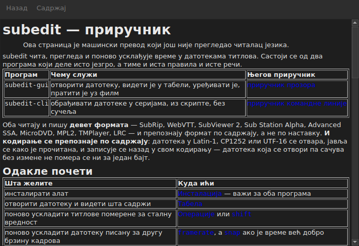

# Приручник у прозору

<!-- machine-translated -->
> Ова страница је машински превод који још није прегледао читалац језика.

`Помоћ ▸ Приручник`, или `F1`, отвара **управо овај приручник** у његовом сопственом прозору.




## Шта отвара, и зашто не адресу

**Приручник инсталиран поред програма**, а не страницу на Интернету.

Адреса би описивала верзију у развоју, а не ону која је при руци.
Корисник који чита приручник верзије коју нема лошије је услужен од
корисника без икаквог приручника — зато прозор чита датотеке које поставља
инсталација, под `<prefix>/share/subedit/manual`. Види
[Инсталација](../subedit-cli/installation.md).

Отвара се на [почетној страници](../index.md), оној која казује одакле почети.

## На ком језику

**На језику прозора.** Приручник се отвара на језику којим
сучеље говори: оном изабраном у `Уређивање ▸ Поставке…`, а иначе оном из
окружења — види
[Језик сучеља](preferences.md#језик-сучеља).

| Прозор говори | Приручник се отвара на |
| :------------ | :--------------------- |
| енглеском | енглеском |
| језику чији је приручник инсталиран — каталонски, чешки, немачки, шпански, фински, француски, галицијски, хебрејски, мађарски, интерлингве, исландски, италијански, холандски, пољски, португалски, бразилски португалски, руски, српски, турски, поједностављени кинески | том језику |
| језику чији приручник није инсталиран | енглеском |

**Страница по страница, а не све или ништа**: страница коју превод нема
отвара се на енглеском, а свака друга страница остаје на језику прозора.
Веза води с једне на другу на исти начин.

Преводи се инсталирају поред енглеског приручника, сваки у директоријуму
названом по свом језику: `<prefix>/share/subedit/manual/fr` за француски.
Језик је онај којим је прозор покренут, па се језик изабран у
поставкама примењује и на приручник, при следећем покретању.

## Кретање

| Шта се ради | Шта се дешава |
| :---------- | :------------ |
| клик на везу у приручнику | страница се отвара у истом прозору |
| клик на везу која циља одељак | страница се отвара, а прозор се помера до њега |
| клик на везу која циља само одељак | прозор се помера до њега, без промене странице |
| `Back` | враћа на претходну страницу; онемогућено на првој |
| `Contents` | враћа на почетну страницу; онемогућено када се већ на њој налазите |

Прозор **није модалан**: остаје отворен док се ради, а то је сва
сврха да приручник буде при руци. Поновни избор ставке не ствара
други прозор, већ овај доноси у први план.

## Шта не може да отвори, и то каже

Приручник понекад упућује на **мапу пута** или на **архитектонску
одлуку**. То су документи репозиторијума, а не пакета: нису
инсталирани, а прозор то каже обичним речима уместо да клик остави
без дејства.

```
../../feuille-de-route.md is not part of the installed manual;
it lives in the project's repository.
```

Могу се прочитати у репозиторијуму, чија је адреса у `Помоћ ▸ О програму subedit`.

## Када је ставка онемогућена

**`Помоћ ▸ Приручник` је онемогућено када поред програма нема приручника.** Два
случаја, и ниједан није квар:

| Случај | Зашто |
| :----- | :---- |
| извршна датотека се покреће из свог стабла градње | тамо ништа није инсталирано, па нема шта да се чита |
| инсталација је делимична | приручник је уклоњен, или никада није копиран |

Задржавање показивача изнад ставке каже који је од два: „Уз овај програм није инсталиран
приручник“.

Страница која недостаје док приручник постоји — датотека обрисана ручно — не
затвара прозор: именује датотеку коју није могла да прочита и задржава на екрану оно
што је приказивала.

## Где се приручник тражи

**Поред извршне датотеке**, у `../share/subedit/manual` — распоред који
даје свака инсталација, ма који био префикс. То омогућава да инсталација
под `~/.local` пронађе свој приручник једнако као пакет инсталиран под `/usr`.
