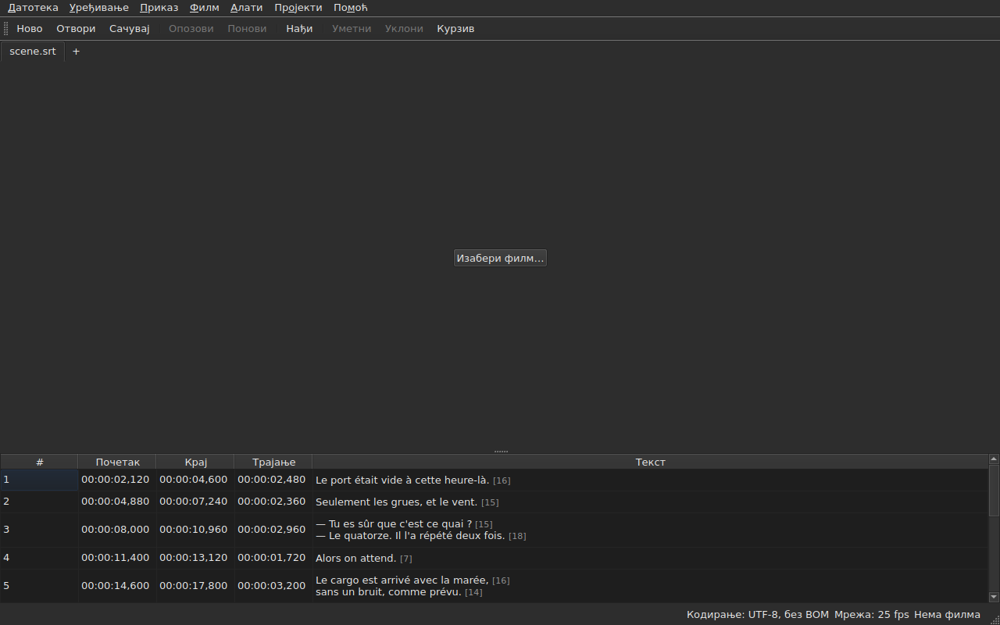

# subedit-gui — приручник

<!-- machine-translated -->
> Ова страница је машински превод који још није прегледао читалац језика.

Прозор програма subedit: отворити датотеку титлова и видети је у табели. За
други програм и за то одакле почети, види [приручник](../index.md).

> **Тренутно стање.** Прозор **отвара више датотека, сваку у посебном језичку**,
> без обзира на њихово кодирање — преко `Open…` или превлачењем на прозор —,
> **приказује их**, **уређује њихове ћелије**, **умеће и уклања редове**,
> **опозива**, **чува — уз избор кодирања, завршетака редова и
> ознаке редоследа бајтова** —, и **означава титлове чији положаји
> не држе заједно**. **Стапа и дели** титлове, **исеца,
> копира и лепи** текстове, и **налази и замењује** у видљивом тексту
> не кварећи ознаке, у једном пројекту или у свим. **Отвара превод
> поред главне датотеке**, поравнат по положају или по броју, у још једном ступцу,
> и чува га одвојено. Мени `Tools` садржи шеснаест операција и две ставке за проверу писања —
> померање, преобразовање, претварање брзине кадрова, дотеривање трајања,
> **прикачивање датотеке, дељење пројекта на два дела**, стављање
> у искошено писмо, додавање цртица разговора, промену величине слова на четири начина,
> уклањање напомена за наглуве, **исправљање текстова помоћу
> вишестраничног чаробњака**, **проверу писања реч по реч**, поравнање на брзину кадрова, враћање
> на мрежу — и анализу мреже, која ништа не мења. Мени `Projects`
> **чува и затвара све** једним потезом. **Придружује документу филм**,
> изабран или погођен, и **пушта га у прозору**, са текућим
> редом нацртаним на слици; **поставља почетак, крај или
> титл према положају у филму**, **иде кадар по кадар** и **помера ивицу за један кадар**. Трака репродукције **премотава, подешава
> јачину звука и положај**, табела **прати репродукцију** не поништавајући ручно померање, положаји
> могу бити приказани **у кадровима**, а мени `Video` **бира звучну нумеру**. Два откривања
> **предлажу, али никада не примењују**: превод померен за сталан износ, који се може **поново отворити
> померен**, и промена брзине кадрова која враћа датотеку на мрежу. **Памти своју геометрију, редослед, ширину и присутност својих
> ступаца, и своје поставке** од једне
> сесије до друге, и појављује се **светао или таман**, како се изабере. `Помоћ ▸ Приручник`
> отвара **овај приручник** у прозору. Овај приручник описује оно што постоји, никада
> оно што је планирано; шта следи налази се на
> [мапи пута](../../../../feuille-de-route.md).

> **Слике у овом приручнику су генерисане, текст није.** Примери из
> приручника `subedit-cli` настају извршавањем команде; снимци екрана
> настају изградњом правог прозора и његовим фотографисањем — обоје ради `make
> manual`. Слика стога не може описивати сучеље које више не постоји, а сучеље
> које се мења види се у разлици у репозиторијуму. Без мреже сигурности остаје
> текст око њих, чија тачност почива на прегледу.

**Сваки екран је приказан двапут, под обе палете које програм
поставља** — `Light` и `Dark`, оне које нуде
[поставке](preferences.md#тема). Под радном површином чија
тема одлучује, `System` даје једну или другу према ономе што је радна површина изабрала.

## Менији

`File`, `Edit`, `View`, `Video`, `Tools`, `Projects`, `Help` — редом којим
се користе: документ, оно што му се ради, начин на који се гледа, оно
што иде уз њега, оно што га испитује, оно што се односи на све отворене пројекте, оно
што га објашњава.

Мени `View` садржи подмени `Columns`, са по једном ставком за потврђивање за сваки ступац осим `Text`
— види [Табела](table.md#скривање-и-премештање-ступаца) — и једну поставку, `Positions in Frames`, која приказује
`Start` и `End` као бројеве кадрова — види [Положаји у кадровима](table.md#положаји-у-кадровима).

Мени `Projects` садржи две ставке, `Save All` и `Close All` — види
[Мени „Пројекти“](files.md#мени-пројекти).

Мени `Edit` садржи пет група, свака испод једног раздвојника: опозивање;
привремена меморија — исецање, копирање и лепљење текстова; `Find and Replace…`;
уметање, уклањање, стапање и дељење редова; на крају
`Preferences…`. Опозивање је оно што се ради *над* изменом, премештање текста
не додаје нити уклања ред, четири ставке следеће групе мењају број
редова, а подешавање теме уопште није измена.

**Тастери су названи онако како их мени приказује**, на енглеском као и остатак
сучеља: `Ins`, `Del`, `Ctrl+Shift+Z`. Тастер који се притисне, а
који ниједан мени не помиње, задржава своје енглеско име: `Enter`, `Esc`, `Shift`.

Мени `Help` садржи две ставке, редом којим их мени приказује. `Manual`, или
`F1`, отвара овај приручник у прозору — види
[Приручник у прозору](help.md). `About subedit` даје верзију,
лиценцу и библиотеке против којих прозор ради, са њиховим верзијама — види
[`--version`](invocation.md#--version).

## Трака са алаткама

Испод менија, једна трака носи **најчешће покрете**, у групама.
Свако дугме носи једну кратку реч; мени задржава целу ставку, а
пречица је иста.

| Дугме | Ставка менија | Пречица |
| :---- | :------------ | :------ |
| Ново | Датотека ▸ Нови пројекат | `Ctrl+N` |
| Отвори | Датотека ▸ Отвори… | `Ctrl+O` |
| Сачувај | Датотека ▸ Сачувај | `Ctrl+S` |
| Опозови | Уређивање ▸ Опозови | `Ctrl+Z` |
| Понови | Уређивање ▸ Понови | `Ctrl+Shift+Z` |
| Нађи | Уређивање ▸ Нађи и замени… | `Ctrl+F` |
| Уметни | Уређивање ▸ Уметни титлове… | `Ins` |
| Уклони | Уређивање ▸ Уклони титлове | `Del` |
| Курзив | Алати ▸ Курзив | `Ctrl+I` |

**Онемогућено дугме је онемогућено из истог разлога као и његова ставка**: `Undo` без
ичега за опозивање, `Remove` без изабраног реда. Ставке превода
и операције менија `Tools`, осим `Italic`, остају у својим
менијима: користе се ређе, или их не користи свако.

## Одељци

| Одељак | Садржај |
| :----- | :------ |
| [Инсталација](../subedit-cli/installation.md) | градња и инсталирање — страница важи за оба програма |
| [Покретање](invocation.md) | покретање прозора, аргументи, излазни кодови |
| [Отварање и чување](files.md) | команде, језичци, мени `Projects`, превлачење датотека, превод и његово поновно отварање померен, дијагностика, кодирање у статусној траци, повратни пут, затварање |
| [Табела](table.md) | шта приказује сваки ступац, њихово скривање и премештање, положаји у кадровима, ступац превода и текст на који операције делују |
| [Уређивање ћелије](editing.md) | које ћелије се могу уређивати, и како |
| [Исецање, копирање и лепљење текстова](clipboard.md) | три ставке, шта путује, додати редови, преведене ознаке |
| [Налажење и замена](find-and-replace.md) | дијалог, четири покрета, две опције, шта претрага обухвата, у свим отвореним пројектима |
| [Уметање, уклањање, стапање, дељење, ређање и раздвајање титлова](lines.md) | четири ставке, њихове пречице, куда иду нови редови |
| [Опозив и понављање](undo.md) | историја, две радње, ознака измене |
| [Мрежа кадрова](frame-grid.md) | брзина кадрова изведена из положаја, анализа, и претварање које враћа датотеку на мрежу |
| [Операције](operations.md) | померање, преобразовање, претварање, дотеривање трајања, прикачивање датотеке, дељење пројекта, стављање у искошено писмо, величина слова, цртице, уклањање напомена, поравнање, враћање на мрежу, и оно што прелази крај филма |
| [Исправи текстове…](correct-texts.md) | чаробњак за исправке: одредиште и задаци, страница сваког задатка, напредак, потврда |
| [Провера писања…](check-spelling.md) | провера писања: њене поставке, пролаз, затварање усред посла, одсуство речника |
| [Придружени филм](video.md) | избор филма, самосталан предлог, звучна нумера, статусна трака, `ffmpeg` |
| [Плејер](player.md) | приказ филма, трака репродукције, пуштање, премештање, јачина звука, табела која прати, нацртани ред |
| [Усклађивање времена према филму](timing.md) | постављање почетка или краја титла, уметање, избор према положају у филму, ход кадар по кадар, померање ивице |
| [Поставке](preferences.md) | тема, датотека поставки, њене опције, и шта бива са нечитљивом вредношћу |
| [Приручник у прозору](help.md) | `Помоћ ▸ Приручник`, шта отвара и како се у њему креће |
