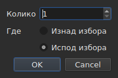

# Уметање, уклањање, стапање, дељење, ређање и раздвајање титлова

<!-- machine-translated -->
> Ова страница је машински превод који још није прегледао читалац језика.

Осам ставки менија `Edit`, испод одвајача који их издваја од
`Find and Replace…`. Четири имају заједничко то што мењају број редова, док
сечење, копирање и налепљивање, изнад, премештају текстове; `Sort Subtitles` мења
само **редослед** редова, `Join Repeated Subtitles` поново прави један
титл од узастопних делова истог текста, а `Make Ranges Disjoint…`
их поново сече тамо где се преклапају.

| Ставка | Пречица | Шта ради |
| :----- | :------ | :------- |
| Уметни титлове… | `Ins` | отвара дијалог, а затим додаје празне редове |
| Уклони титлове | `Del` | уклања избор, без икаквог питања |
| Стопи титлове | нема | од блока суседних редова прави један ред |
| Подели титл | нема | сече ред на два на половини његовог трајања |
| Споји поновљене титлове | нема | од узастопних делова истог текста прави један титл |
| Среди титлове | нема | враћа редове на редослед њиховог почетка, у целом пројекту |
| Раздвој распоне… | нема | сече редове који се преклапају тако да ниједан интервал више не залази у други |
| Поправи титлове… | нема | повезује претходне три ставке — спајање понављања, ређање, сечење интервала — одједном |

Свих осам улази у историју: `Ctrl+Z` их опозива као и остало.

## Уметање

| Поље | Шта садржи | Подразумевано |
| :--- | :--------- | :------------ |
| `How many` | цео број од 1 до 99.999 | `1` |
| `Where` | `Above the selection` или `Below the selection` | последњи избор, `Below` при првом покретању |

`OK` додаје редове, `Cancel` не додаје ништа.

### Где се налазе

**Уз последњи изабрани**, а не први. Ако се изаберу редови 1 и 3,
па се уметне испод, нови ред долази на положај 4 — не на
положај 2. Тако Gaupol ради већ двадесет година, и то рука
очекује после прелаза одозго надоле.

`Above the selection` га ставља непосредно пре тог истог реда.

### Колико трају

Празан ред нема текста, али има положаје. Они се изводе
из доступног простора:

| Ситуација | Почетак | Трајање |
| :-------- | :------ | :------ |
| између два титла | крај претходног | простор до следећег, подељен на једнаке делове |
| после последњег | крај последњег | по три секунде |
| на почетку датотеке | исходиште | простор до првог, подељен |
| у празној датотеци | исходиште | по три секунде |

Када се датотека на изабраном месту преклапа, **нема простора за
дељење**: редови добијају нулто трајање, које табела приказује, уместо
измишљеног трајања које би залазило у суседа.

### Празан документ

**Избор није потребан**, и то је једини начин да се започне нова
датотека: редови иду на индекс нула. Избор стране је тада онемогућен
у дијалогу — нема избора према коме би се редови сместили.

Чим документ садржи ред, ставка `Insert Subtitles…` **је онемогућена све док
ништа није изабрано**: без избора би се индекс погађао.

### Након тога

Додати редови су **изабрани**, а табела прелази на њих. Други притисак на
`Ins` зато умеће иза њих, без потребе да се кликне између
та два корака.

### Страна се памти

`Above` или `Below` памти се **од једног до другог уметања, и од једне сесије до
друге**: то је опција `edit.insert-placement` у
[датотеци поставки](preferences.md#датотека). Не умеће се једном,
умеће се десет редова заредом, увек на истој страни.

## Уклањање

`Remove Subtitles`, или `Del`, уклања изабране редове — укључујући
прекинут избор, при чему се сваки ред враћа на своје место ако се опозове.

**Потврда се не тражи**, и то није пропуст:
операција се опозива са `Ctrl+Z`. Модални дијалог пред радњом која се може опозвати
коштао би клик сваки пут да би се уштедео по који `Ctrl+Z`.

**Ставка је онемогућена када ништа није изабрано.** На другим местима у прозору
„ништа изабрано“ значи „цела датотека“ — због тога је
померање употребљиво без бирања четири хиљаде редова. Овде би то тумачење
испразнило документ једним несрећним `Del`, па се не нуди.

После уклањања **бира се ред који је заузео место првог уклоњеног** —
или последњи преостали, ако је уклањање однело крај
датотеке. Више узастопних притисака на `Del` зато уклања редове један
по један.

Потпуно испражњена датотека оставља прозор употребљивим: `Insert Subtitles…`
поново постаје омогућена, јер се у празан документ умеће без избора.

## Стапање

`Merge Subtitles` прави **један ред** од изабраних редова:

| Шта добија стопљени ред | Одакле долази |
| :---------------------- | :------------ |
| његов почетак | почетак првог |
| његов крај | крај последњег |
| његов текст | текстови свих, по реду, са прелом реда између два |
| његов превод | преводи, спојени на исти начин |
| оно што формат носи поред тога — стил, слој, координате | први |

**Празан текст не оставља празан ред**: стапање редова `Un.`, реда без
текста и `Trois.` даје два реда текста, а не три.

Стопљени редови нестају, а ред који их замењује заузима место
првог.

**Ставка је онемогућена** све док избор није **блок од најмање
два суседна реда**. Један ред нема са чим да се стопи; редови
1 и 3 без 2 такође не, јер би резултат прелазио преко 2 и
покрио га.

После стапања **стопљени ред је изабран**: `Split Subtitle` је
спреман да га поново пресече.

## Дељење

`Split Subtitle` сече изабрани ред **на половини његовог трајања**, до на
милисекунду:

| Половина | Почетак | Крај | Текст |
| :------- | :------ | :--- | :---- |
| прва | првобитни почетак | средина | **сав** текст и превод |
| друга | средина | првобитни крај | празан |

**Текст се не сече на свом прелому реда.** То би било исправно за
титл од два реда, а погрешно за титл од једног или од три реда;
сав текст остаје у првој половини, а оно што треба да иде у
другу преноси се ручно.

Прва половина задржава оно што је формат носио поред текста; друга
настаје као уметнути ред, без ичега.

**Ставка је онемогућена** све док избор не броји **тачно један
ред**. Ништа изабрано овде не значи „цела датотека“.

После дељења **обе половине су изабране** — то је оно што Gaupol
ради после сваког уметања, па је `Merge Subtitles` тада спреман да опозове
радњу.

## Ређање

`Sort Subtitles` враћа **цео пројекат** на редослед почетака. Никада
избор: редослед је особина документа, а ређање половине
датотеке ништа не значи. Ређање је **стабилно**: два титла која
почињу заједно задржавају редослед који им је дала датотека.

**Током ређања у статусној траци тече трака, а курсор постаје
пешчани сат**: на дугој датотеци прозор неко време не реагује — табела
се гради ред по ред —, а без тога се не зна да ли је нешто
у току. Трака не показује део, јер ређање не јавља напредак,
и нестаје са њим.

Статусна трака каже колико је редова променило место — `3 subtitles moved`
— или, када је све било по реду, `already in order`. **Пројекат који је већ по реду
не улази у историју**: операција која ништа не мења није
операција коју треба опозвати. Ставка је онемогућена за пројекат од једног титла.

Датотека **са нечим за исправку при отварању** то нуди сама,
[у једном пољу](#при-отварању-једно-поље): видети испод. Погрешно постављени
титлови се такође [броје у дијагностици](files.md#дијагностика-читања),
па се проналазе без премотавања табеле.

У командној линији [`sort`](../subedit-cli/sort.md) ради исто на
датотекама, а `--sort` то ради успут на
[`convert`](../subedit-cli/convert.md#ређање-при-писању),
[`append`](../subedit-cli/append.md#ређање-резултата) и
[`split-file`](../subedit-cli/split-file.md#сечење-по-временском-редоследу).

## Спајање поновљених титлова

`Join Repeated Subtitles` прави **један титл** од титлова који заредом приказују
исту ствар: текст исечен на узастопне делове, какав остављају
неки алати за сегментацију. Делује на **цео пројекат**.

**Понављање** има исти текст, исти превод и исте поставке формата
(стил, положај, поставке cue-а) као други титл, **и почиње најкасније
када се тај завршава**. Низ понављања постаје онај који почиње
први, са највећим крајем низа; остали нестају.
`Alpha [1, 2]`, `Alpha [2, 4]` и `Alpha [4, 6]` дају `Alpha [1, 6]`.

- **Редослед датотеке ту ништа не мења, и не мења се**: задржани титл
  је онај који почиње први, где год да су остали.
- **Ништа се не спаја грешком**: други текст, друге поставке, размак
  између два дела, титл без текста или онај чији крај претходи његовом почетку
  остају одвојени.
- Статусна трака каже шта је урађено — `2 repeated subtitles joined`, или
  `no repeated subtitles`.

**Чини се пре ређања и сечења**, који боље читају чист низ: текст
у три дела, плус други текст преко целог интервала, дати
неуређено, сређује се и сече у редове који прелазе са једног дела на други; спојен
претходно, долази у ред и стапа се чисто. Поље при отварању, испод, ради
све три радње тим редом.

## Раздвајање интервала

`Make Ranges Disjoint…` сече титлове који се преклапају тако да **ниједан
интервал `[start, end]` више не залази у други**. Делује на **цео
пројекат**, никада на избор: група титлова који се преклапају
сече се тамо где се преклапају, а половина групе ништа не значи.

**Ништа се не скраћује нити продужава.** У сваком тренутку прозор приказује
исте текстове као и пре. Мења се начин на који је временска линија исечена:
сече се на сваком почетку и сваком крају групе; интервал који покрива
један титл остаје тај титл; интервал који покрива више њих
постаје **један** титл чији су редови њихови, **најранији у реду 1**.
`A [0, 5]` и `B [3, 8]` дају `[0, 3] A`, `[3, 5] A / B`, `[5, 8] B`.

Дијалог тражи три поставке, које се памте од једног до другог пута:

| Поље | Шта садржи | Подразумевано |
| :--- | :--------- | :------------ |
| `Shortest interval kept` | од 0 до 10.000 ms: краћи интервал преузима сусед | `80 ms` (око два кадра) |
| `Most lines in a subtitle` | од 0 до 10; `No limit` код 0 | `2` |
| `Put a dash before each subtitle's text` | цртица пред оним што сваки титл доприноси спојеном титлу | није означено |

`OK` сече, `Cancel` не ради ништа. **Написани редови су изабрани**
након тога, а статусна трака каже шта је урађено: `2 subtitles split, 1 merged`.
Други пролаз ништа не мења и то каже: `already disjoint`.

- **Ред се никада не удвостручује.** Два титла са истим текстом дају
  један ред тамо где се преклапају, а два суседна дела која приказују
  исту ствар дају само један титл. Текст титла исеченог на више
  делова иначе се понавља у сваком: то је оно што је на екрану у том тренутку.
- **Веома кратак интервал преузима сусед**: онај чији редови
  већ садрже његове, иначе најдужи, проширује свој интервал да би га покрио.
  Цео титл краћи од прага никада се не преузима.
- **Више редова од ограничења: прозори.** Три реда током три секунде
  постају две половине, прва два реда па последња два;
  четири реда, три трећине, и тако даље. Ништа се не скраћује.
- Превод прати исто сечење; стил и положај првог
  покривајућег титла се задржавају.

**Оно што није могло да се уради у потпуности каже се у дијалогу који се затвара**, а не у
статусној траци: прозори, преузети интервали, прекратки титлови
остављени целим, стилови који се разликују, титлови чији крај претходи
почетку (остављени где јесу).

**Ставка се одбија, уз разлог, када титлови нису по
редоследу почетка**: групе су низови суседа, а језгро никада
само не сређује. Прво `Sort Subtitles` — или поље при отварању, које
ради обоје тим редом.

### Све одједном: `Repair Subtitles…`

`Repair Subtitles…` ради претходне три ставке **једну за другом**, јединим редоследом који функционише: понављања
се спајају, титлови се стављају у редослед почетка, па се интервали раздвајају. То је ставка
за датотеку која је лоше сегментирана, лоше поређана и преклапа се, када се зна да су потребне све три. Дијалог тражи
поставке сечења (исте као код `Make Ranges Disjoint…`, памте се од једног до другог пута) и каже да прво спаја и
ређа. Статусна трака — или дијалог који се затвара, када нешто није могло да се уради у потпуности — даје **један извештај**
о све три радње: `2 repeated subtitles joined; already in order; 2 subtitles split, 1 merged`. Свака исправка је своја
ставка историје: `Ctrl+Z` их опозива једну по једну. У командној линији: [`repair`](../subedit-cli/repair.md).

### При отварању, једно поље

Датотека која се отвара са нечим што знамо да исправимо **то нуди у
једном пољу**, `Problems found in this file`, уместо да отвара по једно за сваки
проблем. Сваки пронађени проблем је ред са својим пољем за потврду, означеним:

- `Join the repeated subtitles` — титлови понављају други који
  их додирује, са њиховим бројем;
- `Sort the subtitles` — титлови нису по редоследу почетка,
  са њиховим бројем;
- `Make the ranges disjoint` — титлови почињу пре краја претходног,
  бројано **кад је датотека поређана**, јер се ту исправљају.

**Сваки проблем се броји тамо где се исправља**, на копији на којој су
претходне исправке већ урађене: текст исечен на делове је
узрок неког нереда, па спајање прво може да не остави ниједан — поље
тада не нуди ређање.

Проблем који није пронађен нема ред. Искључивање ређања **сиви и
искључује** друго поље: интервали се раздвајају само по реду.
`Fix` примењује означено — спајање, па ређање, па сечење, са
поставкама последњег `Make Ranges Disjoint…` — и даје **један извештај** о томе;
`Keep as is` не додирује ништа. **Ништа се не ради без потврдног одговора**, свака исправка
је ставка историје, а датотека без ичега за исправку није
предмет никаквог питања.

У командној линији [`disjoint`](../subedit-cli/disjoint.md) ради исто на датотекама, а `--disjoint`
то ради успут на [`convert`](../subedit-cli/convert.md#раздвајање-интервала),
[`append`](../subedit-cli/append.md#раздвајање-интервала) и
[`split-file`](../subedit-cli/split-file.md#раздвајање-интервала).

### Зашто не пречице из Gaupol-а

Gaupol стапа са `M` а дели са `S`. Једно слово би табела узела
пре него што стигне до ћелије која се уређује, а `Ctrl+S`
већ чува: две ставке се постижу кроз мени.

## Шта о томе каже радња опозива

**Једна ставка историје по радњи.** Стапање пет редова опозива се једним
`Ctrl+Z` и враћа пет редова онаквим какви су били — положаји, текстови и
све што је формат носио.

| Операција | Шта пише `Undo` |
| :-------- | :-------------- |
| уметање | `Undo: inserting` |
| уклањање | `Undo: removing` |
| стапање | `Undo: merging` |
| дељење | `Undo: splitting` |
| спајање понављања | `Undo: joining repeated subtitles` |
| сечење интервала | `Undo: making the ranges disjoint` |

Исправка понуђена при отварању је једна ставка историје по исправци: спајање, ређање, па сечење опозивају се једно за другим.

Видети [Опозив и понављање](undo.md).

## Пречице док је ћелија отворена

`Ins` и `Del` припадају пољу за унос док је уређивач ћелије
отворен: тастер за брисање тамо брише знак, а не
титл. Затварање уређивача — `Enter` или `Esc` — враћа им значење. Покренуто
из менија, `Remove Subtitles` прво потврђује унос, као и остале
радње из [Уређивање ћелије](editing.md).

Овај приручник назива тастере онако како их мени приказује — видети
[Менији](index.md#менији).
