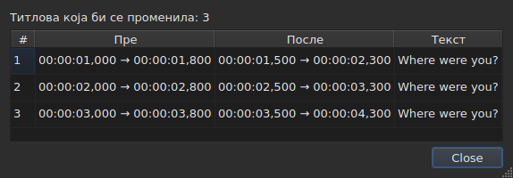
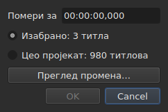
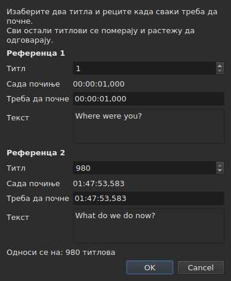
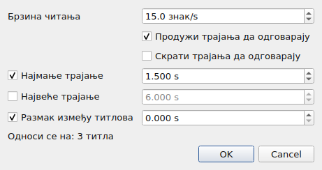
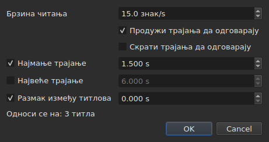
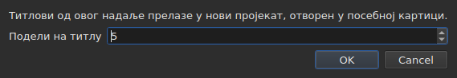

# Операције

<!-- machine-translated -->
> Ова страница је машински превод који још није прегледао читалац језика.

Мени **Алати** садржи шеснаест операција, једну анализу и две ставке за проверу писања. Свака од
шеснаест се опозива једним `Ctrl+Z`; анализа ништа не мења. `Check Spelling…` се такође опозива, а `Spell-Check Settings…` не дира ниједан текст.

| Ставка | Дијалог | Шта ради |
| :----- | :------ | :------- |
| `Shift Positions…` | да | помера одредиште за трајање |
| `Transform Positions…` | да | исправља одредиште према два маркера |
| `Convert Frame Rate…` | да | поново усклађује време одредишта са једне брзине кадрова на другу |
| `Adjust Durations…` | да | помера крајеве да би се држала брзина читања, трајања и размак |
| `Append File…` | бирач датотеке | качи датотеку на крај пројекта |
| `Split Project…` | да | сече пројекат на два дела, остатак иде у нови језичак |
| `Italic` | **не** | ставља одредиште у искошено писмо, или га из њега вади |
| `Dialogue` | **не** | ставља цртицу разговора на почетак сваког реда, или је уклања |
| `Величина слова ▸ Свака Реч Великим Словом` | **не** | свака реч добија велико слово |
| `Величина слова ▸ Прво слово велико` | **не** | прво слово текста, и само оно |
| `Величина слова ▸ ВЕЛИКА СЛОВА` | **не** | све великим словима |
| `Величина слова ▸ мала слова` | **не** | све малим словима |
| `Remove Hearing-Impaired Mentions…` | да, без поставки | уклања напомене за наглуве |
| `Correct Texts…` | да, вишестраничан чаробњак | предлаже исправке — напомене, спајање и дељење речи, уобичајене грешке, велика слова, ломљење редова — и примењује их кад се прихвате, види [Исправи текстове…](correct-texts.md) |
| `Check Spelling…` | да, пролаз реч по реч | пролази кроз речи непознате речнику и примењује оно што је исправљено, види [Провера писања…](check-spelling.md) |
| `Spell-Check Settings…` | да | бира језик, одредиште и документ провере, и подвлачење током куцања, види [Провера писања…](check-spelling.md#поставке-провере-писања) |
| `Snap to Frame Rate…` | да | враћа сваку временску ознаку на најближи кадар |
| `Shift Whole File onto Grid (…)` | **не** | враћа целу датотеку на њену мрежу |
| `Frame Rate Analysis…` | да, без поставки | **не мења ништа** — види [Мрежа кадрова](frame-grid.md) |

**Шта је операција урадила каже се у информативном дијалогу који треба
затворити, осим за `Italic`, `Case` и `Dialogue`**: та три не отварају
ниједан дијалог, а њихов извештај — укључујући „нема шта да се мења“ — приказује се
у статусној траци, без ичега за затварање. `Split Project…` такође даје свој
у статусној траци: његов резултат је већ пред очима, у новом језичку. Поруке су наведене у
одељку сваке операције.

Уметање, уклањање, стапање и дељење редова нису овде већ у
менију `Edit`, јер мењају број редова. Види
[Уметање, уклањање, стапање, дељење, ређање и раздвајање титлова](lines.md).

## На шта делују

**Изабрани редови, или цела датотека ако ниједан није изабран.** Правило је
исто за све, а дијалози, када га има, подсећају на њега обичним
речима:

```
Applies to: 4 subtitles
```

Избор свих редова своди се на исто што и избор ниједног.

**Када је изабран само део редова, дијалог пита
на шта да делује.** Приказују се два избора, са својим бројем, а **изабрано
је означено**:

```
(•) Selected: 2 subtitles
( ) Whole project: 4 subtitles
```

Означавање `Whole project` проширује операцију на целу датотеку, без
потребе да се претходно мења избор. Када нема шта да се бира — ништа
није изабрано, или је изабрано све —, ред `Applies to:` изнад остаје сам.

Дијалози за `Shift Positions…`, `Transform Positions…`,
`Convert Frame Rate…`, `Adjust Durations…`, `Snap to Frame Rate…` и
`Remove Hearing-Impaired Mentions…` нуде овај избор.

### Прво видети, па применити

`Shift Positions…`, `Transform Positions…`, `Convert Frame Rate…`,
`Adjust Durations…` и `Snap to Frame Rate…` носе дугме **`Preview changes…`**.
Оно отвара мали прозор који каже колико титлова би операција
променила **са оним што је у том тренутку откуцано, на означеном одредишту**, и
наводи првих дванаест: њихов број, њихов положај пре,
њихов положај после, и први ред њиховог текста. **Ништа се не примењује**: затварање
прозора враћа у дијалог, где се може променити вредност и погледати
поново.




Отвара се довољно велик да прикаже све ступце, а може се мењати
ручно.

Ако операција не би променила ништа, прозор то каже (`Nothing would change.`).
Докле год откуцано не одређује операцију — нечитљиво трајање, два
маркера на истом титлу —, преглед је празан из истог разлога због кога је дугме
`OK` засивљено. `Remove Hearing-Impaired Mentions…` нема преглед: оно
што мења је текст, а извештај који даје после
то каже.

**Са преводом, који текст?** Операције над положајима и структуром
делују на цео титл — његова два текста га прате. Оне које
преписују текст — `Italic`, `Case`, `Dialogue`,
`Remove Hearing-Impaired Mentions…` — циљају **текст ступца текуће ћелије**:
превод у свом ступцу, главни текст на другим местима. Други остаје нетакнут, а
статусна трака каже који је циљан. Види [Табела](table.md#текст-на-који-операције-циљају).

**Један изузетак, и његов назив га носи**: `Shift Whole File onto Grid`
игнорише избор. Мрежа је својство документа, а пола
документа нема своју мрежу; ставка то стога каже у свом имену, а не
само у овом приручнику.

**`Append File…` такође игнорише избор**, из другог разлога: он
не преписује одредиште, већ гура један крај уназад. Види његов
[одељак](#append-file). **Тако и `Split Project…`**: сече тамо где му је
речено. Види [његов одељак](#split-project).

**`Correct Texts…` бира своје одредиште на својој страници**, уместо да следи
текући избор: избор, текући пројекат или сви отворени
пројекти. Види [Исправи текстове…](correct-texts.md). **`Check Spelling…` га бира у
`Spell-Check Settings…`**, и памти га: види [Провера писања…](check-spelling.md).

**Две операције мреже не говоре о истој ствари као мрежа.**
Операција делује на избор; анализа и статусна трака говоре о
**целом документу**. Поравнање пет редова од стотину седамдесет шест мења тих
пет — табела то показује — а да се ниједно од њих не помери, што
изгледа као пропуштено освежавање. Није: немају шта да
кажу. Види [`Snap to Frame Rate…`](#snap-to-frame-rate) и
[Мрежа кадрова](frame-grid.md).

### Шта значи „ништа није изабрано“, ставку по ставку

Правило важи за мени `Tools` и за претрагу. Ставке менија
`Edit` које дирају редове или их празне читају га другачије — иначе би
несрећно `Del` или `Ctrl+X` испразнили документ.

| Ставка | Без избора | Шта захтева |
| :----- | :--------- | :---------- |
| операције менија `Tools` | цела датотека | непразан документ |
| `Shift Whole File onto Grid` | цела датотека, **увек** | нађена мрежа |
| `Find and Replace…` | цела датотека | непразан документ |
| `Cut Texts`, `Copy Texts`, `Paste Texts` | **онемогућено** | најмање један изабран ред |
| `Remove Subtitles` | **онемогућено** | најмање један изабран ред |
| `Merge Subtitles` | **онемогућено** | блок од најмање два суседна реда |
| `Split Subtitle` | **онемогућено** | тачно један ред |
| `Insert Subtitles…` | онемогућено, осим на празном документу | ред уз који ће се поставити |

Свака страница даје разлог: [привремена меморија](clipboard.md#на-шта-делују),
[редови](lines.md), [претрага](find-and-replace.md#шта-претрага-обухвата).

Ставке су **онемогућене на празној датотеци**: не би било шта
да се помера. `Italic` има други услов, који описује његов одељак: отворени
формат мора бити у стању да запише стил. Величина слова и цртице га немају — текст
је текст у свих девет формата.

## `Shift Positions…`

Помера одредиште за трајање, унапред или уназад. Обе границе сваког
титла померају се за исти износ: ниједан не остаје на екрану дуже или краће
него пре.

Трајање се пише **као временска ознака, укључујући предзнак** — `00:00:02,500` помера унапред,
`-00:00:01,250` помера уназад. **Поље се преписује, а не уписује у њега**: почиње као `00:00:00,000`, цифра замењује цифру испод курсора, а курсор сам прескаче `:` и `,`, па се облик никада не мења. Прихватају се само цифре и `-` (или `+`) за промену предзнака; `Backspace` и `Delete` враћају нулу. Исто поље се користи свуда где се подешава време: у дијалогу трансформације, у ћелијама положаја табеле и у опсегу транскрипције.




| Одбијање | Зашто |
| :------- | :---- |
| нечитљиво трајање | дугме остаје онемогућено; ништа се не помера насумице |
| померање од нула | нема операције коју би требало забележити |
| титл би отишао пре почетка филма | **ниједна датотека не може да понесе такав положај** |

Трећи случај именује кривца — „титл 1 би почео пре почетка“ —
и то је онај на који треба гледати да би се видело за колико је грешка. Ништа
се не примењује.

## `Transform Positions…`

Исправка датотеке темпиране према другом монтажном резу. Каже се где **два**
титла заиста почињу, а све остало следи, сразмерно.

Дијалог два пута тражи исту ствар: број титла, и
положај где његов почетак припада. За сваки маркер он показује **шта тај
број означава** — његов текст (`Text`) и време у које почиње
**сада** (`Now starts`), као обичне ознаке — и оне прате број
док се он мења. Текст задржава **три реда простора** ма шта
титл говорио: дужи, или дугачка адреса, помера се унутар њега, а
дијалог задржава своју величину док се маркер мења. **По маркеру се куца једно једино поље:
`Should start`**, време у које овај титл мора да почне. Нема потребе да се у табели тражи који је ред `980`.

`Should start` се **предлаже на текућој вредности**: докле год му се не
дира вредност, маркер каже „овај титл је већ тамо где мора бити“. Мења се
само оно што се жели променити. Други маркер је унапред попуњен на последњем
титлу датотеке — два удаљена маркера дају поузданију исправку
него два суседна.




**Оба маркера слећу тачно тамо где је тражено.** То није
апроксимација: рачун је направљен тако да то буде тачно.

| Одбијање | Зашто |
| :------- | :---- |
| два маркера на истом титлу | не одређују никакву исправку |
| нечитљив положај | исти разлог као за померање |

Број изван датотеке не може да се откуца: поље је ограничено
бројем титлова.

## `Convert Frame Rate…`

Поново усклађује време одредишта када су положаји израчунати према једној брзини
кадрова, а морају бити према другој.

Обе листе нуде осам стандардних брзина кадрова.

> **Погрешна улазна брзина кадрова помера целу датотеку а да ништа не
> јави.** То је најгори начин отказа ове операције, и зато
> дијалог каже одакле потичу вредности које предлаже, уместо да
> их тихо поставља.

### Два извора, и шта одговарају

Дијалог носи до два додатна реда, од којих се сваки појављује када има
шта да каже:

| Ред | Шта каже | Шта унапред попуњава |
| :-- | :------- | :------------------- |
| `The positions say` | [мрежа кадрова](frame-grid.md) изведена из положаја у датотеци | `Timed against` |
| `The video declares` | брзина кадрова коју контејнер објављује, на пример `24000/1001` | `Should play at` |
| `The file was read at` | брзина кадрова при којој је прочитана датотека **бројана у кадровима** | `Timed against` |

**Сваки предлог иде у поље на које одговара.** Мрежа каже према чему је
датотека *писана* — то је горња листа. Оно што контејнер објављује је
брзина кадрова при којој филм *тече*, а тиме и она при којој титлови
морају стићи — то је доња листа.

**Само чиста мрежа унапред попуњава улаз.** Делимична мрежа је
траг који и само извођење квалификује као делимичан, а ово поље одлучује о
операцији над целом датотеком. [Статусна трака](frame-grid.md) и анализа
носе тај случај; овај не.

**Датотека бројана у кадровима замењује мрежу уместо да јој се додаје.**
MicroDVD носи бројеве кадрова, а положаји документа су
израчунати из њих при брзини кадрова читања: мрежа изведена из тих положаја
може само да пронађе тај исти број. `The positions say` стога нестаје, а
`The file was read at` заузима његово место — исти избор
прави [статусна трака](frame-grid.md#документ-бројан-у-кадровима-нема-мрежу-има-брзину-кадрова).

**Тако се мења брзина кадрова MicroDVD датотеке.** Постављање брзине кадрова
прочитане као улаза и праве као излаза поново рачуна сваки положај из кадрова
датотеке — без поновног читања ичега, а операција се опозива као
остале.

### Неслагање није противуречност

Оба реда могу бити приказана заједно и објављивати различите бројеве.
**То није грешка коју треба пресудити**: филм тече при једној брзини кадрова,
датотека је писана на другој мрежи. Датотека на 24 за филм на 25 је
управо случај за који постоји поравнање — `snap` у командној линији.

Ништа се стога не бира уместо корисника: обе листе остају
изменљиве, и то је намерно. Извор који се намеће забрањује унакрсну проверу.

Редови се не појављују када нема шта да се каже: нема придруженог
филма, нема `ffprobe`, или нема чисте мреже. Дијалог је тада онај
описан изнад, а **ниједна операција због тога не одбија** —
брзину кадрова даје корисник. Види
[Придружени филм](video.md#ffmpeg-није-потребан).

Брзина кадрова коју филм објављује а која није једна од осам стандардних
**приказује се без избора**: сазнање да филм тече при
необичној брзини кадрова јесте информација, а овде нема у шта да се претвори.

Претварање брзине кадрова саму у себе не мења ништа: дугме остаје онемогућено.

## `Adjust Durations…`

Продужује или скраћује трајање титлова одредишта **померањем њиховог
краја, никада почетка**. Померање почетка померало би титл, а то је
посао за [`Shift Positions…`](#shift-positions).





### Четири ограничења

| Поље | Шта тражи | Вредности | Подразумевано |
| :--- | :-------- | :-------- | :------------ |
| `Reading speed` | време потребно да се текст прочита | од 1 до 99 знакова у секунди, на десетинку | 15 знакова/с |
| `Lengthen durations to match it` | продужити оно што је прекратко да би се прочитало | означено или не | означено |
| `Shorten durations to match it` | скратити оно што остаје приказано дуже него што треба | означено или не | неозначено |
| `Minimum duration` | доње трајање | од 0 до 99 с, на милисекунду | означено, 1,5 с |
| `Maximum duration` | горње трајање | од 0 до 99 с, на милисекунду | неозначено, 6 с |
| `Gap between subtitles` | размак који треба оставити пре следећег титла | од 0 до 99 с, на милисекунду | означено, 0 с |

То су Gaupol-ове подразумеване вредности.

**Неозначено ограничење је одсутно**: његово поље је засивљено и не чита се.
Ограничење означено на нули вреди нулу — размак од 0 с забрањује да се
титл преклапа са следећим. Брзина читања се чита само ако је
означено `Lengthen` или `Shorten`.

**Када је све неозначено, `OK` је онемогућено**: нема шта да се тражи.

Дијалог се поново отвара на вредностима последњег дотеривања, **и чува их од једне
сесије до друге** — као две опције претраге. **Неозначено поље
задржава своју вредност**: скидање ознаке са `Minimum duration` после постављања 2 с не враћа
1,5 с, а поновно означавање налази 2 с. Девет поставки налази се у
[датотеци поставки](preferences.md#датотека), под `duration-adjust.`.

**Командна линија их дели.** [`subedit-cli adjust`](../subedit-cli/adjust.md) подразумевано чита
истих девет поставки, тако да је брзина постављена овде брзина коју користи, осим ако
његове сопствене опције не кажу другачије; [`subedit-cli config`](../subedit-cli/config.md) их приказује и мења. Види
[Два блока, један дељен са командном линијом](preferences.md#два-блока-један-дељен-са-командном-линијом).

### Којим редом, и које побеђује

Сваки титл одредишта пролази кроз четири ограничења **овим редом**, а
свако у свом реду поставља крај:

| Ранг | Ограничење | Шта поставља |
| ---: | :--------- | :----------- |
| 1 | брзина читања | `end = start + length ÷ speed`, ако је титл прекратак (`Lengthen`) или предугачак (`Shorten`) |
| 2 | најмање трајање | `end = start + minimum`, ако је трајање краће |
| 3 | највеће трајање | `end = start + maximum`, ако је трајање дуже |
| 4 | размак | `end = next start − gap`, ако је крај превише близу њему — никада пре почетка |

**Побеђује последње примењено.** Размак долази последњи и може вратити
трајање испод управо постављеног минимума: два титла на екрану у исто
време су грешка коју гледалац види, а мало прекратак титл
није.

**Дужина текста се броји без ознака**, у знаковима, са прелазима
у нови ред: `<i>été</i>` броји три знака. Брзина читања говори о
ономе што гледалац чита.

**Следећи је следећи титл датотеке**, био у одредишту или
не. **Последњи титл датотеке нема следећи**: размак га не
ограничава.

### Оно што ниједан крај не може да задовољи се каже

Када је дотеривање обављено, прозор каже колико је крајева померено, и **шта
није могло да се одржи** — ограничење се појављује само ако је
жртвовано за бар један титл:

```text
adjusted the durations of 12 subtitles; could not satisfy the reading speed in 9 subtitles, the minimum duration in 4 subtitles
```

Три могућа помена су `the reading speed`, `the minimum duration` и
`the gap`. **Највеће трајање се увек одржава**: долази после брзине
и минимума, а само га размак следи, који може само да скрати. Минимум
већи од максимума уступа пред њим, а броји се минимум. Размак
се жртвује само када следећи почиње пре почетка самог
титла.

Збир покрива цело одредиште, **укључујући титлове чији крај се
није померио**: титл већ постављен уз свој следећи и прекратак за
минимум се броји. Када се ниједан крај не помери, прозор то каже —
`no duration to adjust` — и ништа не улази у историју.

## `Append File…`

Качи датотеку на крај отвореног пројекта. **Ништа се не умеће између
њих**: изабрана датотека се помера за крај последњег титла
пројекта, тачно као што то ради Gaupol.

**Онемогућено на празном документу**: не би било краја од кога би се померало. Отвара
се бирач датотеке, без кодирања за избор — као `Open…`.

**Прикачена датотека пролази кроз претварање**, речима из `Save As…` и из
[лепљења из другог формата](clipboard.md#ознаке-другог-формата-се-преводе):
њене ознаке се преводе у формат пројекта, а оно што тај формат не може да
запише, каже се:

```text
appended 12 subtitles; Advanced SSA into SubRip: 1 tag dropped
```

**Оно што је прикачена датотека носила не преживљава у целини.** Њени положаји
следе, ознаке укључене; њено заглавље, њена поља специфична за формат — име
стила, маргине — и оно што ознака не може да постане у формату пројекта
не следе, и то кажу. **Нема превод**: превод остаје
специфичан за документ који га је примио, а прикачена датотека стиже сама.

**Изабрани после**, као редови које је лепљење записало иза
краја. Када се ништа не губи, збир се приказује у статусној траци уместо
у дијалогу који треба затворити — исто правило као за
[отварање превода](files.md#отварање-превода).

**Једна ставка историје**, ма колики био број прикачених
титлова: `Ctrl+Z` их уклања све одједном.

**Већ отворена датотека може се прикачити самој себи**: ништа то не забрањује, као
у Gaupol-у.

**У командној линији**, [`append`](../subedit-cli/append.md) ради исто за више датотека одједном,
у једном резултату.

## `Split Project…`

Сече пројекат на два дела: **тачна инверзија `Append File…`**. Дијалог
пита од ког титла се сече — од другог до последњег, нумерисано
као у табели — и отвара се на текућем реду.

**Табела показује где се сече пре сечења**: сваки број који
дијалог узме бира свој ред. `Cancel` враћа претходни избор.




**Онемогућено испод два титла**: сечење хоће титл са
сваке стране.

**Остатак се копира у нови пројекат, отворен у новом језичку, и
уклања из првобитног пројекта.** Нови пројекат се **помера за минус крај
последњег титла који је остао**: дељење па прикачивање враћа почетни пројекат.
Његова два текста, главни и превод, прате своје титлове, а он
задржава формат и кодирање оригинала — **без путање**: још га ниједна датотека
не држи. Његов језичак се стога од рођења пише `untitled*`, а
његово затварање без чувања поставља питање које се поставља за све што није
записано.

**Статусна трака каже колико је титлова отишло**, без дијалога за
затварање — нови језичак већ показује резултат:

```text
split 12 subtitles into a new project
```

**Једна ставка историје**, у првобитном пројекту:
`Undo: splitting the project` му враћа остатак. Нови пројекат има своју
историју, празну; опозивање га не дира, а он остаје отворен.

**Одбијено када ниједна датотека не би могла да запише резултат.** Ако се две
половине преклапају на месту сечења, померање би довело титл пре
почетка филма — негативан положај, који ниједан формат не пише. Дијалог
који одбија **именује титл** и предлаже сечење на другом месту:

```text
Cannot split at subtitle 3: subtitle 3 would fall before the start of the video. Cut somewhere else.
```

Долазак тачно на почетак је дозвољен: нула је положај.

**У командној линији**, [`split-file`](../subedit-cli/split-file.md) сече датотеку на исти начин, на две
именоване датотеке.

## `Snap to Frame Rate…`

Враћа **сваку временску ознаку** — почетак и крај — на најближи кадар
изабране брзине кадрова. Једна једина листа, и то је цела разлика у односу на
претварање: претварање тражи две брзине кадрова јер скалира
датотеку са једне на другу; поравнању је довољна
мрежа на коју треба слетети.

| | `Convert Frame Rate…` | `Snap to Frame Rate…` |
| :--- | :-------------------- | :-------------------- |
| кретање | сразмерно времену — **неколико секунди** на дугометражном филму | највише пола кадра, **свуда** |
| за коју датотеку | датотеку чије је **темпирање погрешно** | датотеку чије је темпирање **исправно**, а мрежа погрешна |

**Случај употребе**, изложен: филм са 25 кадрова у секунди,
титлови написани на мрежи од 24, редови већ приближно на свом
месту до на неколико милисекунди. Нема шта да се поново темпира — само да се
временске ознаке врате на праве кадрове.

Листа се **отвара на ономе што филм објављује**, а не на ономе што
положаји кажу: намера је да се придружи мрежи филма, а
извођење именује ону коју напушта. Без филма или без `ffprobe`, отвара се
на брзини кадрова пројекта.

Поравнање датотеке на мрежу коју већ заузима не мења је, и то није
грешка: операција се примењује, не помера ништа, и опозива се као
свака друга.

**Поравнање дела датотеке то каже, када се заврши.** Обавештење се приказује
када избор не покрива све а документ се и даље чита на другој
мрежи:

```
5 of 176 subtitles aligned to 25 fps; the document is still read on a 24 fps grid
```

Оно повезује покрет са његовим дејством, и објашњава зашто се статусна трака и
анализа нису померили: говоре о документу, а операција је деловала на
пет редова. Ништа се не спречава — поравнање дела датотеке може
бити намерно.

**Готово увек је ненамерно, и то је измерено.** Над осам датотека
са мрежом у репозиторијуму, поравнање целе датотеке доводи изведену брзину кадрова на
циљну, а њену концентрацију на 100 %; поравнање пет редова никада не помера
изведену брзину кадрова и **снижава** концентрацију у седам случајева од осам — поравнати
редови су напустили мрежу на којој живи остатак датотеке. Осми је
50 према 25, где циљна мрежа дели мрежу датотеке и где су положаји
већ били на њој.

Обавештење се не приказује када избор покрива целу датотеку, када
се ниједна мрежа не изводи, или када се документ сада чита на
тражену брзину кадрова — тада је поравнање урадило оно што је тражено.

## `Shift Whole File onto Grid`

Помера **целу датотеку** за износ који враћа њене положаје на мрежу
коју су напустили. Датотека чији су положаји на мрежи до на
константу је померена, а та константа се може измерити.

**Ставка менија носи износ и обим** —
`Shift Whole File onto Grid (+0.001 s)`. Нема дијалога:
операција не прима опцију, а ставка која ће померити целу
датотеку мора рећи за колико, и да ће то учинити у целини, пре него што буде изабрана.
То је једина операција менија која игнорише избор.

**Онемогућена је када мрежа није нађена.** Тада нема шта да се
придружи, а фаза измерена на шуму померила би датотеку насумице.
„Нема шта да се придружи“ и „придружи за нулу“ не казују исто: друго
остаје понуђено, јер је датотека која је већ на својој мрежи
нормалан случај.

**Ово није `Snap to Frame Rate…`.** Ова ставка помера све за исти износ
и **тачно** чува релативно темпирање; поравнање помера сваки
положај независно и успут упија оне који су били исправљени
ручно. На чистој датотеци обоје дају исти резултат; на
делимичној не — а [детаљ анализе](frame-grid.md) каже које од
та два је пред очима.

## `Italic`

Ставља одредиште у искошено писмо писањем ознака **отвореног формата**, или
их уклања ако је већ искошено. Без дијалога: операција нема поставки, и
опозива се са `Ctrl+Z` као остале.

| Радња | Пречица | Где |
| :---- | :------ | :-- |
| Курзив | `Ctrl+I` | мени **Алати**, трака са алаткама |

То је једина операција менија `Tools` која има дугме на
[траци са алаткама](index.md#трака-са-алаткама).

### Шта пише, формат по формат

Текст титла је онај из његове датотеке, укључујући ознаке — види
[Уређивање ћелије](editing.md). Сваки формат има своје, а то је оно што
ова ставка штеди да се зна:

| Формат | Шта се пише |
| :----- | :---------- |
| SubRip, WebVTT, SubViewer 2 | `<i>text</i>` |
| Sub Station Alpha, Advanced SSA | `{\i1}text{\i0}` |
| MicroDVD | `{Y:i}text` — ознака траје до краја титла, нема шта да се затвори |
| MPL2 | `/` на челу **сваког** реда, ознака важи само за свој ред |
| TMPlayer, LRC | ништа: ова два формата не пишу стил |

**Ставка је онемогућена за TMPlayer и LRC, није сакривена.** Одсутна
ставка не учи ништа; засивљена ставка одговара на „зашто не
могу?“.

**Формат који се чита је онај циљаног текста.** Са преводом, главни текст
може бити у SubRip, а превод у Advanced SSA: `Italic` пише `<i>` у
првом и `{\i1}` у другом. Ставка је исто тако онемогућена када је
циљани текст у формату који не пише стил, чак и ако други пише.

### У ком смеру иде

Једна ставка за оба смера, а одредиште одлучује:

- **довољан је један титл ван искошеног писма** да цело одредиште пређе у искошено;
- одредиште излази из њега само када је **у потпуности** у њему.

То је Gaupol-ово правило, и једино је које чини једно дугме
употребљивим: мешовити избор иде као један блок уместо да се обрће
ред по ред, а двоструки притисак враћа га какав је био.

Извештај каже шта је урађено, у смеру у коме је урађено:

```
2 subtitles put in italics
2 subtitles taken out of italics
```

**Празан ред никада не добија ознаке** — `<i></i>` око ничега
видео би се у табели. Одредиште које садржи само такве редове стога не мења ништа, и
то каже: „нема шта да се мења“. Ниједна ставка тада не улази у историју.

### Шта не дира

**Остале ознаке остају тачно где су**: боја,
фонт, Advanced SSA `{\pos(x,y)}` пролазе кроз операцију не померајући се.
Постављају се и уклањају само ознаке искошеног писма.

Ознака која казује више ствари одједном не уклања се цела:
`{\b1\i1}` постаје `{\b1}`, а `{Y:bi}` постаје `{Y:b}`. Подебљано остаје, а
текст заиста излази из искошеног писма.

## `Case` и `Dialogue`

Две трансформације **видљивог текста**, а ознаке се не дирају: титл
стављен у мала слова задржава свој `<I>` какав јесте, а цртица се поставља
пре текста, не пре отварајуће ознаке. **Ниједна ознака не мења
место**: `<i>bon</i>jour` великим словима даје `<i>BON</i>JOUR`, где би
[замена](find-and-replace.md#претражује-се-видљиви-текст) проширила
искошено писмо на целу реч.

| Ставка | Пречица | Шта ради |
| :----- | :------ | :------- |
| Величина слова ▸ Свака Реч Великим Словом | — | `bonjour marie` постаје `Bonjour Marie` |
| Величина слова ▸ Прво слово велико | — | `BONJOUR MARIE` постаје `Bonjour marie` |
| Величина слова ▸ ВЕЛИКА СЛОВА | — | све великим словима |
| Величина слова ▸ мала слова | — | све малим словима |
| Разговор | — | додаје или уклања цртице |

### Шта величина слова не дира

**Оно што претходи првом слову или првој цифри остаје као што је.**
Цртица разговора, отворени наводник, заграда преживљавају:
`- bonjour` стављено у режим првог слова великог даје `- Bonjour`, а не `- bonjour` са
великом цртицом, што не би имало смисла.

**Режим првог слова великог враћа остало у мала слова.** `BONJOUR MARIE` постаје
`Bonjour marie`: тако ради Gaupol, и то омогућава да се ублажи
титл откуцан великим словима.

**Акценти и нелатинична писма се обрађују исправно.** `éléonore`
даје `ÉLÉONORE`, а апостроф не пресеца реч: `l'été` стављено у режим свих речи
великим словом даје `L'été`, а не `L'Été`. Слово које мења дужину задржава
своје ознаке око себе: `fi <i>x</i>` великим словима даје `FI <i>X</i>`.

**Величина слова не зависи од језика система.** Прати правила заједничка
свим језицима: `istanbul` великим словима даје `ISTANBUL`, било да је машина
подешена на француски или на турски.

### У ком смеру иде `Dialogue`

Једна ставка за оба смера, а одредиште одлучује:

- **довољан је један ред без цртице** да цело одредиште једну добије;
- одредиште их губи само када их **сви** његови редови имају.

Двоструки притисак враћа одредиште какво је било. То је правило
за [`Italic`](#italic), и једино које чини једно дугме употребљивим.

**Три цртице се препознају** — спојница са тастатуре и две
типографске цртице, `–` и `—` — а пише се спојница.
Вишак размака после цртице нестаје. Празан ред не добија
ниједну.

### Шта кажу

```
2 subtitles recased
2 subtitles dashed
2 subtitles undashed
```

А када се ништа не мења — одредиште већ у тражењој величини слова — „нема шта да се
мења“, без стављања ичега у историју.

## `Remove Hearing-Impaired Mentions…`

Уклања напомене намењене глувим и наглувим гледаоцима — описе звукова
у угластим заградама. **Округле заграде остају**: служе и за
шапутане редове, а уклања их `Correct Texts…`, преко свог поља за потврду `Sound in parentheses`.
**Ништа друго**: стихови песама
између знакова броја и име говорника пред двотачком уклањају се само преко
[`Correct Texts…`](correct-texts.md), странице `Mentions`.

Дијалог ништа не тражи: операција нема поставки, а дијалог служи само да
потврди и подсети на оно на шта делује.

**То је једина операција менија `Tools` која чини да редови нестају**, и једина
у целом програму која их чини да нестану а да то није тражено. Титл
који је био *само* напомена нема текста када се очисти, а
титл без текста нема разлога да постоји: уклања се из датотеке. Остали
се преписују без своје напомене.

**Ознаке формата се не рачунају као текст**: `<i>[SOUPIR]</i>`
из SubRip и `{\i1}[SOUPIR]{\i0}` из Advanced SSA уклањају се подједнако.
`<i>` у TMPlayer или LRC, који не пишу ознаке, јесте текст.

**Када циља превод, не уклања ниједан ред.** Превод који
правило испразни — текст који је био само напомена — **се празни**, а титл
остаје: има главни текст, који операција није циљала, а његово уклањање би га
уништило. Извештај га броји као очишћеног:

```text
1 subtitle cleaned, 0 removed
```

Ознаке које се читају су оне из формата превода, који не мора бити онај
главне датотеке.

Извештај каже оба:

```
1 subtitle cleaned, 1 removed
```

**Када ништа не захвати, ништа се не дешава** — а дијалог то каже: „нема помена за
уклањање“. Ниједна ставка не улази у историју, јер операција која
не мења ништа није операција за опозивање.

**Опозивање враћа све**, уклоњене титлове као и преписане
текстове, сваки са текстом који је имао. Титл који је правило испразнило
никада се не преписује пре уклањања, управо да би се вратио
цео.

> **Избор се овом приликом губи**: уклањање редова мења
> структуру табеле, која се поново гради. Све остале операције менија
> `Tools` га задржавају, укључујући `Italic`, `Case` и `Dialogue`. Четири
> структурне ставке менија `Edit` — уметање, уклањање, стапање, дељење —
> такође мењају структуру, и враћају избор на место оног који су
> одузеле — види
> [Уметање, уклањање, стапање, дељење, ређање и раздвајање титлова](lines.md).

Чисто бројчана упута — „See [1] the note“ — није напомена
и остаје каква је.

## Иза краја филма

Када је филм отворен, операција која **гура титлове иза
краја филма** то јавља, када се заврши:

```
shifting leaves 3 subtitles past the end of the video, by 4.200 s at most
```

Реченица именује операцију — `shifting`, `transforming`,
`converting the frame rate`, `adjusting durations`,
`aligning on the frame rate` —, колико титлова прелази, и за колико
најдаљи прелази. `Shift Whole File onto Grid` је померање, и назива се
`shifting`.

| Шта се броји | Шта се не броји |
| :----------- | :-------------- |
| оно што је операција управо дотакла, то јест, одредиште | титл који нико није померио |
| титл који се завршава **после** краја | титл који се завршава тачно са њим |

**То је упозорење, и ништа друго.** Ништа се не одбија, ништа се не
исправља: титл који пада после шпице може бити
управо оно што је потребно, а погрешно одбијање кошта више од
упозорења које се занемари. Операција је у историји, а `Undo`
је опозива као сваку другу.

**Један једини дијалог по операцији.** `Adjust Durations…` и `Align` већ имају
шта да кажу — шта дотеривање није могло да одржи, шта је делимично
поравнање оставило по страни. Када оне такође гурну титл иза краја,
дијалог носи обе реченице, једну испод друге, прво ону операције:

```
adjusted the durations of 2 subtitles
adjusting durations leaves 1 subtitle past the end of the video, by 1.000 s at most
```

Порука се не појављује ако ниједан филм није отворен: трајање долази из
плејера, а без филма нема краја који би се прешао. Тичу се само пет операција
наведених изнад — укључујући `Adjust Durations…`, које може
продужити крај иза филма. Све остале не: оне менија
`Tools` које преписују текст, а у менију `Edit` уметање,
стапање, дељење, лепљење, замена и измењене ћелије — крај
откуцан ручно иза филма се не јавља.
