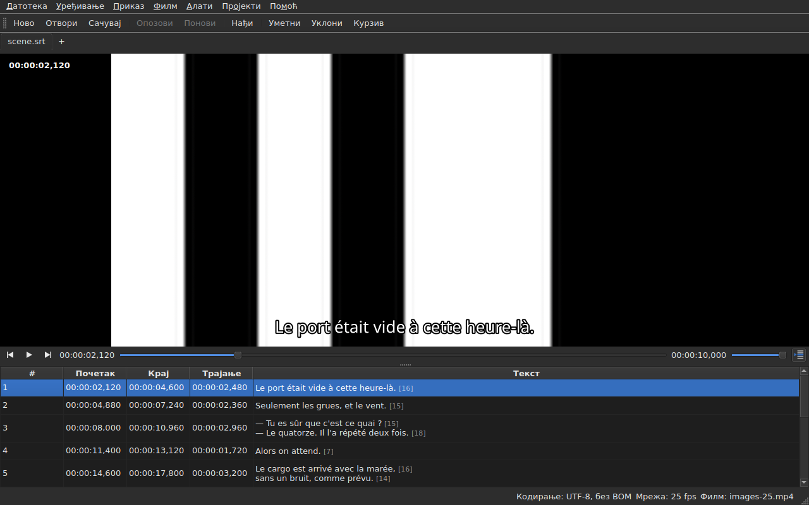

# Плејер

<!-- machine-translated -->
> Ова страница је машински превод који још није прегледао читалац језика.

Придружени филм гледа се **у прозору**, са текућим редом
исцртаним преко њега. Тако се на филму може проверити резултат
померања, преобразбе или претварања брзине кадрова.

О томе како се филм придружује видети [Придружени филм](video.md); ова
страница описује шта се дешава када је придружен.

## Приказ филма

| Ситуација | Шта прозор приказује |
| :-------- | :------------------- |
| филм је придружен и отвара се | слика заузима горњи део, табела испод |
| филм није придружен | нема слике, табела заузима цео прозор |
| филм се не отвара | нема слике, порука, а прозор остаје употребљив |

Подела између слике и табеле **помера се мишем**. Слика не
пада испод 180 пиксела висине. Повећање прозора даје добијени простор
табели, а не слици: оно што недостаје при уређивању су редови.

Испод слике, **трака репродукције**: где је филм, колико траје,
пуштање и пауза, и јачина звука. Видети [Трака репродукције](#трака-репродукције).

## Пуштање и заустављање

| Команда | Пречица | Шта ради |
| :------ | :------ | :------- |
| Филм ▸ Пусти / паузирај | `Ctrl+P` | пушта ако је репродукција заустављена, иначе је зауставља |

Команда је **онемогућена све док ниједан филм није отворен**. Филм који
је управо придружен отвара се **заустављен**: отварање филма није
гледање.

`Ctrl+P` тамо где Gaupol има обично `P`: пречицу од једног слова на
нивоу прозора узима прозор пре него што је види елемент
који има фокус, па би се `P` изгубило на путу до уређивача ћелије. Овде се ништа
не исписује, комбинација је слободна.

## Трака репродукције

Испод слике, са лева на десно — три дугмета су **иконе**, из теме радне површине када их она има, иначе из Qt стила:

| Елемент | Шта ради |
| :------ | :------- |
| два дугмета корака | померају филм уназад, унапред **за један корак у кадровима** — видети [Кадар по кадар](timing.md#кадар-по-кадар) |
| пусти / паузирај | пушта или зауставља, као `Ctrl+P` — дугме показује **шта ће урадити**: троугао када је заустављено, две црте када се пушта; облачић са саветом то каже обичним речима |
| положај | `HH:MM:SS,mmm`, написан као што табела пише положај — **као број кадра** када је означено [`Приказ ▸ Положаји у сличицама`](table.md#положаји-у-кадровима) |
| клизач | **чита и помера**: повлачи се ручка, кликће у жлеб, користе стрелице |
| трајање | оно које филм декларише, написано као положај |
| јачина звука | од 0 до 100, видети [Јачина звука](#јачина-звука) |
| праћење табеле | притиснуто све док табела прати репродукцију, а притиском враћа табелу на ред који се пушта — видети [Табела прати репродукцију](#табела-прати-репродукцију) |

**Клизач не предаје на сваком пикселу.** Повлачење ручке тражи десетине
положаја у секунди, а сваки кошта један декодиран кадар: први положај одлази
одмах, следећи чекају двадесетински део секунде, а **последњи тражени положај је
увек онај који се достиже** — најкасније када се ручка пусти. Слика зато не
каска за руком и не почиње да исцртава пут који нико не гледа.

**Клизач се током репродукције помера сам**, а то се не рачуна као радња:
филм помера само оно што корисник ради. Док се ручка држи, репродукција је не одузима.

## Временска ознака

**Положај је написан на слици**, горе лево, на провидној позадини која га чини
читљивим на свакој сцени. Исцртава га прозор, својим фонтом, и не тражи
од плејера ништа осим положаја који већ даје; освежава се са сваком радњом,
не чекајући следећи круг праћења.

## Кретање кроз филм

У менију **Video**, **Gaupol-ове радње**, под његовим називима. Све су **онемогућене без филма**, као
и репродукција; три које делују на избор онемогућене су и све док ништа није изабрано.

| Команда | Пречица | Шта ради |
| :------ | :------ | :------- |
| Филм ▸ Пусти изабрано | `Ctrl+Shift+P` | пушта од **мало пре почетка** избора **до краја његовог последњег титла**, и зауставља се на слици |
| Филм ▸ Пређи на претходно | `Ctrl+Left` | поставља репродукцију на почетак последњег титла који се **завршио** пре положаја |
| Филм ▸ Пређи на следеће | `Ctrl+Right` | поставља репродукцију на почетак првог титла који **почиње** после положаја |
| Филм ▸ Премотај уназад | `Ctrl+Shift+Left` | враћа се за један скок — подразумевано тридесет секунди |
| Филм ▸ Премотај унапред | `Ctrl+Shift+Right` | иде унапред за један скок |
| Филм ▸ Пређи на почетак избора | `Ctrl+Up` | поставља репродукцију на почетак избора, **са претходним помаком** |
| Филм ▸ Пређи на крај избора | `Ctrl+Down` | поставља репродукцију на крај избора, **са претходним помаком** |

**Пречице су Gaupol-ове**, осим једне: `Play Selection` је тамо `O`, а
голо слово прозор узима пре него што га види ћелија која се уређује — куцање
`o` у тексту покренуло би филм. `Ctrl+P` је одговор за репродукцију, `Ctrl+Shift+P` за
избор. Стрелице на тастатури остају уређивачу ћелије када је
отворен: `Ctrl+Left` тамо помера курсор за једну реч, а не репродукцију.

- **Скок** је 30 секунди, а може се поставити од 1 секунде до једног сата — видети
  [Поставке](preferences.md#плејер). Не прелази ни почетак филма ни његов крај.
- **Претходни помак** је једна секунда: гледа се мало **пре** титла, да се види како долази.
  Може се поставити од 0 до 60 секунди, а репродукција не силази испод нуле.
- **Сусед који не постоји** — ништа пре првог титла, ништа после последњег —
  не ради ништа и ништа не говори: репродукција остаје где јесте.
- **Свака радња се одмах види**: трака, временска ознака и исцртани ред су
  ажурни када се заврши, не чекајући следећи круг.

## Јачина звука

Јачина звука је она **плејера**, од 0 до 100, а не системска. Поставља се клизачем
траке, или двема радњама, у подменију `Филм ▸ Звук`, у корацима од пет:

| Команда | Пречица | Шта ради |
| :------ | :------ | :------- |
| Филм ▸ Звук ▸ Утишај | `Ctrl+-` | смањује јачину звука за пет |
| Филм ▸ Звук ▸ Појачај | `Ctrl++` или `Ctrl+=` | повећава је за пет — друга за тастатуре на којима плус тражи тастер shift |

**Памти се од једне сесије до друге** и даје сваком филму који се отвори. Вредност изван
0 до 100 у датотеци поставки не квари отварање: занемарује се, а прозор то каже.
**Звучна нумера се, напротив, не памти** — број нумере је број њене датотеке; видети
[Звучна нумера](video.md#звучна-нумера).

## Избор и репродукција

Оба иду у оба смера.

| Шта се ради | Шта се дешава |
| :---------- | :------------ |
| бира се ред | репродукција прелази **на почетак тог титла** |
| избор се проширује наниже | ништа више: рачуна се први ред избора |
| репродукција иде даље | **текући ред** прати титл на екрану, **обојен**, а табела га **центрира** — видети [Табела прати репродукцију](#табела-прати-репродукцију) |

Текући ред и избор су две различите ствари. Репродукција
помера први и **никада не дира други**: избор је оно на шта
се операција примењује, а филм који се пушта у углу нема посла да
преписује корисников циљни ред за редом.

Боја следи исто правило: она је ознака, а не избор. **Аномалија
има предност над њом** — ред који носи обоје задржава боју
своје грешке, јер грешка постоји да би се поправила, док је приказани ред то
само током једне реплике. Видети [Табела](table.md).

### Табела прати репродукцију

**Табела центрира ред који се пушта** — на средину онога што приказује, а не на ивицу где би било довољно да се
учини видљивим. Чини то **када се ред промени**, а не на сваки откуцај праћења: реплика траје
секундама, а поновно центрирање сваке десетине секунде било би померање без сврхе.

**Ручно померање обуставља праћење.** Точкић, трака за померање и клик у табели
га обустављају: табела остаје где је корисник ставио, док текући ред, исцртани ред и трака
настављају да прате филм. Дугме за праћење — **икона редова табеле, један означен стрелицом**, десно од траке
репродукције; његов облачић са саветом каже „Follow playback“ — **притиснуто је све док табела прати**, а затим искочи.

**Праћење се наставља радњом плејера**: започета репродукција, скок, корак, постављена ознака,
уметање на положају или померање траке — табела се тада одмах центрира на
ред који се пушта, чак и ако је то већ био исти. **Или на захтев**: притисак на дугме га враћа, а
отпуштање обуставља. Нема тајмера: праћење увек наставља нека радња.

Прелазак на други језичак наставља праћење на филму тог језичка.

**Уређивање у току се не прекида.** Све док је уређивач ћелије
отворен, текући ред остаје где је; ред исцртан на
слици, са своје стране, наставља да прати, јер никоме не смета.

## Исцртани ред

Оно што се приказује на слици долази из **отвореног документа**, никада из датотеке:
**оно што се види на слици је оно што је управо откуцано**, без пролаза кроз
диск. Текст се појављује центриран, при дну слике, и нестаје између два
титла.

**Уз превод, ред је онај из циљаног текста**: превод када
је текућа ћелија у ступцу `Translation`, главни текст
свуда другде. То је правило свих текстуалних операција — видети [Текст на који
операције циљају](table.md#текст-на-који-операције-циљају) —
а **поставке нема**: прелазак из једног ступца у други мења оно што
слика приказује, највише десетину секунде касније. Без превода, или
са уклоњеним ступцем, ништа се не мења: то је главни текст.

Титл са којим превод још није стигао не приказује **ништа** све док
је текући ступац превод: главни текст не заузима
његово место.

**Ознаке формата се разумеју, а никада не исцртавају какве јесу.** Модел носи
текст онако како га датотека пише, а међуформат ознака — онај за
претварање формата — чита га пре него што га преда слици:

| У датотеци | На слици |
| :--------- | :------- |
| подебљано, искошено, подвучено | примењено: `<i>no</i>` се приказује као *no*, без ознака |
| боја | примењена |
| фонт, величина | уклоњени, текст остаје |
| положај, поравнање, говорник, све без еквивалента на екрану | уклоњено, текст остаје |
| `{` и `}` у тексту | исцртани: „{laughs}“ се приказује као „{laughs}“ |

Датотека у формату Advanced SSA чита се на исти начин: њена `{\i1}` се примењују, а њена
`{\an8}` се уклања — ред остаје при дну слике. Сваки текст се чита **у формату
своје датотеке**, превод као и главни текст.

**Суседна датотека титлова се не учитава** у плејер, чак и ако носи име
филма. То би била она која се уређује, па би слика приказивала стање диска
док табела приказује нешто друго.

## Преглед измене

**Није потребно ништа посебно**: примени се операција, гледа се
филм, и бира `Undo: shifting` — или одговарајућа операција — ако
резултат не одговара. Видети [Опозив и понављање](undo.md).

Засебан режим прегледа не постоји, и то је намерно: оно што се
гледа је документ какав јесте, а не невидљиво привремено стање.

## Када се слика не појављује

Две могуће поруке, обе са путањом датотеке на почетку:

| Порука | Шта се догодило |
| :----- | :-------------- |
| `<file>: <reason>` | плејер је одбио датотеку — непознат формат, датотека недостаје, директоријум |
| `<file>: no video player is available` | ниједан плејер није могао да се изгради |

У оба случаја **филм остаје придружен** — мора се видети која
је то датотека да би се изабрала друга — а **прозор остаје употребљив**:
документ је отворен, операције раде, као и чување.

**Слика се исцртава у самом прозору**: `libmpv` попуњава бафер
величине приказа, у стварним пикселима, а прозор га исцртава. Ништа од тога не зависи од
графичке платформе — иста слика под X11, под Wayland-ом и без екрана — и
прати промену величине: однос страна филма се чува, остатак
приказа је црн.

Друга порука се зато појављује само ако библиотека `libmpv` одбије да се покрене,
иако је потребна при градњи.

Исцртавање пролази кроз процесор, али **декодирање може да обави графичка картица**: она
декодира, слика се копира назад у меморију, па исцртава као раније. Машина без
употребљиве картице декодира на процесору, без поруке. На филму 1080p у H.264, репродукција стиже
у реалном времену са резервом. **Филм 4K у тешком HEVC-у можда неће стићи**: мерено на два
језгра, декодира се 0,6 пута брже од реалног времена без картице, а корак од једног кадра тамо траје неколико
секунди када је кључни кадар далеко. Картица то време скраћује — за трећину до две трећине зависно од филма
— али га не уклања. **Не мења приказану слику**: корак или скок слећу на
исти кадар са картицом и без ње. Да би се искључила, искључити `Decode on the graphics card` у
[`Preferences…`](preferences.md#плејер).

## Чега нема

**Постављање ознаке, корак по кадар и померање ивице за један кадар** налазе се у
[Усклађивање времена према филму](timing.md), не овде. Шта не постоји, и бесмислено је тражити:

- таласни облик;
- аутоматска репродукција када се филм отвори;
- стил исцртаног реда (фонт, боја, положај, позадина): задржава стил прозора;
- хардверско декодирање без копирања: видети „Када се слика не појављује“ изнад.

Овај приручник описује оно што постоји: шта ће доћи, и којим редом, налази се у
[мапи пута](../../../../feuille-de-route.md).
