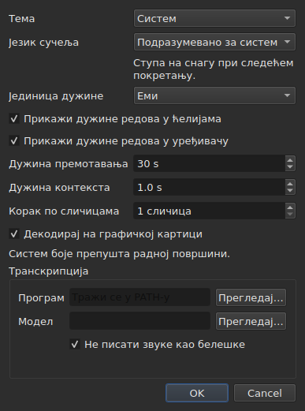

# Поставке

<!-- machine-translated -->
> Ова страница је машински превод који још није прегледао читалац језика.

Прозор памти оно што се мишем подеси — **где је био**, **да ли је
био увећан**, **ширину својих ступаца**, **положај ручке**
између филма и табеле — и **где се ради**, тако да
`Open…` отвара на правом месту. Ништа од тога се не подешава преко дијалога:
помера се, вуче се, и то се памти.

**Шест поставки има свој дијалог**, `Уређивање ▸ Поставке…`, и то је
мерило: поставка која већ има покрет не треба поље. Тема га
нема, нити јединица дужина редова, нити два поља за потврду која
их приказују, нити скок и увод плејера. Види [Тема](#тема),
[Дужине редова](#дужине-редова) и [Плејер](#плејер).

**Језик сучеља је у истом дијалогу, и он је тај који чека**: примењује се при
следећем покретању, а не одмах. Види [Језик сучеља](#језик-сучеља).

**Јачина звука га нема**: трака испод слике и два покрета је подешавају, и памти се.

**Друга се подешава тамо где се користи**: страна на коју `Insert Subtitles…` ставља своје
редове је поље тог дијалога, а последњи избор се памти. Види
[Уметање, уклањање, стапање, дељење, ређање и раздвајање титлова](lines.md#страна-се-памти).

**Тако је и са две опције претраге**: `Regular expression` и
`Ignore case` остају означене или неозначене од једног отварања дијалога до
следећег, и од једне сесије до друге. Види
[Налажење и замена](find-and-replace.md#две-опције).

**Тако је и са поставкама `Adjust Durations…`**: брзина читања, њена два
смера, и три трајања са својим пољима за потврду — свако чува своју вредност, означено
или не. Види [`Adjust Durations…`](operations.md#adjust-durations).

**И последње кодирање изабрано у `Save As…`**, са својом ознаком редоследа
бајтова. Види [датотеку](#датотека).

**И оно што подешавају чаробњак `Correct Texts…` и `Spell-Check Settings…`**:
означени задаци и њихов код, поља за потврду образаца, поставке ломљења редова, језик,
одредиште провере и подвлачење током куцања. Види [Исправи текстове…](correct-texts.md) и
[Провера писања…](check-spelling.md#поставке-провере-писања). **Одредиште и
документ из `Correct Texts…` се не памте.**

**Оно што се не памти:** последња отворена датотека — види
[Запамћени директоријум](#запамћени-директоријум).

## Плејер

Четири поља. **Seek length** и **Context length** су Gaupol-ови и имају његове вредности; **Frame step** и **Decode on the graphics card** су subedit-ови властити:

| Поље | Шта поставља | Подразумевано | Границе |
| :--- | :----------- | ------------: | :------ |
| `Seek length` | скок за `Seek Backward` и `Seek Forward` | 30 с | од 1 с до једног сата |
| `Context length` | увод пре избора, за `Seek Selection Start`, `Seek Selection End` и `Play Selection` | 1 с | од 0 до 60 с, на десетинку |
| `Frame step` | корак, **у кадровима**, за `Step Backward` и `Step Forward`, и за померање ивице | 1 кадар | од 1 до 1000 кадрова |
| `Decode on the graphics card` | допушта графичкој картици да декодира филм када је машина има; без картице, ништа се не мења | означено | означено или не |

Примењују се **одмах**, без чекања поновног покретања, и памте се од једне сесије до друге
под `video.seek-length` (у секундама), `video.context-length-ms` (у милисекундама) `video.step-frames` (у кадровима) и `video.hardware-decoding` (`true` или `false`).
**Вредност ван граница, или која није број**, не спречава отварање прозора: она
се игнорише, подразумевана остаје, а прозор то каже при отварању. **Корак по кадровима никада није у милисекундама**: корак од N кадрова је увек N кадрова, ма колика била брзина кадрова филма — види [Усклађивање времена према филму](timing.md#кадар-по-кадар). Јачина звука се памти у `video.volume`,
од 0 до 100, са истом толеранцијом.

## Датотека

```
~/.config/subedit/settings.conf
```

Тачније `$XDG_CONFIG_HOME/subedit/settings.conf` када је та променљива
постављена. Пише се **када се прозор затвори**, а чита када се отвори.
Прекинут програм — убијен, или заустављен падом — не пише ништа, а
следећа сесија налази оно што је претходна оставила.

Датотека је текст, и може се уређивати ручно. То је својство, а не
узгредан ефекат: оно чини да се поставка може исправити када је
сучеље које је поставља управо оно које је покварено.

### Два блока, један дељен са командном линијом

Датотека се пише у **два блока**, сваки испод натписа у коментару:

| Блок | Кључеви | Чита |
| :--- | :------ | :--- |
| `# Operation settings: shared by the window and the command line` | кључеви `duration-adjust.*` и `correction.*` | прозор **и** `subedit-cli` |
| `# Display preferences: the window's own` | сваки други кључ — геометрија, ступци, тема, језик сучеља, претрага, провера писања, уређивач, филм, последњи директоријум, кодирање при писању | само прозор |

**`subedit-cli` подразумевано чита блок операција**: оно што `Adjust Durations…` и
`Correct Texts…` овде памте је и оно од чега полазе [`subedit-cli adjust`](../subedit-cli/adjust.md)
и део [`subedit-cli correct`](../subedit-cli/correct.md), осим ако опција
командне линије не каже другачије. **Никада не чита поставке приказа.** Његова
команда [`config`](../subedit-cli/config.md) наводи кључеве операција, показује њихове вредности и
мења их — `subedit-cli config set duration-adjust.speed 12` — а прозор види промену
при свом следећем отварању. **Измена направљена док је прозор отворен не преживљава његово затварање**:
прозор преписује целу датотеку оним што држи. `--no-config` чини да командна линија игнорише
датотеку. Види
[Датотека поставки](../subedit-cli/invocation.md#датотека-поставки).

Читач узима кључеве било којим редом, са натписима или без њих: датотека написана пре него што су
постојала два блока чита се непромењена, и преписује у два блока при следећем затварању.

| Опција | Шта садржи | Подразумевано |
| :----- | :--------- | :------------ |
| `window.geometry` | `x,y,width,height`, у пикселима; ширина и висина различите од нуле | прозор сам одређује величину |
| `window.maximised` | `true` или `false` | `false` |
| `table.columns` | четири ширине у пикселима, раздвојене зарезима — `#`, `Start`, `End`, `Duration`, чак и скривене | табела сама одређује величину |
| `table.order` | шест ступаца, **сваки једном**, редом којим их табела приказује: `number`, `start`, `end`, `duration`, `text`, `translation` | `number,start,end,duration,text,translation` |
| `table.hidden` | уклоњени ступци, међу `number`, `start`, `end` и `duration`; празно, ниједан | ниједан |
| `window.table-share` | део висине дат табели, у процентима, од 1 до 99 | прозор дели као што је одувек делио |
| `file.directory` | **апсолутна** путања директоријума | нема: `Open…` отвара тамо где је програм покренут |
| `general.theme` | `system`, `light` или `dark` | `system` |
| `interface.language` | `system`, или име језика како се зове његов каталог: два или три мала слова, затим по жељи `_` и два велика — `fr`, `pt_BR`; `en` за енглески | `system` |
| `edit.insert-placement` | `above` или `below` | `below` |
| `file.write-encoding` | име кодирања које ICU може да пише, а чији претварач не пише своју ознаку | нема |
| `file.write-bom` | `true` или `false` | `false` |
| `search.regex` | `true` или `false` — образац је регуларни израз | `false` |
| `search.ignore-case` | `true` или `false` — величина слова се занемарује | `true` |
| `duration-adjust.speed` | брзина читања, у знаковима у секунди, строго позитивна; децимални број се пише што краће (`15`, `12.5`) | `15` |
| `duration-adjust.lengthen` | `true` или `false` — продужити оно што је прекратко да би се прочитало | `true` |
| `duration-adjust.shorten` | `true` или `false` — скратити оно што остаје приказано дуже него што треба | `false` |
| `duration-adjust.minimum-enabled` | `true` или `false` — најмање трајање је тражено | `true` |
| `duration-adjust.minimum-ms` | најмање трајање, у милисекундама, цео и ненегативан број | `1500` |
| `duration-adjust.maximum-enabled` | `true` или `false` — највеће трајање је тражено | `false` |
| `duration-adjust.maximum-ms` | највеће трајање, у милисекундама, цео и ненегативан број | `6000` |
| `duration-adjust.gap-enabled` | `true` или `false` — размак до следећег титла је тражен | `true` |
| `duration-adjust.gap-ms` | размак, у милисекундама, цео и ненегативан број | `0` |
| `correction.mentions.enabled`, `correction.common-errors.enabled`, `correction.capitalization.enabled`, `correction.line-break.enabled` | `true` или `false` — задатак је означен на првој страници `Correct Texts…` | `false`, `true`, `true`, `false` |
| `correction.mentions.code`, `correction.common-errors.code`, `correction.capitalization.code`, `correction.line-break.code` | код образаца задатка: `Zyyy`, или `Script[-language[-COUNTRY]]` — `Latn-en-US`; није празан | `Zyyy` |
| `correction.human`, `correction.ocr` | `true` или `false` — класе уобичајених грешака | `true`, `true` |
| `correction.sound-in-brackets`, `correction.sound-in-parentheses` | `true` или `false` — два поља за потврду странице `Mentions` | `false`, `false` |
| `correction.line-break.max-length` | највећа дужина реда, децимална; дијалог је ограничава од 1 до 1000 | `24` |
| `correction.line-break.max-lines` | највећи број редова, цео; дијалог га ограничава од 1 до 100 | `3` |
| `correction.line-break.in-ems` | `true`: дужина се мери у *емовима*; `false`: у знаковима | `true` |
| `correction.line-break.skip-on-length`, `correction.line-break.skip-on-lines` | `true` или `false` — два услова прескакања су тражена | `true`, `true` |
| `correction.line-break.skip-max-length`, `correction.line-break.skip-max-lines` | два прага прескакања, у изабраној јединици | `24`, `3` |
| `correction.join-split.enabled` | `true` или `false` — задатак `Join or Split Words` је означен | `false` |
| `correction.join-split.join`, `correction.join-split.split` | `true` или `false` — спојити, поделити | `true`, `false` |
| `correction.join-split.language` | шифра локалитета — `fr`, `en_US`, `sr@Latn` —; празно: језик система | празно |
| `correction.remove-blank` | `true` или `false` — `Remove all blank subtitles` | `true` |
| `transcription.engine` | назив мотора: мала слова, цифре, `.`, `-` и `_` | `whisper.cpp` |
| `transcription.executable`, `transcription.model` | апсолутна путања; празно: мотор се тражи у `PATH`, а модел није задат | празно |
| `transcription.language` | два мала слова, ISO 639-1 код; празно: језик се открива | празно |
| `transcription.suppress-notes` | `true` или `false` — `Do not write sounds as notes` | `true` |
| `transcription.merge-gap-ms` | делови једне реченице ближи од овога спајају се, у милисекундама, цео број који није негативан | `400` |
| `transcription.max-duration-ms` | најдуже време које транскрибовани титл остаје на екрану, у милисекундама, од 1 до 3600000 | `7000` |
| `transcription.max-characters` | највише знакова које транскрибовани титл садржи, од 1 до 1000 | `84` |
| `correction.activations` | поља за потврду образаца која је корисник променио, `<type>:<code>:<name>:<0\|1>`, раздвојена зарезима; **зарез или обрнута коса црта у имену пишу се са обрнутом косом цртом испред** (`\,` и `\\`), а нечитљив унос губи само своју поставку — јавља се, остали се задржавају | празно |
| `spell-check.language` | шифра локалитета, као `fr_FR`; празно: језик система | празно |
| `spell-check.target` | `selection`, `current-project` или `all-projects` | `current-project` |
| `spell-check.document` | `main` или `translation` | `main` |
| `spell-check.inline` | `true` или `false` — подвлачи непознате речи током куцања у уређивачу ћелије | `false` |
| `editor.length-unit` | `em` или `characters` — јединица дужина редова које приказују табела и уређивач | `em` |
| `editor.show-lengths-cell` | `true` или `false` — сваки ред ћелије текста прати његова дужина | `true` |
| `editor.show-lengths-edit` | `true` или `false` — уређивач ћелије приказује дужину сваког реда на маргини | `true` |

**Датотека прихвата више од дијалога.** Читач узима сваку строго
позитивну брзину и свако ненегативно трајање; дијалог `Adjust
Durations…`, са своје стране, ограничава брзину од 1 до 99 знакова у секунди, а свако
трајање од 0 до 99 с. Вредност из датотеке ван тих граница враћа се на
границу када се дијалог отвори, а датотека је тако задржава пошто се
дијалог прихвати и прозор затвори. Отказан дијалог не мења ништа у ономе што
се памти.

**`file.write-encoding` памти последње кодирање изабрано у `Save As…`, и
никада се не намеће датотеци.** Отворени документ носи своје кодирање,
и то је оно које оквир предлаже: његово преписивање у другом јер то каже
поставка стара три недеље изгубило би оно што је читање сачувало.
Оно што ова поставка памти служи документу који нема датотеку — оном
тек направљеном.

**То је намерно „не“, а не превид.** Ко увек испоручује у истом
кодирању а наслеђене датотеке отвара у другом, бира га поново за
сваку датотеку; оквир му га предлаже, а гаранција повратног пута важи
за све.

**`file.write-bom` носи ознаку истог кодирања**, а два
реда су заиста потребна: име кодирања не казује да ли му претходи његова ознака, као
ни `--encoding` не казује оно што казује `--bom`. Оба се читају заједно, било којим
редом, а `file.write-bom` без запамћеног кодирања не поставља ништа.

**Део, а не висине за ручку**, и то је оно што га чини
корисним: три висине у пикселима више ништа не значе чим се прозор
отвори у другој величини, а прозор се често отвара у другој величини.
Део се понавља свуда. **Враћа се на оно што прозор прихвата** ако је
премали — трака филма има најмању висину.

**Четири ширине за шест ступаца**, и то није превид: то су ширине
`#`, `Start`, `End` и `Duration`, тим редом ма какав био редослед
табеле, а **скривени ступац задржава своју** — налази је поново када се
поново прикаже. Последњи приказани ступац узима оно што остали оставе, а давање
ширине не би променило ништа; ширине текста и превода се стога
не памте.

## Шта се дешава када датотека не каже оно што се очекује

Подешавање је удобност. **Његов неуспех кошта удобност и ништа
друго**: прозор се у сваком случају отвара.

| Случај | Шта се дешава |
| :----- | :------------ |
| датотека не постоји | све подразумеване вредности, и ништа се не каже — то је прво покретање |
| датотека постоји и не може да се прочита | све подразумеване вредности, а разлог се пише на ток грешака |
| опција је одсутна | њена подразумевана вредност |
| кључ је непознат | игнорише се, без речи, и одсутан је из преписане датотеке |
| вредност не може да се прочита | задржава се њена подразумевана вредност, а опција се именује на току грешака |

```console
$ subedit-gui film.srt
subedit-gui: /home/vous/.config/subedit/settings.conf: window.geometry: "plus tard" cannot be read, keeping the default
```

**Порука иде на ток грешака и нигде другде.** Модални
прозор при покретању за нечитљиву поставку зауставио би корисника због
мане која га ни у чему не спречава, и пре него што је ишта затражио.

## Опције у коментарима

Преписана датотека садржи **све** познате опције, а оне остављене на
подразумеваној вредности пишу се као коментари:

```
#window.geometry = 0,0,1280,800
#window.maximised = false
#table.columns = 60,110,110,110
#table.order = number,start,end,duration,text,translation
#table.hidden = start,end
```

То није афектација. Без тога, опција која никада није дирана остала би
замрзнута на вредности дана када је написана, а **побољшана подразумевана
вредност никада не би никога стигла**. Са тим, промена подразумеване вредности мења
понашање свих који је нису преписали — а то је управо
оно што подразумевана вредност мора да ради.

Да би се опција преписала: уклони се `#` и промени вредност. Да би се вратило
на подразумевано: обрише се ред, или се поново стави под коментар.

Геометрија, ширине и уклоњени ступци показују **облик**, а
не вредност на снази: подразумевана вредност геометрије и ширина је
„оно што прозор изабере“, што се не пише бројевима, а она за
`table.hidden` је „ниједан“, што не може да се прочита. Заглавље датотеке то
такође каже. `table.order`, са своје стране, показује подразумевани редослед.

## Запамћени директоријум

`Open…` се отвара на директоријуму **последње отворене или сачуване датотеке**,
а не на оном из оквира који је отказан: рачуна се где се
ради, а не где се гледало.

**Последња датотека се, са своје стране, не памти.** Њено памћење значило би
поновно отварање при покретању документа који нико није тражио. Памћење директоријума
*показује* дијалогу; памћење датотеке отворило би је.

## Тема

`Уређивање ▸ Поставке…` се отвара са темом, поставком без покрета, изнад
[дужина редова](#дужине-редова).

| Вредност | Шта ради |
| :------- | :------- |
| `System` | **ништа** — боје остају оне радне површине |
| `Light` | поставља светлу палету |
| `Dark` | поставља тамну палету |

Изабрана тема се примењује **одмах**, без поновног покретања.

**„System“ не ради ништа, и то није недостатак.** Верзија Qt-а
са којом је subedit изграђен нема начина да упита радну површину жели ли да буде
светла или тамна, нити да буде обавештена када се предомисли. Уместо да
измишља читање које не уме да направи, алат испоручује две теме
које се могу тражити и препушта алату да одлучи за трећу —
а то ради и Gaupol под истим условима.

Под радном површином чија је тема већ тамна, `System` стога даје тамни
прозор; под светлом, светли прозор. `Light` и `Dark` је преписују,
ма каква била радна површина.

**Боје аномалија остају читљиве у обе палете** — види
[Табела](table.md#аномалије). То није претпоставка: контраст
текста на свакој од боја проверава тест, на обе позадине.

## Транскрипција

Група **`Transcription`** дијалога садржи две чињенице о машини које су потребне команди
[`Transcribe Audio…`](video.md#транскрипција-звука): **програм** мотора (whisper.cpp,
`whisper-cli`) и **модел** који он чита. Свако има дугме `Browse…`. Ако се остави празан, програм се тражи
у `PATH`-у; модел нема подразумеване вредности.

Испод поља **дијалог каже шта је ту**: да ли је мотор пронађен и где, да ли је `ffmpeg`
пронађен, и модел — није постављен, није пронађен, није модел, само за енглески или вишејезични. Када нешто
недостаје, додаје упутство на
[Инсталирање алата за транскрипцију](../subedit-cli/install-transcription.md), које каже где се
шта налази. Та два поља су поставке `transcription.executable` и `transcription.model`.

Поље за потврду **„Не писати звуке као белешке“** је поставка `transcription.suppress-notes` (подразумевано означено): мотору је речено да не пише звуке
као белешке, на пример `(phone ringing)`. Поништите ознаку да их задржите, за титлове за наглуве. Дијалог `Transcribe Audio…` нуди исто поље за једну транскрипцију.

## Језик сучеља

`Уређивање ▸ Поставке…` бира језик прозора, испод теме.

| Поље | Вредности | Подразумевано |
| :--- | :-------- | :------------ |
| `Interface language` | `System default`; `English`; затим сваки језик инсталиран са програмом, по свом имену — `Français` | `System default` |

**Ступа на снагу при следећем покретању**, а дијалог то каже испод поља: прозор се
преводи док се гради, а покренут прозор задржава језик у коме је почео. Избор се
чува у датотеци поставки, под `interface.language`, и чита када се прозор следећи пут отвори.

| Избор | Прозор почиње на |
| :---- | :--------------- |
| `System default` | језику окружења, као пре било каквог избора — `LANGUAGE`, `LC_ALL`, `LC_MESSAGES`, `LANG`; види [Језик](invocation.md#језик) |
| `English` | енглеском, шта год окружење говорило |
| инсталиран језик | том језику, **шта год окружење говорило**, укључујући `LC_ALL=C`: избор направљен овде је изричит |

Списак садржи језике чији је каталог инсталиран под `<prefix>/share/subedit/locale`;
енглески је увек ту, јер је то језик на коме је програм писан. Језик се приказује
својим именом, које ниједан каталог не преводи, да би читалац нашао онај који чита.

**Вредност коју програм не може да поштује кошта само избор:**

| Шта датотека каже | Шта се дешава |
| :---------------- | :------------ |
| име језика без инсталираног каталога — датотека донета са друге машине | прозор следи окружење, без речи; `Preferences…` показује тај језик, по имену или шифри, и задржава га осим ако се други не изабере |
| нешто што није име језика — `French`, `fr_FR.UTF-8` | `system`, подразумевано, а опција се именује на току грешака, као свака нечитљива вредност |

```console
$ subedit-gui film.srt
subedit-gui: /home/vous/.config/subedit/settings.conf: interface.language: "French" cannot be read, keeping the default
```

**Командна линија је никада не чита**: `subedit-cli` бира свој језик само из
окружења, а `subedit-cli config set interface.language fr` је одбијено као поставка приказа.

## Дужине редова




`Уређивање ▸ Поставке…` поставља и **оно што табела и уређивач приказују од
дужине редова** — Gaupol-ов лењир и маргина.

| Поље | Шта ради | Подразумевано |
| :--- | :------- | :------------ |
| `Length unit` | јединица дужина: `Ems` или `Characters` | `Ems` |
| `Show line lengths in cells` | сваки ред ћелије текста прати његова дужина | означено |
| `Show line lengths in the editor` | уређивач ћелије приказује дужину сваког реда на маргини с десне стране | означено |

**`Length unit` је засивљено када ниједно поље за потврду није означено**: без
дужине за приказ, јединица не поставља ништа. Избор се примењује **одмах** на
табелу, а уређивачи који се отварају после га следе. Три вредности се
памте од једне сесије до друге: `editor.length-unit`, `editor.show-lengths-cell`
и `editor.show-lengths-edit`, у табели [датотеке](#датотека). Види
[Дужина редова](table.md#дужина-редова) и
[у уређивачу](editing.md#дужина-редова).

**То није ограничење чаробњака.** Јединица за `Correct Texts…` — дужина
на којој ломи редове — је посебна поставка, у свом
чаробњаку: у табели се могу читати еми а ломити у знаковима.

## Шта се не може поставити

**Девет запамћених поставки бира се у дијалогу** — не рачунајући оне
чаробњака за исправке и провере писања, које имају
своје —, и свака у ономе где се користи: тема и три поставке дужина редова, овде; страна уметања, у дијалогу уметања;
две опције претраге, у дијалогу претраге; кодирање и
ознака редоследа бајтова, у `Save As…`; брзина читања, трајања
и размак дотеривања трајања, у његовом дијалогу. Нема
других: ништа се не може подесити за дијагностику, јачину звука
плејера, нити подразумевани формат чувања — тај долази из отворене датотеке.

И **ниједан број који припада документу не чува се од једне сесије до
друге**: износ померања, два маркера преобразовања истинити су за једну
датотеку а лажни за следећу. Дијалози их траже поново при сваком покретању,
намерно. Поставке `Adjust Durations…` су изузетак на исти начин као
две опције претраге: брзина читања, најмање трајање или
размак су избори метода, а не мерења датотеке, и
трају од једне сесије до друге из тог разлога.

Овај приручник описује оно што постоји: оно што ће доћи налази се на
[мапи пута](../../../../feuille-de-route.md).
