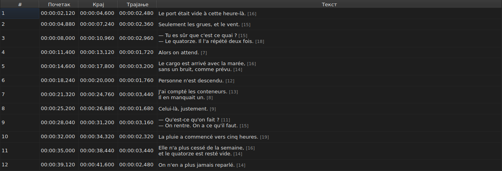
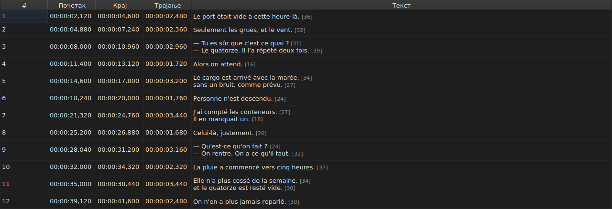
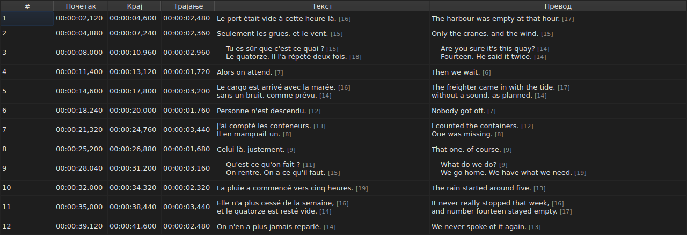
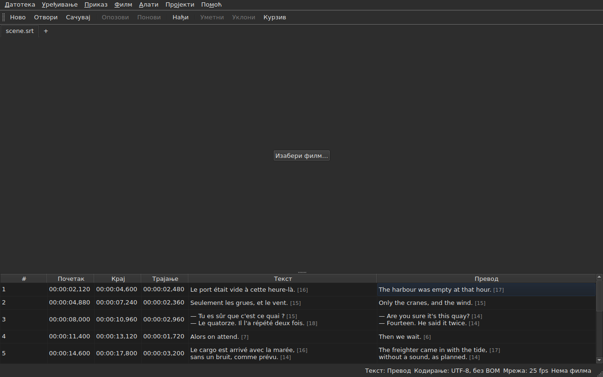

# Табела

<!-- machine-translated -->
> Ова страница је машински превод који још није прегледао читалац језика.

Прозор приказује титлове отворене датотеке, један по реду, у пет
ступаца — шест када пројекат има превод.

**Овај приручник наводи наслове прозора онако како их приказује прозор на енглеском**,
као што чини и за командну линију; преведени прозор их приказује на свом језику.

| Ступац | Шта приказује |
| :----- | :------------ |
| `#` | редни број титла, од 1 |
| `Start` | положај на коме се појављује, `HH:MM:SS,mmm` |
| `End` | положај на коме нестаје |
| `Duration` | `End − Start` |
| `Text` | текст титла |
| `Translation` | превод титла — **одсутан све док пројекат нема превод** |




## Дужина редова




**Иза сваког реда ћелије са текстом стоји његова дужина**, `[N]`, мања
и блеђа — у ступцу `Text` као и у ступцу `Translation`.
Тако ради Gaupol.

| Шта се рачуна | Шта табела ради |
| :------------ | :-------------- |
| **ознаке** | не рачунају се: `<i>Bonjour</i>` даје `[7]`, као `Bonjour` |
| **заокруживање** | наниже: ред од 12,9 ема приказује се `[12]` |
| **празан ред** | нема дужину; ни празан текст нема |
| **јединица** | *ем* подразумевано, или знакови — `Уређивање ▸ Поставке…` |
| **ред предугачак за ступац** | сече се са `…` **пре** броја, који остаје видљив |

**Ем је Gaupol-ов, а не типографски**: мала слова абецеде
вреде 0,55 ема по слову, са фонтом табеле. Дужина у *емовима* зато
зависи од фонта; дужина у знаковима броји кодне тачке, при чему
акценат вреди један.

**Табела не обележава предугачак ред.** Приказује број, а на оку је
да га упореди са границом коју је корисник сам поставио — као Gaupol. То није
граница асистента `Correct Texts…`, који има своју поставку.

**Да се не виде:** искључити `Show line lengths in cells` у
`Уређивање ▸ Поставке…`. Видети [Дужине редова](preferences.md#дужине-редова).

## Скривање и премештање ступаца

**`Приказ ▸ Ступци`** носи једну ставку са пољем за потврду по ступцу, **осим `Text`**:
без главног текста не би остало ништа за уређивање.

| Ставка | Ступац |
| :----- | :----- |
| `Приказ ▸ Ступци ▸ Број` | `#` |
| `Приказ ▸ Ступци ▸ Почетак` | `Start` |
| `Приказ ▸ Ступци ▸ Крај` | `End` |
| `Приказ ▸ Ступци ▸ Трајање` | `Duration` |
| `Приказ ▸ Ступци ▸ Превод` | `Translation` — видети [Ступац превода](#ступац-превода) |

Искључивање ставке уклања њен ступац, поновно укључивање враћа га, на ширини
коју је имао. **Поставка важи за цео прозор**, укључујући све језичке:
постоји једна табела, чији се пројекат мења са језичком.

**Текућа ћелија напушта ступац који се уклања**: прелази у `Text`,
у истом реду, а избор се не помера. Текућа ћелија у
ступцу који нико не види била би ћелија коју би један притисак тастера уређивао
на слепо.

**Ступци се премештају превлачењем њиховог заглавља**, било ког, укључујући
`Text`. Последњи приказани ступац заузима простор који остали оставе.

**Редослед и уклоњени ступци памте се од једне сесије до друге**, заједно са
ширинама, у [датотеци поставки](preferences.md) — `table.order`
и `table.hidden`. Ступца превода ту нема: он прати своје правило
и враћа се уз сваки отворени превод.

**Број није податак датотеке** већ редни број реда. Уметање или уклањање
зато поново нумерише све што следи, а да се ништа
не преписује.

**Децимални раздвојник прати формат датотеке**: зарез за SubRip,
тачка за осталих осам. SubRip је једини од девет који пише зарез.

**Прати раздвојник, а не цео запис.** Табела увек пише
сате и увек три децимале; WebVTT датотека изоставља
сате испод једног сата, SubViewer 2 и два Sub Station Alpha броје у
стотинкама, MPL2 у десетинкама, TMPlayer у секундама, MicroDVD у кадровима.
Ступац чија би ширина пратила формат био би напорнији за читање него
ступац који једноставно није тачан запис датотеке.

Оно што табела јамчи су зато **вредност и раздвојник**, а не број
децимала. Оно што би циљни формат заокружио каже се у тренутку
чувања — видети
[Оно што формат неће понети](files.md#оно-што-формат-неће-понети-речено-пре-писања).

**Трајање (`Duration`) се израчунава**, никада не чува: његово куцање помера
крај. Титл чији крај претходи његовом
почетку приказује негативно трајање, а не нулу: то је аномалија
датотеке, а њено скривање онемогућило би да се пронађе.

**Почетак, крај, трајање, текст и превод уређују се на месту**; број
не. Видети [Уређивање ћелије](editing.md).

**Избор означава на шта операција делује** — видети
[Операције](operations.md).

**Висина реда прати титл који носи**: титл од
два реда заузима два, онај од три заузима три. Текст се приказује
у целини, онако како ће бити написан.

**Сеченим остаје ред предугачак за свој ступац**, и тада
се завршава са три тачке. Ширење ступца `Text`, или прозора, приказује га
у целини; тако чини и отварање ћелије. Редови текста се никада не
преламају: само прави прелом реда прави ред, па се висина
реда табеле не мења када се повлачи ивица ступца.

## Положаји у кадровима

**`Приказ ▸ Положаји у сличицама`** — ставка са пољем за потврду, једна поставка за прозор — приказује
ступце `Start` и `End` **као бројеве кадрова** уместо временских ознака, и **прихвата број кадра као унос**.
Заглавља то кажу: `Start (frames)` и `End (frames)`.

| Шта се мења | Шта се не мења |
| :---------- | :------------- |
| оно што `Start` и `End` пишу и што прихватају | ступац `Duration`, који остаје време |
| заглавља та два ступца | документ: ништа се не мења, историја нема нову ставку, а **оно што датотека пише је оно што је писала** |

**Брзина кадрова која броји кадрове** је, тим редом:

1. **брзина датотеке**, када се броји у кадровима — MicroDVD, који носи бројеве а не
   брзину кадрова: **прозор тада приказује бројке своје датотеке**, ма који био филм;
2. **брзина коју декларише придружени филм**;
3. **мрежа коју положаји исцртавају**, када је исцртавају.

Облачић са саветом за ставку каже која је задржана: *Положаји су бројеви кадрова, бројани при 25 fps, брзини коју
филм декларише*. **Ако нема ниједне од три, ставка је онемогућена, а њен облачић са саветом каже зашто**: датотека
се не броји у кадровима, филм не декларише брзину кадрова, а положаји не падају на мрежу.

- **Број је број кадра у који положај пада**, заокружен на најближи кадар. **Откуцан,
  даје тренутак у коме тај кадар почиње**, заокружен **само једном** из тачног односа
  ([ADR 0013](../../../../adr/0013-mise-a-l-echelle-exacte-des-positions.md)): кадар 37 при 23,976 кадрова у секунди
  почиње на 1543,04 ms, то јест `00:00:01,543`.
- **Прихватају се само цели бројеви** — са знаком минус, јер почетак може претходити филму. Временска
  ознака откуцана у режиму кадрова, или број који то није, оставља ћелију каквом је била.
- **Трака репродукције прати исту поставку**: положај и трајање са обе стране клизача
  пишу се као бројеви кадрова као `Start` и `End`, у истом тренутку — видети
  [Трака репродукције](player.md#трака-репродукције). Сат исцртан при врху слике остаје
  временска ознака.
- **Ова поставка се не памти** од једне сесије до друге: то је поставка прозора, а не
  документа, и поново се укључује једном радњом.

## Аномалије

Титл чији положаји не држе заједно је **обојен на својим
временским ступцима**, а задржавање миша изнад њега каже шта није у реду.

| Боја | Шта јавља | Шта урадити |
| :--- | :-------- | :---------- |
| црвена | `ends before it starts` | исправити његов крај или његов почетак |
| плава | `starts before the previous one starts` | вратити га на своје место у редоследу |
| ћилибарска | `starts before the previous one ends` | подесити његово време |


Боји се само у ступцима `Start`, `End` и `Duration`: аномалија
говори само о времену, а бојење текста наводило би на помисао да има
неке везе са тим.

**Титл може носити више њих**, а облачић са саветом именује све. Боја
је она прве коју треба поправити: титл покварен сам по себи
покварен је шта год да раде његови суседи; погрешно постављен титл се враћа на место,
а његово преклапање нестаје с њим.

> Није случајно што неред готово увек побеђује
> преклапање: почети пре почетка претходног значи почети
> пре његовог краја — осим ако ни претходни није покварен.

**Обележавање се поново рачуна после сваке промене положаја**, било да долази
од уређене ћелије, операције или опозива. Каже шта датотека
јесте сада, а не шта је била при отварању.

Не ослања се ни на какву мрежу кадрова: чим се положај ручно
исправи, он је напушта, а обележавање засновано на њој јављало би
рад корисника.

## Ступац превода

Титл носи **два текста и један пар положаја**: превод
нема сопствено време, везан је за време титла.
Табела га приказује у шестом ступцу, `Translation`, десно од `Text`.




**Ступац постоји само ако пројекат има превод.** Без њега табела
задржава својих пет ступаца, а прозор се понаша као да превод
не постоји — ништа није засивљено нити додато. `Датотека ▸ Отвори превод…` отвара
један: видети [Отварање превода](files.md#отварање-превода).

**Ставка менија `View` га приказује или уклања**:

| Ставка | Шта ради |
| :----- | :------- |
| `Приказ ▸ Ступци ▸ Превод` | означено: ступац је приказан; неозначено: уклоњен је |

Ставка је **онемогућена када пројекат нема превод** — нема шта да се
прикаже — и означена при покретању. **Избор да се уклони је
корисников**: важи од једне датотеке до друге, док се поново не
означи. Уклањање ступца не уклања превод: он остаје у
пројекту и враћа се са ставком. Отварање датотеке која га нема уклања
ступац.

**У ћелије превода куца се као у ћелије текста** — видети
[Уређивање ћелије](editing.md).

### Текст на који операције циљају

Са два текста у реду, текстуалне операције морају знати који од њих
преписују. **То је онај из ступца текуће ћелије**:
превод ако је текућа ћелија у ступцу `Translation`, главни
текст свуда другде — у временском ступцу као и у `Text`.

| Операција | Шта циља |
| :-------- | :------- |
| `Italic`, `Case`, `Dialogue`, `Remove Hearing-Impaired Mentions…` | текст текућег ступца |
| `Cut Texts`, `Copy Texts`, `Paste Texts` | текст текућег ступца |
| `Find and Replace…` | текст текућег ступца — видети [Налажење и замена](find-and-replace.md#у-ком-тексту) |
| операције над положајима, уметање, уклањање, стапање, дељење | **оба текста**: титл је целина |

**Статусна трака то каже када постоје два текста**, лево од осталих
индикација:

```text
Text: Translation
```

или `Text: Main` за главни текст. Ћути када ступац није
приказан: тада постоји само један текст и нема смисла то говорити.




**Ред исцртан на слици прати исто правило**: то је текст текућег
ступца. Видети [Плејер](player.md#исцртани-ред).

**Ништа није засивљено.** Текстуалне операције остају доступне ма који био
текући ступац, а без ступца превода циљају главни
текст, као раније.

## Додавање и уклањање редова

`Уређивање ▸ Уметни титлове…` и `Уређивање ▸ Уклони титлове` додају и уклањају
редове, `Уређивање ▸ Стопи титлове` и `Уређивање ▸ Подели титл` их стапају и
деле; табела се сама поново нумерише. Видети
[Уметање, уклањање, стапање и дељење редова](lines.md).

## Шта табела не ради

**Ређање по ступцу не постоји.** Приказани редослед је редослед датотеке, а
он је једини који има смисла за титлове: редни број реда *јесте*
његово место у времену.
