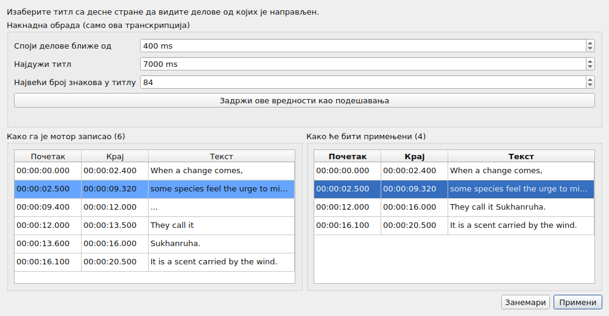
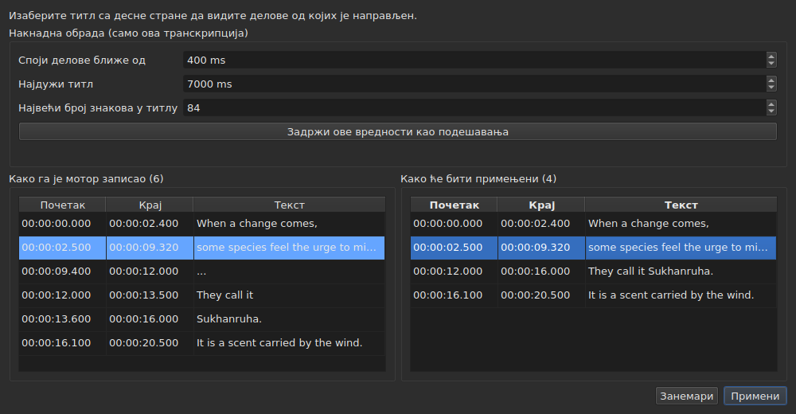

# Придружени филм

<!-- machine-translated -->
> Ова страница је машински превод који још није прегледао читалац језика.

Мени **Филм** носи прво три команде, па покрете који управљају филмом
— види [Плејер](player.md#кретање-кроз-филм).

| Команда | Пречица | Шта ради |
| :------ | :------ | :------- |
| Изабери филм… | нема | бира датотеку филма уз коју документ иде |
| Транскрибуј звук… | нема | транскрибује звук филма у титлове који замењују титлове пројекта — види [Транскрипција звука](#транскрипција-звука) |
| Пусти / паузирај | `Ctrl+P` | пушта или зауставља филм — види [Плејер](player.md#пуштање-и-заустављање) |

Придружени филм је **својство отвореног документа**, а не поставка
апликације: отварањем друге датотеке титлова креће се испочетка. Не
уписује се ни у једну датотеку и нестаје са прозором.

## Звучна нумера

Филм може да носи више звучних нумера — оригиналну верзију, синхронизацију, коментар. Подмени
**`Филм ▸ Звук ▸ Језик`** их наводи, **једну ставку по нумери**, и **означава ону која се пушта**:

| Шта даје датотека | Шта ставка каже |
| :---------------- | :-------------- |
| језик и наслов | `1: fra — Original` |
| само језик | `2: eng` |
| само наслов | `3: Commentary` |
| ништа од тога | `1` |

Број је **место нумере у филму**, једно за другим, редоследом датотеке: две нумере
могу да кажу `eng`, а датотека која ћути о својим ознакама ипак има прву и другу.

**Избор ставке пушта ту нумеру.** Ознака је одговор плејера, а не клик: она показује
нумеру која се пушта.

- **Подмени је искључен** без филма или без звучне нумере. Са једном нумером остаје укључен и
  приказује је, штиклирану: он каже језик филма. Два покрета јачине звука, која су поред њега, остају
  укључена у сваком случају: види [Јачина звука](player.md#јачина-звука).
- **Нумера се не памти** од једног филма до другог, нити од једне сесије до друге: број нумере је
  број у њеној датотеци, а његово преношење на следећи филм изабрало би шта год носи тај број у њему.
  Повратак на језичак поново отвара његов филм на нумери коју плејер сам бира.
- Нема пречице: језик се ретко мења, а мени је довољан.

## Избор филма

Дијалог се отвара у директоријуму датотеке титлова и филтрира по
препознатим наставцима филмова:

    .avi .flv .m2ts .mkv .mov .mp4 .ogg .ogv .vob .webm

Нуди и приказ свих датотека. Одустајање од дијалога не мења
ништа.

Изабрана датотека се **отвара одмах**: слика се појављује у прозору,
паузирана на свом првом тренутку. Види [Плејер](player.md).

**Превлачење датотеке филма на прозор ради исто** — види
[Превлачење датотека на прозор](files.md#превлачење-датотека-на-прозор).

**Филм је онај из пројекта текућег језичка.** Сваки језичак чува
свој; промена језичка мења филм. **Повратак на језичак наставља његов
филм тамо где је остављен**, паузиран, као свако отварање. Други филм
изабран за тај пројекат у међувремену креће, са своје стране, од почетка.

## Аутоматски предлог

Када се отвори датотека титлова, **ако филм није изабран**,
прозор тражи један у истом директоријуму: датотеку филма чије је име
без наставка префикс нашег, до тачке.

| Датотека титлова | Пронађен филм | Зашто |
| :--------------- | :------------ | :---- |
| `film.fr.srt` | `film.mkv` | `film` је префикс од `film.fr` |
| `film.en.forced.srt` | `film.mkv` | исто, без обзира на број сегмената |
| `film.fr.srt` | `film.fr.mkv` пре него `film.mkv` | побеђује дуже име |
| `film.fr.srt` | ниједан, ако су `film.mkv` **и** `film.mp4` ту | два кандидата се не могу разликовати |
| `film.fr.srt` | ниједан, ако је ту само `fil.mkv` | `fil` не стаје на тачки |

**Предлог није избор.** Допушта да га замени други
предлог — отварање друге датотеке, чување под другим именом. Изричит
избор, с друге стране, никада се не преписује: када се једном употреби `Select Video…`,
аутоматски предлог се више не враћа иза њега.

Управо то чини претпоставку прихватљивом: може се исправити, а њена
исправка важи.

## Шта приказује статусна трака

Десно у статусној траци, један ред каже уз шта документ иде. То је
последњи од три: прво долази [кодирање](files.md#кодирање-у-статусној-траци)
прочитане датотеке, затим [мрежа кадрова](frame-grid.md) закључена из
положаја.

| Ситуација | Шта је написано |
| :-------- | :-------------- |
| филм је придружен | `Video: film.mkv` |
| … и `ffprobe` даје његову брзину кадрова | `Video: film.mkv, 24000/1001 fps` |
| ниједан | `No video` |

**Брзина кадрова иде уз филм, а не поред њега.** То је једна чињеница — уз шта
иде овај документ — а треће помињање би је ставило у исти ранг као
[мрежу закључену из положаја](frame-grid.md), која је нешто друго.

## Транскрипција звука

**`Transcribe Audio…`** пише говор филма као титлове. Недоступна је док филм није отворен: ради
са звуком **филма пројекта**, а никада са датотеком коју бисте изабрали — да бисте транскрибовали
звучну датотеку, користите [`transcribe`](../subedit-cli/transcribe.md) у командној линији.

Дијалог тражи четири ствари и каже да ли може да почне:

- **звучну нумеру**, наведену као је наводи мени [`Audio`](#звучна-нумера), са језиком
  и насловом које датотека декларише;
- **језик**, који се бира са **списка**: прво ставка која га открива, „Открити из првих 30 секунди звука“, затим језици које
  мотор нуди за модел, по називу на језику прозора и са кодом иза — „француски (fr)“. Списак је списак
  мотора: око сто са вишејезичним моделом; са моделом само за енглески има једну ставку, енглески, и не може се
  мењати, а ред каже да ће филм испасти на енглеском, ма којим језиком да се говори. Списак почиње језиком изабране
  нумере кад га датотека декларише, а мотор га нуди, прати нумеру све док нисте изабрали свој, а
  **ред испод њега каже одакле потиче**. Када датотека не декларише језик за нумеру, ред то каже и упозорава:
  модел ће га тада открити из првих тридесет секунди звука, а **филм који почиње музиком или тишином може бити узет за
  други језик, па се његов говор тада преводи на њега**. Изаберите језик ако га знате;
- **звуци записани као белешке**: поље за потврду „Не писати звуке као белешке“, подразумевано означено. Мотору је тада речено да не пише звуке као
  белешке, на пример `(phone ringing)` или `[MUSIC PLAYING]`; тамо где нема говора за писање, пише `...`, а делове који немају ни слово ни цифру
  одбацује накнадна обрада. Поништите ознаку да задржите белешке, за титлове за наглуве. Поље је сиво, уз разлог,
  за мотор коме се то не може рећи. То је поставка `transcription.suppress-notes`, коју садрже и [поставке](preferences.md#транскрипција);
- **део филма**, од једног времена до другог — видите [Прво пробати део](#прво-пробати-део). Оба поља празна значи цео филм.

**Каже и шта недостаје.** Три реда кажу да ли су мотор, `ffmpeg` и модел ту, и
где; када нешто није, `OK` остаје искључено, а дијалог то каже уз упутство на
[Инсталирање алата за транскрипцију](../subedit-cli/install-transcription.md). Дугме `Preferences…` отвара
[поставке](preferences.md#транскрипција), где се постављају програм и модел — то су чињенице
о машини, а не избори које треба понављати при свакој транскрипцији — а дијалог поново проверава када се оне затворе.

Језик се памти за следећи пут. Сам мотор и границе титлова су
[поставке](preferences.md) (`transcription.*`).

**Када пројекат већ садржи титлове, прозор пита пре него што их замени**, и каже
колико их одлази. Пита пре рада, да одбијање ништа не кошта. Када је пројекат празан,
нема шта да пита.

Рад се одвија **у позадини**, уз оквир и дугме `Cancel`; прозор остаје употребљив около. **Оквир каже докле је рад стигао**, да знате да је жив и колико ће трајати:

- **корак**: прво „Издвајање звука…“ — оквир је тада заузет, без броја, јер издвајање ништа не каже о томе докле је стигло —, затим „Транскрипција звука…“, са траком;
- **преостало време**, „преостало је око 38 мин“: у почетку га нема, приказује се када је мотор пријавио довољно напретка за екстраполацију и рачуна се по његовој брзини од почетка до последње минуте; тачност је неколико минута, а не обећање;
- **утрошено време**, „протекло: 0:05:12“, које се помера и када се ништа друго не помера;
- **позиција**, „0:12:30 од 0:50:00“: докле је у филму мотор стигао, чим је произвео први текст; приказана је **одмах изнад последњег текста** коме одговара;
- **последњи добијени текст**, да видите да рад има смисла.

На дугом филму са великим моделом на процесору први минути могу бити дуги: мотор учитава модел и ради на својим првим прозорима од тридесет секунди. Позиција и последњи текст се померају пре сопственог процента мотора, који долази само у корацима од 5 % филма.

### Преглед

**Ништа не замењује титлове пројекта док их нисте видели.** Када се рад заврши — а и када га откажете или не успе
пошто је нешто произвео — прозор приказује резултат у две табеле једну поред друге, свака са **својим почетком и крајем**:

- **лево „Како га је мотор записао“**: све што је мотор вратио, онако како га је исекао, без икакве накнадне обраде — оно што би записао
  [`--raw`](../subedit-cli/transcribe.md) —, укључујући чуваре места (`...`);
- **десно „Како ће бити примењени“**: титлови после накнадне обраде, тачно оно што ће ући у пројекат. Одвија се у три корака, сваки преко целе транскрипције пре него што почне следећи: делови без слова и без цифре (`...`) одбацују се; блиски делови једне реченице спајају се; предугачки се секу — **прво на крају реченице (`. ? ! …`), затим на зарезу, тачки и зарезу или двотачки, а усред реченице само када нема интерпункције на којој се може сећи**. Сечења која би оставило титл премали за читање (неколико знакова, делић секунде) се избегава када постоји друго. Титл који почиње део задржава његов почетак, а онај који га завршава задржава његов крај: времена речи служе само за сечења унутар дела.

Изнад табела **„Накнадна обрада (само ова транскрипција)“** садржи три границе накнадне обраде: „Споји делове ближе од“, „Најдужи титл“ и „Највећи број знакова у титлу“ — поставке `transcription.merge-gap-ms`, `transcription.max-duration-ms` и `transcription.max-characters`. **Промена једне од њих одмах поново прави десну табелу**, без учешћа мотора, а титл који сте изабрали остаје изабран. Вредности које унесете важе само за **ову транскрипцију**: применили је или занемарили, поставке апликације остају какве су биле. **„Задржи ове вредности као подешавања“** предаје три вредности поставкама апликације — онима у [поставке](preferences.md#транскрипција), сачуваним уз њих —, а прозор то каже; затварање прозора то не чини само по себи.

Две табеле се не поклапају ред по ред, зато свака има своја времена. **Избор титла десно истиче лево делове од којих је
направљен** и помера леву страну до њих; један титл по један и само у том смеру. Ниједна табела не може се уређивати: оно што ниједна поставка не исправи уређује се после, у табели пројекта, као сваки титл.

Два дугмета га затварају. **„Примени“** замењује титлове пројекта **као једна операција**: један `Undo` враћа оно што је било, укључујући текстове
превода. **„Занемари“** одбацује резултат, и он је изгубљен. „Примени“ је искључено када нема
шта да се примени.

**Када је покретање заустављено**, прозор то каже — „Делимичан резултат: рад је стао на …“ — и нуди оно што је добијено до тада, да се примени
или занемари, да дуго покретање заустављено касно не изгуби свој рад непитано. Ти делови немају речи са временима (мотор их пише на
крају), а накнадна обрада сече по границама самих делова. Неуспех се прво каже у оквиру, као сваки неуспех; отказивање не каже ништа слично.

### Прво пробати део

Опсег омогућава да **процените модел или језик на два минута пре него што се упустите у два сата**. Поља „Део филма“ примају почетак и крај, сваки написан као `HH:MM:SS`, како поља кажу (`2:00` и број секунди, `90`, такође се читају); дозвољено је и само једно (одатле до краја, или од почетка дотле). `OK` остаје искључено док поље није време или крај није после почетка, а ред испод поља каже које.

- **Титлови задржавају време филма**: оно што је речено на 2:10 налази се на `0:02:10` у резултату.
- **Пролази кроз преглед као свака транскрипција** и замењује титлове пројекта када се примени; један `Undo` их враћа.
  Да бисте пробали опсег без дирања свог рада, занемарите преглед или прво сачувајте.

**Оно што јој треба не испоручује се**: мотор (whisper.cpp), модел и `ffmpeg` за издвајање звука.
Видите [Инсталирање алата за транскрипцију](../subedit-cli/install-transcription.md).

## Када филма нема

Прозор показује дугме **`Select Video…`** тамо где би била слика, уместо
ничега. То је иста команда као она у менију `Video`, на дохват
миша: одсуство на које се не може деловати тешко се разликује од
квара.

Дугме нестаје чим је филм отворен, а слика заузима **целокупно** своје
место: висину коју табела оставља изнад ње — ону коју је
[`window.table-share`](preferences.md) памтио од једне сесије до друге —, и
никада мање од најмање висине слике, коју табела по потреби уступа.
Када филм нестане, дугме враћа исто место.

**Име датотеке, никада њена путања.** Путања од две стотине знакова
потиснула би све остало из траке; пуна путања је она коју је
показао дијалог.

## `ffmpeg` није потребан

`subedit-gui` пита `ffprobe` — који долази са `ffmpeg` — за једну једину
ствар: **брзину кадрова коју контејнер наводи**. Чита се једном
по филму, када се придружи.

| Са `ffprobe` | Без њега |
| :----------- | :------- |
| статусна трака пише брзину кадрова поред имена филма | пише само име |
| дијалог претварања предлаже брзину кадрова филма у доњем пољу | не предлаже ништа и отвара се као раније |
| дијалог поравнања се отвара на њој | отвара се на брзини кадрова пројекта |

**Ништа друго не зависи од њега и ниједна операција не одбија.** Плејер,
са своје стране, уопште не треба `ffprobe`: ослања се на `libmpv`, која је
зависност градње. Трајање филма, оно које служи да се јави шта
прелази преко краја, долази од плејера, а не од `ffprobe`.

**Транскрипција је једино што `ffmpeg` заиста треба**: он издваја звук филма. Види
[Инсталирање алата за транскрипцију](../subedit-cli/install-transcription.md).

То дакле није деградиран режим него **нормалан рад** машине
на којој `ffmpeg` никада није инсталиран: податак долази од корисника, а `ffprobe`
га предлаже када је ту.

Прочитана брзина кадрова је **тачан разломак** — `24000/1001`, а не `23.976`.
То је разлог зашто се `ffprobe` држи за тај одговор: плејер
исто зна као број у покретном зарезу, а приближна брзина кадрова
би целу датотеку помало погрешно изнова темпирала.
