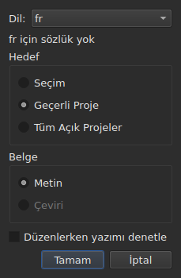
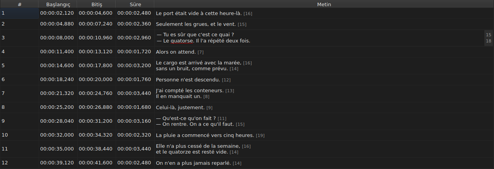
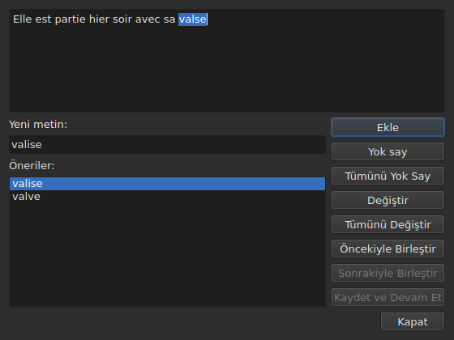

# Yazım denetimi…

<!-- machine-translated -->
> Bu sayfa makine çevirisidir ve henüz dili bilen bir okuyucu tarafından gözden geçirilmemiştir.

`Araçlar ▸ Yazım Denetimi…`, sözlüğün tanımadığı sözcükleri, Gaupol'un yazım denetleyicisini örnek alarak,
tek tek dolaşır. Bir eşi vardır, `Araçlar ▸ Yazım Denetimi Ayarları…`; o da dili, hedefi, belgeyi
ve yazarken altını çizmeyi ayarlar.
İkisi de Enchant aracılığıyla sistemin sözlüklerine dayanır.

Birincisinin etiketi `Chec&k Spelling…` olarak yazılır: `C` zaten
`Correct Texts…` öğesinin hızlandırıcısıdır ve `k`, `Tools` menüsünde boştur.
İkisinin de kısayolu yoktur.

**İkisi de hiç altyazısı olmayan bir belgede devre dışıdır**, tıpkı
[`Correct Texts…`](correct-texts.md) gibi: denetlenecek bir şey yoktur. `Check Spelling…`
ayrıca ayarlanan dil için sözlük yoksa devre dışıdır, bkz.
[Sözlük olmadan](#sözlük-olmadan).

## Yazım denetimi ayarları…




| Grup | Seçimler | Varsayılan |
| :--- | :------- | :--------- |
| `Language` | sistemin sunduğu dil kodları ve zaten seçilmiş olan | sistemin dili, aralarındaysa |
| `Target` | `Selection`, `Current Project`, `All Open Projects` | `Current Project` |
| `Document` | `Text`, `Translation` | `Text` |
| `Check spelling while editing` | bir onay kutusu, bkz. [Yazarken altını çizme](#yazarken-altını-çizme) | işaretsiz |

Gösterilen sekmede hiçbir satır seçili değilse `Selection` devre dışıdır; hiçbir açık
proje bir çeviri taşımadığı sürece `Translation` devre dışıdır. Artık kullanılamayan
hatırlanmış bir ayar — boş bir seçim, olmayan bir çeviri —
`Current Project` ya da `Text` ile açılır. `OK` ayarları korur, `Cancel`
hiçbir şeyi değiştirmez.

**Bu pencere sözlüğe bağlı değildir**: belgede altyazı olduğu sürece, ayarlanan dil için
sözlük olmasa bile etkin kalır ve sözlüğü olmayan bir dilden ayrılmanızı sağlayan odur.
Sözlüğü bulunmayan dil düzenlenebilir kalır ve listede görünür; altında,
`no dictionary for` cümlesi ve ardından kodu yer alır.

**Dört ayar bir oturumdan diğerine hatırlanır**, `subedit` ayar dosyasında —
konumu için bkz. [Tercihler](preferences.md):

| Anahtar | Değerler | Varsayılan |
| :------ | :------- | :--------- |
| `spell-check.language` | `fr_FR` gibi bir dil kodu; boşsa sistemin dili | boş |
| `spell-check.target` | `selection`, `current-project`, `all-projects` | `current-project` |
| `spell-check.document` | `main`, `translation` | `main` |
| `spell-check.inline` | `true` veya `false` — bir hücrenin düzenleyicisinde bilinmeyen sözcüklerin altını çizer | `false` |

Anahtarın kabul etmediği bir değer yoksayılır, varsayılan geçerli olur ve seçenek,
pencere açılırken hata çıktısında adlandırılır — bkz.
[Dosya beklenen şeyi söylemediğinde ne olur](preferences.md#dosya-beklenen-şeyi-söylemediğinde-ne-olur).

## Yazarken altını çizme




`Spell-Check Settings…` penceresindeki `Check spelling while editing` onay kutusu,
bir metin hücresinin düzenleyicisindeki — hem `Text` sütununun hem de
`Translation` sütununun —, bilinmeyen her sözcüğün altını **kırmızı dalgalı bir çizgiyle
ve siz yazarken** çizer. Altı çizgi yazmayı izler: sözcükle birlikte belirir, hareket eder ve
kaybolur. **Varsayılan olarak işaretsizdir**, Gaupol'daki gibi: onsuz
düzenleyicide hiçbir şey değişmez.

**Dil, aynı penceredeki `Language:` alanınındır** ve bilinmeyen sözcükler
`Check Spelling…` işleminin bulacağı sözcüklerdir: günlük konuşma İngilizcesinin aynı durumları
(`goin'`, `we'd`, `1st`), aynı sözcüklere bölme. Altı çizili bir sözcük bir menüden
düzeltilmez: onay kutusu yalnızca onu gösterir.

**Ayarlanan dil için sözlük yoksa düzenleyici sessiz kalır**: hiçbir şeyin altı çizilmez
ve hiçbir şey başarısız olmaz; pencerenin `no dictionary for` cümlesi nedenini söyler.
Onay kutusu ondan sonra açılan düzenleyicilere uygulanır; zaten açık bir
düzenleyici sahip olduğunu korur.

## Gezinti




Pencere, altyazının durduğu yerdeki metnini gösterir; bilinmeyen sözcük içinde
seçilidir. **Her bilinmeyen sözcükte projenin sekmesi öne gelir ve
altyazının satırı tabloda seçilir.** Gezinti altyazı altyazı ilerler, hedef birkaç
projeyi gösteriyorsa sonra proje proje.

Metnin altında: ilk öneriyle doldurulmuş `Replace with:` kutusu ve
`Suggestions:` listesi. Bir öneriyi seçmek onu kutuya kopyalar; kutuya yazmak
listeyi yeniler.

| Düğme | Ne yapar |
| :---- | :------- |
| `Add` | sözcüğü kullanıcının kişisel sözlüğüne ekler ve sonrakine geçer |
| `Ignore` | bu sözcüğü bırakır ve sonrakine geçer |
| `Ignore All` | bu sözcüğü ve bu gezinti sırasındaki diğer geçişlerini bırakır |
| `Replace` | sözcüğü `Replace with:` içeriğiyle değiştirir; kutu boş olduğu sürece devre dışıdır |
| `Replace All` | aynısını diğer geçişleri için yapar; kutu boş olduğu sürece devre dışıdır |
| `Join with Previous` | sözcüğü kendisinden önceki sözcükle birleştirir; yoksa ya da bir boşlukla ayrılmamışlarsa devre dışıdır |
| `Join with Next` | sözcüğü kendisinden sonraki sözcükle birleştirir, aynı koşullarda |
| `Save and Resume` | metni metin alanının taşıdığı haliyle korur ve **bu metni baştan** okumaya devam eder |
| `Close` | pencereyi kapatır |

**Metin alanı düzenlenebilirdir.** İçine yazar yazmaz yalnızca `Save and Resume`
etkin kalır: diğer hareketler seçilen sözcük üzerinde işlem yapar ve bu sözcük artık
metnin sözcüğü değildir.

**Gezinti, bilinmeyen sözcük kalmadığında kendiliğinden biter**:
düğmeler devre dışı kalır, metin boşalır. Hiç bilinmeyen sözcüğü olmayan bir hedef
hiçbir pencere göstermez.

### Ortada kapatma

`Close` ya da pencerenin çarpısı, gezintinin sonunda olduğu gibi **yapılanı uygular**:
zaten bırakılan metinler **ve** geçerli metinde zaten yapılan hareketler — değiştirme,
tümünü değiştirme, birleştirme. Bu, geçerli metni kaybeden Gaupol'dan bir ayrılıktır.
Sayılmayanlar, gezintiden kalanlar ve `Save and Resume` ile onaylanmamış, metin alanına
yazılan rötuşlardır.

**Dokunulan proje başına tek bir geçmiş girişi**, kaç değiştirme yapıldığına bakılmaksızın:
`Undo`, o projenin tüm düzeltmelerini bir seferde geri alır.
Menü bunu `Undo: correcting texts` olarak adlandırır. Durum çubuğu o zaman
sayıyı verir:

```text
Edited 2 and removed 0 subtitles
```

**Değiştirme listesi** — kullanıcının neyi neyle değiştirdiği —
kapatırken `subedit` yapılandırma dizinindeki `spell-check/<language>.repl` dosyasına
yazılır, Gaupol'unkine değil; o asla okunmaz.
Bundan sonra, [`Correct Texts…`](correct-texts.md#sözcükleri-birleştir-veya-ayır--yazım-denetiminin-yeniden-birleştirmesi-ve-bölmesi)
içindeki gibi, burada da yazım denetleyicisinin önerileri arasında sayılır.
Yazılamazsa bir hata kutusu bunu söyler: `Could not save the
replacements for`, ardından dil ve neden; düzeltmeleri iptal etmeden.

## Sözlük olmadan

Ayarlanan dilin — hiçbiri seçilmemişse sistemin dilinin — sözlüğü yoksa
**`Check Spelling…` devre dışıdır** ve öğenin üzerine gelindiğinde ipucu ile durum
çubuğu nedenini söyler:

```text
no dictionary for fr
```

`Spell-Check Settings…` kalır, sözlüğü olan bir dil seçmek için. Hiçbir sözlük
sağlayıcısı olmadan derlenmiş bir pencere aynı şeyi söyler ve hiçbir şey denetlemez.

## İletiler

| İleti | Nerede | Neyin tetiklediği |
| :---- | :----- | :---------------- |
| `no dictionary for fr` | ipucu ve durum çubuğu | ayarlanan dil için sözlük yok |
| `Nothing to check.` | durum çubuğu | hedef hiçbir metni göstermiyor — örneğin boş bir seçim |
| `Edited N and removed M subtitles` | durum çubuğu | gezintinin sonunda ya da kapatırken; `M` `0` olarak kalır |
| `Could not save the replacements for fr: …` | hata kutusu | değiştirme listesi yazılamadı |

## Bir örnek

Açık bir dosya `Elle est partie hier soir avec sa valse` satırını taşıyor. Fransızca
sözlük mevcut: `Araçlar ▸ Yazım Denetimi…` `valse` sözcüğünde durur, satırı
tabloda seçer ve zaten `Replace with:` içinde olan `valise` önerisini sunar. `Replace`,
sonra `Close`: satır `Elle est partie hier soir avec sa valise` olur ve durum
çubuğu şunu söyler:

```text
Edited 1 and removed 0 subtitles
```
