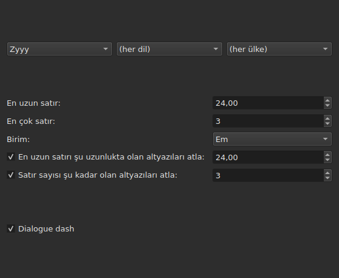
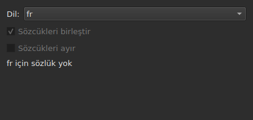
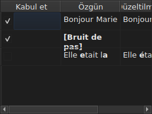

# Metinleri düzelt…

<!-- machine-translated -->
> Bu sayfa makine çevirisidir ve henüz dili bilen bir okuyucu tarafından gözden geçirilmemiştir.

`Araçlar ▸ Metinleri Düzelt…`, Gaupol'unkini örnek alan çok sayfalı bir sihirbaz açar: bir hedef ve
görevler sayfası, işaretli her görev için bir sayfa, bir ilerleme sayfası ve değişiklikleri hiçbir zaman
dayatmadan öneren bir onay sayfası.

**Boş bir belgede devre dışıdır**: düzeltilecek bir şey yoktur.

**Komut satırı aynı şeyi yapar**, tüm görevler için: [`subedit-cli correct`](../subedit-cli/correct.md); aynı desenlerle ve
aynı sayılarla — ve pencerenin em ile ölçtüğü yerde karakterle.
**Bu sihirbazın hatırlanan ayarlarından dördünü** varsayılan olarak okur — iki ortak hata sınıfı
(`Human`, `OCR`), `Remove all blank subtitles` ve `Line Break` görevinin en çok satır sayısı —
ve geri kalan her şeyi (görevleri, kodlarını, satır uzunluğunu, dili, desen kutularını)
kendi satırından alır. Bkz.
[Biri komut satırıyla ortak iki blok](preferences.md#biri-komut-satırıyla-ortak-iki-blok)
ve [`subedit-cli config`](../subedit-cli/config.md).

## Görevler ve hedef — ilk sayfa

| Grup | Seçimler | Varsayılan |
| :---- | :------ | :------ |
| `Target` | `Selection`, `Current Project`, `All Open Projects` | `Current Project` |
| `Document` | `Text`, `Translation` | `Text` |
| `Tasks` | `Mentions`, `Join or Split Words`, `Common Errors`, `Capitalization`, `Line Break` — işaretlenecek, bir veya birkaçı | `Common Errors` ve `Capitalization` işaretli, diğer üçü değil |

Gösterilen sekmede hiçbir satır seçili değilse `Selection` devre dışıdır; hiçbir açık proje
çeviri taşımadığı sürece `Translation` devre dışıdır.

**Hedef ve belge hatırlanmaz**: sihirbaz her zaman `Current Project` ve `Text` ile yeniden açılır.
İşaretli görevler ise hatırlanır.

**Her hedefin gösterdiği**:

| Hedef | Etki ettiği |
| :----- | :------ |
| `Selection` | gösterilen sekmede seçili satırlar |
| `Current Project` | gösterilen sekmenin dosyasının tamamı |
| `All Open Projects` | her açık sekmenin dosyasının tamamı |

**`Translation` üzerinde `All Open Projects`, çevirisi olmayan projeleri atlar**:
çeviri taşımayan bir projenin boş bir sütunda önerecek bir şeyi yoktur ve
sihirbaz onu saymaz.

**Görev sayfaları Gaupol'un sırasıyla izler — `Mentions`,
`Join or Split Words`, `Common Errors`, `Capitalization`, `Line Break` — kutuların
işaretlendiği sırayla asla.** İşaretli olmayan bir görevin sayfası yoktur; hatırlanan
ayarları bu yüzden değişmez. **Hiçbir görev sayfası kendi “etkin” kutusunu
taşımaz**: görevin çalışıp çalışmayacağını belirleyen, yalnızca bu ilk sayfanın kutusudur.

## Görev sayfaları

`Join or Split Words` dışındaki dört desen sayfasının her biri — onda desen yoktur — aynı tabanı taşır:
uygulanacak desenlerin kodunu seçmek için art arda üç açılır menü — yazı, dil, ülke —,
ardından o kodun desenlerinin listesi; her ad için işaretlenecek bir kutu. **Üç menü
yalnızca desen kataloğunun gerçekten taşıdığını sunar** — programla birlikte gelenler ve bir kullanıcının oraya
bıraktıkları (bkz. [Bırakılan desenler](#bırakılan-desenler)) — asla başka bir yerden okunan bir dil
ya da ülke listesini değil. `Zyyy` (“herhangi bir yazı”), `Common Errors` görevinin başlangıç
kodudur ve her yerde geçerli desenleri verir. **Diğer üç tür yalnızca bir yazı altında desene sahiptir**:
sayfaları `Zyyy` ile değil, kataloğun sunduğu ilk yazıyla açılır; programla gelen desenlerde bu yazı `Latn` değeridir.

**Her desenin açıklaması kutusunun ipucudur.** Programla gelen desenlerde adlar ve açıklamalar
pencerenin diline uyar; kendi desenlerinizden biri dosyasının yazdığı gibi gösterilir
([Dil](invocation.md#dil)).

**İşareti kaldırılmış bir desen, yeniden işaretlenene kadar işaretsiz kalır**; kodu
değiştirip geri dönmek de dahil, ve bu seçim sihirbazın bir açılışından diğerine
hatırlanır. Yeniden işaretlendiğinde özgün ayarını bulur ve hatırlanan seçim kaybolur.

| Sayfa | Tabana eklediği |
| :--- | :----------------------- |
| `Mentions` | iki onay kutusu, `Sound in brackets` ve `Sound in parentheses`, varsayılan olarak işaretsiz |
| `Common Errors` | iki onay kutusu, `Human` ve `OCR`, varsayılan olarak işaretli |
| `Capitalization` | başka bir şey yok |
| `Line Break` | bir en büyük uzunluk (varsayılan olarak `24`), bir en çok satır sayısı (`3`), bir birim — `Characters` veya `Ems`, varsayılan olarak `Ems` — ve aşağıda anlatılan iki atlama koşulu |

**`Mentions` sayfasının iki kutusu derlenmiş bir desen adlandırmaz**: çekirdekte, metin üzerinde
[`Remove Hearing-Impaired Mentions…`](operations.md#remove-hearing-impaired-mentions)
öğesinin doğrudan bir hareketle zaten yaptığı taramayı yürütürler. Onu başlatmak için biri **veya** diğeri işaretli olsa yeter. **Sayfanın desen listesi bunları yinelemez**: bu iki ad orada yalnızca bir kez, onay kutusu olarak görünür.

**`Common Errors` sınıfa göre süzer**: iki sınıfı da taşıyan bir desen,
iki kutudan biri işaretlenir işaretlenmez uygulanır; diğer üç sayfa bu ayrımı
bilmez.

### Line Break — birim ve atlama




| Ayar | Ne yapar | Varsayılan |
| :------ | :----------- | :------ |
| `Maximum length` | bir satırın uzunluğu, seçilen birimle; `1` ile `1000` arası | `24` |
| `Maximum lines` | hedeflenen satır sayısı; `1` ile `100` arası | `3` |
| `Unit` | `Characters` karakterleri sayar; `Ems` genişliği pencerenin yazı tipiyle ölçer, ortalama bir küçük harf `0.55` eder — Gaupol'un birimi | `Ems` |
| `Skip subtitles with maximum line length of` | en uzun satırı bu uzunluğa, seçilen birimle, sığan bir altyazıyı olduğu gibi bırakır | işaretli, `24` |
| `Skip subtitles with maximum line amount of` | satır sayısı bu sayıya sığan bir altyazıyı olduğu gibi bırakır | işaretli, `3` |

**Atlamanın kendi eşikleri vardır**, hedeflenen sınırlardan ayrı: Gaupol'un kuralı
budur. Bir altyazı, **kutusu işaretli tüm eşiklere** sığıyorsa olduğu gibi bırakılır; aksi halde kırılır
ve kırma, yalnızca altyazıyı aştığı bir eşiğe yaklaştırıyorsa — daha az
uzunluk ya da daha az satır — korunur. Hiçbir kutu işaretli değilse: her altyazı kırılır,
zaten sığsa da sığmasa da.

**Birimi değiştirmek önerileni değiştirir**: her satırın uzunluğu her hesaplamada,
o andaki sayfa biriminde ölçülür ve önceki bir ölçümden hiçbir şey kalmaz. Yarısı dar
harflerden oluşan yirmi dokuz karakterlik bir metin, `Characters` biriminde `24` değerini aşar ve `Ems` biriminde
rahatça sığar.

**Yedi ayar bir oturumdan diğerine hatırlanır**, birim dahil.

### Sözcükleri birleştir veya ayır — yazım denetiminin yeniden birleştirmesi ve bölmesi




`Mentions` ile `Common Errors` arasında ayrı bir sayfa; metin tanıma yazılımlarının
boşluklara yaptığını onarmak içindir. Desen listesi yoktur: Enchant üzerinden
sistemin sözlüklerine dayanır.

| Ayar | Ne yapar | Varsayılan |
| :------ | :----------- | :------ |
| `Language` | sözlüğün dili; sistemin sunduğu kodlar ve zaten seçili olan | sistemin dili, aralarındaysa |
| `Join words` | yanlış yazılmış bir sözcüğü komşu sözcükle birleştirir | işaretli |
| `Split words` | yanlış yazılmış bir sözcüğü ikiye keser | işaretsiz |

**Birleştirme**: yanlış yazılmış bir sözcük, kendisinden önceki ya da sonraki sözcükle
**ancak ve ancak iki yönden yalnızca biri doğru yazılmış
bir sözcük verirse** birleştirilir. İkisi de verirse ya da hiçbiri vermezse hiçbir şey yapılmaz.
`bon jour`, `bonjour` olur; art arda iki boşluk önce bire indirilir,
ama hiçbir şeyin birleşmediği bir metin, boşluklar dahil, olduğu gibi geri verilir.

**Bölme**: yanlış yazılmış bir sözcük, yazım denetiminin önerileri arasında
**yalnızca biri** o sözcüğün araya bir boşluk girmiş hali ise — aynı
harfler, aynı sırada — kesilir. Bu türden iki öneri ya da hiç öneri yoksa: hiçbir
şey yapılmaz. Yalnızca baş harfi büyük olan bir sözcük (`Bonjourtous`)
asla bölünmez: çoğu zaman bir addır ve sözlüklerde bunlar yoktur.

**Kullanıcının değiştirme listesi** (`spell-check/<language>.repl`,
programın yapılandırma dizininde) yazım denetiminin önerileri arasında sayılır;
sihirbaz onu okur, yazmaz.

**Seçilen dil için sözlük yoksa sayfa kalır ve soluklaşır**:
iki kutu devre dışıdır ve sayfa `no dictionary for` ifadesini ve ardından dilin kodunu
söyler. Dil düzenlenebilir kalır — başka bir dil için sözlük
olabilir — ve görev, ilk sayfada işaretli olsun olmasın, o zaman hiçbir şey yapmaz
ve hata bildirmez.

**Dil, iki kutu ve ilk sayfanın kutusu** sihirbazın bir açılışından diğerine
hatırlanır.

### Bırakılan desenler

Bir kullanıcının kendi desen dizinine bıraktığı bir desen,
programla gelenlere, aynı katalogda ve aynı menüler altında eklenir —
yüklendikten sonra hiçbir şey onları ayırt etmez.

| Desenler | Nerede |
| :------- | :---- |
| programla gelenler | `<prefix>/share/subedit/patterns`, `<prefix>/bin` dizininin yanında |
| kullanıcınınkiler | `$XDG_DATA_HOME/subedit/patterns`; değişken ayarlı değilse ya da mutlak bir yol değilse `~/.local/share/subedit/patterns` |

**Biçim Gaupol'unkidir, olduğu gibi okunur**: her yazı, dil ve ülke için bir `<Code>.<type>` dosyası
— `Latn-en.common-error` —, etkinleştirmesi yanında bir `.conf` dosyasında. Türler
`common-error`, `capitalization`, `hearing-impaired` ve `line-break` türleridir. Programla gelen
dosyalar örnek olarak kullanılır. **Desenler açılışta bir kez okunur**: pencere açıkken
bırakılan bir dosya yalnızca bir sonraki açılışta görülür.

## İlerleme

Son işaretli görev sayfasından (hiçbir görev işaretli değilse ilk sayfadan) `Next` düğmesine
basıldığında sihirbaz önerilen düzeltmeleri bir arka plan iş parçacığında hesaplar; ekranda
belirsiz bir ilerleme çubuğu görünür. Hesaplama bitince onay sayfası kendiliğinden açılır.

**Bu adımda `Cancel`, hesaplamayı kesmeden vazgeçer**: hiçbir şey
uygulanmaz, ama sihirbaz kapanmadan önce sürmekte olan hesaplamanın bitmesini bekler —
bu bekleme, desen motorunun her aramaya uyguladığı zaman sınırıyla sınırlıdır.

**Bu adımda `Back`, beklemeden önceki sayfaya döner**: hesaplama
arka planda biter ve sonucu atılır — sihirbaz kendiliğinden onaya atlamaz.
`Next` yeni bir hesaplama başlatır.

## Onay — son sayfa




Sihirbazın değiştireceği her metin için bir satır — bir görevin olduğu gibi bıraktığı bir
metin için asla satır yoktur.

| Sütun | Ne gösterir |
| :----- | :------------ |
| `Accept` | varsayılan olarak işaretli bir onay kutusu: düzeltme uygulanacak ya da uygulanmayacak |
| `Original` | metin olduğu gibi; değişecek kısım **kalın** |
| `Corrected Text` | önerilen metin; değişen kısım kalın, **düzenlenebilir** — ona dokunmak yazılacak olanı değiştirir, `Accept` kutusunu değiştirmez |

**Değişiklik kalın yazıyla işaretlenir, asla renkle değil**: aynı fark
hiçbir renk tonuna bağlı olmadan iki paletin ikisinde de okunur.

**Önerisi bir silme olan bir satır** — altyazıda hiç metin kalmazdı —
`Corrected Text` sütununu boş, `Original` sütununun tamamını kalın gösterir.

| Düğme | Ne yapar |
| :----- | :----------- |
| `Mark All` | tüm satırlarda `Accept` işaretler |
| `Unmark All` | tüm satırlarda `Accept` işaretini kaldırır |
| `Preview` | projenin bir filmi varsa yerleşik oynatıcıyı seçilen satırın altyazısına koyar — yoksa hiçbir şey yapmaz |
| `Finish` | işaretli satırları uygular ve sihirbazı kapatır |

Varsayılan olarak işaretli olan `Remove all blank subtitles`, bir düzeltmenin hiç metin bırakmadığı
altyazıları boş tutmak yerine siler.

**Hesaplamanın uygulayamadığı bir desen tablonun altında adlandırılır**,
nedeniyle birlikte:

```text
Not applied: some pattern (will not compile)
```

Bu biçimde adlandırılan bir desen, kaç metinde ya da projede başarısız olursa olsun
**neden başına bir kez** adlandırılır: ekran hangisinde olduğunu söylemez.

| Neden | Neyin tetiklediği |
| :----- | :--------------- |
| `cannot be translated` | ifade, Python söz diziminin çevirisinin reddettiği bir şey kullanıyor |
| `will not compile` | motor ifadeyi reddediyor |
| `has an invalid replacement` | değiştirme, Python'un okuduğu gibi okunmuyor |
| `timed out` | bir arama, motorun bir metin üzerinde tanıdığı süreyi aştı |
| `never settled` | `Repeat` yüz geçişten sonra hâlâ metni değiştiriyordu |
| `grew the text too long` | desen üzerinde çalışırken metin 16 384 baytı aştı |

**Bir metinde başarısız olan desen, metni ondan önceki haliyle bırakır**: yarım
yapılmış bir değiştirme, hiç değiştirme yapılmamasından daha değersizdir. Diğer desenler uygulanır.

**Okunamayan bir desen dosyası satırı aynı yerde adlandırılır**,
dosyası, satırı ve nedeniyle — sihirbazın her açılışında, çünkü desenler yalnızca
açılışta bir kez okunur:

```text
Could not be read: Zyyy.common-error, line 8 (malformed line)
```

| Neden | Neyin tetiklediği |
| :----- | :--------------- |
| `directory cannot be read` | programla gelen desenlerin dizini gezilemedi |
| `file cannot be read` | bir desen dosyası okunamadı |
| `malformed line` | ne bir başlık, ne bir açıklama, ne de `Key=Value` olan bir satır |
| `field outside any pattern` | ilk desen başlığından önce gelen bir `Key=Value` |
| `unknown field` | bu desen türünün kullanmadığı bir anahtar — desen korunur |
| `missing field` | bu desen türünün onsuz hiçbir şey yapamadığı bir anahtar — desen atılır |
| `invalid value` | anahtarın kabul etmediği bir değer — desen atılır |
| `malformed activation` | hiçbir şey adlandırmayan bir `.conf` dosyasının `<pattern>` öğesi |

Diğer desenler, yani okunan ve doğru uygulananlar, bundan etkilenmez.

## Geri almanın söylediği ve `Cancel` düğmesinin asla yapmadığı

**`Finish`, dokunulan her proje için bir geçmiş girdisi oluşturur**, düzeltme başına
asla: `Undo`, o projede kabul edilen tüm düzeltmeleri, her biri sahip olduğu metinle, bir
seferde geri alır. Menü bunu `Undo: correcting texts` olarak adlandırır.

Durum çubuğu sayıyı verir; önce değişen metinler, sonra
silinen altyazılar:

```text
Edited 3 and removed 1 subtitles
```

**Herhangi bir sayfada `Cancel` hiçbir şey uygulamaz ve hiçbir şey hatırlamaz** — ne bu açılış sırasında
seçilen ayarları, ne de en küçük bir düzeltmeyi. Sihirbazın bir sonraki açılışı
öncekinin ayarlarından yeniden başlar.

## Bir örnek

Açık bir dosya, bir satırın iki sözcüğü arasında iki boşluk ve başka metni olmayan
köşeli parantez içinde bir not taşıyor. `Araçlar ▸ Metinleri Düzelt…`,
`Common Errors` zaten işaretli, onaya kadar `Next`: iki boşluklu satır solda
`Bonjour  Marie`, sağda `Bonjour Marie` gösterir; düzeltme kalın yazılmıştır ve zaten kabul edilmiştir.
`Finish` bunu uygular ve durum çubuğu şunu söyler:

```text
Edited 1 and removed 0 subtitles
```
