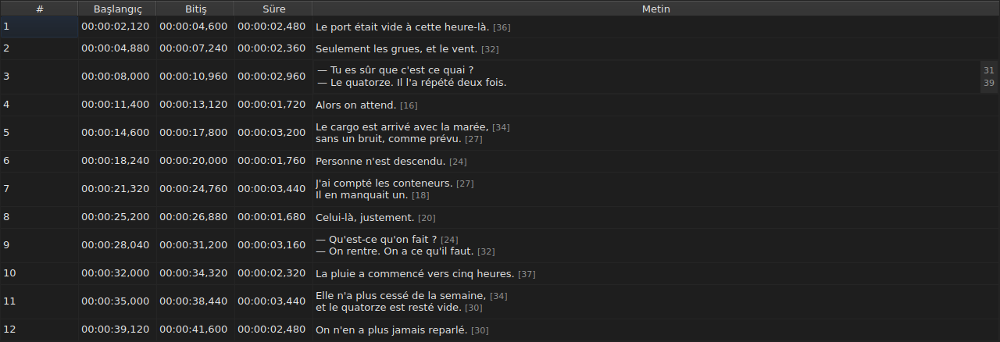

# Hücre düzenleme

<!-- machine-translated -->
> Bu sayfa makine çevirisidir ve henüz dili bilen bir okuyucu tarafından gözden geçirilmemiştir.

Dört sütun yerinde düzenlenir: `Start`, `End`, `Duration` ve `Text` — projenin bir çevirisi varsa
`Translation` sütunuyla beş. `#` düzenlenemez — numara satırın sırasıdır, dosyanın verisi değil.

**Bir hücrenin düzenleyicisini açma:** hücreye çift tıklayın ya da hücreyi seçip
`F2` tuşuna basın.

## Metin

**Çeviri metin gibi düzenlenir**, aynı çok satırlı alan ve aynı kurallarla; yalnızca hücre değişir,
ana metin olduğu gibi kalır. Hiçbir şeyi değiştirmeyen bir onay, biri için de ötekisi için de
hiçbir şey yapmaz — bkz. [aşağısı](#hiçbir-şeyi-değiştirmeyen-onay-hiçbir-şey-yapmaz).

Düzenleyici **çok satırlı** bir alandır ve altyazının yüksekliğinde açılır: iki satırlı bir altyazı
içine yazılacağı gibi yazılır, iki satırı okunaklıdır ve kaydırma çubuğu yoktur. Bir tane daha ekleyen
`Shift+Enter` düzenleyiciyi büyütür; tablonun satırı onayda uyum sağlar.

| Tuş | Etki |
| :-- | :--- |
| `Enter` | onaylar ve düzenleyiciyi kapatır |
| `Shift+Enter` | metne bir satır sonu ekler |
| `Esc` | düzenleyiciyi kapatır; hücre elindekini korur |
| `Tab` | onaylar ve sonraki hücreye geçer |

Başka bir yere tıklamak da onaylar: odağı kaybetmek bir `Enter` değerindedir.

**İletişim kutusu açmayan on bir hareket de aynı biçimde onaylar**, hedeflerini hesaplamadan önce:
`Italic`, `Case ▸ …`, `Dialogue`, `Merge Subtitles`, `Split Subtitle`,
`Cut Texts`, `Paste Texts`, `Copy Texts`, `Remove Subtitles`, `Undo` ve `Redo`.
Menüden, araç çubuğundan ya da bir pencere kısayolundan başlatıldıklarında metni, başka bir yere
tıkladıktan sonra olduğu gibi, düzenleyicinin az önce onayladığı haliyle alırlar. Yine de `Ctrl+X`,
`Ctrl+C` ve `Ctrl+V` düzenleyici açık olduğu sürece ona aittir — bkz.
[Kesme, kopyalama ve yapıştırma](clipboard.md): `Cut Texts`, `Copy Texts` ve `Paste Texts`
öğelerini o zaman başlatan menüdür.

`Undo` ve `Redo` belgeyi değil geçmişi okur: bkz.
[Geri alma ve yineleme](undo.md). Bir iletişim kutusu açan hareketin bu kurala ihtiyacı yoktur,
çünkü iletişim kutusu açılırken odağı alır ve bu zaten girdiyi onaylar.

### Etiketler dosyanın etiketleridir

Gösterilen ve yazılan metin, **etiketleri dahil, dosyanın metnidir**: bir SubRip belgesinin
`<i>…</i>` etiketi o biçimde yazılır, bir Advanced SSA belgesinin `{\i1}…{\i0}` etiketi de öyle.
Görüntüleme için hiçbir şey çevrilmez — [`Italic`](operations.md#italic) tablosu her biçimin ne
yazdığını söyler.

İtalik için bu nedenle bilinecek bir şey yoktur: `Ctrl+I` açık belge için doğru etiketi koyar ve
hiçbirini taşımayan bir biçim — TMPlayer, LRC — sizi aramaya bırakmak yerine öğeyi devre dışı bırakır.
Kalın ve altı çizili Gaupol'daki gibi elle yazılır.

**Ve etiketler metin işlemlerini izlemez**: bir altyazıyı küçük harfe çevirmek `<I>` etiketini
`<i>` yapmaz, bir diyalog çizgisi de açılış etiketinin önüne değil metnin önüne konur. Bkz.
[`Case` ve `Dialogue`](operations.md#case-ve-dialogue).

## Satır uzunluğu

**Metin düzenleyicisi, sağdaki bir kenar boşluğunda her satırın uzunluğunu gösterir**, o satırın ilk
sırasıyla hizalı olarak. Boşluk en büyük sayı kadar geniştir, **siz yazdıkça** güncellenir ve
kaydırmayı izler. Boş bir metin hiçbir şey göstermez. Uzunluklar tablonunkilerdir — etiketler
olmadan, aşağı yuvarlanmış, ayarlanan birimde — ve `Edit ▸ Preferences…` içindeki
`Show line lengths in the editor` onay kutusuyla kaldırılır. Bkz.
[Satır uzunlukları](preferences.md#satır-uzunlukları).

## Başlangıç ve bitiş

Düzenleyici, **bir zaman damgasının biçimine zorlanmış** tek satırlık bir alandır: yazarken hiçbir
zaman biri olamayacak şeyi reddeder.

Kabul edilen biçimler, bir dosyanın okunmasının zaten kabul ettikleridir:

| Öğe | Geçen |
| :-- | :---- |
| alanlar | `MM:SS` ya da `HH:MM:SS`, her biri bir ya da iki basamak |
| ondalıklar | bir virgül ya da noktadan sonra bir ila üç, ya da hiç |
| işaret | videonun başlangıcından önceki bir konum için başta bir `-` |
| sınırlar | dakika ve saniye 60 değerinin altında |

`00:01:02,500`, `1:02.5` ve `-0:01,000` bu nedenle üç geçerli girdidir.

**Okumanın reddettiği bir girdi hücreyi değiştirmeden bırakır.** `00:70:00,000` böyledir: biçimi
doğrudur ama dakikaları sınırların dışındadır: düzenleyici kapanır ve hiçbir şey kımıldamamıştır.
Hiçbir konum uydurulmaz — konumu yanlış girmek sessiz kalır, ekranda hiçbir şey kötü zamanlanmış
bir altyazıyı iyi zamanlanmışından ayırt etmez.

Bir başlangıcı ya da bitişi değiştirmek `Duration` değerini hemen günceller.

## Süre

**Bir süre yazmak bitişi oynatır, başlangıcı asla**: bitiş `Start + Duration` olur. Başlangıcı
oynatmak bütün altyazıyı oynatmak olurdu; bu da [`Shift Positions…`](operations.md) işidir ve
`Start` sütununa zaten yazılabilir.

Süre, sütunun gösterdiği **zaman damgası biçiminde** yazılır ve yukarıdaki tablonun biçimleri
geçerlidir — bir farkla:

| Öğe | Başlangıç, bitiş | Süre |
| :-- | :--------------- | :--- |
| biçim | bir zaman damgasınınki | aynısı |
| başta `-` işareti | kabul edilir | **yazarken reddedilir** |

`0:02.5` ve `00:00:02,500` bu nedenle iki buçuk saniyelik bir sürenin iki geçerli girdisidir;
`-0:01,000` yazılamaz. Sıfır süre kabul edilir: altyazı o zaman göründüğü anda kaybolur.

**Sonraki altyazının üzerine geçen bir bitişe izin verilir.** Çakışma tabloda ipucuyla birlikte
renklendirilir — bkz. [Tablo](table.md#anomaliler) — bu bir uyarıdır, ret değil: istediğiniz şey
olabilir. [Tanılama iletileri listesi](files.md#bir-okumanın-tanılama-iletileri) de onu taşır ve
düzelttiğinizde kaldırır.

**Filmin sonunun ötesine yazılan bir bitiş bildirilmez**, onu oraya iten `Tools` menüsü işleminin
aksine — bkz. [İşlemler](operations.md#filmin-sonunun-ötesi). Bir hücre az önce yazdığınız değeri
zaten gösterir.

Okunamayan bir girdi, bir konumda olduğu gibi hücreyi değiştirmeden bırakır ve gösterilen süreyle
aynı olan bir süre geçmişe girmez.

## Hiçbir şeyi değiştirmeyen onay hiçbir şey yapmaz

Bir hücre açın, hiçbir şey yazmayın, `Enter` tuşuna basın: hiçbir şey olmaz. Hiçbir değişiklik
kaydedilmez ve dosya hâlâ diskteki dosyayla aynı sayılır.

Karşılaştırma **konum** üzerindedir, dizge üzerinde değil: `00:00:01,000` gösteren bir hücreye
`0:01.0` yazmak aynı anı belirtir ve bu nedenle o da hiçbir şeyi değiştirmez.

## Düzenlenen bir hücreye ne olur

**Geri alınabilir** — bir hücre, bir kayıt. Bkz.
[Geri alma ve yineleme](undo.md).

**Kaydedilir** ve bunu yapmadan pencereyi kapatmak onay ister. Bkz. [Açma ve kaydetme](files.md).
