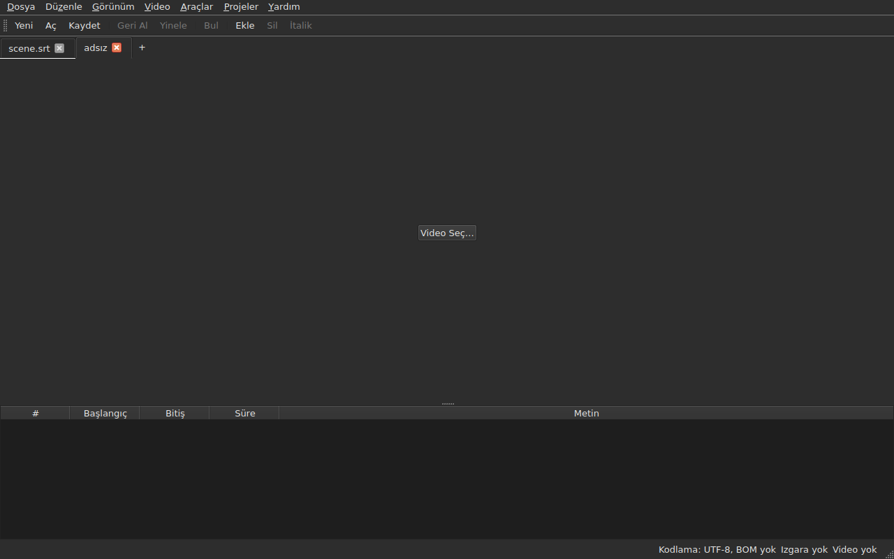
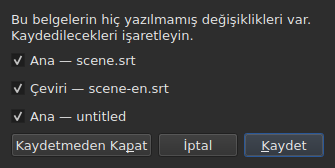
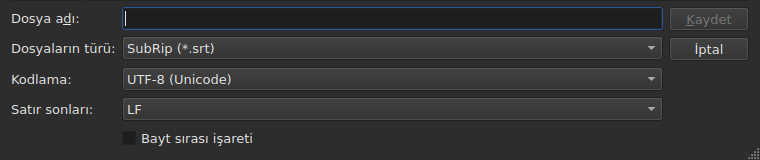
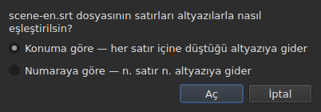
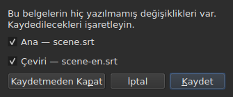

# Açma ve kaydetme

<!-- machine-translated -->
> Bu sayfa makine çevirisidir ve henüz dili bilen bir okuyucu tarafından gözden geçirilmemiştir.

**Dosya** menüsü üç komut, sekmeler için iki komut ve çeviri için üç komut daha taşır; **Projeler** menüsü tüm sekmelere birden etki eder.

| Komut | Kısayol | Ne yapar |
| :------ | :------- | :----------- |
| Yeni Proje | `Ctrl+N` | yeni bir sekmede boş bir proje — son sekmeden sonraki `+` düğmesi de aynısını yapar |
| Aç… | `Ctrl+O` | bir dosya seçer ve yeni bir sekmede açar — ya da boş bir projenin yerine |
| Çeviri Aç… | — | bir çeviri dosyası seçer ve onu geçerli sekmenin ana dosyasına hizalar |
| Kaydet | `Ctrl+S` | açık dosyayı yeniden yazar |
| Farklı Kaydet… | `Ctrl+Shift+S` | bir yol ve bir biçim seçer, sonra yazar |
| Çeviriyi Kaydet | — | çevirinin dosyasını yeniden yazar |
| Çeviriyi Farklı Kaydet… | — | çeviri için bir yol ve bir biçim seçer, sonra yazar |
| Kapat | `Ctrl+W` | geçerli sekmeyi kapatır — tek sekme varsa devre dışıdır |

`New Project`, `Open…` ve `Save` ayrıca [araç çubuğunda](index.md#araç-çubuğu) da vardır, `New`, `Open` ve `Save` sözcükleriyle. **Çevirinin üç öğesi çubukta yoktur**: yalnızca bir çevirisi olanlara yarar ve çubuk herkesindir.

## Sekmelerde birden çok proje

**Açık her projenin kendi sekmesi vardır**, görüntünün ve tablonun üstünde: etiketi dosyanın adıdır, henüz dosyası olmayan bir proje için `untitled`. Bir sekmeye tıklamak ona geçer; `Ctrl+PageDown` ve `Ctrl+PageUp` fare olmadan aynısını yapar ve son sekmeden sonra ilk sekmeye döner. **Son sekmenin hemen yanındaki `+` düğmesi**, `New Project` gibi, yeni bir sekmede boş bir proje açar.




**`Open…` onlara asla dokunmaz.** Bir dosya açmak artık pencerenin gösterdiği şeyin yerini almaz: yeni bir sekmede, yanında belirir ve daha önce baktığınız sekme sahip olduğu her şeyi korur — geçmişini, seçimini, bağlı videosunu. Açmanın artık hiçbir şey sormamasının nedeni de budur: kaybedilecek bir şey yoktur, çünkü yerine geçilecek bir şey yoktur.

**Bir istisna: boş proje yerini bırakır.** Dosyasız başlatılan ya da `New Project` sonrasındaki pencere, içinde hiçbir şey olmayan `untitled` bir proje gösterir. Açılan bir dosya — `Open…` ile de, bırakma ile de — **o zaman sekmesini alır, çubukta aynı yerde**, işe yaramaz bir projenin yanında bir tane daha açmak yerine. Bir proje şu durumda boştur: **dosyası, altyazısı, geri alınacak ya da yinelenecek bir şeyi, filmi yoktur ve hiç değiştirilmemiştir**: bunlardan herhangi birinin olması sekmesini korumasına yeter. Geçerli sekme olmayan boş bir projeye dokunulmaz.

**Zaten açık bir dosya ikinci kez açılmaz.** Başka bir sekmenin tuttuğu bir dosyada `Open…`, odağı o sekmeye geri verir ve bunu durum çubuğunda söyler:

```text
premier.srt: already open
```

**Her sekme tam bir projedir, ötekilerden bağımsız**: geçmişi, seçimi, bağlı videosu ve son okumasında karşılaştıkları yalnızca o sekme geçerli olduğunda gösterilir ve bir başkası geçerliyken değişmez. **Bir istisna vardır ve ADR 0033 içindedir**: video oynatıcısı tüm pencere için tektir — tek bir mpv süreci — ve filmi sekmeyle değişir; **her sekme filminin nerede kaldığını hatırlar** ve ona döndüğünüzde oradan, duraklatılmış olarak sürdürür. Pano ise pencereye aittir: bir sekmede kopyalayıp ötekinde yapıştırmak, ikisini açma nedeninizdir.

**`Close` geçerli sekmeyi kapatır**, gerekirse [kaydedilmemiş değişiklikler sorusunu](#kaydedilmemiş-değişiklikler) sorarak — yalnızca bu sekmeninkini, ötekiler ilgili değildir. **Tek sekme varken devre dışıdır**: pencere her zaman en az bir sekme tutar ve onu kapatmak pencereyi kapatmak olurdu — ki sistemin düğmesi bunu zaten yapar.

**Her sekme ayrıca bir çarpı taşır**, **kendi** projesini aynı soruyla kapatan. Geçerli olmayan bir sekmenin çarpısı o sekmeyi kapatır ve baktığınız sekme görüntülenmeye devam eder; o projede değişiklik varsa sekmesi soru süresince öne gelir. **Tek sekme kaldığında çarpı yoktur**, `Close` öğesinin devre dışı olmasıyla aynı nedenle.

**Bir sekme değiştirildiğini söyler**: belgelerinden biri dosyasından farklı olduğu sürece adını bir yıldız izler, `premier.srt*`, baktığınız projenin pencere başlığının söylediği gibi. Kaydedince kaybolur.

## Projeler menüsü

İki komut tüm projelere birden etki eder.

| Komut | Kısayol | Ne yapar |
| :------ | :------- | :----------- |
| Tümünü Kaydet | `Ctrl+Shift+L` | değiştirilmiş her belgeyi sekme sekme yazar |
| Tümünü Kapat | `Ctrl+Shift+W` | tüm projeleri kapatır — yani pencereyi |

**`Save All` sekmelerin sırasıyla gider**, ana belge çeviriden önce. Dosyası olan bir belge **sekmesi öne gelmeden** orada yeniden yazılır; **dosyası olmayan bir belge, kendi sekmesinde, tek tek `Save As…` açar** — `Save All` işleminin sekme değiştirdiği tek durum, kutunun hangi projeyi ilgilendirdiğini göstermesi içindir. **Bir `Save As…` iptal edilirse ya da bir kayıt başarısız olursa kalanı durur**: sonraki projelere dokunulmaz ve bir kutu nelerin yazıldığını söyler.

```text
Save All stopped: 1 of 3 documents saved
```

Her şey yazıldığında durum çubuğu bunu söyler — `2 documents saved`, ya da hiçbir şey değiştirilmemişse `Nothing to save`. Bir `Save As…` bir sekmeyi öne getirdiyse pencere, komutun başlatıldığı sekmeye geri döner.

**`Close All` ve pencerenin çarpısı bir ve aynı şeydir**: pencere her zaman bir proje tutar ve hepsini kapatmak onu kapatmaktır. Bu nedenle **tüm projeler için tek bir soru** sorarlar; [değiştirilmiş iki belgedekiyle](#değiştirilmiş-iki-belgeyle-kapatma) aynı, her sekmenin değiştirilmiş her belgesi için bir onay kutusuyla:




**`Cancel` hiçbir şeyi kapatmaz** ve hiçbir şey yazılı bırakmaz. `Save`, işaretli belgeleri `Save All` gibi yazar: sekmelerinin arkasında, adı olmayan ve `Save As…` için sekmesi öne gelen belge hariç. Tüm projelerde tek bir belge değiştirilmişse, her zaman sormuş olduğumuz basit soru, kendi sekmesinde sorulur. `Save All As…` yoktur: adı olmayan belgeler için `Save All` işleminin zaten tek tek sorduğu `Save As…` dizisidir.

## Açma

İletişim kutusu **okunan dokuz biçimi** süzer, her biri için bir giriş ve hepsini gösteren bir ilk giriş. Biçim o zaman **içeriğe göre, uzantıya göre değil** tanınır: SubRip içeren bir `.txt` açılır ve süzgeç hiçbir şeye karar vermez — yalnızca dosyaları gizler.

| Süzgeç girişi | Uzantı |
| :----------- | :-------- |
| `SubRip` | `.srt` |
| `WebVTT` | `.vtt` |
| `SubViewer 2` | `.sub` |
| `Sub Station Alpha` | `.ssa` |
| `Advanced SSA` | `.ass` |
| `MicroDVD` | `.sub` |
| `MPL2` | `.txt` |
| `TMPlayer` | `.txt` |
| `LRC` | `.lrc` |

**İki uzantı her biri iki biçimi gösterir** — `.sub` SubViewer 2 ve MicroDVD’dir, `.txt` MPL2 ve TMPlayer’dır. Açarken bunun bir sonucu yoktur, çünkü içerik karar verir; kaydederken biçimi veren, seçilen girişin **adıdır**, deseni asla.

**Okunamayan bir dosya hiçbir şey açmaz.** Eksik, sistem tarafından reddedilen, baytlarının çözülemediği bir kodlamada yazılmış ya da bilinen hiçbir biçimde olmayan dosya: bir kipli kutu **nedeni adlandırır**, hiçbir sekme açılmaz ve var olanlar yerinden oynamaz.

| İleti | Ne oldu |
| :------ | :------------ |
| `does not exist` | yol hiçbir dosyayı göstermiyor |
| `cannot be opened: permission denied` | sistem açmayı reddediyor |
| `cannot be read` | sistem başka bir nedenle reddetti |
| `cannot be decoded in the chosen encoding` | baytlar seçilen kodlamada okunamıyor |
| `is in no format this tool knows` | hiçbir biçim içeriği tanımıyor |
| `holds nothing recognisable as a subtitle` | biçim tanınıyor, ancak içinde altyazı sayılabilecek bir şey yok |

İletinin önünde yol bulunur: `notes.txt: is in no format this tool knows`. Bunlar komut satırının sözcükleridir ve bu bir rastlantı değildir — her iki yüzey de bir dosyayı aynı tarifle okur.

### Dosyaları pencereye bırakma

**Dosyaları pencerenin herhangi bir yerine bırakmak onları açar**, dosya yöneticisinden: tablo, sekme çubuğu, `Select Video…` düğmesi ve **filmin görüntüsünün kendisi**, hem oynarken hem durmuşken. Görüntü, oynatıcının çizdiği ayrı bir penceredir ve hiçbir şey bir bırakmayı ileteceğini garanti etmezdi; bu, gerçek bir masaüstünde, bir Wayland oturumunda elle denetlendi. `subedit-gui` orada filmi gösterebilmek için X11 altında başlatılır, dolayısıyla bırakma X11 protokolünden geçer — ayrıca denenmemiş bir X11 oturumununki gibi.

- **Her altyazı dosyası kendi sekmesini açar**, bırakıldıkları sırayla — tıpkı `Open…` gibi. **Zaten açık** bir dosya yeniden okunmaz: sekmesi öne gelir ve durum çubuğu bunu söyler (`premier.srt: already open`).
- **Bırakılan bir video geçerli sekmeye bağlanır**, `Select Video…` ile olduğu gibi. Altyazılarla birlikte bırakılmışsa, bırakma sırası ne olursa olsun, onların açtığı son sekmeye gider. Bir video, uzantısıyla tanınır — dosyanın yanında bir film öneren listeyle aynısı.
- **İki ya da daha fazla video bir arada açılmaz**: bir proje tek bir filmi izler. Aynı bırakmanın altyazıları ise açılır.
- **Açılmayan bir dosya ötekileri durdurmaz.** Bu durumda tek bir kutu, `Open…` sözcükleriyle, her dosya için bir satırla, yapılamayanı söyler:

  ```text
  /films/notes.txt: is in no format this tool knows
  /films/absent.srt: does not exist
  ```

Yalnızca yerel dosyalar alınır: bir tarayıcıdan sürüklenen bir bağlantı, pencerenin okuyabileceği hiçbir şeyi göstermez.

Komut satırından açma hâlâ çalışır: `subedit-gui film.srt`. Orada aynı neden hata akışına yazılır ve pencere boş açılır — bkz. [Çalıştırma](invocation.md#açma-başarısız-olduğunda).

## Bir okumanın tanılama iletileri

Gerçek bir dosya nadiren kusursuzdur ve okuma pes etmek yerine toparlar: eksik bir numara, hiçbir yere gitmeyen bir satır, karışık satır sonları. **Karşılaştığı şey durum çubuğundaki bir düğmeye sığar** — `2 diagnostics`, çubuğun belge hakkında zaten söylediğinin solunda — ve **liste, düğmenin üstünde yüzen bir pencerede bir tıklamayla açılır**. Pencerenin hiçbir satırı bunun için ayrılmaz: okumanın söyleyecek bir şeyi olsun olmasın tablo tam yüksekliğini korur. Liste başka bir yere tıklamakla ya da `Esc` ile kapanır.

```
a SubRip block without its number, settled by the reader: 5
```

**Her satır sayılır**: karşılaşılan şey, onunla ne yapıldığı ve kaç kez. Kötü yapılmış bir dosya yüzlercesiyle karşılaşır ve her türden kaç tane olduğunu bilmek harekete geçmeyi sağlayan şeydir; her oluşumun dosyadaki satır numarası ise komut satırında, `-vvv` ayrıntı düzeyinde okunur. Düğme bu satırları — tür başına bir tane — sayar, oluşumları değil.

**Tahmin edilen kodlama da orada görünür**, bir kez: dosyanın tek bir satırı var olmadan önce, baytlar tartılarak önerilmişti.

```
an encoding nothing declared, settled by the reader: 1
```

Yalnızca kodlama **tahmin edildiğinde ve UTF-8 olmadığında** görüntülenir — bu şekilde okunan bir UTF-8 dosyası bir olay değildir ve her açışta bunu söylemek, her sıradan belgenin durum çubuğuna bir düğme koyardı. Bir bayt sırası işareti taşıyan dosya da bunu tetiklemez: kodlamasını kendisi bildirdi, hiçbir şey tahmin edilmedi.

**Aynı liste altyazıların kendisindeki yanlışları da sayar**: bir önceki bitmeden başlayan bir altyazı, başlangıcından önce biten bir bitiş, yukarıdaki altyazınınkinden önce başlayan bir başlangıç. Tablo bunları renklendirir, ama bir renk kaydırarak bulunur ve iki bin satırlık bir dosyada biri kolayca gözden kaçar; burada türlerin hepsi bir aradadır, **her biri bir satırda ve sayısıyla**, `inspect` raporunun sözcükleriyle:

```
subtitle starts before the previous one ends: 12
subtitle starts before the previous one starts: 3
```

**Birine tıklamak ilgili ilk altyazıya götürür**, tabloda seçili olarak. Bu satırlar **düzeltmeleri izler** — süreyi sıralamak ya da düzeltmek bazılarını kaldırır ya da sayısını düşürür —, okuduğunuz listeyi kapatmadan. Bir altyazı iki kez sayılabilir: bir öncekinin bitişinden önce ve başlangıcından önce başlamak iki ayrı bulgudur, iki ayrı yolla düzeltilir. Bunları tek tek adlandırmak için `subedit-cli inspect --detail`.

Düğme, ne okumada ne de altyazılarda bildirilecek bir şey olmadığında **görünmez** ve **sekmeyi izler**: her proje kendi okumasının tanılama iletilerini tutar ve düğme, görüntülenen projeninkileri gösterir.

## Durum çubuğundaki kodlama

**Durum çubuğu açık belgenin kodlamasını her zaman verir**, [kare ızgarası](frame-grid.md) ve [bağlı video](video.md) hakkında söylediğinin solunda:

| Durum | Yazılan |
| :-------- | :-------------- |
| dosya işaretsiz UTF-8 olarak okundu | `Encoding: UTF-8, no BOM` |
| … işaretli | `Encoding: UTF-8, BOM` |
| Latin-1 bir dosya | `Encoding: ISO-8859-1, no BOM` |

**Tanılama iletisi ve bu satır aynı soruya yanıt vermez** ve ikisinin de var olmasının nedeni budur. Tanılama iletisi okumanın **ne yaptığını** söyler — tahmin etti ve denetlemek isteyebilirsiniz; bu yüzden yalnızca bir tahmin olduğunda görüntülenir. Durum çubuğu ise belgenin **ne olduğunu** söyler, sürekli olarak, kodlamasını kendisi bildiren ve okumanın söyleyecek bir şeyi olmayan bir dosya için de.

**Yanıtın nereden geldiği orada görünmez.** `inspect` bunu verir — `detected`, `from its byte order mark`, `as asked for` — çünkü bir raporda söylemeye yer vardır; bir durum çubuğu satırında yoktur ve tanılama listesi önemli olduğunda bunu zaten taşır.

## Kaydetme

`Save`, açık dosyayı **özgün biçiminde** yeniden yazar: biçimi, kodlaması, satır sonları, bayt sırası işareti ve başlığıyla. Açılıp değiştirilmeden kaydedilen bir dosya tek bir bayt bile oynamaz — kesin güvence için aşağıya bakın.

Yazma **atomiktir**: yeniden adlandırılarak üstüne konan bir geçici dosyadan geçer. Herhangi bir anda yarıda kalan bir kayıt, önceki sürümü bozulmadan bırakır.

Hiç diskte bulunmamış bir belgeyi kaydetmek `Save As…` ile aynıdır.

**Başarısız bir yazma bunu söyler ve hiçbir şey kaybettirmez**: dolu bir disk, salt okunur bir dosya, eksik bir dizin — ya da **dosyanın kodlamasının yazamadığı bir karakter**, Latin-1 bir dosyadaki bir `ł`. İleti o zaman `holds a character the chosen encoding cannot write` olur ve hiçbir şey yazılmaz: karakteri bir `?` ile değiştirmek, metni az önce yazanın gözü önünde kaybettirirdi. İleti dosyayı ve nedeni adlandırır, pencere değişikliklerini korur ve başlıktaki işaret kalır.

## Farklı kaydetme

`Save As…` bir yol, bir biçim, **ve yazılan baytların biçimini** sorar: kodlama, satır sonları, bayt sırası işareti. Belge **sonra orada yaşar**: başlık değişir, `Save` yeni dosyayı hedefler ve seçilen biçimde yazar, özgün dosya olduğu gibi kalır.

**Dokuz biçim de sunulur** ve kutu açıldığında seçili olan giriş **belgenin kendisininkidir**. Süzgece dokunmadan başka bir adla kaydetmek bu yüzden biçimi değiştirmez.




**Görüntüler yalnızca kutunun alt kısmını gösterir**, yukarıdaki dosya listesini değil: o makineye bağlıdır — dizinleri, tarihleri, yan kısayolları —, dolayısıyla fotoğrafı iki kez aynı olmazdı. Bu şerit olur ve her şeyin gerçekleştiği yer odur.

| Alan | Ne sunar | Varsayılan |
| :---- | :------------- | :------ |
| `Encoding` | bir altyazı dosyasının pratikte taşıdığı on dört kodlama, artı `Other…` | **okunan dosyanınki** |
| `Other…` | ICU’nun yazabildiği herhangi bir kodlamayı **tamamlamayla** yazmak için bir alan — `cp1257`, `EUC-KR` | — |
| `Line endings` | `LF`, `CRLF` ya da `CR` | okunan dosyanınkiler |
| `Byte order mark` | işaret, **işaret taşımayan bir kodlama için devre dışıdır** | okunan dosyanınki |

**Varsayılanlar okunan dosyanınkilerdir ve bu bir kolaylıktan çok bir güvencedir**: açılıp bu üç alana dokunmadan yeniden kaydedilen bir dosya aynı baytları verir.

**Liste kısadır ve bir tavan değildir.** ICU iki yüz yirmi birini bilir; menünün sunduğu şey bir altyazı dosyasının pratikte taşıdığıdır, çünkü iki yüz girişli bir menü kimseye yardım etmez. `Other…` kalanını açar.

**Alan iki yüz yirmi biri üzerinden tamamlar**, dolayısıyla kesin adı bilmek gerekmez: `1252` yazmak `windows-1252` önerir, `koi` yazmak `KOI8-R` ve `KOI8-U` önerir. Tamamlama adın **içerdiği** şey üzerindendir, başladığı şey üzerinden değil — Windows Batı için kanonik ad `windows-1252`'dir ve insanların aklındaki `cp1252`'dir. İkisi de tamamlama olmadan tam olarak yazılabilir: ICU kendi takma adlarını kabul eder.

**Kimsenin bilmediği bir ad hiçbir şey yazmaz.** `klingon-1` yazmak UTF-8’e dönmez: hiçbir şey yazılmaz ve ileti bunu söyler.

**Bayt sırasını belirtmeyen bir ad da yazmaz.** `UTF-16` ve `UTF-32`, ICU’nun bildiği adlardır ve dönüştürücüleri **kendi işaretini** yazar: `Byte order mark` onay kutusu o zaman hiçbir şeye karar vermez olurdu. İkisi de reddedilir ve ileti, aynı baytları onay kutusunun denetiminde yazan `UTF-16LE` ya da `UTF-16BE` adlarına yönlendirir. Bu, komut satırınınkiyle aynı ret, aynı sözcüklerle.

**Seçilen kodlamanın yazamadığı bir karakter kaydı durdurur** — Latin-1 içindeki bir `ł`. İleti `holds a character the chosen encoding cannot write` olur, pencere değişikliklerini korur ve hedef dosyaya dokunulmaz.

**Belge de yerinden oynamaz**: dosyasında, biçiminde ve kodlamasında kalır ve bir sonraki `Save` açılmış olanı yeniden yazar. Gerçekleşmeyen bir kayıt hiçbir şeyi değiştirmez — ne diskte ne de pencerede.

Biçimi değiştirmek tablonun gösterdiğini değiştirir — ondalık ayırıcı biçimi izler, SubRip için virgül, WebVTT için nokta, ve **etiketler hedef biçimin sözcük dağarcığıyla yeniden yazılır**: bir `<i>`, Sub Station Alpha içinde `{\i1}`, MicroDVD içinde `{Y:i}`, MPL2 içinde bir satırın başında `/` olur. Belge o dosya **olmuştur**, dolayısıyla tablo dosyanın taşıdığını gösterir.

**Bu bir komut değildir ve `Ctrl+Z` onu geri almaz.** Biçimi LRC diyen ama metinleri hâlâ `<i>` diyen bir belge tutarsız bir belge olurdu; geri alınacak bir yarı yoktur.

## Bir biçimin taşımayacağı şeyler, yazmadan önce söylenir

**Bir kipli kutu uyarır ve yine de hayır diyebilirsiniz.** Hedef biçimin tutmayacağı şeyleri, öğe öğe, komut satırının sonradan yazdığı sözcüklerle listeler:

```
ends are not carried by LRC, line breaks were joined in 2 subtitles, 1 tag dropped
```

| Düğme | Etki |
| :----- | :----- |
| `Save` | yine de yazar, kayıp kabul edilmiştir |
| `Cancel` | hiçbir şey yazmaz; belge yerinden oynamaz, ne dosya ne biçim |

`Cancel` varsayılan düğmedir: okumadan basılan bir Enter tuşu dosyayı olduğu gibi tutar.

**Hiçbir şey kaybedilmediğinde hiçbir şey sorulmaz.** “Hiçbir şey kaybolmayacak” diye duyuran bir kutu, önemli olanı da geçmenizi öğretirdi.

Duyurulabilecekler:

| Öğe | Ne zaman |
| :--- | :--- |
| bitişler | hedef biçim hiç bitiş taşımıyor — TMPlayer, LRC |
| satır sonları | hedef biçim hiç satır sonu taşımıyor — LRC |
| etiketler | kaynağın bir etiketinin hedefte karşılığı yok ya da pivot onu bilmiyor |
| başlık | okunan dosya bir başlık taşıyordu ve geçmiyor |
| bildirilen alanlar | SSA sütunlarının sırası, TMPlayer zamanının biçimi |
| duyarlık | hedef biçim daha kaba sayıyor — MPL2’nin onda biri, TMPlayer’ın saniyesi |

**Öteki biçime ait olan bir kenara bırakılır.** Bir WebVTT dosyası cue tanımlayıcıları ve yerleşim ayarları taşır; SubRip görüntü koordinatları taşır. Öteki biçimde yazmak bunları gelişigüzel çevirmek yerine yok sayar — bu yüzden kaybolmuş değildirler, yalnızca yazılmazlar.

## Gidiş dönüş güvencesi

İki yarısı vardır ve ikisi de gereklidir:

- `subedit` tarafından yazılan düzende — Gaupol’unki, son boş satır dahil — zaten olan bir dosyada **bayt bayt aslına uygun** ve **kodlaması ne olursa olsun**: CP1252 ya da UTF-16 bir dosya kendi kodlamasında, işaret dahil, yeniden yazılır;
- aksi halde **eş güçlü**: ilk kayıt düzeni normalleştirir, sonrakilerin hiçbiri artık hiçbir şeye dokunmaz.

Somut olarak, son bloğunu boş bir satır izlemeyen bir dosya bir kez bir tane kazanır. Değiştirilmeden yapılan bir kaydın üretebileceği tek değişiklik budur.

## Çeviri açma

`Dosya ▸ Çeviri Aç…`, ana dosyanın yanına **ikinci bir dosya** koyar. Öğe, çevirinin satırlarını verecek bir altyazı olmadığı sürece devre dışıdır.

**Birbirini izleyen iki soru.** `Open…` dosya seçicisi — aynı süzgeç, aynı başlangıç dizini, kodlama ana dosyadaki gibi tanınır — sonra **hizalama yöntemi**:




| Yöntem | Ne yapar |
| :----- | :----------- |
| `By position` (varsayılan) | her satır, ortasının düştüğü altyazıya gider |
| `By number` | n. satır n. altyazıya gider, konumlara bakmadan |

**Varsayılan konumdur**, çünkü ortadaki tek bir eksik satır numaraya göre sonraki *tüm* satırların kaymasına yol açar, konuma göre ise yalnızca tek bir altyazı çevirisiz kalır.

**Ne yapılır, ne yazılır:**

- bağlanan satırların metinleri, görünen `Translation` sütununa girer;
- **hiçbir altyazı bulamayan bir satır bir altyazı doğurur**, **o satırın konumlarıyla** — her iki yöntemle de;
- **hiçbir şey sıralanmaz**, ne dosya ne belge: satırlar zaman sırasıyla dolaşılır ve içinde olmayanların sayısı verilir;
- **zaten açık bir çeviri değiştirilir**, tüm metinleri önce silinerek.

**Olan söylenir.** Her satır altyazısını bulduğunda ve hiçbiri yalnız kalmadığında durum çubuğu bunu yazar; aksi halde **kapatılacak bir kutu** çıkar, söyleyecek bir şeyi olan her hareketteki gibi:

```text
translation: 3 lines attached
translation: 2 lines attached; 1 subtitle left without a translation
translation: 3 lines attached; 1 subtitle born of a line; 2 lines out of order
```

Öğeler yalnızca sıfır değillerse yazılır: bağlanan satırlar, bir satırdan doğan altyazılar, hiçbir satırın ulaşmadığı olanlar, sırası bozuk satırlar. Hiç satırı olmayan bir dosya, bunun suçunu altyazılara yüklemek yerine bunu söyler (`translation: the file holds no line`).

**Kaymış bir çeviri tanınır ve kaydırılmış olarak yeniden açılır.** İki saniye geç zamanlanmış bir çeviri, doğru bir bağlamadan onu ayıran hiçbir şey olmadan yanlış altyazılara hizalanır. **Konuma göre** açma temiz olmadığında pencere **sabit bir kayma** arar: her satırın başlangıcı ile çevresindeki altyazıların başlangıcı arasındaki farklar adayları verir, on milisaniyeye gruplanır ve **her biri açmanın kendi bağlamasıyla yargılanır**. Tek bir kayma açmayı temiz yapıyorsa kutu bunu sayımından sonra söyler ve **kaydırılmış olarak yeniden açmayı önerir**:

```text
translation: 4 subtitles born of a line; 4 subtitles left without a translation
the lines sit 2.000 s later than the subtitles; moved back, 4 lines would attach instead of 0
```

`Yes` açmayı geri alır ve satırlar bu kaymayla geri getirilmiş olarak yeniden yapar; `No`, varsayılan yanıt, açmayı olduğu gibi bırakır. **Sonuç tek bir geçmiş girdisidir**: geri almak her şeyi geri verir, her açma gibi.

**Kayma sabit olmadığında hiçbir şey önerilmez** — bir sürüklenme, dosyanın yalnızca bir kısmına dokunan bir kayma —, iki kayma açmayı eşit ölçüde temiz yaptığında ya da hiçbiri yapmadığında: cümle o zaman bir tane olduğunu söylemez. Konumlara bakılmayan numaraya göre açmada da öyle. Bunun için **komut satırı yoktur**.

**Bir çeviri açmak tek bir geçmiş girdisidir**, `Undo: opening a translation`, ve geri almak her şeyi geri verir: metinler, doğan altyazılar kaldırılır, çevirinin dosyası ayrılır — sütun da onunla gider. Öteki yöntemle açmak için önce geri alırsınız.

**Az önce açılan çeviri değiştirilmiş değildir**: hiçbir şey yazılmadı ve kapatmak onu kaydetmeyi önermez. Altyazılar doğduysa değiştirilen, ana belgedir.

**Değiştirilmiş bir çeviri değiştirilmeden önce kaydetmek için önerilir**, [kaydedilmemiş değişiklikler](#kaydedilmemiş-değişiklikler) bölümündeki üç sonuçla.

| İleti | Ne oldu |
| :------ | :------------ |
| `the file is already open as the main document` | seçilen dosya ana belgenin kendisi, yolu nasıl yazılırsa yazılsın |
| `does not exist`, `cannot be decoded in the chosen encoding`, … | `Open…` ile aynı nedenler |

İletinin önünde yol bulunur ve **hiçbir şey değişmez**: pencere geçmişini ve değişikliklerini korur.

**Okumanın karşılaştığı sorunlar**, varsa — onarılmış bir satır, yok sayılan bir alan —, tanılama iletileri listesine girer, [son okumanınkine](#bir-okumanın-tanılama-iletileri).

**Çevirinin korumadığı şey**: dosyasının **altyazı başına** ayarları — bir SSA stili, bir WebVTT altyazısının konumu. Bir altyazı yalnızca tek bir küme taşır, ana belgeninkini; ne geri okunur ne yeniden yazılır.

## Çeviriyi kaydetme

**Her belge ayrı kaydedilir**, kendi dosyasında, biçiminde, kodlamasında ve satır sonlarında: `.srt` bir ana dosyanın altındaki `.ass` bir çeviri, UTF-8 bir ana dosyanın altındaki Windows-1252 bir çeviri olduğu gibi geri gelir.

| Öğe | Ne yapar |
| :---- | :----------- |
| `Save Translation` | çevirinin dosyasını — geldiği dosyayı — yeniden yazar |
| `Save Translation As…` | `Save As…` seçicisi, **çevirinin** dosyasında, biçimi ve kodlamasıyla açılır |

İkisi de **projenin çevirisi olmadığı sürece devre dışıdır**. `Save Translation As…`, öteki belgede `Save As…` işlemidir: aynı alanlar, aynı [kayıp uyarısı](#bir-biçimin-taşımayacağı-şeyler-yazmadan-önce-söylenir), ki **yazılan dosyanın neleri kaybedeceğini** sayar — ana metnin etiketleri çevirinin etiketleri değildir ve italik yazmayan bir biçim bundan yalnızca çevirinin italiği varsa şikâyet eder.

**Her belgenin kendi değiştirilmiş durumu vardır.** Ana belgeyi kaydetmek çeviriyi değiştirilmiş bırakır, tersi de öyle; **pencere başlığı ikisinden biri değiştirilmişse değiştirilmiştir** ve yalnızca bir yıldızı vardır.

**Birinin hiçbir şeyi ötekine dokunmaz**: çeviriyi kaydetmek ana belgeyi yazmaz ve ne dosyasını, ne biçimini, ne metinlerini değiştirir.

## Değiştirilmiş iki belgeyle kapatma

Geçerli sekmeyi ya da pencereyi, **iki belge** ya da daha fazlası dosyalarından farklıyken kapatmak **tek bir soru** sorar, belge başına bir onay kutusuyla:




| Düğme | Ne olur |
| :----- | :----------- |
| `Save` | onay kutusu işaretli belgeleri yazar, sonra devam eder — hiçbiri işaretli değilse devre dışıdır |
| `Close Without Saving` | onay kutularına bakmadan ikisini de kaybeder |
| `Cancel` | hiçbir şey olmaz; pencere olduğu gibi kalır |

**Bir belgenin işaretini kaldırmak onu kaybetmek demektir**: `Save` ötekileri yazar ve devam eder. **Bir kayıt başarısız olursa eylem devam etmez.** Kutuyu yanıt vermeden kapatmak `Cancel` değerindedir.

**Değiştirilmiş tek bir belgeyle soru, her zaman sormuş olduğumuz sorudur**, aşağıda anlatılan, ve cümle hangisi olduğunu söyler: `The translation has changes that were never written.` ya da `The document has …`.

**Diskten kaybolan bir dosya değiştirilmiş sayılır** ve liste bunu söyler — `(file is gone from the disk)`: pencerenin tuttuğu şey o zaman **tek kopyadır** ve yazmadan kapatmak onu yok ederdi. Bu durumdaki tek bir belgeyle cümle `The document is no longer where it was read from.` olur.

## Kaydedilmemiş değişiklikler

Belge diskteki belgeden farklıyken pencereyi ya da geçerli sekmeyi kapatmak, ya da zaten orada olan çevirinin yerine geçecek bir çeviri açmak, üç sonuçla **onay ister**:

| Yanıt | Ne olur |
| :----- | :----------- |
| `Save` | belge yazılır, sonra eylem devam eder |
| `Discard` | değişiklikler kaybedilir ve eylem devam eder |
| `Cancel` | hiçbir şey olmaz; pencere olduğu gibi kalır |

Kutuyu yanıt vermeden kapatmak `Cancel` değerindedir.

**Kayıt başarısız olursa** eylem devam etmez: iş ne yazılmış ne kaybedilmiştir.
