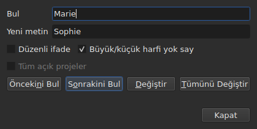
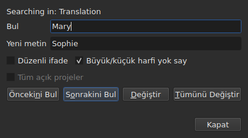

# Arama ve değiştirme

<!-- machine-translated -->
> Bu sayfa makine çevirisidir ve henüz dili bilen bir okuyucu tarafından gözden geçirilmemiştir.

`Düzenle ▸ Bul ve Değiştir…` ya da `Ctrl+F`, arama iletişim kutusunu açar.




**İletişim kutusu kipli değildir**: siz tabloya bakarken, bir hücreyi düzenlerken,
yeniden ararken açık kalır. `Close` onu kapatır; yeniden açmak onu,
desen ve değiştirme metni dahil, bıraktığınız gibi geri verir.

| Alan | Taşıdığı |
| :--- | :------- |
| `Find` | aranan desen |
| `Replace with` | onun yerine geçen |
| `Regular expression` | desen, düz metin yerine bir düzenli ifadedir |
| `Ignore case` | “marie”, “Marie” sözcüğünü bulur |
| `All open projects` | arama tüm sekmeleri dolaşır — [aşağıya bakın](#açık-tüm-projelerde) |

Öğe boş bir belgede devre dışıdır: aranacak bir şey yoktur.

## Dört hareket

| Düğme | Ne yapar |
| :---- | :------- |
| `Find Previous` | önceki eşleşmeyi bulur ve tablo ona gider |
| `Find Next` | sonrakini bulur — `Enter` tuşunun bastığı düğmedir |
| `Replace` | bulunan eşleşmeyi değiştirir, ardından sonrakini bulur |
| `Replace All` | hedefteki tüm eşleşmeleri değiştirir |

`Find` boş olduğu sürece dördü de devre dışıdır.

**Tablo, satırını seçerek eşleşmeye gider.** Sonuncuya ulaşıldığında `Find Next`
ilkinden yeniden başlar; `Find Previous` aynısını diğer yönde yapar.

**Eşleşme bulunmamışken `Replace` önce arar**: ilk basış neyin
değiştirileceğini gösterir, sonraki onu değiştirir. Gaupol'un yaptığı budur.

## Aramanın kapsadığı şeyler

**Seçim, hiçbir şey seçili değilse belgenin tamamı** — `Tools` menüsünün kuralı.
Bkz. [İşlemler](operations.md#neye-etki-ettikleri).

**Hedef ilk harekette alınır ve** arama sürdüğü sürece **korunur**: `Find Next`
bir eşleşmenin satırını seçer ve bu seçim hedefi daraltmaz. **Başka satırları kendiniz
seçmek hedefi değiştirir**, sonraki hareket için.

Arama altyazıların metnini kapsar; konumlar da numara da aranmaz.

### Açık tüm projelerde

**`All open projects`** onay kutusu kapsamı her sekmeye genişletir. **Tek proje açıkken
devre dışıdır** — genişletilecek bir şey yoktur —, ikinci bir sekme açılır açılmaz etkinleşir
ve yalnızca biri kaldığında kendiliğinden işaretini kaldırır.

**İşaretliyken seçim artık sayılmaz**: her proje tek bir proje için olduğu gibi,
**hedeflenen belgede** — geçerli sütunun belgesi, ana metin ya da çeviri — baştan sona aranır.

- **`Find Next` ve `Find Previous` sekmeden sekmeye, sekmelerin sırasıyla gider.**
  Önce gösterilen proje; başka eşleşmesi kalmadığında, sekmesini pencerenin gösterdiği
  ve satırını seçtiği bir sonraki.
- **Tur başladığı yerde biter**: arama son sekmeyi aşıp ilkine döndüğünde — ya da
  yukarı çıkarken tersine —, iletişim kutusunun satırı, hiçbir şey söylemeden yeniden
  başlamak yerine bunu söyler:

  ```text
  Search wrapped around
  ```

  Sonraki adım sıradan bir adımdır ve satır temizlenir.
- **`Replace`, aramanın bulunduğu yerde değiştirir**, sonra başka bir sekmede olabilecek
  sonraki eşleşmeye geçer.
- **`Replace All` tüm projeleri dolaşır** ve **dokunulan proje başına bir geçmiş girişi
  oluşturur**: bir sekmede geri almak yalnızca o sekmenin aldıklarını geri alır. Sayı yalnızca
  kaç değiştirme yapıldığını değil, kaç projenin değiştiğini de söyler:

  ```text
  replaced 4 matches in 3 projects
  ```

  Desenin bulunmadığı bir projeye dokunulmaz ve geri alınacak bir şeyi olmaz.
  **Hiçbir sekme öne gelmez**: her proje değiştirmelerini sekmesinin
  arkasında alır; sekme yıldızını alır ve hareketin başladığı sekme, filmiyle birlikte,
  gösterilmeye devam eder.

### Hangi metinde

**Bir çeviri varsa arama iki metnin yalnızca birini kapsar: geçerli hücrenin sütununun
metnini** — geçerli hücre `Translation` sütunundaysa çeviriyi, başka her yerde ana
metni. Bu, tüm metin işlemlerinin kuralıdır ve ek bir ayar yoktur:
bkz. [Metin: işlemlerin hedefi](table.md#metin-işlemlerin-hedefi).

**İletişim kutusu hangi metinde aradığını söyler**, `Find` üzerindeki bir satırda ve
geçerli sütun değiştiğinde — açıkken bile — bunu değiştirir:




| Geçerli hücre şurada | Satırın söylediği |
| :------------------- | :---------------- |
| `Translation` sütunu | `Searching in: Translation` |
| başka herhangi bir sütun | `Searching in: Main` |
| — projede çeviri yok ya da sütun kaldırılmış | hiçbir şey: satır yoktur |

**Değiştirme o metne ve yalnızca ona yazar.** Çeviri üzerindeki `Replace` ve `Replace
All` ana metni olduğu gibi bırakır, tersi de
öyle; `Undo` yazdıklarını geri verir. **Etiketler,
o metnin dosyasının biçimindeki etiketlerdir**: Advanced SSA biçimindeki bir çeviri,
ana metin SubRip olsa bile `{\i1}` ile okunur. `Replace with` oraya aynı
etiketlerle yazılır.

**Tablo bulunduğu sütunda kalır.** `Find Next`, geçerli hücreyi bir sütundan
diğerine taşımadan bir eşleşmenin satırını seçer: çeviride başlatılan bir arama çeviride sürer.

**İki metni birden aramak yoktur**: her eşleşme bir (altyazı, metin) çifti
olurdu ve ona giden tablonun gidecek net bir yeri olmazdı. Birinde arar, sonra sütun değiştirirsiniz.

**Sıfırdan yeniden başlayanlar**:

| Hareket | Unutulan |
| :------ | :------- |
| `Find`, `Replace with` ya da bir seçeneği değiştirmek | geçerli eşleşme ve durum satırı |
| başka satırları kendiniz seçmek | hedef ve eşleşme |
| geçerli hücreyi bir metinden diğerine taşımak — `Text` sütunundan `Translation` sütununa ya da tersine | eşleşme: bir metindeki bir yerdir |
| başka bir dosya açmak | hedef ve eşleşme; iletişim kutusu, desen dahil, açık kalır |

## Aranan metin görünen metindir

**Etiketler metin değildir.** `<i>` aramak hiçbir şey bulmaz ve `Bonjour` aramak
bir etiketle kesilmiş `<i>Bon</i>jour` sözcüğünü bulur.

**Değiştirme dosyanın metninde, etiketleri bozmadan yapılır**:

| Metin | Aranan → yerine konan | Yazılan |
| :---- | :-------------------- | :------ |
| `<i>Bonjour</i>` | `Bonjour` → `Salut` | `<i>Salut</i>` |
| `<i>Bon</i>jour` | `Bonjour` → `Salut` | `<i>Salut</i>` |
| `<i>Bonjour</i> Marie` | `Bonjour Marie` → `Salut Sophie` | `<i>Salut Sophie</i>` |

Bir sözcüğü kesen etiket sözcüğün tamamını kapsar ve eşleşmeye dokunan her stil
değiştirmeyi de kapsar. **Eşleşmenin dokunmadığı etiketler olduğu yerde kalır**, aynı
altyazının başka bir sözcüğünü kesen bir etiket bile: `<i>Bon</i>jour Marie` içinde `Marie`
değiştirilince `<i>Bon</i>jour Sophie` elde edilir. Bir sözcük harflerden ve rakamlardan
oluşur — bölünmez boşluk ya da tırnak işareti ona dahil değildir. **`Replace with`, hedeflenen
metnin etiketleriyle okunur**: orada bir SubRip dosyasında `<b>Salut</b>` yazmak sözcüğü kalın yapar.

## Her iki seçenek

| Seçenek | Varsayılan | Neyi değiştirir |
| :------ | :--------- | :-------------- |
| `Regular expression` | işaretsiz | `.` artık bir nokta değil, herhangi bir karakter arar |
| `Ignore case` | işaretli | büyük/küçük harf sayılmaz, aksanlı harfler dahil: `élise`, `Élise` sözcüğünü bulur |

Bunlar Gaupol'un varsayılanlarıdır. **İkisi de bir açılıştan diğerine ve bir
oturumdan diğerine hatırlanır**, [tercihler dosyasının](preferences.md#dosya)
`search.regex` ve `search.ignore-case` seçeneklerinde.

### Düzenli ifade

Desen ICU tarafından okunur. Gaupol'daki gibi `.` bir satır sonunu aşar, `^`
ve `$` bir altyazının **her satırının** başında ve sonunda geçerlidir:
`^` ifadesini `- ` ile değiştirmek her satırın önüne bir çizgi koyar.

`Replace with` içinde ve yalnızca düzenli ifade için:

| Yazılan | Koyduğu |
| :------ | :------ |
| `$1` ile `$9` | o numaralı grup; bulunmayan bir grup hiçbir şey koymaz |
| `$0` | eşleşmenin tamamı |
| `\n` | bir satır sonu |
| `\$`, `\\` | bir `$`, bir ters eğik çizgi |
| `\` ve ardından başka herhangi bir karakter | o karakter: `\t` bir `t` koyar |

**`\1` bir grup değildir** ve bir `1` koyar. Bu, ifadelerini Python'da okuyan
Gaupol'un söz dizimidir; buradaki, deseni okuyan ICU'nunkidir.

## İletişim kutusunun söyledikleri

Düğmelerin altında bir satır, aramanın yapamadığını ya da bir `Replace All`
işleminin yaptığını söyler:

| Durum | Gösterilen |
| :---- | :--------- |
| hedefte eşleşme yok | `"Sophie" not found` |
| okunamayan bir düzenli ifade | `not a regular expression (U_REGEX_MISMATCHED_PAREN)` |
| `Replace All` değiştirdi | `replaced 3 matches` |
| `Replace All` deseni buldu ama değiştirme hiçbir metni değiştirmiyor | `nothing to change` |

**Hiçbir şey bulmayan bir arama hiçbir şeye dokunmaz**: seçim olduğu yerde kalır
ve geçmişe hiçbir şey girmez.

**`not found` ve `nothing to change` aynı şeyi söylemez.** `not found`,
desenin hedefte hiçbir yerde olmadığını söyler. `nothing to change` ise desenin
orada olduğunu ama değiştirmenin her metni olduğu gibi bıraktığını söyler —
örneğin `Marie` yerine `Marie` koymak. Her iki durumda da geçmişe hiçbir şey girmez.
`replaced N matches` sayısı, metni değişen altyazıların eşleşmelerini sayar.

## Geri alma eyleminin bu konuda söyledikleri

| Hareket | `Undo` neyi okur |
| :------ | :---------------- |
| `Replace` | `Undo: replacing` — değiştirme başına bir tane |
| `Replace All` | `Undo: replacing all` — eşleşme sayısı ne olursa olsun **tek bir giriş** |

Bkz. [Geri alma ve yineleme](undo.md).
