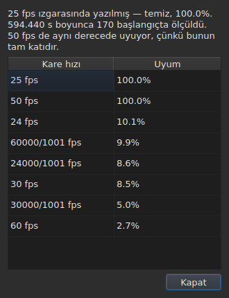

# Kare ızgarası

<!-- machine-translated -->
> Bu sayfa makine çevirisidir ve henüz dili bilen bir okuyucu tarafından gözden geçirilmemiştir.

Bir altyazı dosyası, konumlarının hesaplandığı kare hızını **bildirmez**: SubRip dosyasının başlığı yoktur,
WebVTT dosyasınınki serbest metindir. Pencere kare hızını konumların kendisinden, açılışta **çıkarır** ve
aynı soruyu yanıtlamayan iki yerde gösterir.

| Yüzey | Ne verir |
| :---- | :------- |
| durum çubuğu | **yanıtı**, sürekli ve sorulmadan |
| `Tools ▸ Frame Rate Analysis…` | **gerekçeyi**, görmek istediğinizde |

## Durum çubuğunun gösterdikleri

Sağda, okunan dosyanın [kodlaması](files.md#durum-çubuğundaki-kodlama) hakkında söylediği ile
[bağlı video](video.md#durum-çubuğunun-gösterdikleri) hakkında söylediği arasında:

| Durum | Ne yazılır |
| :---- | :--------- |
| konumlar bir ızgaradadır | `Grid: 24 fps` |
| yalnızca bir kısmı | `Grid: 29.97 fps (partial)` |
| bilinen hiçbir ızgara uymaz | `No grid` |

**`No grid` hiçbir kare hızı adlandırmaz ve bu bilerek böyledir.** Adaylar kümesi kapalıdır —
dönüştürme iletişim kutusunun sunduğu sekiz kare hızı — ve bunların en az yanlış olanını bildirmek,
“bilmiyorum”un doğru yanıt olduğu yerde yanlış bir yanıt vermek olurdu.

**`No grid` iki nedene sahiptir ve bunlar aynı yanıt değildir.** Ya hiçbir ızgara uymaz ya da dosyanın
hakkında bir şey söylenmesine yetecek kadar altyazısı yoktur — iki başlangıç her zaman kusursuzca
hizalı görünür ve bu hiçbir şeyi kanıtlamaz. Durum çubuğu ikisi için de aynı şeyi söyler;
**çözümleme ikisini birbirinden ayırır** ve ilk durumda en iyi adayın ne kadar yetersiz kaldığını verir.

Satır **her işlemden sonra güncellenir**. Bir dosyayı başka bir kare hızına hizalamak ızgarayı
değiştirir ve durum çubuğu eskisini duyurmaya devam etmemelidir.

### Karelerle sayılan bir belgenin ızgarası yoktur, kare hızı vardır

**MicroDVD, dokuz biçim içinde karelerle sayan tek biçimdir.** Her satırı iki kare numarası taşır,
başka bir şey taşımaz ve dosya bunları hangi kare hızında okumak gerektiğini **söylemez**. Durum
çubuğunun aynı yeri o zaman şunu yazar:

| Durum | Ne yazılır |
| :---- | :--------- |
| belge karelerle sayılır | `Frames: 24000/1001 fps` |

**Bu ızgara değildir ve ızgara burada döngüsel olurdu.** Bir MicroDVD belgesinin konumları,
kareleri *kullanılarak* tam bu kare hızında hesaplanmıştır; onlardan bir ızgara çıkarmak aynı sayıyı
geri verirdi, yani ölçüm kılığına girmiş bir veriyi.

**Nereden geldiği bir kez söylenir**, okuma tarafından,
[tanılama iletileri listesinde](files.md#bir-okumanın-tanılama-iletileri):
`counts in frames and states no rate; it was read at ("24000/1001")`. Durum çubuğunun satırı ise
olanı sürekli söyler.

**Kare hızını yanlış almak bütün dosyayı kaydırır** ve bunu düzelteceğiniz yer
[`Convert Frame Rate…`](operations.md#convert-frame-rate) iletişim kutusudur: okuma kare hızıyla
açılır ve bunun o olduğunu söyler.

## Çözümlemenin gösterdikleri

`Tools ▸ Frame Rate Analysis…` **hiçbir şeyi değiştirmez.** Bir özetle ve sekiz adayın puanlarıyla
sıralamasıyla açılır.




Özet yanıtı verir, sonra onu niteleyenleri — her cümle yalnızca söyleyecek bir şeyi varsa görünür:

| Orada okunabilenler | Ne zaman |
| :------------------ | :------- |
| kaç başlangıç üzerinden ve hangi aralıkta | her zaman |
| dosyanın ızgarasından ne kadar kaydığı | konumları bir sabite kadar ızgaradadır |
| başka bir kare hızının da aynı derecede uyduğu | korunan kare hızının tam katıdır |
| aralığın iki kare hızını ayırt etmeye izin vermediği | dosya onları ayırmak için çok kısadır |
| kaç başlangıcın ızgaradan çıktığı, **ve kaç dizide** | dosya kısmidir |

**Dizilerin sayısı, yüzdenin tek başına karıştırdığı iki öyküyü ayıran şeydir.** Tek başlangıçlık
çok sayıda dizi, elle tek tek düzeltilmiş konumlardır. Birkaç uzun dizi, yeniden zamanlanmış bir
bölüm ya da iki dosyadan birleştirilmiş bir dosyadır.

**Tek bir yanıt yerine tam sıralama gösterilir.** 25 kare hızına yüzde yüz, 50 kare hızına da yüzde yüz uyan bir dosya,
tek başına bir kararın gizleyeceği bir şey söyler.

## Dönüştürme yanlış olduğunda

Hiçbir ızgaraya düşmeyen bir dosya bazen **yanlış kare hızında dönüştürülmüş** bir dosyadır: o zaman
gerçek bir ızgaradadır ama sekizin hiçbirine ait olmayan bir oranla kaymıştır. Çıkarım `none` ya da
`partial` döndürdüğünde çözümleme, **sekiz standart kare hızının elli altı sıralı çifti arasında** —
küme budur, kapalıdır — dönüştürmesi konumları bir ızgaraya geri koyanı arar. Her oran konumlara
uygulanır ve **sonucu yargılayan çıkarımın kendisidir**: güven, onun söyleyeceği şeydir, uydurulmuş
bir sayı asla. Aynı oranı veren iki çift, örneğin 30 kare hızından 25 kare hızına ve 60 kare hızından 50 kare hızına, tek bir dönüştürmedir.

Cümle özete eklenir:

```text
converting from 24 to 25 fps puts the positions on a 24 fps grid: 99.9%, against 11.8% as they are and 14.9% for the next best conversion
```

Dönüştürmeyi, konumların düşeceği ızgarayı ve ona ne kadar iyi düştüklerini verir, **sonra konumların
olduğu gibi haliyle ve diğer dönüştürmelerin en iyisiyle arasındaki farkı.** Bir `Convert Frame Rate…`
düğmesi çözümlemeyi kapatır ve [dönüştürme
iletişim kutusunu](operations.md#convert-frame-rate)
**bulunan çiftle doldurulmuş** olarak açar — iletişim kutusu kabul edilmedikçe hiçbir şey uygulanmaz
ve geri dönmek için iptal etmek yeter. Yanında açık olan video, yanıtın doğru olup olmadığını
görüntüye bakarak yargılamanızı sağlar.

**İki çift eşit derecede iyi olduğunda hiçbiri önerilmez ve cümle bunu söyler:**

```text
converting from 30 to 25 fps and converting from 25 to 24 fps fit equally well (99.7% and 99.6%), so none is proposed
```

Bu istisna değil olağan durumdur: saniyede 28,8 karelik bir ızgara 30 kare hızına olduğu kadar 24 kare hızına da geri
döner ve bütün zamanları iki katına çıkarılmış bir dosya 25 ızgarasında kalır. Tek bir onarımı olan
hareket, **zaten** hedef kare hızında olan bir dosyayı dönüştürmektir. Bir eşitlikte videoyu karar
verir: `Convert Frame Rate…` iletişim kutusunu iki çiftten biri üzerinde kendiniz açarsınız.

**Hiçbir şey söylenmez**: zaten bir ızgarada olan bir dosya, bir karara değer vermeyecek kadar kısa
bir dosya ve kümenin hiçbir dönüştürmesinin ızgaraya geri koymadığı bir dosya için — bir kayma, sekiz
kare hızının dışında bir oran, yapısı olmayan konumlar.

## Tablonun göstermedikleri

**Tablonun hiçbir satırı ızgara yüzünden işaretlenmez**, asla.

Bir konumu elle düzelttiğiniz anda hizalı olmaktan çıkar. Otomatik bir işaretleme bu nedenle,
kullanıcının çalışmasını tam da düzelttiği bir dosyada bir anomali olarak bildirirdi. Çıkarım
**belgeden** söz eder ve çözümleme tek istisnadır — çünkü onu bunun için açtınız.

Tablonun işaretleri ise birbiriyle tutmayanlarla ilgilidir: başlangıcından önce biten bir bitiş,
bir çakışma, bozuk bir sıra. Bkz. [Tablo](table.md).
