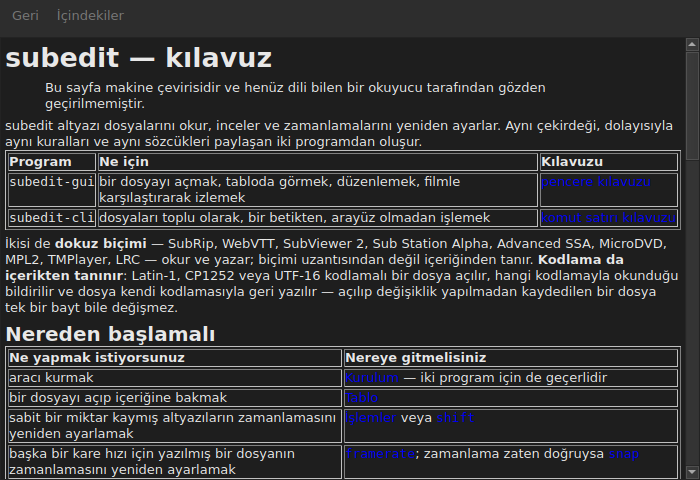

# Pencere içi kılavuz

<!-- machine-translated -->
> Bu sayfa makine çevirisidir ve henüz dili bilen bir okuyucu tarafından gözden geçirilmemiştir.

`Yardım ▸ Kılavuz` ya da `F1`, **tam olarak bu kılavuzu** kendi penceresinde açar.




## Ne açar ve neden bir adres açmaz

**Programın yanına kurulan kılavuz**; internetteki bir sayfa değil.

Bir adres, elinizdeki sürümü değil, geliştirilmekte olan sürümü anlatırdı. Sahip olmadığı bir sürümün kılavuzunu okuyan kullanıcı, hiç kılavuzu olmayan kullanıcıdan daha kötü durumdadır; bu yüzden pencere, kurulumun `<prefix>/share/subedit/manual` altına koyduğu dosyaları okur. Bkz. [Kurulum](../subedit-cli/installation.md).

Kılavuz, nereden başlanacağını söyleyen [ana sayfada](../index.md) açılır.

## Hangi dilde

**Pencerenin dilinde.** Kılavuz, arayüzün konuştuğu dilde açılır: `Düzenle ▸ Tercihler…` altında seçilen dilde, seçilmemişse ortamın diliyle; bkz.
[Arayüz dili](preferences.md#arayüz-dili).

| Pencere şu dili konuşur | Kılavuz şu dilde açılır |
| :---------------- | :------------------ |
| İngilizce | İngilizce |
| kılavuzu kurulu olan bir dil — Katalanca, Çekçe, Almanca, İspanyolca, Fince, Fransızca, Galiçyaca, İbranice, Macarca, Interlingue, İzlandaca, İtalyanca, Felemenkçe, Lehçe, Portekizce, Brezilya Portekizcesi, Rusça, Sırpça, Türkçe, Çince (Basitleştirilmiş) | o dil |
| kılavuzu kurulu olmayan bir dil | İngilizce |

**Hep ya da hiç değil, sayfa sayfa**: çevirisi bulunmayan bir sayfa İngilizce açılır, diğer tüm sayfalar pencerenin dilinde kalır. Bir bağlantı, bir sayfadan ötekine aynı biçimde geçirir.

Çeviriler İngilizce kılavuzun yanına, her biri dilinin adını taşıyan bir dizine kurulur: Fransızca için `<prefix>/share/subedit/manual/fr`. Dil, pencerenin başladığı dildir; tercihlerde seçilen bir dil de kılavuza bir sonraki açılışta uygulanır.

## Gezinme

| Yapılan | Olan |
| :---------- | :----------- |
| kılavuzdaki bir bağlantıya tıklamak | sayfa aynı pencerede açılır |
| bir bölümü hedefleyen bağlantıya tıklamak | sayfa açılır ve pencere o bölüme kayar |
| yalnızca bir bölümü hedefleyen bağlantıya tıklamak | pencere sayfayı değiştirmeden o bölüme kayar |
| `Back` | önceki sayfaya döner; ilk sayfada devre dışıdır |
| `Contents` | ana sayfaya döner; zaten oradayken devre dışıdır |

Pencere **kipli değildir**: siz çalışırken açık kalır; kılavuzu elinizin altında tutmanın tüm amacı budur. Menü öğesini yeniden seçmek ikinci bir pencere oluşturmaz, var olanı öne getirir.

## Açamadıkları ve bunu söylemesi

Kılavuz bazen **yol haritasına** ya da bir **mimari kararına** gönderme yapar. Bunlar paketin değil deponun belgeleridir: kurulmazlar ve pencere, tıklamayı sonuçsuz bırakmak yerine bunu açık sözlerle söyler.

```
../../feuille-de-route.md is not part of the installed manual;
it lives in the project's repository.
```

Bunlar, adresi `Yardım ▸ subedit Hakkında` içinde bulunan depoda okunabilir.

## Menü öğesi devre dışı olduğunda

**Programın yanında kılavuz yoksa `Yardım ▸ Kılavuz` devre dışıdır.** İki durum vardır ve hiçbiri bir arıza değildir:

| Durum | Neden |
| :--- | :-- |
| ikili dosya derleme ağacından çalıştırılıyor | orada hiçbir şey kurulmadı, dolayısıyla okunacak bir şey yok |
| kurulum eksik | kılavuz silinmiş ya da hiç kopyalanmamış |

Öğenin üzerine gelmek hangisi olduğunu söyler: “Bu programın yanında kurulu bir kılavuz yok”.

Kılavuz yerindeyken bir sayfanın eksik olması — elle silinmiş bir dosya — pencereyi kapatmaz: okunamayan dosyanın adını söyler ve o sırada gösterdiği içeriği ekranda tutar.

## Kılavuzun aranacağı yer

**Çalıştırılabilir dosyanın yanında**, `../share/subedit/manual` içinde — önek ne olursa olsun her kurulumun ürettiği düzen budur. `~/.local` altındaki bir kurulumun kılavuzunu `/usr` altına kurulan bir paket kadar kolay bulmasını sağlayan da budur.
