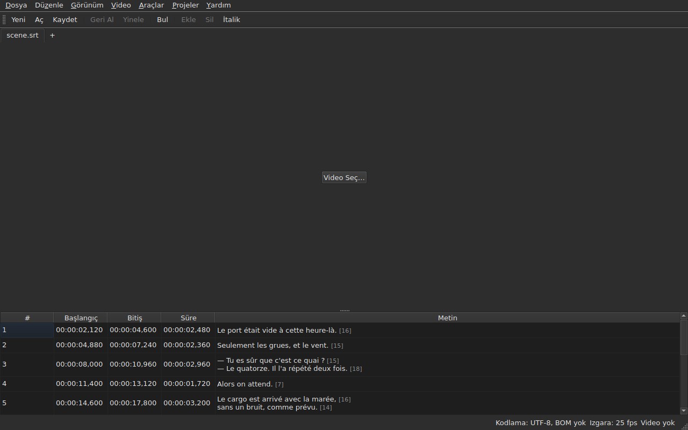

# subedit-gui — kılavuz

<!-- machine-translated -->
> Bu sayfa makine çevirisidir ve henüz dili bilen bir okuyucu tarafından gözden geçirilmemiştir.

subedit penceresi: bir altyazı dosyasını açın ve bir tabloda görün. Diğer program için ve nereden başlanacağını öğrenmek için [kılavuza](../index.md) bakın.

> **Güncel durum.** Pencere, kodlamaları ne olursa olsun **birden çok dosyayı, her biri bir sekmede açar** — `Open…` ile ya da üzerlerine bırakarak —, bunları **görüntüler**, **hücrelerini düzenler**, **satır ekler ve siler**, **geri alır**, **kaydeder — kodlamayı, satır sonlarını ve bayt sırası işaretini seçerek —** ve **konumları birbiriyle tutmayan altyazıları işaretler**. Satırları **birleştirir ve böler**, metinleri **keser, kopyalar ve yapıştırır**, görünen metinde etiketleri bozmadan, tek bir projede ya da hepsinde **bulur ve değiştirir**. **Bir çeviriyi ana dosyanın yanında açar**, konuma ya da numaraya göre hizalayarak, bir sütun daha içinde, ve onu ayrıca kaydeder. `Tools` menüsü on altı işlem ve iki yazım denetimi öğesi taşır — kaydırma, dönüştürme, kare hızını dönüştürme, süreleri ayarlama, **bir dosya ekleme, projeyi ikiye bölme**, italik yapma, diyalog çizgileri ekleme, harf biçimini dört şekilde değiştirme, işitme engelli notlarını kaldırma, **çok sayfalı bir sihirbazla metinleri düzeltme**, **yazım denetimini sözcük sözcük yapma**, bir kare hızına hizalama, ızgaraya geri getirme — ve hiçbir şeyi değiştirmeyen ızgara çözümlemesi. `Projects` menüsü **her şeyi tek hareketle kaydeder ve kapatır**. **Belgeye bir video bağlar**, seçilmiş ya da tahmin edilmiş, ve onu **pencerede oynatır**, geçerli satır görüntünün üzerine çizilir; **bir başlangıcı, bir bitişi ya da bir altyazıyı filmin konumundan ayarlar**, **kare kare ilerler** ve **bir ucu bir kare kaydırır**. Oynatma çubuğu **konumu ve ses düzeyini arar ve ayarlar**, tablo **oynatmayı izler** ve elle yapılan kaydırmayı bozmaz, konumlar **karelerle** gösterilebilir ve `Video` menüsü **ses izini seçer**. İki algılama **hiçbir zaman uygulamadan önerir**: sabit bir miktar kaymış bir çeviri, ki **kaydırılmış olarak yeniden açılabilir**, ve bir dosyayı ızgarasına geri getiren kare hızı dönüştürmesi. **Geometrisini, sütunlarının sırasını, genişliğini ve varlığını, ayarlarını** bir oturumdan ötekine hatırlar ve seçtiğiniz gibi **açık ya da koyu** gelir. `Yardım ▸ Kılavuz` **bu kılavuzu** bir pencerede açar. Bu kılavuz var olanı anlatır, planlananı asla; sonraki adımlar [yol haritasında](../../../../feuille-de-route.md) yer alır.

> **Bu kılavuzdaki görüntüler üretilir, metin üretilmez.** `subedit-cli`
> örnekleri komut çalıştırılarak üretilir; ekran görüntüleri gerçek pencere
> kurulup fotoğraflanarak üretilir — her ikisini de `make
> manual` yapar. Bu nedenle bir görüntü artık var olmayan bir arayüzü
> anlatamaz ve değişen bir arayüz deponun farkında görünür. Güvenlik ağı
> olmadan kalan, çevrelerindeki metindir; doğruluğu gözden geçirmeye dayanır.

**Her ekran, uygulamanın belirlediği iki palette iki kez gösterilir** — [tercihlerin](preferences.md#tema) sunduğu `Light` ve `Dark`. Teması belirleyici olan bir masaüstünde `System`, masaüstünün seçimine göre birini ya da ötekini verir.

## Menüler

`File`, `Edit`, `View`, `Video`, `Tools`, `Projects`, `Help` — kullanma sırasıyla: belge, ona yapılanlar, nasıl bakıldığı, ona eşlik eden şeyler, onu inceleyen şeyler, açık tüm projelere uygulanan şeyler, onu açıklayan şeyler.

`View`, `Text` dışında her sütun için işaretlenebilir bir öğe taşıyan `Columns` alt menüsünü — bkz. [Tablo](table.md#sütunları-gizleme-ve-taşıma) — ve `Start` ile `End` konumlarını kare numaraları olarak gösteren bir ayarı, `Positions in Frames` öğesini taşır — bkz. [Karelerle konumlar](table.md#karelerle-konumlar).

`Projects`, `Save All` ve `Close All` olmak üzere iki öğe taşır — bkz. [Projeler menüsü](files.md#projeler-menüsü).

`Edit`, her biri bir ayırıcının altında beş blok taşır: geri alma; pano — metinleri kesme, kopyalama, yapıştırma; `Find and Replace…`; satırları ekleme, silme, birleştirme ve bölme; son olarak `Preferences…`. Geri alma, bir düzenlemeye *yapılan* şeydir; bir metni taşımak satır eklemez ya da silmez, sonraki bloğun dördü satır sayısını değiştirir ve temayı ayarlamak hiç düzenleme değildir.

**Tuşlar, menünün gösterdiği gibi adlandırılır**, arayüzün geri kalanı gibi İngilizce: `Ins`, `Del`, `Ctrl+Shift+Z`. Basılan ve hiçbir menünün adlandırmadığı bir tuş İngilizce adını korur: `Enter`, `Esc`, `Shift`.

`Help` iki öğe taşır, menünün gösterdiği sırayla. `Manual` ya da `F1`, bu kılavuzu bir pencerede açar — bkz. [Pencere içi kılavuz](help.md). `About subedit` sürümü, lisansı ve pencerenin birlikte çalıştığı kitaplıkları sürümleriyle verir — bkz. [`--version`](invocation.md#--version).

## Araç çubuğu

Menülerin altında bir çubuk, **en sık yapılan hareketleri** gruplar halinde taşır. Her düğme kısa bir sözcük okur; menü öğenin tamamını tutar ve kısayol aynıdır.

| Düğme | Menü öğesi | Kısayol |
| :----- | :--------- | :------- |
| Yeni | Dosya ▸ Yeni Proje | `Ctrl+N` |
| Aç | Dosya ▸ Aç… | `Ctrl+O` |
| Kaydet | Dosya ▸ Kaydet | `Ctrl+S` |
| Geri Al | Düzenle ▸ Geri Al | `Ctrl+Z` |
| Yinele | Düzenle ▸ Yinele | `Ctrl+Shift+Z` |
| Bul | Düzenle ▸ Bul ve Değiştir… | `Ctrl+F` |
| Ekle | Düzenle ▸ Altyazı Ekle… | `Ins` |
| Sil | Düzenle ▸ Altyazıları Kaldır | `Del` |
| İtalik | Araçlar ▸ İtalik | `Ctrl+I` |

**Devre dışı bir düğme, öğesiyle aynı nedenle devre dışıdır**: geri alınacak bir şey yokken `Undo`, seçili satır yokken `Remove`. Çevirinin öğeleri ve `Italic` dışında `Tools` menüsünün işlemleri menülerinde kalır: daha seyrek kullanılırlar ya da herkes tarafından kullanılmazlar.

## Bölümler

| Bölüm | İçerik |
| :------ | :------- |
| [Kurulum](../subedit-cli/installation.md) | derleme ve kurma — sayfa iki program için de geçerlidir |
| [Çalıştırma](invocation.md) | pencereyi başlatma, bağımsız değişkenler, çıkış kodları |
| [Açma ve kaydetme](files.md) | komutlar, sekmeler, `Projects` menüsü, dosya bırakma, çeviri ve kaydırılmış olarak yeniden açılması, tanılama iletileri, durum çubuğundaki kodlama, gidiş dönüş, kapatma |
| [Tablo](table.md) | her sütunun gösterdiği, bunları gizleme ve taşıma, karelerle konumlar, çeviri sütunu ve işlemlerin hedeflediği metin |
| [Hücre düzenleme](editing.md) | hangi hücreler düzenlenebilir ve nasıl |
| [Metinleri kesme, kopyalama ve yapıştırma](clipboard.md) | üç öğe, taşınan şey, eklenen satırlar, çevrilen etiketler |
| [Arama ve değiştirme](find-and-replace.md) | iletişim kutusu, dört hareket, iki seçenek, aramanın kapsadığı şey, açık tüm projelerde |
| [Altyazıları ekleme, silme, birleştirme, bölme, sıralama ve aralıkları ayrık yapma](lines.md) | dört öğe, kısayolları, yeni satırların gittiği yer |
| [Geri alma ve yineleme](undo.md) | geçmiş, iki eylem, değişiklik işareti |
| [Kare ızgarası](frame-grid.md) | konumlardan çıkarılan kare hızı, çözümleme ve bir dosyayı ızgarasına geri getiren dönüştürme |
| [İşlemler](operations.md) | kaydırma, dönüştürme, kare hızı dönüştürme, süreleri ayarlama, dosya ekleme, projeyi bölme, italik yapma, harf biçimi, çizgiler, notları kaldırma, hizalama, ızgaraya geri getirme ve filmin sonunu aşan şey |
| [Metinleri düzelt…](correct-texts.md) | düzeltme sihirbazı: hedef ve görevler, her görev sayfası, ilerleme, onay |
| [Yazım denetimi…](check-spelling.md) | yazım denetimi: ayarları, sözcük sözcük gezinme, ortada kapatma, sözlüğün bulunmaması |
| [Bağlı video](video.md) | video seçme, otomatik öneri, ses izi, durum çubuğu, `ffmpeg` |
| [Oynatıcı](player.md) | video görünümü, oynatma çubuğu, oynatma, gezinme, ses düzeyi, izleyen tablo, çizilen satır |
| [Videoya göre zamanlama](timing.md) | bir altyazının başlangıcını ya da bitişini ayarlama, ekleme, filmin konumundan seçme, kare kare ilerleme, bir ucu kaydırma |
| [Tercihler](preferences.md) | tema, tercihler dosyası, seçenekleri ve okunamayan bir değerin akıbeti |
| [Pencere içi kılavuz](help.md) | `Yardım ▸ Kılavuz`, neyi açtığı ve içinde nasıl gezinileceği |
