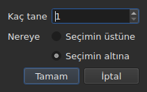

# Altyazıları ekleme, silme, birleştirme, bölme, sıralama ve aralıkları ayrık yapma

<!-- machine-translated -->
> Bu sayfa makine çevirisidir ve henüz dili bilen bir okuyucu tarafından gözden geçirilmemiştir.

`Edit` menüsünün sekiz öğesi, onları `Find and Replace…` öğesinden ayıran bir ayırıcının altında yer alır.
Dördünün ortak yanı satır sayısını değiştirmeleridir; yukarıda anlatılan kesme, kopyalama ve yapıştırma
ise metinleri taşır. `Sort Subtitles` yalnızca satırların **sırasını** değiştirir,
`Join Repeated Subtitles` aynı metnin art arda gelen parçalarından yeniden tek bir
altyazı yapar, `Make Ranges Disjoint…` ise çakışan satırları çakıştıkları yerden yeniden keser.

| Öğe | Kısayol | Ne yapar |
| :---- | :------- | :----------- |
| Altyazı Ekle… | `Ins` | bir iletişim kutusu açar, ardından boş satırlar ekler |
| Altyazıları Kaldır | `Del` | seçimi hiçbir şey sormadan siler |
| Altyazıları Birleştir | yok | bitişik satırlardan oluşan bir bloğu tek satır yapar |
| Altyazıyı Böl | yok | bir satırı süresinin ortasından ikiye keser |
| Yinelenen Altyazıları Birleştir | yok | aynı metnin art arda gelen parçalarından tek bir altyazı yapar |
| Altyazıları Sırala | yok | satırları, bütün proje üzerinde, başlangıçlarının sırasına geri koyar |
| Aralıkları Ayrık Yap… | yok | çakışan satırları, hiçbir aralık bir başkasıyla çakışmayacak biçimde keser |
| Altyazıları Onar… | yok | önceki üç öğeyi — yinelemeleri birleştirme, sıralama, aralıkları kesme — tek hamlede zincirler |

Sekizi de geçmişe girer: `Ctrl+Z` hepsini diğerleri gibi geri alır.

## Ekleme

| Alan | İçerdiği | Varsayılan |
| :---- | :------------ | :------ |
| `How many` | 1 ile 99 999 arasında bir tam sayı | `1` |
| `Where` | `Above the selection` veya `Below the selection` | son seçim; ilk açılışta `Below` |

`OK` satırları ekler, `Cancel` hiçbir şey eklemez.

### Nereye giderler

Seçilen **ilk satırın değil, sonuncusunun** yanına. 1. ve 3. satırları seçip
aşağıya eklemek yeni satırı 2. konuma değil, 4. konuma koyar. Gaupol yirmi yıldır
böyle yapıyor ve yukarıdan aşağıya tarayan elin beklediği de budur.

`Above the selection` ise yeni satırı aynı satırın hemen önüne koyar.

### Ne kadar sürerler

Boş bir satırın metni yoktur ama konumları vardır. Bunlar, kullanılabilir boşluktan
çıkarılır:

| Durum | Başlangıç | Süre |
| :-------- | :---- | :------- |
| iki altyazı arasında | öncekinin bitişi | bir sonrakine kadar olan boşluk, eşit parçalara bölünür |
| sonuncudan sonra | sonuncunun bitişi | her biri üç saniye |
| bir dosyanın başında | başlangıç noktası | ilkine kadar olan boşluk, paylaştırılır |
| boş bir dosyada | başlangıç noktası | her biri üç saniye |

Dosya seçilen yerde çakışıyorsa **paylaştırılacak boşluk yoktur**: satırlara, komşuyu
aşacak uydurma bir süre vermek yerine, tablonun gösterdiği sıfır süre verilir.

### Boş belge

**Seçim gerekmez** ve yeni bir dosyaya başlamanın tek yolu budur: satırlar sıfır
numaralı sıraya gider. Bu durumda iletişim kutusunda taraf seçimi devre dışıdır —
satırları yerleştirecekleri bir seçim yoktur.

Belge tek bir satır taşır taşımaz `Insert Subtitles…` öğesi **hiçbir şey seçili olmadığı sürece devre dışı kalır**:
seçim olmadan sıra tahmin edilirdi.

### Sonrasında

Eklenen satırlar **seçilir** ve tablo onlara gider. `Ins` tuşuna ikinci kez basmak
bu nedenle, arada tıklamaya gerek kalmadan, onların ardına ekler.

### Taraf hatırlanır

`Above` veya `Below` seçimi **bir eklemeden diğerine ve bir oturumdan diğerine**
hatırlanır: [tercihler dosyasındaki](preferences.md#dosya) `edit.insert-placement`
seçeneğidir. Bir kez eklemezsiniz, art arda on satır eklersiniz; hep aynı tarafa.

## Silme

`Remove Subtitles` veya `Del`, seçili satırları siler — kesintili bir seçim de dahil;
geri alırsanız her satır yerine döner.

**Onay istenmez** ve bu bir unutkanlık değildir: işlem `Ctrl+Z` ile geri alınır.
Geri alınabilir bir hareketten önce kipli bir pencere, ara sıra bir `Ctrl+Z` basmaktan
kurtarmak için her seferinde bir tıklamaya mal olurdu.

**Hiçbir şey seçili değilken öğe devre dışıdır.** Pencerenin başka yerlerinde
“hiçbir şey seçili değil”, “dosyanın tamamı” anlamına gelir — dört bin satırı seçmeden
bir kaydırmayı kullanılabilir kılan da budur. Burada bu okuma, şanssız bir `Del` ile bir belgeyi
boşaltırdı; bu yüzden sunulmaz.

Silmeden sonra **silinen ilk satırın yerini alan satır seçilir** — silme dosyanın sonunu
götürdüyse kalan son satır. `Del` tuşuna art arda basmak bu nedenle satırları
tek tek siler.

Tamamen boşaltılmış bir dosya pencereyi kullanılabilir bırakır: boş bir belgeye seçim olmadan
eklenebildiği için `Insert Subtitles…` yeniden etkinleşir.

## Birleştirme

`Merge Subtitles`, seçili satırlardan **tek bir satır** yapar:

| Birleşen satırın aldığı | Nereden gelir |
| :---------------------------- | :------------------ |
| başlangıcı | ilkinin başlangıcı |
| bitişi | sonuncunun bitişi |
| metni | hepsinin metinleri, sırayla, iki metin arasında bir satır sonu |
| çevirisi | çeviriler, aynı biçimde birleştirilmiş |
| biçimin ayrıca taşıdığı şeyler — bir stil, bir katman, koordinatlar | ilkininki |

**Boş bir metin boş satır bırakmaz**: `Un.`, metinsiz bir satır ve `Trois.`
birleştirildiğinde üç değil, iki metin satırı elde edilir.

Birleştirilen satırlar kaybolur; onların yerini alan satır ilkinin yerini alır.

Seçim **en az iki bitişik satırdan oluşan bir blok** olmadığı sürece
**öğe devre dışıdır**. Tek satırın birleşeceği bir şey yoktur; araya giren satır olmadan
ilk ve üçüncü satır da birleşmez, çünkü sonuç ortadaki satırı aşıp onu örterdi.

Birleştirmeden sonra **birleşen satır seçilir**: `Split Subtitle` onu yeniden
kesmeye hazırdır.

## Bölme

`Split Subtitle`, seçili satırı **süresinin ortasından**, milisaniye hassasiyetiyle keser:

| Yarı | Başlangıç | Bitiş | Metin |
| :--- | :---- | :-- | :--- |
| ilki | özgün başlangıç | orta nokta | metnin **tamamı** ve çeviri |
| ikincisi | orta nokta | özgün bitiş | boş |

**Metin satır sonundan kesilmez.** Bu, iki satırlık bir altyazı için doğru, bir veya
üç satırlık bir altyazı için yanlış olurdu; metnin tamamı ilk yarıda kalır, ikinci yarıya
gitmesi gerekeni kendiniz taşırsınız.

İlk yarı biçimin metnin dışında taşıdığı şeyleri korur; ikincisi, eklenen bir satır gibi, hiçbir şey olmadan doğar.

Seçim **tam olarak bir satır** içermediği sürece **öğe devre dışıdır**. Burada hiçbir şey seçili olmaması
“dosyanın tamamı” anlamına gelmez.

Bölmeden sonra **iki yarı da seçilir** — Gaupol'un her eklemeden sonra yaptığı da budur ve
`Merge Subtitles` bu hareketi geri almaya hazırdır.

## Sıralama

`Sort Subtitles`, **projenin tamamını** başlangıçların sırasına geri koyar. Asla seçimi
değil: sıra belgenin bir özelliğidir ve bir dosyanın yarısını sıralamanın anlamı yoktur. Sıralama
**kararlıdır**: birlikte başlayan iki altyazı dosyanın verdiği sırayı korur.

**Sıralama sırasında durum çubuğunda bir çubuk ilerler ve imleç kum saatine dönüşür**: uzun bir dosyada
pencere bir süre yanıt vermez — tablo satır satır yeniden kurulur — ve bu olmasa bir şeyin
sürüp sürmediğini bilemezsiniz. Çubuk bir oran göstermez, sıralama oran bildirmez
ve çubuk sıralamayla birlikte kaybolur.

Durum çubuğu kaç satırın yer değiştirdiğini söyler — `3 subtitles moved` — ya da her şey
sıradaysa `already in order` der. **Zaten sıralı bir proje geçmişe girmez**: hiçbir şeyi
değiştirmeyen bir işlem geri alınacak bir işlem değildir. Tek altyazılı bir projede öğe devre dışıdır.

**Açılışta düzeltilecek bir şeyi olan** bir dosya bunu kendiliğinden sunar,
[tek bir kutuda](#açılışta-tek-bir-kutu): aşağıya bakın. Yerinde olmayan
altyazılar ayrıca [tanılama iletileriyle birlikte sayılır](files.md#bir-okumanın-tanılama-iletileri);
böylece tabloyu kaydırmadan bulursunuz.

Komut satırında [`sort`](../subedit-cli/sort.md) aynısını dosyalar üzerinde yapar, `--sort` ise
[`convert`](../subedit-cli/convert.md#yazarken-sıralama),
[`append`](../subedit-cli/append.md#sonucu-sıralama) ve
[`split-file`](../subedit-cli/split-file.md#zaman-sırasına-göre-kesme) alt komutlarında bunu yolda yapar.

## Yinelenen altyazıları birleştirme

`Join Repeated Subtitles`, art arda aynı şeyi gösteren altyazılardan **tek bir altyazı**
yapar: bazı bölümleme araçlarının bıraktığı gibi, art arda parçalara kesilmiş bir metin.
**Projenin tamamı** üzerinde işler.

**Bir yineleme**, bir başkasıyla aynı metne, aynı çeviriye ve aynı biçim ayarlarına
(bir stil, bir konum, cue ayarları) sahiptir **ve en geç o bitince başlar**. Bir yineleme dizisi,
ilk başlayanın başlangıcını ve dizinin en büyük bitişini alan tek bir altyazı olur; diğerleri kaybolur.
`Alpha [1, 2]`, `Alpha [2, 4]` ve `Alpha [4, 6]` birleşince `Alpha [1, 6]` olur.

- **Dosyanın sırası bunu etkilemez ve onu değiştirmez**: korunan altyazı, diğerleri nerede olursa olsun,
  ilk başlayandır.
- **Hata yapılarak hiçbir şey birleştirilmez**: başka bir metin, başka ayarlar, iki parça arasında
  bir boşluk, metni olmayan ya da bitişi başlangıcından önce gelen bir altyazı ayrı kalır.
- Durum çubuğu yapılanı söyler — `2 repeated subtitles joined` ya da
  `no repeated subtitles`.

**Sıralamadan ve kesmeden önce yapılmalıdır**, çünkü bunlar temiz bir diziyi daha iyi okur: üç
parçaya bölünmüş bir metin, tüm aralığı kaplayan başka bir metinle birlikte sırasız verildiğinde,
bir parçadan diğerine geçen satırlara sıralanır ve kesilir; önce birleştirilirse
sıraya girer ve temiz biçimde birleşir. Aşağıdaki açılış kutusu üçünü de bu sırayla
yapar.

## Aralıkları ayrık yapma

`Make Ranges Disjoint…`, çakışan altyazıları **hiçbir `[start, end]` aralığı
bir başkasıyla çakışmayacak** biçimde keser. **Projenin tamamı** üzerinde işler,
asla seçim üzerinde değil: çakışan altyazılardan oluşan bir grup, çakıştıkları yerden
kesilir ve bir grubun yarısının anlamı yoktur.

**Hiçbir şey kısaltılmaz ya da uzatılmaz.** Her anda pencere öncekiyle aynı metinleri
gösterir. Değişen, zaman çizgisinin kesilme biçimidir: bir grubun her başlangıcında ve
her bitişinde kesilir; yalnızca tek bir altyazının kapladığı aralık o altyazı olarak kalır;
birkaçının kapladığı aralık, satırları onların satırları olan **tek bir** altyazı olur,
**en erken olan 1. satırda**.
`A [0, 5]` ve `B [3, 8]` birleşince `[0, 3] A`, `[3, 5] A / B`, `[5, 8] B` olur.

İletişim kutusu, bir seferden diğerine hatırlanan üç ayar ister:

| Alan | İçerdiği | Varsayılan |
| :---- | :------------ | :------ |
| `Shortest interval kept` | 0 ile 10 000 ms arası: daha kısa bir aralığı bir komşu devralır | `80 ms` (yaklaşık iki kare) |
| `Most lines in a subtitle` | 0 ile 10 arası; 0 ise `No limit` | `2` |
| `Put a dash before each subtitle's text` | birleşen bir altyazıya her altyazının kattığı şeyin önüne bir çizgi | işaretli değil |

`OK` keser, `Cancel` hiçbir şey yapmaz. **Yazılan satırlar sonrasında seçilir**
ve durum çubuğu yapılanı söyler: `2 subtitles split, 1 merged`.
İkinci bir geçiş hiçbir şeyi değiştirmez ve bunu söyler: `already disjoint`.

- **Hiçbir satır çoğaltılmaz.** Aynı metne sahip iki altyazı, çakıştıkları yerde tek
  bir satır verir ve aynı şeyi gösteren iki bitişik parça yalnızca tek bir altyazı yapar.
  Birkaç parçaya kesilen bir altyazının metni, bunun dışında, her parçada yinelenir:
  o anda ekranda olan budur.
- **Çok kısa bir aralığı bir komşu devralır**: satırları zaten kendi satırlarını içeren,
  yoksa en uzun olan, aralığını onu kapsayacak biçimde genişletir.
  Eşikten kısa bir altyazının tamamı asla devralınmaz.
- **Sınırdan fazla satır: pencereler.** Üç saniyeye yayılan üç satır iki yarıya bölünür,
  ilk iki satır ve ardından son iki satır;
  dört satır üç üçte birlik parçaya bölünür, vb. Hiçbir şey kırpılmaz.
- Çeviri aynı kesimleri izler; kaplayan ilk altyazının stili ve konumu korunur.

**Tam olarak yapılamayanlar durum çubuğunda değil, kapatılacak bir kutuda söylenir**:
pencereler, devralınan aralıklar, bütün bırakılan çok kısa altyazılar, farklı olan stiller, bitişi
başlangıcından önce gelen altyazılar (oldukları yerde bırakılır).

**Altyazılar başlangıçlarının sırasında değilse öğe, nedeni söylenerek reddedilir**:
gruplar komşulardan oluşan dizilerdir ve çekirdek asla kendiliğinden sıralamaz.
Önce `Sort Subtitles` — ya da ikisini bu sırayla yapan açılış kutusu.

### Hepsi bir arada: `Repair Subtitles…`

`Repair Subtitles…`, önceki üç öğeyi **art arda**, çalışan tek sırayla yapar: yinelemeler birleştirilir,
altyazılar başlangıçlarının sırasına konur, ardından aralıklar ayrık yapılır. Kötü bölümlenmiş, kötü sıralanmış
ve çakışan bir dosya için, üçünü de istediğinizi bildiğinizde kullanılacak öğedir. İletişim kutusu
kesme ayarlarını ister (`Make Ranges Disjoint…` ile aynıdır, bir seferden diğerine hatırlanır) ve önce birleştirip
sıraladığını söyler. Durum çubuğu — ya da bir şey tam olarak yapılamadığında kapatılacak kutu — üçünün de **tek bir
dökümünü** verir: `2 repeated subtitles joined; already in order; 2 subtitles split, 1 merged`. Her düzeltme kendi
geçmiş girdisidir: `Ctrl+Z` onları tek tek geri alır. Komut satırında: [`repair`](../subedit-cli/repair.md).

### Açılışta tek bir kutu

Nasıl düzeltileceğini bildiğimiz bir sorunla açılan bir dosya, her sorun için ayrı bir kutu açmak yerine
bunu **tek bir kutuda** sunar: `Problems found in this file`. Bulunan her sorun, onay kutusu
işaretli bir satırdır:

- `Join the repeated subtitles` — altyazılar, dokundukları bir başka altyazıyı yineler,
  sayılarıyla birlikte;
- `Sort the subtitles` — altyazılar başlangıçlarının sırasında değildir,
  sayılarıyla birlikte;
- `Make the ranges disjoint` — altyazılar öncekinin bitişinden önce başlar,
  **dosya sıraya girdikten sonra** bir kez sayılır, çünkü düzeltildikleri yer orasıdır.

**Her sorun düzeltildiği yerde sayılır**, kendisinden önceki düzeltmelerin zaten yapıldığı bir kopya üzerinde:
parçalara bölünmüş bir metin bazı düzensizliklerin nedenidir ve onu önce birleştirmek hiçbirini
bırakmayabilir — kutu o zaman sıralamayı sunmaz.

Bulunmayan bir sorunun satırı yoktur. Sıralamanın işaretini kaldırmak diğer kutuyu
**soluklaştırır ve işaretini kaldırır**: aralıklar yalnızca sıradayken ayrık yapılır.
`Fix` işaretli olanı uygular — önce birleştirme, sonra sıralama, sonra kesme, son
`Make Ranges Disjoint…` ayarlarıyla — ve bunun **tek bir dökümünü** verir;
`Keep as is` hiçbir şeye dokunmaz. **Bir evet olmadan hiçbir şey yapılmaz**, her düzeltme
bir geçmiş girdisidir ve düzeltilecek bir şeyi olmayan bir dosya hiçbir sorunun konusu olmaz.

Komut satırında [`disjoint`](../subedit-cli/disjoint.md) aynısını dosyalar üzerinde yapar, `--disjoint` ise
[`convert`](../subedit-cli/convert.md#aralıkları-ayrık-yapma),
[`append`](../subedit-cli/append.md#aralıkları-ayrık-yapma) ve
[`split-file`](../subedit-cli/split-file.md#aralıkları-ayrık-yapma) alt komutlarında bunu yolda yapar.

### Neden Gaupol'un kısayolları değil

Gaupol `M` ile birleştirir ve `S` ile böler. Çıplak bir harfi, düzenlenen bir hücreye ulaşmadan önce
tablo alırdı ve `Ctrl+S` zaten kaydeder: iki öğeye menüden ulaşılır.

## Geri alma eylemi bu konuda ne der

**Her hareket için bir geçmiş girdisi.** Beş satırı birleştirmek tek bir
`Ctrl+Z` ile geri alınır ve beş satırı olduğu gibi geri verir — konumlar, metinler ve
biçimin taşıdığı her şey.

| İşlem | `Undo` neyi okur |
| :-------- | :---------------- |
| bir ekleme | `Undo: inserting` |
| bir silme | `Undo: removing` |
| bir birleştirme | `Undo: merging` |
| bir bölme | `Undo: splitting` |
| yinelemeleri birleştirme | `Undo: joining repeated subtitles` |
| aralıkları kesme | `Undo: making the ranges disjoint` |

Açılışta sunulan bir düzeltme, düzeltme başına bir geçmiş girdisidir: birleştirme, sıralama, ardından kesme art arda geri alınır.

Bkz. [Geri alma ve yineleme](undo.md).

## Bir hücre açıkken kısayollar

Bir hücre düzenleyicisi açık olduğu sürece `Ins` ve `Del` giriş alanına aittir: silme tuşu orada
bir karakteri siler, bir altyazıyı değil. Düzenleyiciyi kapatmak — `Enter` ya da `Esc` — onlara anlamlarını geri verir.
Menüden başlatılan `Remove Subtitles`, diğer hareketler gibi, önce girişi onaylar:
bkz. [Hücre düzenleme](editing.md).

Bu kılavuz tuşları menünün gösterdiği biçimde adlandırır — bkz.
[Menüler](index.md#menüler).
