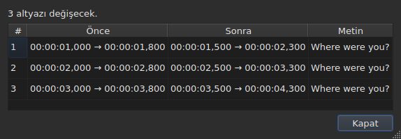
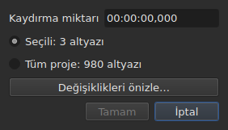
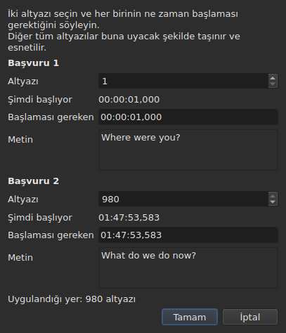
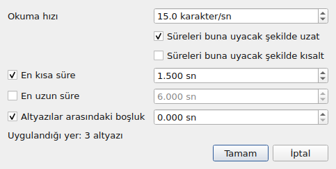
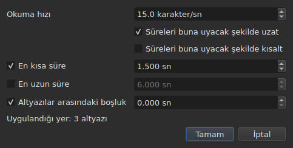
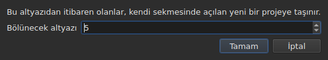

# İşlemler

<!-- machine-translated -->
> Bu sayfa makine çevirisidir ve henüz dili bilen bir okuyucu tarafından gözden geçirilmemiştir.

**Araçlar** menüsü on altı işlem, bir çözümleme ve iki yazım denetimi öğesi taşır. On altısının her biri bir `Ctrl+Z` ile geri alınır; çözümleme hiçbir şeyi değiştirmez. `Check Spelling…` de geri alınır, `Spell-Check Settings…` ise hiçbir metne dokunmaz.

| Öğe | İletişim kutusu | Ne yapar |
| :---- | :----- | :----------- |
| `Shift Positions…` | evet | hedefi bir süre kadar kaydırır |
| `Transform Positions…` | evet | hedefi iki işaretçiden düzeltir |
| `Convert Frame Rate…` | evet | hedefi bir kare hızından ötekine göre yeniden zamanlar |
| `Adjust Durations…` | evet | bir okuma hızını, süreleri ve bir boşluğu tutturmak için bitişleri taşır |
| `Append File…` | bir dosya seçici | bir dosyayı projenin sonuna ekler |
| `Split Project…` | evet | projeyi ikiye keser, kalan yeni bir sekmeye gider |
| `Italic` | **hayır** | hedefi italik yapar ya da italikten çıkarır |
| `Dialogue` | **hayır** | her satırın başına bir diyalog çizgisi koyar ya da kaldırır |
| `Case ▸ Title Case` | **hayır** | her sözcük bir büyük harf alır |
| `Case ▸ Sentence case` | **hayır** | metnin ilk harfi ve yalnızca o |
| `Case ▸ UPPER CASE` | **hayır** | her şey büyük harfle |
| `Case ▸ lower case` | **hayır** | her şey küçük harfle |
| `Remove Hearing-Impaired Mentions…` | evet, ayarsız | işitme engelli notlarını kaldırır |
| `Correct Texts…` | evet, çok sayfalı bir sihirbaz | düzeltmeler önerir — notlar, sözcükleri birleştirme ve bölme, yaygın hatalar, büyük harfler, satır bölme — ve kabul edildikten sonra uygular, bkz. [Metinleri düzelt…](correct-texts.md) |
| `Check Spelling…` | evet, sözcük sözcük bir gezinme | sözlüğün bilmediği sözcükleri dolaşır ve düzeltileni uygular, bkz. [Yazım denetimi…](check-spelling.md) |
| `Spell-Check Settings…` | evet | denetimin dilini, hedefini ve belgesini ve yazarken altını çizmeyi seçer, bkz. [Yazım denetimi…](check-spelling.md#yazım-denetimi-ayarları) |
| `Snap to Frame Rate…` | evet | her zaman damgasını en yakın kareye geri koyar |
| `Shift Whole File onto Grid (…)` | **hayır** | tüm dosyayı ızgarasına geri getirir |
| `Frame Rate Analysis…` | evet, ayarsız | **hiçbir şeyi değiştirmez** — bkz. [Kare ızgarası](frame-grid.md) |

**Bir işlemin ne yaptığı, kapatılması gereken bir bilgi kutusunda söylenir; `Italic`, `Case` ve `Dialogue` hariç**: bu üçü hiçbir iletişim kutusu açmaz ve raporları — “değiştirilecek bir şey yok” dahil — kapatılacak bir şey olmadan durum çubuğunda görüntülenir. `Split Project…` da kendi raporunu durum çubuğunda verir: sonucu zaten yeni sekmede gözünüzün önündedir. İletiler her işlemin bölümünde alıntılanır.

Satırları ekleme, silme, birleştirme ve bölme burada değil `Edit` menüsündedir, çünkü satır sayısını değiştirirler. Bkz. [Altyazıları ekleme, silme, birleştirme ve bölme](lines.md).

## Neye etki ettikleri

**Seçili satırlara, hiçbiri seçili değilse tüm dosyaya.** Hepsi için aynı kuraldır ve varsa iletişim kutuları bunu sade sözcüklerle hatırlatır:

```
Applies to: 4 subtitles
```

Tüm satırları seçmek hiçbirini seçmemekle aynı sonucu verir.

**Satırların yalnızca bir kısmı seçiliyken iletişim kutusu neye etki edeceğini sorar.** Sayılarıyla birlikte iki seçenek görüntülenir ve **işaretli olan seçimdir**:

```
(•) Selected: 2 subtitles
( ) Whole project: 4 subtitles
```

`Whole project` işaretlemek, önce seçimi değiştirmek zorunda kalmadan işlemi tüm dosyaya genişletir. Seçilecek bir şey olmadığında — hiçbir şey seçili değilse ya da her şey seçiliyse —, yukarıdaki `Applies to:` satırı tek başına kalır.

`Shift Positions…`, `Transform Positions…`, `Convert Frame Rate…`, `Adjust Durations…`, `Snap to Frame Rate…` ve `Remove Hearing-Impaired Mentions…` iletişim kutuları bu seçeneği sunar.

### Uygulamadan önce görme

`Shift Positions…`, `Transform Positions…`, `Convert Frame Rate…`, `Adjust Durations…` ve `Snap to Frame Rate…`, bir **`Preview changes…`** düğmesi taşır. O anda yazılanla, **işaretli hedefte**, işlemin kaç altyazıyı değiştireceğini söyleyen küçük bir pencere açar ve ilk on ikisini listeler: numaralarını, önceki konumlarını, sonraki konumlarını ve metinlerinin ilk satırını. **Hiçbir şey uygulanmaz**: pencereyi kapatmak iletişim kutusuna döndürür, orada bir değeri değiştirip yeniden bakabilirsiniz.




Tüm sütunları gösterecek kadar geniş açılır ve elle yeniden boyutlandırılabilir.

İşlem hiçbir şeyi değiştirmeyecekse pencere bunu söyler (`Nothing would change.`). Yazılan şey bir işlem tanımlamadığı sürece — okunamayan bir süre, aynı altyazı üzerinde iki işaretçi —, önizleme, `OK` düğmesinin gri olmasıyla aynı nedenle boştur. `Remove Hearing-Impaired Mentions…` için önizleme yoktur: değiştirdiği şey metindir ve sonradan verdiği rapor bunu söyler.

**Bir çeviri varken hangi metin?** Konum ve yapı işlemleri tüm altyazıya etki eder — iki metni de onu izler. Bir metni yeniden yazanlar — `Italic`, `Case`, `Dialogue`, `Remove Hearing-Impaired Mentions…` — **geçerli hücrenin sütununun metnini** hedefler: kendi sütunundaki çeviriyi, başka yerde ana metni. Öteki bozulmadan kalır ve durum çubuğu hangisinin hedeflendiğini söyler. Bkz. [Metin: işlemlerin hedefi](table.md#metin-işlemlerin-hedefi).

**Bir istisna ve etiketi bunu taşır**: `Shift Whole File onto Grid` seçimi yok sayar. Izgara belgenin bir özelliğidir ve bir belgenin yarısının kendi ızgarası yoktur; bu nedenle öğe bunu yalnızca bu kılavuzda değil, adında da söyler.

**`Append File…` da seçimi yok sayar**, başka bir nedenle: yeniden yazdığı bir hedef değil, geriye ittiği bir uçtur. Bkz. [kendi bölümü](#append-file). **`Split Project…` da öyle**: kesmesi söylenen yerden keser. Bkz. [kendi bölümü](#split-project).

**`Correct Texts…` hedefini kendi sayfasında seçer**, geçerli seçimi izlemek yerine: seçim, geçerli proje ya da açık tüm projeler. Bkz. [Metinleri düzelt…](correct-texts.md). **`Check Spelling…` bunu `Spell-Check Settings…` içinde seçer** ve hatırlar: bkz. [Yazım denetimi…](check-spelling.md).

**İki ızgara işlemi, ızgarayla aynı şeyden söz etmez.** Bir işlem seçime etki eder; çözümleme ve durum çubuğu **tüm belgeden** söz eder. Yüz yetmiş altı satırın beşini oturtmak o beş satırı gerçekten değiştirir — tablo bunu gösterir — ama hiçbiri oynamaz, ki bu da kaçırılmış bir yenileme gibi okunur. Öyle değildir: söyleyecek bir şeyleri yoktur. Bkz. [`Snap to Frame Rate…`](#snap-to-frame-rate) ve [Kare ızgarası](frame-grid.md).

### “Hiçbir şey seçili değil” öğe öğe ne anlama gelir

Kural `Tools` menüsü ve arama için geçerlidir. Satırlara dokunan ya da onları boşaltan `Edit` menüsü öğeleri bunu farklı okur — aksi halde şanssız bir `Del` ya da `Ctrl+X` belgeyi boşaltırdı.

| Öğe | Seçim yokken | Gerektirdiği |
| :---- | :------------------ | :--------------- |
| `Tools` menüsünün işlemleri | tüm dosya | boş olmayan bir belge |
| `Shift Whole File onto Grid` | tüm dosya, **her zaman** | bulunmuş bir ızgara |
| `Find and Replace…` | tüm dosya | boş olmayan bir belge |
| `Cut Texts`, `Copy Texts`, `Paste Texts` | **devre dışı** | seçili en az bir satır |
| `Remove Subtitles` | **devre dışı** | seçili en az bir satır |
| `Merge Subtitles` | **devre dışı** | yan yana en az iki satırlık bir blok |
| `Split Subtitle` | **devre dışı** | tam olarak bir satır |
| `Insert Subtitles…` | boş bir belge dışında devre dışı | onları karşısına yerleştirecek bir satır |

Her sayfa nedenini verir: [pano](clipboard.md#neye-etki-ettikleri), [satırlar](lines.md), [arama](find-and-replace.md#aramanın-kapsadığı-şeyler).

Öğeler **boş bir dosyada devre dışıdır**: kaydırılacak bir şey olmazdı. `Italic` öğesinin ikinci bir koşulu vardır ve bölümü bunu anlatır: açık biçim bir stil yazabilmelidir. Harf biçimi ve çizgilerin koşulu yoktur — bir metin dokuz biçimin hepsinde bir metindir.

## `Shift Positions…`

Hedefi bir süre kadar, ileri ya da geri taşır. Her altyazının iki sınırı da aynı miktarda taşınır: hiçbiri öncekinden daha uzun ya da daha kısa süre ekranda kalmaz.

Süre **bir zaman damgası gibi, işaret dahil** yazılır — `00:00:02,500` ileri taşır, `-0:01,250` geri. Kabul edilen biçimler bir konum hücresinin biçimleridir.




| Ret | Neden |
| :------ | :-- |
| okunamayan bir süre | düğme devre dışı kalır; hiçbir şey gelişigüzel kaydırılmaz |
| sıfır kayma | kaydedilecek bir işlem yok |
| bir altyazı videonun başından önceye düşerdi | **hiçbir dosya böyle bir konumu taşıyamaz** |

Üçüncü durum suçluyu adlandırır — “subtitle 1 would start before the origin” — ve ne kadar yanıldığınızı görmek için bakılacak olan odur. Hiçbir şey uygulanmaz.

## `Transform Positions…`

Başka bir kesime göre zamanlanmış bir dosyanın düzeltilmesi. **İki** altyazının gerçekte nerede başladığını söylersiniz ve geri kalan her şey orantılı olarak izler.

İletişim kutusu aynı şeyi iki kez sorar: bir altyazı numarası ve başlangıcının ait olduğu konum. Her işaretçi için **o numaranın neyi gösterdiğini** gösterir — metnini (`Text`) ve **şimdi** başladığı zamanı (`Now starts`), sade etiketler olarak — ve numarayı değiştirdikçe bunlar onu izler. Metin, altyazı ne söylerse söylesin **üç satırlık yer** tutar: daha uzun olan ya da uzun bir adres onun içinde kayar ve işaretçi değiştikçe iletişim kutusu boyutunu korur. **İşaretçi başına yazılacak tek bir alan vardır: `Should start`**, bu altyazının başlaması gereken zaman. `980` numaralı satırın hangisi olduğunu tabloda aramaya gerek yoktur.

`Should start` **geçerli değerle önerilir**: ona dokunmadığınız sürece işaretçi “bu altyazı zaten olması gereken yerde” der. Yalnızca değiştirmek istediğinizi değiştirirsiniz. İkinci işaretçi dosyanın son altyazısında önceden doldurulur — iki uzak işaretçi, iki komşu işaretçiden daha güvenli bir düzeltme verir.




**İki işaretçi de tam olarak istendikleri yere iner.** Bu bir yaklaşıklık değildir: hesap bunun doğru olması için yapılır.

| Ret | Neden |
| :------ | :-- |
| aynı altyazı üzerinde iki işaretçi | hiçbir düzeltme tanımlamazlar |
| okunamayan bir konum | kaydırmadakiyle aynı neden |

Dosyanın dışında bir numara yazılamaz: alan altyazı sayısıyla sınırlıdır.

## `Convert Frame Rate…`

Konumlar bir kare hızına göre hesaplanmış ve bir başkasına göre olması gerektiğinde hedefi yeniden zamanlar.

İki liste de sekiz standart kare hızını sunar.

> **Girdi kare hızını yanlış almak, hiçbir şey bildirmeden tüm dosyayı kaydırır.** Bu işlemin en kötü hata kipidir ve iletişim kutusunun, önerdiği değerlerin nereden geldiğini söylemesinin, onları sessizce ayarlamamasının nedeni budur.

### İki kaynak ve yanıtları

İletişim kutusu, her biri söyleyecek bir şeyi olduğunda görünen en fazla iki satır daha taşır:

| Satır | Ne söyler | Neyi önceden doldurur |
| :--- | :----------- | :---------------- |
| `The positions say` | dosyanın konumlarından çıkarılan [kare ızgarası](frame-grid.md) | `Timed against` |
| `The video declares` | kapsayıcının duyurduğu kare hızı, örneğin `24000/1001` | `Should play at` |
| `The file was read at` | **karelerle sayılan** bir dosyanın okunduğu kare hızı | `Timed against` |

**Her öneri yanıtladığı alana gider.** Izgara dosyanın neye karşı *yazıldığını* söyler — bu üstteki listedir. Kapsayıcının duyurduğu, filmin *çalıştığı* kare hızıdır ve dolayısıyla altyazıların ulaşması gereken kare hızıdır — bu alttaki listedir.

**Girdiyi yalnızca temiz bir ızgara önceden doldurur.** Kısmi bir ızgara, çıkarımın kendisinin kısmi diye nitelediği bir ipucudur ve bu alan tüm dosyaya ilişkin bir işleme karar verir. [Durum çubuğu](frame-grid.md) ve çözümleme bu durumu taşır; bu iletişim kutusu taşımaz.

**Karelerle sayılan bir dosya ızgaranın yerini alır, ona eklenmez.** MicroDVD kare numaraları taşır ve belgenin konumları onlardan okuma kare hızında hesaplanmıştır: bu konumlardan çıkarılan bir ızgara yalnızca o numarayı yeniden bulabilir. Bu nedenle `The positions say` kaybolur ve yerini `The file was read at` alır — [durum çubuğunun](frame-grid.md#karelerle-sayılan-bir-belgenin-ızgarası-yoktur-kare-hızı-vardır) yaptığı seçim de budur.

**Bir MicroDVD’nin kare hızını bu şekilde değiştirirsiniz.** Girdi olarak okunan kare hızını ve çıktı olarak gerçek olanı ayarlamak, her konumu dosyanın karelerinden yeniden hesaplar — hiçbir şeyi yeniden okumadan, ve işlem ötekiler gibi geri alınır.

### Bir uyuşmazlık bir çelişki değildir

İki satır birlikte görüntülenebilir ve farklı sayılar duyurabilir. **Bu, hakemlik edilecek bir hata değildir**: film bir kare hızında çalışır, dosya başka bir ızgarada yazılmıştır. 25 kare hızındaki bir film için 24’te bir dosya, hizalamanın — komut satırındaki `snap` — tam olarak ele almak için var olduğu durumdur.

Bu nedenle kullanıcının yerine hiçbir şey seçilmez: iki liste de düzenlenebilir kalır ve bu bilinçlidir. Kendini dayatan bir kaynak çapraz denetimi engeller.

Söyleyecek bir şey olmadığında satırlar görünmez: bağlı video yok, `ffprobe` yok ya da temiz ızgara yok. İletişim kutusu o zaman yukarıda anlatılandır ve **bunun için hiçbir işlem reddetmez** — kare hızı kullanıcıdan gelir. Bkz. [Bağlı video](video.md#ffmpeg-gerekmez).

Filmin duyurduğu ama sekiz standart orandan biri olmayan bir kare hızı **seçilmeden görüntülenir**: filmin alışılmadık bir kare hızında çalıştığını bilmek bilginin kendisidir ve burada ona dönüştürülecek bir şey yoktur.

Bir kare hızını kendisine dönüştürmek hiçbir şeyi değiştirmez: düğme devre dışı kalır.

## `Adjust Durations…`

Hedefin altyazılarının süresini **başlangıçlarını değil, bitişlerini taşıyarak** uzatır ya da kısaltır. Başlangıcı taşımak altyazıyı taşımak olurdu, ki bu [`Shift Positions…`](#shift-positions) işidir.





### Dört kısıt

| Alan | Ne ister | Değerler | Varsayılan |
| :---- | :--------------- | :----- | :------ |
| `Reading speed` | metni okumak için gereken süre | saniyede 1 ile 99 karakter arası, onda birine kadar | 15 kar/sn |
| `Lengthen durations to match it` | okunamayacak kadar kısa olanı uzatır | işaretli ya da değil | işaretli |
| `Shorten durations to match it` | gerekenden uzun süre ekranda kalanı kısaltır | işaretli ya da değil | işaretsiz |
| `Minimum duration` | bir taban süre | 0 ile 99 sn arası, milisaniyeye kadar | işaretli, 1,5 sn |
| `Maximum duration` | bir tavan süre | 0 ile 99 sn arası, milisaniyeye kadar | işaretsiz, 6 sn |
| `Gap between subtitles` | sonraki altyazıdan önce bırakılacak boşluk | 0 ile 99 sn arası, milisaniyeye kadar | işaretli, 0 sn |

Bunlar Gaupol’un varsayılan değerleridir.

**İşaretsiz bir kısıt yoktur**: alanı gri olur ve okunmaz. Sıfırda işaretli bir kısıt sıfır değerindedir — 0 sn’lik bir boşluk, bir altyazının ötekiyle çakışmasını yasaklar. Okuma hızı yalnızca `Lengthen` ya da `Shorten` işaretliyse okunur.

**Her şey işaretsizken `OK` devre dışıdır**: istenecek bir şey yoktur.

İletişim kutusu son ayarlamanın değerleriyle yeniden açılır ve **bunları bir oturumdan ötekine korur** — iki arama seçeneği gibi. **İşaretsiz bir kutu değerini korur**: 2 sn ayarladıktan sonra `Minimum duration` işaretini kaldırmak 1,5 sn’yi geri getirmez ve yeniden işaretlemek 2 sn’yi bulur. Dokuz ayar [tercihler dosyasında](preferences.md#dosya), `duration-adjust.` altındadır.

**Komut satırı bunları paylaşır.** [`subedit-cli adjust`](../subedit-cli/adjust.md) varsayılan olarak aynı dokuz ayarı okur, dolayısıyla burada ayarlanan hız, kendi seçenekleri başka türlü söylemedikçe onun kullandığı hızdır; [`subedit-cli config`](../subedit-cli/config.md) bunları gösterir ve değiştirir. Bkz. [Biri komut satırıyla ortak iki blok](preferences.md#biri-komut-satırıyla-ortak-iki-blok).

### Hangi sırayla ve hangisi kazanır

Hedefin her altyazısı dört kısıttan **bu sırayla** geçer ve her biri sırayla bitişi ayarlar:

| Sıra | Kısıt | Neyi ayarlar |
| ---: | :--------- | :----------- |
| 1 | okuma hızı | altyazı çok kısaysa (`Lengthen`) ya da çok uzunsa (`Shorten`) `end = start + length ÷ speed` |
| 2 | en kısa süre | süre daha kısaysa `end = start + minimum` |
| 3 | en uzun süre | süre daha uzunsa `end = start + maximum` |
| 4 | boşluk | bitiş sonrakine çok yakınsa `end = next start − gap` — başlangıçtan asla önce değil |

**Uygulanan son kazanır.** Boşluk en sonda gelir ve süreyi az önce ayarlanan en kısa sürenin altına geri getirebilir: aynı anda ekranda iki altyazı, izleyicinin gördüğü bir hatadır; biraz kısa bir altyazı ise değildir.

**Metnin uzunluğu etiketsiz sayılır**, karakter olarak, satır sonları dahil: `<i>été</i>` üç karakter sayılır. Okuma hızı izleyicinin okuduğundan söz eder.

**Sonraki, hedefte olsun olmasın dosyanın sonraki altyazısıdır.** **Dosyanın son altyazısının sonraki yoktur**: boşluk onu kısıtlamaz.

### Hiçbir bitişin sağlayamadığı söylenir

Ayarlama bittiğinde pencere kaç bitişin taşındığını ve **neyin tutturulamadığını** söyler — bir kısıt, yalnızca en az bir altyazı için feda edildiyse görünür:

```text
adjusted the durations of 12 subtitles; could not satisfy the reading speed in 9 subtitles, the minimum duration in 4 subtitles
```

Olası üç anma `the reading speed`, `the minimum duration` ve `the gap` ifadeleridir. **En uzun süre her zaman tutturulur**: hızdan ve en kısa süreden sonra gelir ve yalnızca boşluk onu izler, o da yalnızca kısaltabilir. Tavandan büyük bir taban ona boyun eğer ve sayılan en kısa süredir. Boşluk yalnızca sonraki altyazı kendi başlangıcından önce başladığında feda edilir.

Sayım **bitişi oynamayan altyazılar dahil** tüm hedefi kapsar: zaten sonrakine göre ayarlanmış ve en kısa süre için çok kısa olan bir altyazı sayılır. Hiçbir bitiş taşınmadığında pencere bunu söyler — `no duration to adjust` — ve geçmişe hiçbir şey girmez.

## `Append File…`

Bir dosyayı açık projenin sonuna ekler. **İkisinin arasına hiçbir şey eklenmez**: seçilen dosya, projenin son altyazısının bitişi kadar kaydırılır, tam olarak Gaupol’un yaptığı gibi.

**Boş bir belgede devre dışıdır**: kaydırmaya başlanacak bir bitiş olmazdı. Bir dosya seçici açılır, seçilecek kodlama yoktur — `Open…` gibi.

**Eklenen dosya dönüştürmeden geçer**, `Save As…` sözcükleriyle ve [başka bir biçimden yapıştırma](clipboard.md#başka-bir-biçimin-etiketleri-çevrilir) gibi: etiketleri projenin biçimine çevrilir ve o biçimin yazamadığı söylenir:

```text
appended 12 subtitles; Advanced SSA into SubRip: 1 tag dropped
```

**Eklenen dosyanın taşıdığı bütün olarak hayatta kalmaz.** Konumları, etiketler dahil, izler; başlığı, biçime özgü alanları — stil adı, kenar boşlukları — ve bir etiketin projenin biçiminde dönüşemediği şey izlemez ve bunu söyler. **Çevirisi yoktur**: bir çeviri onu alan belgeye özgü kalır ve eklenen dosya tek başına gelir.

**Sonradan seçilir**, sonun ötesine yazılan bir yapıştırmanın satırları gibi. Hiçbir şey kaybedilmediğinde sayım, kapatılacak bir kutuda değil durum çubuğunda görüntülenir — [bir çeviri açma](files.md#çeviri-açma) ile aynı kural.

**Tek bir geçmiş girdisi**, eklenen altyazı sayısı ne olursa olsun: `Ctrl+Z` hepsini birden kaldırır.

**Zaten açık bir dosya kendisine eklenebilir**: hiçbir şey bunu yasaklamaz, Gaupol’da olduğu gibi.

**Komut satırında** [`append`](../subedit-cli/append.md), aynı şeyi tek sonuçta birçok dosya için yapar.

## `Split Project…`

Projeyi ikiye keser: **`Append File…` işleminin tam tersi**. Bir kutu hangi altyazıdan kesileceğini sorar — ikinciden sonuncuya, tablodaki gibi numaralanmış — ve geçerli satırda açılır.

**Tablo kesmeden önce nerede keseceğinizi gösterir**: kutunun aldığı her numara satırını seçer. `Cancel` önceki seçimi geri verir.




**İki altyazının altında devre dışıdır**: bir kesim her iki yanda bir altyazı ister.

**Kalan, yeni bir sekmede açılan yeni bir projeye kopyalanır ve özgün projeden çıkarılır.** Yeni proje, **kalan son altyazının bitişi eksi kadar kaydırılır**: bölüp sonra eklemek başlangıçtaki projeyi geri verir. İki metni, ana ve çeviri, altyazılarını izler ve özgününün biçimini ve kodlamasını korur — **yolsuz**: henüz hiçbir dosya onu tutmaz. Bu nedenle sekmesi doğduğu andan itibaren `untitled*` yazılır ve kaydetmeden kapatmak, yazılmamış her şey için sorulan soruyu sorar.

**Durum çubuğu kaç altyazının ayrıldığını söyler**, kapatılacak bir kutu olmadan — yeni sekme sonucu zaten gösterir:

```text
split 12 subtitles into a new project
```

**Tek bir geçmiş girdisi**, özgün projede: `Undo: splitting the project` ona kalanını geri verir. Yeni projenin boş, kendine ait bir geçmişi vardır; geri almak ona dokunmaz ve açık kalır.

**Sonucu hiçbir dosyanın yazamayacağı durumda reddedilir.** İki yarı kesimde çakışıyorsa kaydırma bir altyazıyı videonun başından öne getirirdi — hiçbir biçimin yazmadığı negatif bir konum. Reddeden kutu **altyazıyı adlandırır** ve başka bir yerden kesmeyi önerir:

```text
Cannot split at subtitle 3: subtitle 3 would fall before the start of the video. Cut somewhere else.
```

Tam olarak başlangıca ulaşmak serbesttir: sıfır bir konumdur.

**Komut satırında** [`split-file`](../subedit-cli/split-file.md) bir dosyayı aynı şekilde, adlandırılmış iki dosyaya keser.

## `Snap to Frame Rate…`

**Her zaman damgasını** — başlangıcı ve bitişi — seçilen kare hızının en yakın karesine koyar. Tek bir liste vardır ve dönüştürmeden tüm fark budur: dönüştürme dosyayı birinden ötekine ölçeklediği için iki kare hızı ister; oturtma yalnızca konulacak ızgarayı ister.

| | `Convert Frame Rate…` | `Snap to Frame Rate…` |
| :--- | :-------------------- | :-------------------- |
| kayma | zamanla orantılı — bir uzun metrajlı filmde **birkaç saniye** | en çok yarım kare, **her yerde** |
| hangi dosya için | **zamanlaması yanlış** olan bir dosya | zamanlaması **doğru** ve ızgarası yanlış olan bir dosya |

**Kullanım durumu**, ayrıntılı olarak: saniyede 25 karelik bir film, 24’lük bir ızgarada yazılmış altyazılar, satırlar birkaç milisaniye içinde zaten yaklaşık olarak yerlerinde. Yeniden zamanlanacak bir şey yoktur — yalnızca zaman damgalarını doğru karelere geri koymak gerekir.

Liste **videonun bildirdiğiyle açılır**, konumların söylediğiyle değil: amaç filmin ızgarasına katılmaktır ve çıkarım, terk edileni adlandırır. Video yoksa ya da `ffprobe` yoksa projenin kare hızıyla açılır.

Bir dosyayı zaten kapladığı ızgaraya oturtmak onu değiştirmez ve bu bir hata değildir: işlem uygulanır, hiçbir şeyi taşımaz ve ötekiler gibi geri alınır.

**Dosyanın bir kısmını oturtmak, yapıldıktan sonra bunu söyler.** Seçim her şeyi kapsamadığında ve belge hâlâ başka bir ızgarada okunduğunda bir not görüntülenir:

```
5 of 176 subtitles aligned to 25 fps; the document is still read on a 24 fps grid
```

Hareketi etkisine bağlar ve durum çubuğunun ve çözümlemenin neden oynamadığını açıklar: belgeden söz ederler, işlem beş satıra etki etti. Hiçbir şey engellenmez — bir dosyanın bir kısmını oturtmak istenmiş olabilir.

**Neredeyse her zaman istenmemiştir ve bu ölçülmüştür.** Deponun sekiz ızgara dosyasında, tüm dosyayı oturtmak çıkarılan kare hızını hedefe ve yoğunluğunu yüzde 100’e getirir; beş satırı oturtmak çıkarılan kare hızını asla oynatmaz ve yoğunluğu sekiz durumun yedisinde **düşürür** — oturtulan satırlar dosyanın geri kalanının yaşadığı ızgaradan ayrılmıştır. Sekizincisi 50’den 25’e olandır: hedef ızgaranın dosyanınkini böldüğü ve konumların zaten üzerinde olduğu durum.

Not, seçim tüm dosyayı kapsadığında, hiçbir ızgara çıkarılmadığında ya da belge artık istenen kare hızında okunduğunda görüntülenmez — yani oturtma istenileni yaptığında.

## `Shift Whole File onto Grid`

**Tüm dosyayı**, konumlarını ayrıldıkları ızgaraya geri getiren miktar kadar kaydırır. Konumları bir sabite kadar bir ızgarada olan bir dosya kaymıştır ve bu sabit ölçülebilir.

**Menü öğesi miktarı ve kapsamı taşır** — `Shift Whole File onto Grid (+0.001 s)`. İletişim kutusu yoktur: işlem hiçbir seçenek almaz ve tüm bir dosyayı taşıyacak bir öğe, seçilmeden önce ne kadar taşıyacağını ve bunu bütünüyle yapacağını söylemelidir. Menünün seçimi yok sayan tek işlemidir.

**Hiçbir ızgara bulunmadığında devre dışıdır.** O zaman katılacak bir şey yoktur ve gürültü üzerinde ölçülen bir evre dosyayı gelişigüzel taşırdı. “Katılacak bir şey yok” ile “sıfır kadar katıl” aynı şeyi söylemez: ikincisi sunulmaya devam eder, çünkü ızgarasında olan bir dosya bunun normal bir durumudur.

**Bu `Snap to Frame Rate…` değildir.** Bu öğe her şeyi aynı miktarda kaydırır ve göreli zamanlamayı **tam olarak** korur; oturtma her konumu bağımsız olarak taşır ve bu arada elle düzeltilmiş olanları da emer. Temiz bir dosyada ikisi aynı sonucu verir; kısmi bir dosyada vermez — ve [çözümlemenin ayrıntısı](frame-grid.md) karşınızdakinin hangisi olduğunu söyler.

## `Italic`

Hedefi **açık biçimin** etiketlerini yazarak italik yapar ya da zaten italikse kaldırır. İletişim kutusu yoktur: işlemin ayarı yoktur ve ötekiler gibi bir `Ctrl+Z` ile geri alınır.

| Eylem | Kısayol | Nerede |
| :----- | :------- | :---- |
| İtalik | `Ctrl+I` | **Araçlar** menüsü, araç çubuğu |

`Tools` menüsünün [araç çubuğunda](index.md#araç-çubuğu) düğmesi olan tek işlemidir.

### Ne yazar, biçim biçim

Bir altyazının metni dosyasınınkidir, etiketler dahil — bkz. [Hücre düzenleme](editing.md). Her biçimin kendine ait olanı vardır ve bu öğenin sizi bilmekten kurtardığı şey budur:

| Biçim | Yazılan |
| :----- | :-------------- |
| SubRip, WebVTT, SubViewer 2 | `<i>text</i>` |
| Sub Station Alpha, Advanced SSA | `{\i1}text{\i0}` |
| MicroDVD | `{Y:i}text` — etiket altyazının sonuna kadar sürer, kapatılacak bir şey yoktur |
| MPL2 | **her** satırın başında `/`, işaret yalnızca kendi satırına uygulanır |
| TMPlayer, LRC | hiçbir şey: bu iki biçim stil yazmaz |

**Öğe bir TMPlayer ve bir LRC için devre dışıdır, gizli değil.** Bulunmayan bir öğe hiçbir şey öğretmez; gri bir öğe “neden yapamıyorum?” sorusunu yanıtlar.

**Okunan biçim, hedeflenen metnindir.** Bir çeviriyle ana metin SubRip’te, çeviri Advanced SSA’da olabilir: `Italic` birincide `<i>`, ikincide `{\i1}` yazar. Öğe, öteki yazsa bile hedeflenen metin stil yazmayan bir biçimdeyse aynı şekilde devre dışıdır.

### Hangi yöne gider

İki yön için tek bir öğe vardır ve karar veren hedeftir:

- **italikte olmayan tek bir altyazı** tüm hedefin italiğe geçmesine yeter;
- hedef italikten ancak **tamamı** italikteyken çıkar.

Bu Gaupol’un kuralıdır ve tek bir düğmeyi kullanılır kılan tek kuraldır: karışık bir seçim satır satır ters çevrilmek yerine tek blok olarak gider ve iki kez basmak onu olduğu gibi geri verir.

Rapor yapılanı, yapıldığı yönde söyler:

```
2 subtitles put in italics
2 subtitles taken out of italics
```

**Boş bir satır asla etiket kazanmaz** — hiçbir şeyin çevresindeki bir `<i></i>` tabloda görünürdü. Yalnızca böyle satırlar içeren bir hedef bu nedenle hiçbir şeyi değiştirmez ve bunu söyler: “değiştirilecek bir şey yok”. Geçmişe hiçbir girdi girmez.

### Dokunmadıkları

**Öteki etiketler tam olarak oldukları yerde kalır**: bir renk, bir yazı tipi, bir Advanced SSA `{\pos(x,y)}` işlemden oynamadan geçer. Yalnızca italik etiketler konur ve kaldırılır.

Aynı anda birkaç şey söyleyen bir etiket bütünüyle kaldırılmaz: `{\b1\i1}`, `{\b1}` olur ve `{Y:bi}`, `{Y:b}` olur. Kalın kalır ve metin gerçekten italikten çıkar.

## `Case` ve `Dialogue`

**Görünen metnin** iki dönüşümü ve etiketlere dokunulmaz: küçük harfe çevrilen bir altyazı `<I>` etiketini olduğu gibi korur ve çizgi, bir açılış etiketinin değil, metnin önüne konur. **Hiçbir etiket yer değiştirmez**: büyük harfli `<i>bon</i>jour`, `<i>BON</i>JOUR` verir; [bir değiştirme](find-and-replace.md#aranan-metin-görünen-metindir) italiği tüm sözcüğe yayardı.

| Öğe | Kısayol | Ne yapar |
| :---- | :------- | :----------- |
| Harf Biçimi ▸ Başlık Biçimi | — | `bonjour marie`, `Bonjour Marie` olur |
| Harf Biçimi ▸ Cümle Biçimi | — | `BONJOUR MARIE`, `Bonjour marie` olur |
| Harf Biçimi ▸ BÜYÜK HARF | — | her şey büyük harfle |
| Harf Biçimi ▸ küçük harf | — | her şey küçük harfle |
| Diyalog | — | çizgileri ekler ya da kaldırır |

### Harf biçiminin dokunmadığı

**İlk harften ya da ilk rakamdan önce gelen olduğu gibi bırakılır.** Bir diyalog çizgisi, bir açılış tırnağı, bir parantez kalır: cümle biçimine çevrilen `- bonjour`, `- Bonjour` verir; büyük harfli bir çizgiyle `- bonjour` vermez, ki bu anlamsız olurdu.

**Cümle biçimi geri kalanı küçük harfe çevirir.** `BONJOUR MARIE`, `Bonjour marie` olur: Gaupol’un yaptığı budur ve büyük harfle yazılmış bir altyazıyı yumuşatmayı sağlayan da budur.

**Aksanlar ve Latin olmayan alfabeler doğru işlenir.** `éléonore`, `ÉLÉONORE` verir ve bir kesme işareti sözcüğü kesmez: başlık biçimine çevrilen `l'été`, `L'Été` değil `L'été` verir. Uzunluğu değişen bir harf çevresindeki etiketleri korur: büyük harfli `fi <i>x</i>`, `FI <i>X</i>` verir.

**Harf biçimi sistemin diline bağlı değildir.** Tüm dillerde ortak kuralları izler: büyük harfli `istanbul`, makine Fransızcaya ya da Türkçeye ayarlı olsun `ISTANBUL` verir.

### `Dialogue` hangi yöne gider

İki yön için tek bir öğe vardır ve karar veren hedeftir:

- **çizgisiz tek bir satır** tüm hedefin bir çizgi kazanmasına yeter;
- hedef çizgileri ancak **tüm** satırlarında varsa kaybeder.

İki kez basmak hedefi olduğu gibi geri verir. Bu [`Italic`](#italic) kuralıdır ve tek bir düğmeyi kullanılır kılan tek kuraldır.

**Üç çizgi tanınır** — klavyenin tiresi ve dizgicinin iki çizgisi, `–` ve `—` — ve yazılan tiredir. Çizgiden sonraki fazladan boşluklar kaybolur. Boş bir satır çizgi kazanmaz.

### Ne söylerler

```
2 subtitles recased
2 subtitles dashed
2 subtitles undashed
```

Ve hiçbir şey değişmediğinde — zaten istenen harf biçiminde bir hedef — “değiştirilecek bir şey yok”, geçmişe hiçbir şey koymadan.

## `Remove Hearing-Impaired Mentions…`

Sağır ya da işitme güçlüğü olan izleyicilere yönelik notları kaldırır — köşeli parantez içindeki ses tanımlarını. **Parantezler kalır**: fısıldanan satırlar için de kullanılırlar ve onları kaldıran işlem `Correct Texts…` olup `Sound in parentheses` onay kutusunu kullanır. **Başka hiçbir şey**: diyez işaretleri arasındaki şarkı sözleri ve iki noktadan önceki konuşmacı adı yalnızca [`Correct Texts…`](correct-texts.md) üzerinden, `Mentions` sayfasıyla kaldırılır.

İletişim kutusu hiçbir şey sormaz: işlemin ayarı yoktur ve iletişim kutusu yalnızca onaylamaya ve neye etki ettiğini hatırlatmaya yarar.

**`Tools` menüsünde satırların kaybolmasına yol açan tek işlemdir** ve tüm programda bunu istenmeden yapan tek işlemdir. *Yalnızca* bir not olan bir altyazının temizlendiğinde metni kalmaz ve metni olmayan bir altyazının var olmak için bir nedeni yoktur: dosyadan kaldırılır. Ötekiler notları olmadan yeniden yazılır.

**Biçimin etiketleri metin sayılmaz**: bir SubRip’in `<i>[SOUPIR]</i>` ve bir Advanced SSA’nın `{\i1}[SOUPIR]{\i0}` ifadeleri aynı şekilde kaldırılır. Etiket yazmayan bir TMPlayer ya da LRC’de bir `<i>` metindir.

**Çeviriye hedeflendiğinde hiçbir satırı kaldırmaz.** Kuralın boşalttığı bir çeviri — yalnızca bir not olan bir metin — **boşaltılır** ve altyazı kalır: hedeflenmeyen işlemin dokunmadığı bir ana metni vardır ve onu kaldırmak onu yok ederdi. Rapor bunu temizlenmiş sayar:

```text
1 subtitle cleaned, 0 removed
```

Okunan etiketler çevirinin biçimininkilerdir, ki bu ana dosyanınki olmayabilir.

Rapor ikisini de söyler:

```
1 subtitle cleaned, 1 removed
```

**Hiçbir şey ısırmadığında hiçbir şey olmaz** — ve iletişim kutusu bunu söyler: “kaldırılacak not yok”. Geçmişe hiçbir girdi girmez, çünkü hiçbir şeyi değiştirmeyen bir işlem geri alınacak bir işlem değildir.

**Geri almak her şeyi yerine koyar**, kaldırılan altyazıları da yeniden yazılan metinleri de, her biri sahip olduğu metinle. Kuralın boşalttığı bir altyazı, kaldırılmadan önce asla yeniden yazılmaz; tam olarak bütün olarak geri gelmesi için.

> **Seçim bu vesileyle kaybolur**: satırları kaldırmak tablonun yapısını değiştirir, o da yeniden kurulur. `Tools` menüsünün diğer tüm işlemleri, `Italic`, `Case` ve `Dialogue` dahil, onu korur. `Edit` menüsünün dört yapı öğesi — ekleme, silme, birleştirme, bölme — de yapıyı değiştirir ve aldıkları seçimin yerine bir seçim geri verir — bkz. [Altyazıları ekleme, silme, birleştirme ve bölme](lines.md).

Salt sayısal bir gönderme — “Bkz. [1] not” — bir not değildir ve olduğu gibi kalır.

## Filmin sonunun ötesi

Bir video açıkken, **altyazıları filmin sonunun ötesine iten** bir işlem, yapıldıktan sonra bunu bildirir:

```
shifting leaves 3 subtitles past the end of the video, by 4.200 s at most
```

Cümle işlemi adlandırır — `shifting`, `transforming`, `converting the frame rate`, `adjusting durations`, `aligning on the frame rate` —, kaç altyazının aştığını ve en uzak olanın ne kadar aştığını. `Shift Whole File onto Grid` bir kaydırmadır ve `shifting` olarak adlandırılır.

| Sayılan | Sayılmayan |
| :-------------- | :---------- |
| işlemin az önce dokunduğu, yani hedef | kimsenin taşımadığı bir altyazı |
| bitişten **sonra** biten bir altyazı | tam olarak onunla biten bir altyazı |

**Bu bir uyarıdır, başka bir şey değil.** Hiçbir şey reddedilmez, hiçbir şey düzeltilmez: bitiş jeneriğinden sonraya düşen bir altyazı tam olarak istediğiniz şey olabilir ve yanlış bir ret, görmezden gelinen bir uyarıdan daha pahalıya mal olur. İşlem geçmiştedir ve `Undo` onu ötekiler gibi geri alır.

**İşlem başına tek bir kutu.** `Adjust Durations…` ve `Align` zaten söyleyecek bir şeye sahiptir — bir ayarlamanın tutturamadığı, kısmi bir oturtmanın kenara bıraktığı. Bir altyazıyı sonun ötesine de ittiklerinde kutu iki cümleyi de taşır, biri ötekinin altında, önce işlemin cümlesi:

```
adjusted the durations of 2 subtitles
adjusting durations leaves 1 subtitle past the end of the video, by 1.000 s at most
```

İleti hiçbir video açık değilse görünmez: süre oynatıcıdan gelir ve film olmadan aşılacak bir son yoktur. Yalnızca yukarıda adlandırılan beş işlem ilgilidir — bir bitişi filmin ötesine uzatabilen `Adjust Durations…` dahil. Ötekilerin hiçbiri değildir: `Tools` menüsünün bir metni yeniden yazanları ve `Edit` menüsünde ekleme, birleştirme, bölme, yapıştırma, değiştirme ve düzenlenen hücreler — filmin ötesine elle yazılan bir bitiş bildirilmez.
