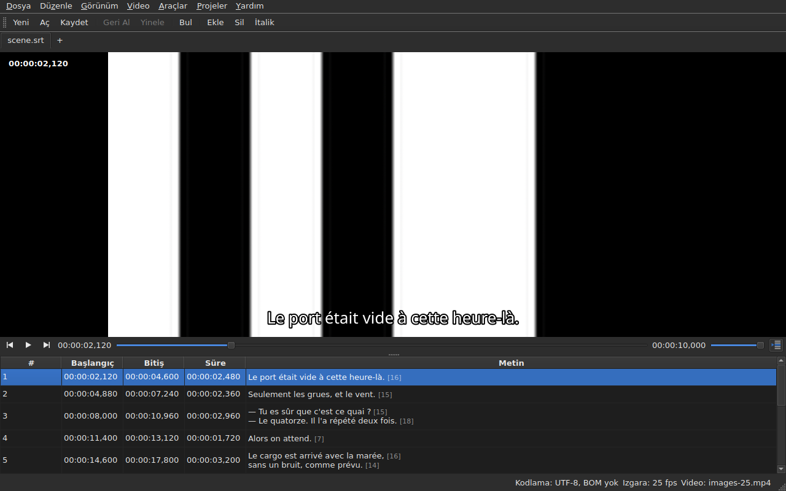

# Oynatıcı

<!-- machine-translated -->
> Bu sayfa makine çevirisidir ve henüz dili bilen bir okuyucu tarafından gözden geçirilmemiştir.

Bağlı video **pencerenin içinde** izlenir; geçerli satır üzerine çizilir. Bir
kaydırmanın, bir dönüşümün ya da bir kare hızı dönüştürmesinin sonucunu filmde
denetlemenizi sağlayan budur.

Bir filmin nasıl bağlanacağı için [Bağlı video](video.md) sayfasına bakın; bu sayfa,
film bağlandıktan sonra olanları anlatır.

## Video görünümü

| Durum | Pencerenin gösterdiği |
| :---- | :-------------------- |
| bir video bağlı ve açılıyor | görüntü üst kısmı, tablo altını kaplar |
| bağlı video yok | görüntü yok, tablo pencerenin tamamını kaplar |
| video açılmıyor | görüntü yok, bir ileti; pencere kullanılabilir kalır |

Görüntü ile tablo arasındaki bölme **fareyle hareket eder**. Görüntü 180 pikselden
daha alçak olmaz. Pencereyi büyütmek kazanılan alanı görüntüye değil tabloya verir:
düzenlerken eksik olan satırlardır.

Görüntünün altında **bir oynatma çubuğu** bulunur: filmin neresinde olunduğu, ne kadar
sürdüğü, oynatma ve duraklatma ve ses düzeyi. Bkz. [Oynatma çubuğu](#oynatma-çubuğu).

## Oynatma ve durdurma

| Komut | Kısayol | Ne yapar |
| :---- | :------ | :------- |
| Video ▸ Oynat / Duraklat | `Ctrl+P` | oynatma durmuşsa oynatır, aksi halde durdurur |

Komut, **hiçbir video açık olmadığı sürece devre dışıdır**. Yeni bağlanmış bir video
**durdurulmuş** olarak açılır: bir filmi açmak onu izlemek değildir.

Gaupol'da düz bir `P` olan yerde `Ctrl+P`: pencere kapsamındaki tek harfli bir
kısayol, odaktaki bileşen onu görmeden önce alınır; bu yüzden bir `P`, bir hücre
düzenleyicisine giderken yutulurdu. Burada hiçbir şey
yazdırmaz, bu tuş bileşimi boştur.

## Oynatma çubuğu

Görüntünün altında, soldan sağa — üç düğme **simgedir**; masaüstü temasında varsa onun simgeleri, yoksa Qt stilinin simgeleri kullanılır:

| Öğe | Ne yapar |
| :-- | :------- |
| iki adım düğmesi | filmi **bir kare adımı kadar** geri, ileri alır — bkz. [Kare kare](timing.md#kare-kare) |
| oynat / duraklat | `Ctrl+P` gibi oynatır ya da durdurur — düğme **ne yapacağını** gösterir: durmuşken bir üçgen, oynarken iki çubuk; ipucu bunu düz sözcüklerle söyler |
| konum | `HH:MM:SS,mmm`, tablonun bir konumu yazdığı gibi yazılır — [`Görünüm ▸ Konumlar Karelerle`](table.md#karelerle-konumlar) işaretliyken **bir kare numarası olarak** |
| kaydırıcı | **hem okur hem hareket ettirir**: tutamacı sürüklersiniz, oluğa tıklarsınız, ok tuşlarını kullanırsınız |
| süre | videonun bildirdiği süre, konum gibi yazılır |
| ses düzeyi | 0 ile 100 arası, bkz. [Ses düzeyi](#ses-düzeyi) |
| tablo izleme | tablo oynatmayı izlediği sürece basılıdır ve basıldığında tabloyu oynayan satıra geri getirir — bkz. [Tablo oynatmayı izler](#tablo-oynatmayı-izler) |

**Kaydırıcı her pikselde konum iletmez.** Tutamacı sürüklemek saniyede onlarca konum
ister ve her biri çözülmüş bir kareye mal olur: ilk konum hemen gider, sonrakiler saniyenin
yirmide biri kadar bekler ve **istenen son konum her zaman ulaşılandır** —
en geç tutamacı bıraktığınızda. Böylece görüntü elin gerisinde kalmaz ve
kimsenin bakmadığı bir yolu çizmeye başlamaz.

**Kaydırıcı oynatma sırasında kendiliğinden hareket eder** ve bu bir hareket sayılmaz:
filmi yalnızca sizin yaptığınız şey hareket ettirir. Tutamacı tuttuğunuz sürece oynatma onu geri almaz.

## Zaman kodu

**Konum görüntünün üzerine**, sol üst köşeye, onu her sahnede okunabilir kılan yarı saydam bir
arka plan üzerine yazılır. Pencere tarafından, kendi yazı tipiyle çizilir ve
oynatıcıdan, zaten verdiği konumdan başka bir şey istemez; her harekette, izlemenin bir sonraki turunu
beklemeden güncellenir.

## Filmde gezinme

**Video** menüsünde, **Gaupol'un hareketleri**, adlarıyla. Hepsi, oynatma gibi,
**video yokken devre dışıdır**; seçim üzerinde işlem yapan üçü ayrıca hiçbir şey seçili olmadığı sürece devre dışıdır.

| Komut | Kısayol | Ne yapar |
| :---- | :------ | :------- |
| Video ▸ Seçimi Oynat | `Ctrl+Shift+P` | seçimin **başlangıcından biraz önce**, **son altyazısının bitişine** kadar oynatır ve görüntüde durur |
| Video ▸ Önceki Altyazıya Git | `Ctrl+Left` | oynatmayı, konumdan önce **biten** son altyazının başlangıcına getirir |
| Video ▸ Sonraki Altyazıya Git | `Ctrl+Right` | oynatmayı, konumdan sonra **başlayan** ilk altyazının başlangıcına getirir |
| Video ▸ Geri Sar | `Ctrl+Shift+Left` | bir atlama kadar geri gider — varsayılan olarak otuz saniye |
| Video ▸ İleri Sar | `Ctrl+Shift+Right` | bir atlama kadar ileri gider |
| Video ▸ Seçim Başlangıcına Git | `Ctrl+Up` | oynatmayı seçimin başlangıcına getirir, **öncesindeki pay kadar önce** |
| Video ▸ Seçim Sonuna Git | `Ctrl+Down` | oynatmayı seçimin sonuna getirir, **öncesindeki pay kadar önce** |

**Kısayollar Gaupol'undur**, biri dışında: orada `Play Selection` `O`'dur ve çıplak
bir harfi, düzenlenmekte olan hücre görmeden önce pencere alır — bir metne
`o` yazmak filmi başlatırdı. `Ctrl+P` oynatmanın, `Ctrl+Shift+P` ise
seçimin karşılığıdır. Klavye okları, hücre düzenleyicisi açıkken ona kalır:
orada `Ctrl+Left` imleci bir sözcük kadar hareket ettirir, oynatmayı değil.

- **Atlama** 30 saniyedir ve 1 saniyeden bir saate kadar ayarlanabilir — bkz.
  [Tercihler](preferences.md#oynatıcı). Ne filmin başını ne de sonunu aşar.
- **Pay** bir saniyedir: altyazıdan biraz **önce** izlersiniz, gelişini görmek için.
  0 ile 60 saniye arasında ayarlanabilir ve oynatma sıfırın altına inmez.
- **Var olmayan bir komşu** — ilk altyazıdan önce hiçbir şey, sonuncudan sonra hiçbir şey —
  hiçbir şey yapmaz ve hiçbir şey söylemez: oynatma olduğu yerde kalır.
- **Her hareket hemen görünür**: çubuk, zaman kodu ve çizilen satır, hareket
  bittiğinde, bir sonraki turu beklemeden günceldir.

## Ses düzeyi

Ses düzeyi **oynatıcınındır**, 0 ile 100 arasındadır ve sistemin değildir. Çubuğun
kaydırıcısıyla ya da `Video ▸ Ses` alt menüsündeki, beşer beşer iki hareketle ayarlanır:

| Komut | Kısayol | Ne yapar |
| :---- | :------ | :------- |
| Video ▸ Ses ▸ Sesi Azalt | `Ctrl+-` | ses düzeyini beş azaltır |
| Video ▸ Ses ▸ Sesi Artır | `Ctrl++` veya `Ctrl+=` | beş artırır — ikincisi, artı tuşunun üst karakter tuşunu gerektirdiği klavyeler için |

**Bir oturumdan diğerine hatırlanır** ve açtığınız her videoya verilir. Ayar dosyasında 0 ile
100 dışında bir değer açılışı bozmaz: yoksayılır ve pencere bunu söyler.
**Buna karşılık ses izi hatırlanmaz** — bir iz numarası kendi dosyasınındır; bkz.
[Ses izi](video.md#ses-izi).

## Seçim ve oynatma

İkisi de iki yönlüdür.

| Ne yaparsınız | Ne olur |
| :------------ | :------ |
| bir satır seçersiniz | oynatma **o altyazının başlangıcına** gider |
| seçimi aşağı doğru genişletirsiniz | başka bir şey olmaz: seçimin ilk satırı sayılır |
| oynatma ilerler | **geçerli satır** ekrandaki altyazıyı izler, **renklendirilir** ve tablo onu **ortalar** — bkz. [Tablo oynatmayı izler](#tablo-oynatmayı-izler) |

Geçerli satır ile seçim iki ayrı şeydir. Oynatma
birincisini hareket ettirir ve **ikincisine asla dokunmaz**: seçim, bir işlemin
uygulandığı şeydir ve bir köşede oynayan bir filmin, kullanıcının hedef satırını
satır satır yeniden yazmaya hakkı yoktur.

Renk tonu da aynı kurala uyar: bir işaretleyicidir, bir seçim değil. **Bir
anomali ona üstün gelir** — ikisini de taşıyan bir satır hatasının rengini korur;
hata onarılmak içindir, gösterilen bir satır ise yalnızca bir diyalog
satırı süresince öyledir. Bkz. [Tablo](table.md).

### Tablo oynatmayı izler

**Tablo, oynayan satırı ortalar** — gösterdiğinin ortasına, görünür kılmaya yeteceği
kenara değil. Bunu **satır değiştiğinde** yapar, izlemenin her adımında değil: bir diyalog
satırı saniyelerce sürer ve her saniyenin onda birinde yeniden ortalamak amaçsız kaydırma olurdu.

**Elle kaydırma izlemeyi askıya alır.** Tekerlek, kaydırma çubuğu ve tabloda bir tıklama
onu askıya alır: tablo, bıraktığınız yerde kalır; geçerli satır, çizilen satır ve çubuk
filmi izlemeyi sürdürür. İzleme düğmesi — **bir tablonun satırlarının simgesi, biri okla işaretli**, oynatma
çubuğunun sağında; ipucu “Oynatmayı izle” der — **tablo izlediği sürece basılıdır**, sonra yukarı çıkar.

**İzleme bir oynatıcı hareketiyle sürer**: oynatma başlatıldığında, bir atlamada, bir adımda, bir işaret konduğunda, konumda bir
ekleme yapıldığında ya da çubuk hareket ettirildiğinde — tablo o zaman, zaten aynı satır olsa bile,
oynayan satırı hemen ortalar. **Ya da isteğe bağlı olarak**: düğmeye basmak onu geri getirir,
bırakmak askıya alır. Zamanlayıcı yoktur: izlemeyi sürdüren her zaman bir harekettir.

Başka bir sekmeye geçmek, izlemeyi o sekmenin filminde sürdürür.

**Süren bir düzenleme kesilmez.** Bir hücre düzenleyicisi açık olduğu sürece geçerli satır
olduğu yerde kalır; görüntüde çizilen satır ise kimseyi rahatsız etmediği için
izlemeyi sürdürür.

## Çizilen çizgi

Görüntüde gösterilen şey **açık belgeden** gelir, asla bir dosyadan değil:
**görüntüde gördüğünüz, az önce yazdığınızdır**, diskten geçmeden. Metin, görüntünün
altında ortalanmış olarak görünür ve iki altyazı arasında kaybolur.

**Bir çeviri varsa çizilen satır hedeflenen metnindir**: geçerli hücre `Translation`
sütunundaysa çeviri, başka her yerde ana metin. Bu, tüm metin işlemlerinin kuralıdır — bkz. [Metin: işlemlerin
hedefi](table.md#metin-işlemlerin-hedefi) —
ve **ayar yoktur**: bir sütundan diğerine geçmek görüntünün gösterdiğini değiştirir,
en çok onda bir saniye sonra. Çeviri yoksa ya da sütun kaldırılmışsa hiçbir şey değişmez:
ana metindir.

Çevirinin henüz yetişmediği bir altyazı, geçerli sütun çeviri olduğu sürece
**hiçbir şey** göstermez: yerini ana metin almaz.

**Biçimin etiketleri anlaşılır, asla olduğu gibi çizilmez.** Model metni dosyanın yazdığı
gibi taşır ve onu görüntüye vermeden önce okuyan, etiket eksenidir — biçim dönüştürmenin
kullandığı eksen:

| Dosyada | Görüntüde |
| :------ | :-------- |
| kalın, italik, altı çizili | uygulanır: `<i>no</i>`, etiketleri olmadan *no* olarak görüntülenir |
| renk | uygulanır |
| yazı tipi, boyut | kaldırılır, metin kalır |
| konum, hizalama, konuşmacı, ekranda karşılığı olmayan her şey | kaldırılır, metin kalır |
| metindeki `{` ve `}` | çizilir: “{laughs}”, “{laughs}” olarak görüntülenir |

Bir Advanced SSA dosyası aynı biçimde okunur: `{\i1}` uygulanır, `{\an8}` kaldırılır —
satır görüntünün altında kalır. Her metin, çeviri de ana metin de, **kendi dosyasının
biçiminde** okunur.

**Komşu altyazı dosyası oynatıcı tarafından yüklenmez**, filmin adını taşısa bile.
Düzenlenmekte olan o olurdu ve görüntü o zaman, tablo başka bir şey gösterirken
diskin durumunu gösterirdi.

## Bir değişikliği önizleme

**Özel bir şey yapmak gerekmez**: işlemi uygularsınız, filmi izlersiniz ve sonuç
uygun değilse `Undo: shifting` — ya da ilgili işlem — seçersiniz. Bkz. [Geri alma ve yineleme](undo.md).

Ayrı bir önizleme kipi yoktur ve bu bilerek böyledir: izlediğiniz şey, görünmez
geçici bir durum değil, olduğu gibi belgedir.

## Görüntü görünmediğinde

İkisi de dosyanın yoluyla başlayan iki olası ileti:

| İleti | Ne oldu |
| :---- | :------ |
| `<file>: <reason>` | oynatıcı dosyayı reddetti — bilinmeyen biçim, eksik dosya, dizin |
| `<file>: no video player is available` | hiçbir oynatıcı kurulamadı |

Her iki durumda da **video bağlı kalır** — başka birini seçmek için hangi dosya
olduğunu görmeniz gerekir — ve **pencere kullanılabilir kalır**:
belge açıktır, işlemler çalışır, kaydetme de.

**Görüntü pencerenin içinde çizilir**: `libmpv`, görünümün boyutunda bir arabelleği
gerçek piksellerle doldurur ve pencere onu boyar. Hiçbir şey grafik platformuna
bağlı değildir — X11'de, Wayland'de ve ekran olmadan aynı görüntü — ve yeniden
boyutlandırmayı izler: filmin en boy oranı korunur, görünümün geri kalanı siyahtır.

İkinci ileti bu nedenle yalnızca `libmpv` kitaplığı, derleme sırasında zorunlu olmasına
rağmen, başlamayı reddederse görünür.

Çizim işlemci üzerinden geçer ama **çözme grafik kartında yapılabilir**: kart çözer,
görüntü belleğe geri kopyalanır, sonra eskisi gibi çizilir. Kullanılabilir kartı olmayan bir makine
işlemcide çözer, ileti vermeden. H.264 bir 1080p filmde oynatma gerçek zamanı rahatça yakalar.
**Ağır HEVC bir 4K film yetişemeyebilir**: iki çekirdekte ölçüldü, kart olmadan gerçek zamanın 0,6 katı
hızla çözer ve anahtar kare uzaktayken orada bir kare ilerlemek birkaç saniye alır.
Kart bu süreyi — filme göre üçte birinden üçte ikisine — kısaltır ama ortadan kaldırmaz.
**Gösterilen görüntüyü değiştirmez**: bir adım ya da bir atlama, kartla da kartsız da
aynı kareye iner. Kapatmak için
[`Preferences…`](preferences.md#oynatıcı) içinde `Decode on the graphics card` işaretini kaldırın.

## Olmayanlar

**İşaret koymak, kare kare ilerlemek ve bir ucu bir kare kaydırmak** burada değil,
[Videoya göre zamanlama](timing.md) sayfasındadır. Var olmayan ve aramanın boşuna olduğu şeyler:

- bir dalga biçimi;
- bir film açıldığında otomatik oynatma;
- çizilen satırın stili (yazı tipi, renk, konum, arka plan): pencerenin stilini korur;
- kopyalama olmadan donanımla çözme: yukarıdaki “Görüntü görünmediğinde” bölümüne bakın.

Bu kılavuz var olanı anlatır: gelecek olanlar ve hangi sırayla geleceği
[yol haritasında](../../../../feuille-de-route.md) yer alır.
