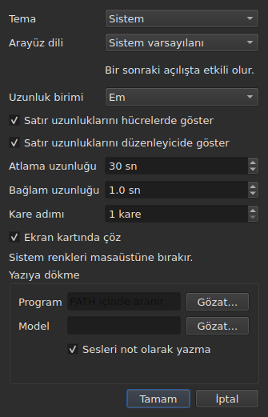

# Tercihler

<!-- machine-translated -->
> Bu sayfa makine çevirisidir ve henüz dili bilen bir okuyucu tarafından gözden geçirilmemiştir.

Pencere, fareyle ayarladığınız şeyi hatırlar — **nerede olduğunu**, **büyütülmüş olup olmadığını**, **sütunlarının genişliğini**, film ile tablo arasındaki **tutamağın konumunu** — ve **nerede çalıştığınızı**, böylece `Open…` doğru yerde açılır. Bunların hiçbiri bir iletişim kutusundan ayarlanmaz: taşırsınız, sürüklersiniz ve hatırlanır.

**Altı tercihin kendi iletişim kutusu vardır**, `Düzenle ▸ Tercihler…`, ve ölçüt budur: zaten bir hareketi olan bir tercihin alana ihtiyacı yoktur. Temanın, satır uzunluklarının biriminin, onları gösteren iki onay kutusunun, oynatıcının atlama ve bağlam uzunluğunun alanı yoktur. Bkz. [Tema](#tema), [Satır uzunlukları](#satır-uzunlukları) ve [Oynatıcı](#oynatıcı).

**Arayüz dili aynı iletişim kutusundadır ve bekleyen odur**: hemen değil, bir sonraki başlatmada uygulanır. Bkz. [Arayüz dili](#arayüz-dili).

**Ses düzeyinin yoktur**: görüntünün altındaki çubuk ve iki hareket onu ayarlar ve hatırlanır.

**Bir diğeri kullanıldığı yerde ayarlanır**: `Insert Subtitles…` öğesinin satırlarını koyduğu taraf o iletişim kutusunun bir alanıdır ve son seçim hatırlanır. Bkz. [Taraf hatırlanır](lines.md#taraf-hatırlanır).

**İki arama seçeneği de öyle**: `Regular expression` ve `Ignore case`, iletişim kutusunun bir açılışından ötekine ve bir oturumdan ötekine işaretli ya da işaretsiz kalır. Bkz. [Her iki seçenek](find-and-replace.md#her-iki-seçenek).

**`Adjust Durations…` ayarları da öyle**: okuma hızı, iki yönü ve onay kutularıyla üç süre — her biri, işaretli olsun olmasın, değerini korur. Bkz. [`Adjust Durations…`](operations.md#adjust-durations).

**Ve `Save As…` içinde seçilen son kodlama**, bayt sırası işaretiyle. Bkz. [dosya](#dosya).

**Ve `Correct Texts…` sihirbazının ve `Spell-Check Settings…` öğesinin ayarladığı**: işaretli görevler ve kodları, desen onay kutuları, satır bölme ayarları, dil, denetimin hedefi ve yazarken altını çizme. Bkz. [Metinleri düzelt…](correct-texts.md) ve [Yazım denetimi…](check-spelling.md#yazım-denetimi-ayarları). **`Correct Texts…` hedefi ve belgesi hatırlanmaz.**

**Hatırlanmayan**: açılan son dosya — bkz. [Hatırlanan dizin](#hatırlanan-dizin).

## Oynatıcı

Dört alan. **Seek length** ve **Context length** Gaupol’undur ve onun değerlerine sahiptir; **Frame step** ve **Decode on the graphics card** subedit’e özgüdür:

| Alan | Neyi ayarlar | Varsayılan | Sınırlar |
| :---- | :----------- | ------: | :----- |
| `Seek length` | `Seek Backward` ve `Seek Forward` atlaması | 30 sn | 1 sn ile bir saat arası |
| `Context length` | `Seek Selection Start`, `Seek Selection End` ve `Play Selection` için seçimden önceki pay | 1 sn | 0 ile 60 sn arası, onda birine kadar |
| `Frame step` | `Step Backward` ve `Step Forward` adımı, **kare olarak**, ve bir ucu kaydırma adımı | 1 kare | 1 ile 1000 kare arası |
| `Decode on the graphics card` | makinede varsa filmi ekran kartının çözmesine izin verir; kart yoksa hiçbir şey değişmez | işaretli | işaretli ya da değil |

**Hemen** uygulanırlar, yeniden başlatmayı beklemeden, ve bir oturumdan ötekine `video.seek-length` (saniye olarak), `video.context-length-ms` (milisaniye olarak) `video.step-frames` (kare olarak) ve `video.hardware-decoding` (`true` ya da `false`) altında hatırlanır. **Sınırların dışında olan ya da sayı olmayan bir değer** pencerenin açılmasını engellemez: yok sayılır, varsayılan kalır ve pencere açılırken bunu söyler. **Kare adımı asla milisaniye değildir**: N karelik bir adım, filmin kare hızı ne olursa olsun her zaman N karedir — bkz. [Kare kare](timing.md#kare-kare). Ses düzeyi, aynı hoşgörüyle, 0 ile 100 arasında `video.volume` içinde hatırlanır.

## Dosya

```
~/.config/subedit/settings.conf
```

Daha doğrusu, bu değişken tanımlıysa `$XDG_CONFIG_HOME/subedit/settings.conf`. **Pencere kapandığında** yazılır ve açıldığında okunur. Yarıda kalan bir program — öldürülmüş ya da bir çökmeyle durmuş — hiçbir şey yazmaz ve bir sonraki oturum öncekinin bıraktığını bulur.

Dosya metindir ve elle düzenlenebilir. Bu bir yan etki değil bir özelliktir: bir ayarı, onu ayarlayan arayüz tam da bozukken düzeltilebilir kılan budur.

### Biri komut satırıyla ortak iki blok

Dosya, her biri bir başlık yorumunun altında **iki blok** halinde yazılır:

| Blok | Anahtarlar | Okuyan |
| :---- | :--- | :------ |
| `# Operation settings: shared by the window and the command line` | `duration-adjust.*` ve `correction.*` anahtarları | pencere **ve** `subedit-cli` |
| `# Display preferences: the window's own` | diğer her anahtar — geometri, sütunlar, tema, arayüz dili, arama, yazım denetimi, düzenleyici, video, son dizin, yazma kodlaması | yalnızca pencere |

**`subedit-cli` işlem bloğunu varsayılan olarak okur**: `Adjust Durations…` ve `Correct Texts…` burada ne hatırlıyorsa, komut satırının bir seçeneği başka türlü söylemedikçe [`subedit-cli adjust`](../subedit-cli/adjust.md) ve [`subedit-cli correct`](../subedit-cli/correct.md) komutunun bir kısmının da başlangıç noktasıdır. **Görünüm tercihlerini asla okumaz.** [`config`](../subedit-cli/config.md) komutu işlem anahtarlarını listeler, değerlerini gösterir ve değiştirir — `subedit-cli config set duration-adjust.speed 12` — ve pencere değişikliği bir sonraki açılışında görür. **Pencere açıkken yapılan bir değişiklik kapanışını atlatamaz**: pencere dosyanın tamamını tuttuğu şeyle yeniden yazar. `--no-config`, bir komut satırının dosyayı yok saymasını sağlar. Bkz. [Ayar dosyası](../subedit-cli/invocation.md#ayar-dosyası).

Okuyucu anahtarları herhangi bir sırayla, başlıklarla ya da başlıksız alır: iki blok var olmadan önce yazılmış bir dosya değişmeden okunur ve bir sonraki kapanışta iki blok halinde yeniden yazılır.

| Seçenek | İçerdiği | Varsayılan |
| :----- | :------------ | :------ |
| `window.geometry` | `x,y,width,height`, piksel olarak; genişlik ve yükseklik sıfırdan farklı | pencere kendi boyutunu belirler |
| `window.maximised` | `true` ya da `false` | `false` |
| `table.columns` | piksel olarak virgülle ayrılmış dört genişlik — `#`, `Start`, `End`, `Duration`, gizli olsalar bile | tablo kendi boyutunu belirler |
| `table.order` | altı sütun, **her biri bir kez**, tablonun gösterdiği sırayla: `number`, `start`, `end`, `duration`, `text`, `translation` | `number,start,end,duration,text,translation` |
| `table.hidden` | `number`, `start`, `end` ve `duration` arasından kaldırılan sütunlar; boş, hiçbiri | yok |
| `window.table-share` | yüksekliğin tabloya verilen payı, yüzde olarak, 1 ile 99 arası | pencere her zamanki gibi paylaştırır |
| `file.directory` | **mutlak** bir dizin yolu | yok: `Open…` programın başlatıldığı yerde açılır |
| `general.theme` | `system`, `light` ya da `dark` | `system` |
| `interface.language` | `system`, ya da kataloğunun adlandırıldığı gibi bir dilin adı: iki ya da üç küçük harf, sonra isteğe bağlı olarak `_` ve iki büyük harf — `fr`, `pt_BR`; İngilizce için `en` | `system` |
| `edit.insert-placement` | `above` ya da `below` | `below` |
| `file.write-encoding` | ICU’nun yazabildiği ve dönüştürücüsünün kendi işaretini yazmadığı bir kodlamanın adı | yok |
| `file.write-bom` | `true` ya da `false` | `false` |
| `search.regex` | `true` ya da `false` — desen düzenli bir ifadedir | `false` |
| `search.ignore-case` | `true` ya da `false` — büyük/küçük harf yok sayılır | `true` |
| `duration-adjust.speed` | okuma hızı, saniyede karakter olarak, kesinlikle pozitif; ondalık bir sayı mümkün olduğunca kısa yazılır (`15`, `12.5`) | `15` |
| `duration-adjust.lengthen` | `true` ya da `false` — okunamayacak kadar kısa olanı uzatır | `true` |
| `duration-adjust.shorten` | `true` ya da `false` — gerekenden uzun süre ekranda kalanı kısaltır | `false` |
| `duration-adjust.minimum-enabled` | `true` ya da `false` — en kısa süre istenir | `true` |
| `duration-adjust.minimum-ms` | en kısa süre, milisaniye olarak, tam sayı ve negatif olmayan | `1500` |
| `duration-adjust.maximum-enabled` | `true` ya da `false` — en uzun süre istenir | `false` |
| `duration-adjust.maximum-ms` | en uzun süre, milisaniye olarak, tam sayı ve negatif olmayan | `6000` |
| `duration-adjust.gap-enabled` | `true` ya da `false` — sonraki altyazıya olan boşluk istenir | `true` |
| `duration-adjust.gap-ms` | boşluk, milisaniye olarak, tam sayı ve negatif olmayan | `0` |
| `correction.mentions.enabled`, `correction.common-errors.enabled`, `correction.capitalization.enabled`, `correction.line-break.enabled` | `true` ya da `false` — görev `Correct Texts…` ilk sayfasında işaretlidir | `false`, `true`, `true`, `false` |
| `correction.mentions.code`, `correction.common-errors.code`, `correction.capitalization.code`, `correction.line-break.code` | görevin desenlerinin kodu: `Zyyy` ya da `Script[-language[-COUNTRY]]` — `Latn-en-US`; boş değil | `Zyyy` |
| `correction.human`, `correction.ocr` | `true` ya da `false` — yaygın hataların sınıfları | `true`, `true` |
| `correction.sound-in-brackets`, `correction.sound-in-parentheses` | `true` ya da `false` — `Mentions` sayfasının iki onay kutusu | `false`, `false` |
| `correction.line-break.max-length` | bir satırın en büyük uzunluğu, ondalık; iletişim kutusu bunu 1 ile 1000 arasında sınırlar | `24` |
| `correction.line-break.max-lines` | en çok satır sayısı, tam sayı; iletişim kutusu bunu 1 ile 100 arasında sınırlar | `3` |
| `correction.line-break.in-ems` | `true`: uzunluk *em* olarak ölçülür; `false`: karakter olarak | `true` |
| `correction.line-break.skip-on-length`, `correction.line-break.skip-on-lines` | `true` ya da `false` — iki atlama koşulu istenir | `true`, `true` |
| `correction.line-break.skip-max-length`, `correction.line-break.skip-max-lines` | iki atlama eşiği, seçilen birimde | `24`, `3` |
| `correction.join-split.enabled` | `true` ya da `false` — `Join or Split Words` görevi işaretlidir | `false` |
| `correction.join-split.join`, `correction.join-split.split` | `true` ya da `false` — birleştir, böl | `true`, `false` |
| `correction.join-split.language` | bir yerel ayar kodu — `fr`, `en_US`, `sr@Latn` —; boş: sistemin dili | boş |
| `correction.remove-blank` | `true` ya da `false` — `Remove all blank subtitles` | `true` |
| `transcription.engine` | motorun adı: küçük harfler, rakamlar, `.`, `-` ve `_` | `whisper.cpp` |
| `transcription.executable`, `transcription.model` | mutlak bir yol; boşsa: motor `PATH` içinde aranır ve hiçbir model ayarlanmamıştır | boş |
| `transcription.language` | iki küçük harf, bir ISO 639-1 kodu; boşsa: dil algılanır | boş |
| `transcription.suppress-notes` | `true` ya da `false` — `Do not write sounds as notes` | `true` |
| `transcription.merge-gap-ms` | bir cümlenin bundan daha yakın parçaları birleştirilir, milisaniye cinsinden, tam ve negatif olmayan | `400` |
| `transcription.max-duration-ms` | yazıya dökülmüş bir altyazının ekranda kalabileceği en uzun süre, milisaniye cinsinden, 1 ile 3600000 arasında | `7000` |
| `transcription.max-characters` | yazıya dökülmüş bir altyazının taşıyabileceği en fazla karakter, 1 ile 1000 arasında | `84` |
| `correction.activations` | kullanıcının değiştirdiği desen onay kutuları, `<type>:<code>:<name>:<0\|1>`, virgülle ayrılmış; **bir addaki virgül ya da ters eğik çizgi, önüne bir ters eğik çizgi konarak yazılır** (`\,` ve `\\`) ve okunamayan bir girdi yalnızca kendi ayarını kaybettirir — bildirilir, ötekiler korunur | boş |
| `spell-check.language` | `fr_FR` gibi bir yerel ayar kodu; boş: sistemin dili | boş |
| `spell-check.target` | `selection`, `current-project` ya da `all-projects` | `current-project` |
| `spell-check.document` | `main` ya da `translation` | `main` |
| `spell-check.inline` | `true` ya da `false` — bir hücrenin düzenleyicisinde yazarken bilinmeyen sözcüklerin altını çizer | `false` |
| `editor.length-unit` | `em` ya da `characters` — tablonun ve düzenleyicinin gösterdiği satır uzunluklarının birimi | `em` |
| `editor.show-lengths-cell` | `true` ya da `false` — bir metin hücresinin her satırını uzunluğu izler | `true` |
| `editor.show-lengths-edit` | `true` ya da `false` — bir hücrenin düzenleyicisi her satırın uzunluğunu bir kenar boşluğunda gösterir | `true` |

**Dosya iletişim kutusundan fazlasını kabul eder.** Okuyucu kesinlikle pozitif herhangi bir hızı ve negatif olmayan herhangi bir süreyi alır; `Adjust
Durations…` iletişim kutusu ise hızı saniyede 1 ile 99 karakter arasında ve her süreyi 0 ile 99 sn arasında sınırlar. Dosyadaki bu sınırların dışında bir değer, iletişim kutusu açıldığında sınıra getirilir ve dosya, iletişim kutusu kabul edilip pencere kapatıldıktan sonra onu öyle tutar. İptal edilen bir iletişim kutusu hatırlananda hiçbir şeyi değiştirmez.

**`file.write-encoding`, `Save As…` içinde seçilen son kodlamayı hatırlar ve bir dosyaya asla kendini dayatmaz.** Açık bir belge kendi kodlamasını taşır ve kutunun önerdiği odur: onu, üç hafta önceki bir ayar öyle diyor diye başka bir kodlamada yeniden yazmak, okumanın koruduğunu kaybettirirdi. Bu ayarın hatırladığı, dosyası olmayan belgeye — yeni oluşturulana — yarar.

**Bu bilinçli bir “hayır”dır, bir ihmal değil.** Her zaman aynı kodlamada teslim eden ve devraldığı dosyaları başka bir kodlamada açan biri onu her dosya için yeniden seçer; kutu ona bunu önerir ve gidiş dönüş güvencesi herkes için geçerli kalır.

**`file.write-bom`, aynı kodlamanın işaretini taşır** ve iki satır gerçekten gereklidir: bir kodlamanın adı, önünde işaretinin olup olmadığını söylemez; `--encoding` seçeneğinin `--bom` seçeneğinin söylediğini söylememesi gibi. İkisi birlikte, herhangi bir sırayla okunur ve hatırlanan bir kodlama olmadan `file.write-bom` hiçbir şey ayarlamaz.

**Tutamak için yükseklikler değil bir pay**, ve onu yararlı kılan budur: piksel olarak üç yükseklik, pencere başka bir boyutta açılır açılmaz hiçbir şey ifade etmez ve bir pencere sık sık başka bir boyutta açılır. Pay her yerde yeniden oynatılır. Çok küçükse **pencerenin kabul ettiği değere getirilir** — filmin şeridinin en az bir yüksekliği vardır.

**Altı sütun için dört genişlik** ve bu bir ihmal değildir: bunlar `#`, `Start`, `End` ve `Duration` genişlikleridir, tablonunki ne olursa olsun bu sırayla, ve **gizli bir sütun kendisininkini korur** — yeniden gösterildiğinde onu bulur. Gösterilen son sütun ötekilerin bıraktığını alır ve ona bir genişlik vermek hiçbir şey yapmazdı; metnin ve çevirinin genişlikleri bu nedenle hatırlanmaz.

## Dosya beklenen şeyi söylemediğinde ne olur

Bir yapılandırma bir rahatlıktır. **Başarısızlığı rahatlığa mal olur, başka bir şeye değil**: pencere her durumda açılır.

| Durum | Ne olur |
| :--- | :----------- |
| dosya yok | tüm varsayılanlar ve hiçbir şey söylenmez — ilk başlatmadır |
| dosya var ve okunamıyor | tüm varsayılanlar ve neden hata akışına yazılır |
| bir seçenek yok | varsayılanı |
| bir anahtar bilinmiyor | tek sözcük etmeden yok sayılır ve yeniden yazılan dosyada yoktur |
| bir değer okunamıyor | varsayılanı korunur ve seçenek hata akışında adlandırılır |

```console
$ subedit-gui film.srt
subedit-gui: /home/vous/.config/subedit/settings.conf: window.geometry: "plus tard" cannot be read, keeping the default
```

**İleti hata akışına gider, başka hiçbir yere.** Başlangıçta okunamayan bir tercih için çıkan kipli bir pencere, kullanıcıyı hiçbir şeyi engellemeyen bir kusur için, daha bir şey istemeden önce durdururdu.

## Yorumlanmış seçenekler

Yeniden yazılan dosya bilinen **tüm** seçenekleri içerir ve varsayılanında bırakılanlar yorum olarak yazılır:

```
#window.geometry = 0,0,1280,800
#window.maximised = false
#table.columns = 60,110,110,110
#table.order = number,start,end,duration,text,translation
#table.hidden = start,end
```

Bu bir yapmacıklık değildir. Bu olmasaydı, hiç dokunulmamış bir seçenek yazıldığı günün değerinde donup kalırdı ve **iyileştirilmiş bir varsayılan hiç kimseye ulaşmazdı**. Bununla, bir varsayılanı değiştirmek onu geçersiz kılmamış herkesin davranışını değiştirir — ki bir varsayılanın yapması gereken tam olarak budur.

Bir seçeneği geçersiz kılmak için: `#` işaretini kaldırın ve değeri değiştirin. Varsayılana dönmek için: satırı silin ya da yeniden yoruma alın.

Geometri, genişlikler ve kaldırılan sütunlar yürürlükteki bir değeri değil bir **biçimi** gösterir: geometrinin ve genişliklerin varsayılanı sayılarla yazılmayan “pencerenin seçtiği”dir ve `table.hidden` varsayılanı okunamayan “hiçbiri”dir. Dosyanın başlığı da bunu söyler. `table.order` ise varsayılan sırayı gösterir.

## Hatırlanan dizin

`Open…`, **açılan ya da kaydedilen son dosyanın** dizininde açılır, iptal ettiğiniz bir kutununkinde değil: önemli olan baktığınız yer değil çalıştığınız yerdir.

**Son dosya ise hatırlanmaz.** Onu hatırlamak, açılışta kimsenin istemediği bir belgeyi yeniden açmak olurdu. Bir dizini hatırlamak bir iletişim kutusunu *yönlendirir*; bir dosyayı hatırlamak bir tane açardı.

## Tema

`Düzenle ▸ Tercihler…`, hareketi olmayan bir tercih olan temayla, [satır uzunluklarının](#satır-uzunlukları) üstünde açılır.

| Değer | Ne yapar |
| :---- | :----------- |
| `System` | **hiçbir şey** — renkler masaüstününkiler kalır |
| `Light` | açık bir palet ayarlar |
| `Dark` | koyu bir palet ayarlar |

Seçilen tema **hemen**, yeniden başlatmadan uygulanır.

**“System” hiçbir şey yapmaz ve bu bir eksiklik değildir.** subedit’in üzerine kurulduğu Qt sürümünün masaüstüne açık mı koyu mu olmak istediğini sorma, ya da fikrini değiştirdiğinde haberdar olma yolu yoktur. Nasıl yapılacağını bilmediğimiz bir okumayı icat etmek yerine araç, istenebilecek iki temayı sunar ve üçüncüsü için karar vermeyi araç takımına bırakır — Gaupol’un aynı koşullar altında yaptığı budur.

Teması zaten koyu olan bir masaüstünde `System` bu nedenle koyu bir pencere verir; açık bir masaüstünde açık bir pencere. `Light` ve `Dark` masaüstü ne olursa olsun bunu geçersiz kılar.

**Anomali renk tonları her iki palette de okunabilir kalır** — bkz. [Anomaliler](table.md#anomaliler). Bu bir varsayım değildir: metnin her bir tondaki karşıtlığı, her iki arka planda bir testle denetlenir.

## Yazıya dökme

İletişim kutusunun **`Transcription`** grubu, [`Transcribe Audio…`](video.md#sesi-yazıya-dökme) için gereken makineyle ilgili iki bilgiyi
tutar: motorun **programı** (whisper.cpp, `whisper-cli`) ve okuduğu **model**. İkisinin de bir `Browse…` düğmesi
vardır. Boş bırakılırsa program `PATH` içinde aranır; modelin varsayılanı yoktur.

Alanların altında **kutu orada ne olduğunu söyler**: motorun bulunup bulunmadığını ve nerede olduğunu, `ffmpeg`'in
bulunup bulunmadığını ve modeli — ayarlanmamış, bulunamadı, bir model değil, yalnızca İngilizce için ya da çok dilli. Bir şey
eksik olduğunda, her birinin nerede bulunacağını söyleyen
[Yazıya dökme araçlarını kurma](../subedit-cli/install-transcription.md) sayfasına yönlendirme ekler.
İki alan, `transcription.executable` ve `transcription.model` ayarlarıdır.

**“Sesleri not olarak yazma”** kutusu `transcription.suppress-notes` ayarıdır (varsayılan olarak işaretli): motora sesleri
`(phone ringing)` gibi notlar olarak yazmaması söylenir. Onları korumak için işareti kaldırın, işitme engelliler için altyazılarda. `Transcribe Audio…` iletişim kutusu tek bir yazıya dökme için aynı kutuyu sunar.

## Arayüz dili

`Düzenle ▸ Tercihler…`, temanın altında, pencerenin dilini seçer.

| Alan | Değerler | Varsayılan |
| :---- | :----- | :------ |
| `Interface language` | `System default`; `English`; sonra programla kurulan her dil, kendi adıyla — `Français` | `System default` |

**Bir sonraki başlatmada etkili olur** ve iletişim kutusu bunu alanın altında söyler: pencere kurulurken çevrilir ve çalışan bir pencere başladığı dili korur. Seçim ayar dosyasında `interface.language` altında tutulur ve pencere bir sonraki açıldığında okunur.

| Seçim | Pencere şu dilde başlar |
| :----- | :------------------- |
| `System default` | ortamın dili, herhangi bir seçimden önceki gibi — `LANGUAGE`, `LC_ALL`, `LC_MESSAGES`, `LANG`; bkz. [Dil](invocation.md#dil) |
| `English` | ortam ne derse desin İngilizce |
| kurulu bir dil | **ortam ne derse desin**, `LC_ALL=C` dahil, o dil: burada yapılan bir seçim açık bir seçimdir |

Liste, kataloğu `<prefix>/share/subedit/locale` altına kurulu dilleri tutar; İngilizce her zaman oradadır, çünkü program onunla yazılmıştır. Bir dil, hiçbir kataloğun çevirmediği kendi adıyla gösterilir, böylece okuyucu okuduğu dili bulur.

**Programın yerine getiremediği bir değer yalnızca seçime mal olur:**

| Dosyanın söylediği | Ne olur |
| :----------------- | :----------- |
| kurulu kataloğu olmayan bir dilin adı — başka bir makineden getirilmiş bir dosya | pencere tek sözcük etmeden ortamı izler; `Preferences…` o dili adıyla ya da koduyla gösterir ve başka biri seçilmedikçe korur |
| bir dil adı olmayan bir şey — `French`, `fr_FR.UTF-8` | varsayılan olan `system` ve seçenek, okunamayan her değer gibi hata akışında adlandırılır |

```console
$ subedit-gui film.srt
subedit-gui: /home/vous/.config/subedit/settings.conf: interface.language: "French" cannot be read, keeping the default
```

**Komut satırı bunu asla okumaz**: `subedit-cli` dilini yalnızca ortamdan seçer ve `subedit-cli config set interface.language fr` bir görünüm tercihi olarak reddedilir.

## Satır uzunlukları




`Düzenle ▸ Tercihler…` ayrıca **tablonun ve düzenleyicinin satır uzunluğundan ne gösterdiğini** ayarlar — Gaupol’un cetveli ve kenar boşluğu.

| Alan | Ne yapar | Varsayılan |
| :---- | :----------- | :------ |
| `Length unit` | uzunlukların birimi: `Ems` ya da `Characters` | `Ems` |
| `Show line lengths in cells` | bir metin hücresinin her satırını uzunluğu izler | işaretli |
| `Show line lengths in the editor` | bir hücrenin düzenleyicisi her satırın uzunluğunu sağdaki bir kenar boşluğunda gösterir | işaretli |

**İki onay kutusu da işaretli olmadığında `Length unit` gridir**: gösterilecek uzunluk yokken birim hiçbir şey ayarlamaz. Seçim tabloya **hemen** uygulanır ve sonradan açılan düzenleyiciler onu izler. Üç değer bir oturumdan ötekine hatırlanır: `editor.length-unit`, `editor.show-lengths-cell` ve `editor.show-lengths-edit`, [dosyanın](#dosya) tablosunda. Bkz. [Satır uzunluğu](table.md#satır-uzunluğu) ve [düzenleyicide](editing.md#satır-uzunluğu).

**Sihirbazın sınırı değildir.** `Correct Texts…` birimi — satırları böldüğü uzunluk — kendi sihirbazındaki ayrı bir ayardır: tabloda em okuyabilir ve karakterle bölebilirsiniz.

## Ayarlanamayanlar

**Hatırlanan dokuz ayar bir iletişim kutusunda seçilir** — her birinin kendi olan düzeltme sihirbazınınkiler ve yazım denetiminkiler sayılmadan —, ve her biri kullanıldığı yerde: tema ve üç satır uzunluğu ayarı, burada; bir eklemenin tarafı, ekleme iletişim kutusunda; iki arama seçeneği, arama iletişim kutusunda; kodlama ve bayt sırası işareti, `Save As…` içinde; okuma hızı, süreler ve süre ayarlamasının boşluğu, kendi iletişim kutusunda. Başkası yoktur: tanılama iletileri, oynatıcının ses düzeyi ya da varsayılan kayıt biçimi için hiçbir şey ayarlanamaz — o, açık dosyadan gelir.

Ve **bir belgeye ait hiçbir sayı bir oturumdan ötekine korunmaz**: bir kayma miktarı, iki dönüştürme işaretçisi bir dosya için doğru, ötekisi için yanlıştır. İletişim kutuları bunları her başlatmada yeniden sorar, bilinçli olarak. `Adjust Durations…` ayarları, iki arama seçeneği gibi aynı şekilde bir istisnadır: bir okuma hızı, bir en kısa süre ya da bir boşluk bir dosyanın ölçümlerinden çok bir yöntemin seçimleridir ve bu nedenle bir oturumdan ötekine kalır.

Bu kılavuz var olanı anlatır: gelecek olan [yol haritasındadır](../../../../feuille-de-route.md).
