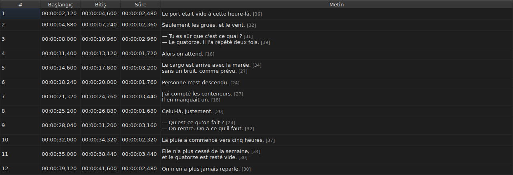
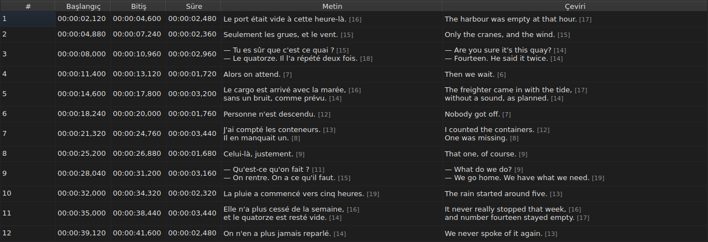
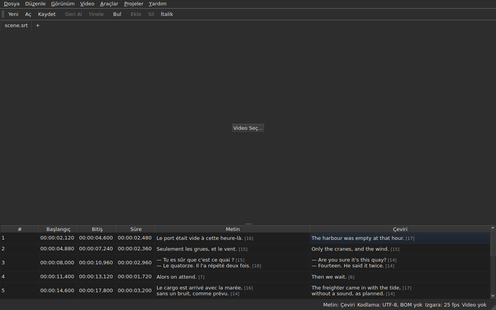

# Tablo

<!-- machine-translated -->
> Bu sayfa makine çevirisidir ve henüz dili bilen bir okuyucu tarafından gözden geçirilmemiştir.

Pencere, açık dosyanın altyazılarını satır başına bir tane olmak üzere beş sütunda
gösterir — projenin bir çevirisi varsa altı sütunda.

**Bu kılavuz pencerenin başlıklarını, komut satırında olduğu gibi,
İngilizce pencerenin gösterdiği biçimde anar**; çevrilmiş bir pencere bunları
kendi dilinde gösterir.

| Sütun | Ne gösterir |
| :----- | :------------ |
| `#` | altyazının sırası, 1'den başlayarak |
| `Start` | göründüğü konum, `HH:MM:SS,mmm` |
| `End` | kaybolduğu konum |
| `Duration` | `End − Start` |
| `Text` | altyazının metni |
| `Translation` | altyazının çevirisi — **projede çeviri olmadığı sürece yoktur** |


## Satır uzunluğu




**Bir metin hücresinin her satırını uzunluğu izler**, `[N]`, daha küçük
ve daha soluk — `Text` sütununda da `Translation` sütununda da.
Gaupol'un yaptığı da budur.

| Sayılan | Tablonun yaptığı |
| :---------- | :------------------ |
| **etiketler** | sayılmaz: `<i>Bonjour</i>`, `Bonjour` gibi `[7]` eder |
| **yuvarlama** | aşağıya doğru: 12,9 em'lik bir satır `[12]` olarak gösterilir |
| **boş bir satır** | uzunluğu yoktur; boş bir metnin de yoktur |
| **birim** | varsayılan olarak *em*, ya da karakter — `Düzenle ▸ Tercihler…` |
| **sütuna sığmayacak kadar uzun bir satır** | sayıdan **önce** `…` ile kesilir; sayı görünür kalır |

**Buradaki *em* Gaupol'undur, dizgenin değil**: küçük harfli alfabe,
tablonun yazı tipiyle harf başına 0,55 em eder. *Em* cinsinden bir uzunluk bu nedenle
yazı tipine bağlıdır; karakter cinsinden bir uzunluk kod noktalarını sayar, bir
vurgulu harf bir eder.

**Tablo çok uzun bir satırı işaretlemez.** Sayıyı gösterir ve onu kendi koyduğunuz sınırla
karşılaştırmak gözün işidir — Gaupol'daki gibi. Bu, kendi ayarı olan `Correct Texts…`
sihirbazının sınırı değildir.

**Görmemek için:** `Düzenle ▸ Tercihler…` içindeki `Show line lengths in cells` işaretini kaldırın.
Bkz. [Satır uzunlukları](preferences.md#satır-uzunlukları).

## Sütunları gizleme ve taşıma

**`Görünüm ▸ Sütunlar`**, `Text` dışında her sütun için işaretlenebilir bir öğe taşır:
ana metin olmazsa düzenlenecek bir şey kalmazdı.

| Öğe | Sütun |
| :---- | :----- |
| `Görünüm ▸ Sütunlar ▸ No.` | `#` |
| `Görünüm ▸ Sütunlar ▸ Başlangıç` | `Start` |
| `Görünüm ▸ Sütunlar ▸ Bitiş` | `End` |
| `Görünüm ▸ Sütunlar ▸ Süre` | `Duration` |
| `Görünüm ▸ Sütunlar ▸ Çeviri` | `Translation` — bkz. [Çeviri sütunu](#çeviri-sütunu) |

Bir öğenin işaretini kaldırmak sütununu kaldırır, yeniden işaretlemek onu eski
genişliğinde geri koyar. **Ayar tüm pencere için geçerlidir**, tüm sekmeler
dahil: projesi sekmeyle değişen tek bir tablo vardır.

**Geçerli hücre kaldırılan sütunu terk eder**: aynı satırda `Text` sütununa geçer
ve seçim yerinden oynamaz. Kimsenin görmediği bir sütundaki geçerli hücre,
bir tuş vuruşunun körlemesine düzenleyeceği bir hücre olurdu.

**Sütunlar başlıklarından sürüklenerek taşınır**, herhangi biri,
`Text` dahil. Gösterilen son sütun, diğerlerinin bıraktığı yeri alır.

**Sıra ve kaldırılan sütunlar bir oturumdan diğerine hatırlanır**, genişliklerle birlikte,
[tercihler dosyasında](preferences.md) — `table.order`
ve `table.hidden`. Çeviri sütunu orada değildir: kendi kuralına uyar ve
açılan her çeviriyle geri gelir.

**Numara dosyanın verisi değil, satırın sırasıdır.** Bir ekleme ya da silme bu nedenle
kendisinden sonraki her şeyi, hiçbir şey yeniden yazılmadan yeniden numaralandırır.

**Ondalık ayırıcı dosyanın biçimini izler**: SubRip için virgül,
diğer sekiz biçim için nokta. Dokuz biçim içinde virgül yazan tek biçim SubRip'tir.

**İzlenen ayırıcıdır, yazımın tamamı değil.** Tablo her zaman
saatleri ve her zaman üç ondalığı yazar; bir WebVTT dosyası bir saatin altında
saatleri atlar, SubViewer 2 ve iki Sub Station Alpha yüzde saniye cinsinden sayar, MPL2 onda saniye,
TMPlayer saniye, MicroDVD kare cinsinden. Genişliği biçimi izleyen bir
sütun, dosyanın tam yazımı olmayan bir sütundan
daha yorucu okunurdu.

Tablonun güvence verdiği bu nedenle **değer ve ayırıcıdır**, ondalık
sayısı değil. Hedef bir biçimin neyi yuvarlayacağı kaydetme anında söylenir — bkz.
[Bir biçimin taşımayacağı şeyler](files.md#bir-biçimin-taşımayacağı-şeyler-yazmadan-önce-söylenir).

**Süre (`Duration`) hesaplanır**, asla saklanmaz: onu yazmak
bitişi hareket ettirir. Bitişi başlangıcından önce gelen bir altyazı, sıfır yerine
negatif bir süre gösterir: dosyanın bir anomalisidir ve gizlemek onu bulmayı
olanaksız kılardı.

**Başlangıç, bitiş, süre, metin ve çeviri yerinde düzenlenir**;
numara düzenlenmez. Bkz. [Hücre düzenleme](editing.md).

**Seçim, bir işlemin etki ettiği şeyi belirler** — bkz.
[İşlemler](operations.md).

**Bir satırın yüksekliği taşıdığı altyazıyı izler**: iki satırlık bir altyazı
iki, üç satırlık biri üç yer kaplar. Metin, yazılacağı gibi tam olarak
gösterilir.

**Kesik kalan, sütuna sığmayacak kadar uzun bir satırdır** ve o zaman üç noktayla
biter. `Text` sütununu ya da pencereyi genişletmek onu tam gösterir; hücreyi açmak da.
Metnin satırları asla sarılmaz: yalnızca gerçek bir satır sonu satır oluşturur; böylece
bir sütunun kenarını sürüklediğinizde tablo satırının yüksekliği değişmez.

## Karelerle konumlar

**`Görünüm ▸ Konumlar Karelerle`** — işaretlenebilir bir öğe, tüm pencere için tek bir ayar —
`Start` ve `End` sütunlarını zaman damgaları yerine **kare numaraları olarak** gösterir ve
**girdi olarak kare numarasını kabul eder**. Başlıklar bunu söyler: `Start (frames)` ve `End (frames)`.

| Değişenler | Değişmeyenler |
| :----------- | :------------------- |
| `Start` ve `End` sütunlarının yazdıkları ve kabul ettikleri | zaman olarak kalan `Duration` sütunu |
| bu iki sütunun başlıkları | belge: hiçbir şey değişmez, geçmişe yeni girdi eklenmez ve **dosyanın yazdığı, yazdığı şeydir** |

**Kareleri sayan kare hızı** şu sırayla belirlenir:

1. **dosyanın kare hızı**, kare olarak sayılıyorsa — numara taşıyan ama kare hızı taşımayan MicroDVD:
   **pencere o zaman dosyasındaki sayıları gösterir**, video ne olursa olsun;
2. **bağlı videonun bildirdiği hız**;
3. **konumların çizdiği ızgara**, bir tane çiziyorlarsa.

Öğenin ipucu hangisinin seçildiğini söyler: *Konumlar, videonun bildirdiği hız olan 25 fps hızında sayılan
kare numaralarıdır*. **Üçünden hiçbiri yoksa öğe devre dışıdır ve ipucu nedenini söyler**: dosya
kare olarak sayılmıyor, video kare hızı bildirmiyor ve konumlar hiçbir ızgaraya oturmuyor.

- **Bir numara, konumun içine düştüğü karenin numarasıdır**, en yakın kareye yuvarlanır. **Yazıldığında
  o karenin başladığı anı verir**, tam orandan **yalnızca bir kez** yuvarlanır
  ([ADR 0013](../../../../adr/0013-mise-a-l-echelle-exacte-des-positions.md)): saniyede 23,976 karede 37. kare
  1 543,04 ms'de başlar, yani `00:00:01,543`.
- **Yalnızca tam sayılar kabul edilir** — eksi işaretiyle, çünkü bir başlangıç filmden önce olabilir. Kare kipinde
  yazılan bir zaman damgası ya da tam sayı olmayan bir sayı hücreyi olduğu gibi bırakır.
- **Oynatma çubuğu aynı ayarı izler**: kaydırıcının iki yanındaki konum ve süre, `Start` ve `End` gibi,
  aynı anda kare numarası olarak yazılır — bkz. [Oynatma çubuğu](player.md#oynatma-çubuğu). Görüntünün
  üstüne çizilen saat zaman damgası olarak kalır.
- **Bu ayar bir oturumdan diğerine hatırlanmaz**: bir belgenin değil, pencerenin ayarıdır ve
  tek bir hareketle yeniden açılır.

## Anomaliler

Konumları birbiriyle uyuşmayan bir altyazı, **zaman sütunlarında renk tonuyla
işaretlenir** ve üzerine gelmek neyin yanlış olduğunu söyler.

| Renk tonu | Neyi bildirir | Ne yapılmalı |
| :--- | :-------------- | :--------- |
| kırmızı | `ends before it starts` | bitişini ya da başlangıcını düzeltin |
| mavi | `starts before the previous one starts` | sıradaki yerine geri koyun |
| kehribar | `starts before the previous one ends` | zamanlamasını ayarlayın |


Yalnızca `Start`, `End` ve `Duration` sütunları renklendirilir: bir anomali
yalnızca zamandan söz eder ve metni renklendirmek onunla bir ilgisi olduğunu
düşündürürdü.

**Bir altyazı birkaçını birden taşıyabilir** ve ipucu hepsini adlandırır.
Renk tonu, onarılacak ilk anomalininkidir: kendi içinde bozuk bir altyazı,
komşuları ne yaparsa yapsın bozuktur; yeri şaşmış bir altyazı yerine konur
ve çakışması onunla birlikte gider.

> Düzensizliğin hemen her zaman çakışmaya üstün gelmesi bir tesadüf değildir:
> öncekinin başlamasından önce başlamak, onun bitmesinden önce başlamaktır —
> öncekinin kendisi bozuk değilse.

**İşaretleme her konum değişikliğinden sonra yeniden hesaplanır**, ister düzenlenen bir
hücreden, ister bir işlemden, ister bir geri almadan gelsin. Dosyanın açılışta ne olduğunu
değil, şimdi ne olduğunu söyler.

Hiçbir kare ızgarasına dayanmaz: bir konum elle düzeltilir düzeltilmez
ızgaradan çıkar ve ona dayalı bir işaretleme kullanıcının işini bildirirdi.

## Çeviri sütunu

Bir altyazı **iki metin ve tek bir konum çifti** taşır: çevirinin kendi zamanlaması
yoktur, altyazınınkine bağlıdır.
Tablo onu altıncı bir sütunda, `Translation`, `Text` sütununun sağında gösterir.




**Sütun yalnızca projenin bir çevirisi varsa vardır.** Çeviri yoksa tablo
beş sütununu korur ve pencere, çeviri hiç yokmuş gibi davranır —
hiçbir şey soluklaştırılmaz ya da eklenmez. `Dosya ▸ Çeviri Aç…` bir çeviri açar:
bkz. [Çeviri açma](files.md#çeviri-açma).

**`View` menüsünün bir öğesi onu gösterir ya da kaldırır**:

| Öğe | Ne yapar |
| :---- | :----------- |
| `Görünüm ▸ Sütunlar ▸ Çeviri` | işaretli: sütun gösterilir; işaretsiz: kaldırılır |

Projenin çevirisi yoksa **öğe devre dışıdır** — gösterilecek bir şey yoktur — ve
başlangıçta işaretlidir. **Kaldırma seçimi kullanıcıya aittir**: yeniden işaretlenene
kadar bir dosyadan diğerine geçerlidir. Sütunu kaldırmak çeviriyi kaldırmaz: proje içinde
kalır ve öğeyle geri gelir. Çeviri taşımayan bir dosya açmak sütunu
kaldırır.

**Çevirinin hücrelerine metnin hücreleri gibi yazılır** — bkz.
[Hücre düzenleme](editing.md).

### Metin: işlemlerin hedefi

Bir satırda iki metin varken metin işlemleri hangisini yeniden yazacaklarını bilmelidir.
**Bu, geçerli hücrenin sütunundaki metindir**: geçerli hücre `Translation` sütunundaysa
çeviri, başka her yerde — bir zaman sütununda da `Text` sütununda da — ana
metin.

| İşlem | Neyi hedefler |
| :-------- | :-------------- |
| `Italic`, `Case`, `Dialogue`, `Remove Hearing-Impaired Mentions…` | geçerli sütunun metni |
| `Cut Texts`, `Copy Texts`, `Paste Texts` | geçerli sütunun metni |
| `Find and Replace…` | geçerli sütunun metni — bkz. [Arama ve değiştirme](find-and-replace.md#hangi-metinde) |
| konum işlemleri, ekleme, silme, birleştirme, bölme | **her iki metin**: bir altyazı bir bütündür |

**İki metin olduğunda durum çubuğu bunu söyler**, diğer
göstergelerin soluna:

```text
Text: Translation
```

ya da ana metin için `Text: Main`. Sütun gösterilmiyorsa susar:
o zaman yalnızca bir metin vardır ve bunu söylemenin anlamı yoktur.




**Görüntüye çizilen satır aynı kuralı izler**: geçerli sütunun metnidir.
Bkz. [Oynatıcı](player.md#çizilen-çizgi).

**Hiçbir şey soluklaştırılmaz.** Metin işlemleri geçerli sütun ne olursa olsun
kullanılabilir kalır ve çeviri sütunu yoksa, eskisi gibi, ana metni hedefler.

## Satır ekleme ve silme

`Düzenle ▸ Altyazı Ekle…` ve `Düzenle ▸ Altyazıları Kaldır` satır ekler ve siler,
`Düzenle ▸ Altyazıları Birleştir` ve `Düzenle ▸ Altyazıyı Böl` bunları birleştirir ve
böler; tablo kendini yeniden numaralandırır. Bkz.
[Altyazıları ekleme, silme, birleştirme ve bölme](lines.md).

## Tablonun yapmadıkları

**Sütuna göre sıralama yoktur.** Gösterilen sıra dosyanın sırasıdır ve
altyazılar için anlamlı olan tek sıra budur: bir satırın sırası, zamandaki
yerinin *kendisidir*.
