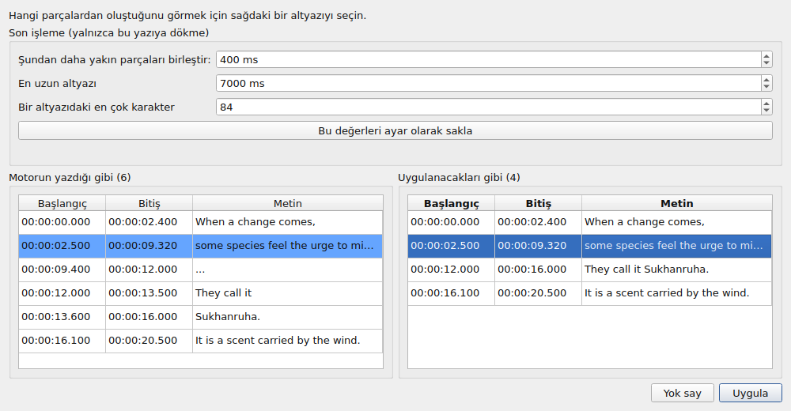
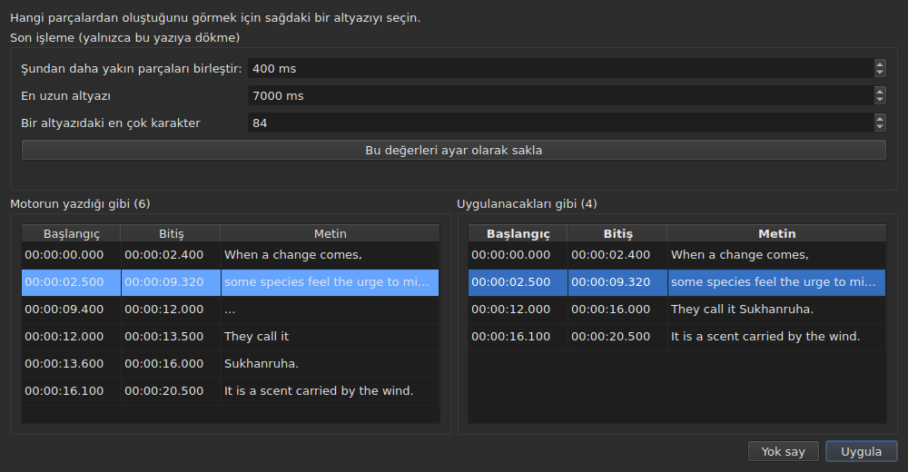

# Bağlı video

<!-- machine-translated -->
> Bu sayfa makine çevirisidir ve henüz dili bilen bir okuyucu tarafından gözden geçirilmemiştir.

**Video** menüsü önce üç komut ve filmi yöneten hareketleri taşır
— bkz. [Oynatıcı](player.md#filmde-gezinme).

| Komut | Kısayol | Ne yapar |
| :---- | :------ | :------- |
| Video Seç… | yok | belgenin eşlik ettiği video dosyasını seçer |
| Sesi Yazıya Dök… | yok | filmin sesini, projenin altyazılarının yerine geçen altyazılara dönüştürür — bkz. [Sesi yazıya dökme](#sesi-yazıya-dökme) |
| Sesle Eşitle… | yok | projenin altyazılarını, filmin sesinde sözcüklerinin söylendiği yere taşır — bkz. [Sesle eşitleme](#sesle-eşitleme) |
| Oynat / Duraklat | `Ctrl+P` | videoyu oynatır ya da durdurur — bkz. [Oynatıcı](player.md#oynatma-ve-durdurma) |

Bağlı video **açık belgenin bir özelliğidir**, uygulamanın bir ayarı değil: başka bir altyazı
dosyası açmak sıfırdan başlar. Hiçbir dosyaya yazılmaz ve pencereyle birlikte kaybolur.

## Ses izi

Bir film birkaç ses izi taşıyabilir — özgün sürüm, bir dublaj, bir yorum. **`Video ▸ Ses ▸ Dil`**
alt menüsü bunları listeler, **iz başına bir öğe**, ve **çalanı işaretler**:

| Dosyanın verdiği | Öğenin söylediği |
| :--------------- | :--------------- |
| bir dil ve bir başlık | `1: fra — Original` |
| yalnızca bir dil | `2: eng` |
| yalnızca bir başlık | `3: Commentary` |
| hiçbiri | `1` |

Numara, **izin filmdeki yeridir**, birer birer, dosyanın sırasıyla: iki iz `eng` diyebilir ve
etiketleri hakkında sessiz kalan bir dosyanın da yine bir birinci ve bir ikinci izi vardır.

**Bir öğeyi seçmek o izi çalar.** İşaret, tıklamanın değil oynatıcının yanıtıdır: çalan izi söyler.

- **Alt menü devre dışıdır**, video ya da ses izi yoksa. Tek iz varsa etkin kalır ve onu işaretli
  olarak gösterir: filmin dilini söyler. Yanında bulunan iki ses düzeyi hareketi her durumda etkin
  kalır: bkz. [Ses düzeyi](player.md#ses-düzeyi).
- **İz hatırlanmaz**, bir videodan ötekine ya da bir oturumdan ötekine: bir iz numarası kendi
  dosyasına özgüdür ve onu sonraki filme taşımak orada o numarayı taşıyanı seçerdi. Bir sekmeye
  dönmek filmini, oynatıcının kendi seçtiği izle yeniden açar.
- Kısayol yok: dili seyrek değiştirirsiniz ve menü yeter.

## Video seçme

İletişim kutusu altyazı dosyasının dizininde açılır ve tanınan video uzantılarına göre süzer:

    .avi .flv .m2ts .mkv .mov .mp4 .ogg .ogv .vob .webm

Tüm dosyaları göstermeyi de önerir. İletişim kutusunu iptal etmek hiçbir şeyi değiştirmez.

Seçilen dosya **hemen açılır**: görüntü pencerede belirir, ilk anında duraklatılmış olarak.
Bkz. [Oynatıcı](player.md).

**Bir video dosyasını pencereye bırakmak da aynı şeyi yapar** — bkz.
[Dosyaları pencereye bırakma](files.md#dosyaları-pencereye-bırakma).

**Video, geçerli sekmenin projesinin videosudur.** Her sekme kendisininkini tutar; sekme
değiştirmek filmi değiştirir. **Bir sekmeye dönmek filmine bıraktığınız yerden devam eder**,
duraklatılmış olarak, her açılış gibi. Bu arada o proje için seçilen başka bir film ise baştan
başlar.

## Otomatik öneri

Bir altyazı dosyası açıldığında, **hiçbir video seçilmemişse**, pencere aynı dizinde bir tane arar:
uzantısız adı, bir noktaya kadar, bizimkinin bir öneki olan bir video dosyası.

| Altyazı dosyası | Bulunan video | Neden |
| :-------------- | :------------ | :---- |
| `film.fr.srt` | `film.mkv` | `film`, `film.fr` adının önekidir |
| `film.en.forced.srt` | `film.mkv` | aynı şekilde, bölüm sayısı ne olursa olsun |
| `film.fr.srt` | `film.mkv` yerine `film.fr.mkv` | en uzun ad kazanır |
| `film.fr.srt` | yok, `film.mkv` **ve** `film.mp4` varsa | iki aday birbirinden ayırt edilemez |
| `film.fr.srt` | yok, yalnızca `fil.mkv` varsa | `fil` bir noktada bitmez |

**Bir öneri bir seçim değildir.** Başka bir öneriyle değiştirilmesine izin verir — başka bir dosya
açmak, başka bir adla kaydetmek. Açık bir seçim ise asla üzerine yazılmaz: `Select Video…` bir kez
kullanıldığında otomatik öneri artık arkasından geri gelmez.

Tahmini kabul edilebilir kılan budur: düzeltilebilir ve düzeltmesi kalır.

## Durum çubuğunun gösterdikleri

Durum çubuğunun sağında bir satır, belgenin neye eşlik ettiğini söyler. Üçün sonuncusudur: önce
okunan dosyanın [kodlaması](files.md#durum-çubuğundaki-kodlama) gelir, ardından konumlardan çıkarılan
[kare ızgarası](frame-grid.md).

| Durum | Ne yazılır |
| :---- | :--------- |
| bir video bağlıdır | `Video: film.mkv` |
| … ve `ffprobe` kare hızını verir | `Video: film.mkv, 24000/1001 fps` |
| hiçbiri | `No video` |

**Kare hızı filmin yanında değil, filmle birlikte gider.** Bunlar tek bir olgudur — bu belgenin neye
eşlik ettiği — ve üçüncü bir ifade onu, başka bir şey olan
[konumlardan çıkarılan ızgara](frame-grid.md) ile aynı sıraya koyardı.

## Sesi yazıya dökme

**`Transcribe Audio…`** filmin konuşmasını altyazı olarak yazar. Bir film açılana kadar devre dışıdır: bu,
**projenin filminin** sesidir ve asla seçeceğiniz bir dosya değildir — bir ses dosyasını yazıya dökmek için
komut satırında [`transcribe`](../subedit-cli/transcribe.md) komutunu kullanın.

İletişim kutusu dört şey ister ve başlayıp başlayamayacağını söyler:

- **ses izi**, [`Audio`](#ses-izi) menüsünün listelediği gibi listelenir, dosyanın bildirdiği dil
  ve başlıkla birlikte;
- **dil**, bir **listeden** seçilir: önce onu algılayan bir giriş, “Sesin ilk 30 saniyesinden algıla”, sonra motorun model için
  sunduğu diller, pencerenin dilindeki adıyla ve ardından kodu — “Fransızca (fr)”. Liste motorun kendi listesidir: çok dilli bir modelle yaklaşık yüz;
  yalnızca İngilizce bir modelle tek girişi vardır, İngilizce, ve değiştirilemez, bir satır ise filmin hangi dili konuşursa konuşsun İngilizce
  çıkacağını söyler. Liste, dosya bildirdiğinde ve motor sunduğunda seçilen izin diliyle başlar, siz kendiniz bir tane seçmediğiniz sürece ize uyar ve
  **altındaki bir satır nereden geldiğini söyler**. Dosya iz için bir dil bildirmediğinde satır bunu söyler ve uyarır:
  model dili o zaman sesin ilk otuz saniyesinden algılar ve **müzikle ya da sessizlikle açılan bir film başka bir dil sanılabilir ve konuşması o zaman
  o dile çevrilir**. Biliyorsanız dili seçin;
- **not olarak yazılan sesler**: bir kutu, “Sesleri not olarak yazma”, varsayılan olarak işaretli. Motora o zaman sesleri
  `(phone ringing)` ya da `[MUSIC PLAYING]` gibi notlar olarak yazmaması söylenir; yazılacak konuşma olmayan yerde `...` yazar ve ne harf ne rakam içeren parçaları
  son işleme atar. Notları korumak için kutunun işaretini kaldırın, işitme engelliler için altyazılarda. Bunun söylenemediği bir motor için kutu, nedeni belirtilerek
  gri gösterilir. Bu, [tercihlerin](preferences.md#yazıya-dökme) de içerdiği `transcription.suppress-notes` ayarıdır;
- **filmin bölümü**, bir zamandan bir başkasına — bkz. [Önce bir bölümü denemek](#önce-bir-bölümü-denemek). İki alan da boşsa filmin tamamı demektir.

**Neyin eksik olduğunu da söyler.** Üç satır motorun, `ffmpeg`'in ve modelin orada olup olmadığını ve
nerede olduğunu söyler; biri yoksa `OK` kapalı kalır ve kutu bunu
[Yazıya dökme araçlarını kurma](../subedit-cli/install-transcription.md) sayfasına yönlendirerek söyler. Bir `Preferences…` düğmesi
[tercihleri](preferences.md#yazıya-dökme) açar; program ve model orada ayarlanır — bunlar makineyle ilgili
bilgilerdir, her yazıya dökmede yeniden yapılacak seçimler değil — ve kutu, tercihler kapanınca yeniden bakar.

Dil bir sonraki sefer için saklanır. Motorun kendisi ve altyazıların sınırları
[ayarlardır](preferences.md) (`transcription.*`).

**Proje zaten altyazı içeriyorsa, pencere onları değiştirmeden önce sorar** ve kaç tanesinin gideceğini
söyler. İşten önce sorar, böylece vazgeçmenin bir maliyeti olmaz. Proje boşsa
sorulacak bir şey yoktur.

İş **arka planda** çalışır, bir kutu ve bir `Cancel` düğmesiyle; pencere çevresinde kullanılabilir kalır. **Kutu işin nerede olduğunu söyler**, böylece canlı olduğunu ve ne kadar süreceğini bilirsiniz:

- **adım**: önce “Ses çıkarılıyor…” — kutu o sırada meşguldür, rakam göstermez, çünkü çıkarma ne kadar ilerlediğini söylemez —, sonra “Ses yazıya dökülüyor…”, bir çubukla;
- **kalan süre**, “yaklaşık 38 dk kaldı”: başta yoktur, motor tahmin yürütmeye yetecek kadar ilerleme bildirdiğinde görünür ve başlangıçtan son dakikaya kadarki hızından hesaplanır; birkaç dakikalık bir doğruluktur, bir söz değil;
- **geçen süre**, “geçen: 0:05:12”, başka hiçbir şey kıpırdamadığında bile ilerler;
- **konum**, “0:12:30 / 0:50:00”: motorun filmde ne kadar ilerlediği; ilk metnini üretir üretmez görünür ve karşılık geldiği **son metnin hemen üstünde** gösterilir;
- **elde edilen son metin**, işin anlamlı gittiğini görmeniz için.

Büyük bir modelle işlemcide çalışan uzun bir filmde ilk dakikalar uzun olabilir: motor modeli yüklüyor ve ilk otuz saniyelik pencereleri üzerinde çalışıyor. Konum ve son metin, motorun yalnızca filmin %5'lik adımlarıyla gelen kendi yüzdesinden önce hareket eder.

### Önizleme

**Siz görmeden hiçbir şey projenin altyazılarının yerini almaz.** İş bittiğinde — ve onu iptal ettiğinizde ya da bir şey ürettikten sonra
başarısız olduğunda da — bir pencere sonucu yan yana iki tabloda gösterir, her biri **kendi başlangıcı ve bitişiyle**:

- **solda “Motorun yazdığı gibi”**: motorun döndürdüğü her şey, onu nasıl kestiyse öyle, hiçbir son işleme olmadan — 
  [`--raw`](../subedit-cli/transcribe.md)'ın yazacağı şey —, yer tutucular (`...`) dahil;
- **sağda “Uygulanacakları gibi”**: son işlemeden sonraki altyazılar, projeye girecek olan tam olarak budur. Üç adımda ilerler, her biri bir sonraki başlamadan önce yazının tamamı üzerinde yapılır: ne harf ne rakam içeren parçalar (`...`) atılır; bir cümlenin yakın parçaları birleştirilir; fazla uzun olanlar kesilir — **önce cümle sonundan (`. ? ! …`), sonra virgülden, noktalı virgülden veya iki noktadan, cümlenin ortasından ise yalnızca kesilecek bir noktalama işareti yoksa**. Okunamayacak kadar küçük bir altyazı bırakacak bir kesimden (birkaç karakter, saniyenin bir kesri), başka bir kesim varsa kaçınılır. Bir parçayı başlatan altyazı onun başlangıcını, bitiren altyazı ise sonunu korur: sözcüklerin zamanları yalnızca bir parça içindeki kesimlerde kullanılır.

Tabloların üstünde **“Son işleme (yalnızca bu yazıya dökme)”** son işlemenin üç sınırını taşır: “Şundan daha yakın parçaları birleştir:”, “En uzun altyazı” ve “Bir altyazıdaki en çok karakter” — `transcription.merge-gap-ms`, `transcription.max-duration-ms` ve `transcription.max-characters` ayarları. **Birini değiştirmek sağdaki tabloyu hemen yeniden yapar**, motor devreye girmeden, ve seçili altyazı seçili kalır. Yazdığınız değerler yalnızca **bu yazıya dökme** için geçerlidir: ister uygulayın ister yok sayın, uygulamanın ayarları olduğu gibi kalır. **“Bu değerleri ayar olarak sakla”** üç değeri uygulamanın ayarlarına, yani [tercihler](preferences.md#yazıya-dökme) içindekilere, onlarla birlikte kaydedilerek aktarır ve pencere bunu söyler; pencereyi kapatmak bunu kendiliğinden yapmaz.

İkisi satır satır hizalanmaz, bu yüzden her birinin kendi zamanları vardır. **Sağdaki bir altyazıyı seçmek, solda onun oluştuğu parçaları
vurgular** ve sol tarafı onlara kaydırır; bir seferde tek altyazı ve yalnızca bu yönde. Hiçbir tablo düzenlenemez: hiçbir ayarın düzeltemediği şey sonradan, projenin tablosunda, her altyazı gibi düzenlenir.

İki düğme pencereyi kapatır. **“Uygula”** projenin altyazılarını **tek bir işlem olarak** değiştirir: bir `Undo` orada olanı geri verir, çeviri
metinleri dahil. **“Yok say”** sonucu atar ve o kaybolur. Uygulanacak bir şey olmadığında “Uygula” kapalıdır.

**Çalışma durdurulduğunda** pencere bunu söyler — “Kısmi sonuç: iş … konumunda durdu” — ve oraya kadar elde edileni uygulamak
ya da yok saymak üzere sunar, böylece geç durdurulan uzun bir çalışma emeğini sormadan yitirmez. Bu parçaların zaman damgalı kelimeleri yoktur (motor onları
sonda yazar) ve son işleme parçaların kendi sınırlarından keser. Bir başarısızlık önce, her başarısızlık gibi, bir kutuda söylenir; bir iptal böyle bir şey söylemez.

### Önce bir bölümü denemek

Bir aralık, **iki saate girişmeden önce bir modeli ya da bir dili iki dakikada değerlendirmenizi** sağlar. “Filmin bir bölümü” alanları bir başlangıç ve bir bitiş alır, her biri `HH:MM:SS` olarak yazılır ve [kaydırma penceresinde](operations.md#shift-positions) olduğu gibi rakam rakam üzerine yazılır (`2:00` olarak yapıştırılan bir süre biçime sokulur); yalnızca biri de olabilir (oradan sona kadar ya da baştan oraya kadar). Bir alan süre olmadığı ya da bitiş başlangıçtan sonra gelmediği sürece `OK` kapalı kalır ve alanların altındaki bir satır hangisi olduğunu söyler.

- **Altyazılar filmin zamanını korur**: 2:10'da söylenen şey sonuçta `0:02:10` konumundadır.
- **Her yazıya dökme gibi önizlemeden geçer** ve uygulandığında projenin altyazılarının yerini alır; bir `Undo` onları geri verir.
  Çalışmanıza dokunmadan bir aralığı denemek için önizlemeyi yok sayın ya da önce kaydedin.

**İhtiyaç duyduğu şey birlikte gelmez**: bir motor (whisper.cpp), bir model ve sesi çıkarmak için `ffmpeg`.
Bkz. [Yazıya dökme araçlarını kurma](../subedit-cli/install-transcription.md).

## Sesle eşitleme

**`Synchronize with Audio…`** projenin altyazılarını filmin sesine göre yeniden zamanlar. Çevrimiçi bulunan, başta ve sonda kaymış, tek bir kaydırmayla düzelmeyen `.srt` durumu budur: her altyazı söylenenler içinde aranır ve söylendiği yere yerleşir. **Yalnızca başlangıçlar ve bitişler değişir** — metin, biçem, altyazı sayısı ya da sıraları asla. `Transcribe Audio…` gibi, bir film açılana kadar devre dışıdır ve bu, **projenin filminin** sesidir; aynı komut satırı [`sync`](../subedit-cli/sync.md) komutudur.

Altyazılar konuşulan dilde olmalıdır: hiçbir şey çevrilmez. İşi yazıya döken motor yapar — [tercihlerdeki](preferences.md#yazıya-dökme) motor, aynı program, `ffmpeg` ve model — ve **iletişim kutusu neyin eksik olduğunu söyler**, tıpkı yazıya dökmeninki gibi, [Yazıya dökme araçlarını kurma](../subedit-cli/install-transcription.md) sayfasına yönlendirerek ve bir `Preferences…` düğmesiyle.

İletişim kutusu şunları ister:

- yazıya dökmedeki gibi **ses izi** ve **dil**;
- **filmin bölümü**, bir zamandan bir başkasına, tüm film için ikisi de boş: yalnızca aralıkta **başlayan** altyazılar aranır ve taşınır;
- **“Yalnızca seçili altyazılar”**: bir kutu, hiçbir şey seçili değilken devre dışı. Yalnızca seçili altyazıları, ilkinden bir dakika önce başlayan ve sonuncudan bir dakika sonra biten film bölümünde arar; böylece geç ya da erken kalmış bir dosya yine dinlenen bölümün içinde kalır;
- **“Duyulacak sözcükler”**, yüzde olarak: bir altyazının bulunmuş sayılması için sözcüklerinin ne kadarının duyulması gerektiği, varsayılan olarak %50 — `alignment.min-match` ayarı;
- **“Denetlenecek kayma”**, milisaniye olarak: bir altyazının, işaretlenmeden önce komşularının kaymasından ne kadar uzaklaşabileceği, varsayılan olarak 2000 ms — `alignment.doubt-gap` ayarı.

Son üçü bir sonraki sefer için saklanır. İş **arka planda** çalışır, yazıya dökmedeki aynı kutu ve `Cancel` düğmesiyle; başarısız olan ya da durdurduğunuz bir çalışma hiçbir şeyi değiştirmez.

### Sonuç

**Altyazıların nereye gideceğini görmeden hiçbir şey taşınmaz.** İş bitince bir pencere, aranan her altyazı için numarasını, metnini, **sahip olduğu başlangıcı, aldığı başlangıcı, ikisi arasındaki kaymayı** ve sözcüklerle **denetlenecek** olanı gösterir:

- **“seste bulunamadı, olduğu gibi bırakıldı”**: kutunun istediğinden daha az sözcük duyuldu. Altyazı zamanlarını korur — **hiçbir konum uydurulmaz, komşulardan da tahmin edilmez**;
- **“yalnızca kısmen duyuldu”**: bulundu, ama sözcüklerinin %80'inden azı duyuldu;
- **“komşularından farklı kaydı”**: bulundu, ama kayması, iki yanındaki ikişer altyazının ortanca kaymasından “Denetlenecek kayma” değerinden fazla ayrılıyor;
- **“sonraki altyazının başlangıcına kadar kısaltıldı”** ve **“hâlâ sonraki altyazıyla çakışıyor”**: bir sonrakine taşacak altyazı, sonrakinin başladığı yere kadar kısaltılır; kısaltmanın çözemediği, hâlâ çakışan ise olduğu gibi bırakılır ve söylenir.

Tablonun üstündeki bir satır ne olduğunu söyler — kaç altyazının yerleştirildiği, kaçının denetlenmesi gerektiği, ortanca kayma ve sapma —, **“Yalnızca denetlenecek altyazılar”** ise yalnızca onları gösterir. Tablo düzenlenemez.

İki düğme onu kapatır. **“Uygula”** başlangıçları ve bitişleri **tek bir işlem olarak** taşır: bir `Undo` önceki zamanları geri verir. “İptal” projeyi olduğu gibi bırakır. Hiçbir şey taşınmayacaksa “Uygula” devre dışıdır. Altyazıların hiçbiri bulunamadığında pencere bunu bir kutuda söyler ve uygulanacak bir şey göstermez: bu hemen hemen kesinlikle yanlış ses ya da yanlış dildir.

## Film olmadığında

Pencere, görüntünün yerine hiçbir şey koymak yerine bir **`Select Video…`** düğmesi gösterir. Bu,
`Video` menüsündekiyle aynı komuttur, fare erişiminde: üzerinde işlem yapamadığınız bir yokluğu bir
arızadan ayırmak zordur.

Düğme bir film açılır açılmaz kaybolur ve görüntü yerinin **tamamını** alır: tablonun onun
üstünde bıraktığı yükseklik — [`window.table-share`](preferences.md) değerinin bir oturumdan
ötekine hatırladığı — ve görüntünün en küçük yüksekliğinden asla az olmamak üzere; gerekirse tablo
yer verir. Film gittiğinde düğme aynı yeri geri alır.

**Dosyanın adı, yolu asla.** İki yüz karakterlik bir yol, çubuktaki her şeyi dışarı iterdi; tam yol,
iletişim kutusunun gösterdiğidir.

## `ffmpeg` gerekmez

`subedit-gui`, `ffprobe` programına — `ffmpeg` ile birlikte gelir — yalnızca bir şey sorar:
**kapsayıcının bildirdiği kare hızı**. Her film için, bağlandığında bir kez okunur.

| `ffprobe` ile | Olmadan |
| :------------ | :------ |
| durum çubuğu kare hızını filmin adının yanına yazar | yalnızca adı yazar |
| dönüştürme iletişim kutusu filmin kare hızını alttaki alanda önerir | hiçbir şey önermez ve eskisi gibi açılır |
| hizalama iletişim kutusu onunla açılır | projenin kare hızıyla açılır |

**Başka hiçbir şey ona bağlı değildir ve hiçbir işlem reddetmez.** Oynatıcı ise `ffprobe`
programına hiç ihtiyaç duymaz: bir derleme bağımlılığı olan `libmpv` kitaplığına dayanır. Filmin
süresi, sonun ötesine geçeni bildirmek için kullanılan süre, `ffprobe` değil oynatıcıdan gelir.

**Yazıya dökme, `ffmpeg` programına gerçekten ihtiyaç duyan tek şeydir**: filmin sesini çıkarır. Bkz.
[Yazıya dökme araçlarını kurma](../subedit-cli/install-transcription.md).

Bu nedenle bir bozulmuş kip değil, `ffmpeg` kurmamış bir makinenin **normal işleyişidir**: veri
kullanıcıdan gelir ve `ffprobe` varsa onu önerir.

Okunan kare hızı **kesin bir orandır** — `24000/1001`, `23.976` değil. `ffprobe` programının bu
yanıt için tutulmasının nedeni budur: oynatıcı aynı şeyi kayan noktalı bir sayı olarak bilir ve
yaklaşık bir kare hızı bütün dosyayı biraz yanlış yeniden zamanlardı.
