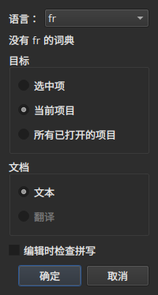
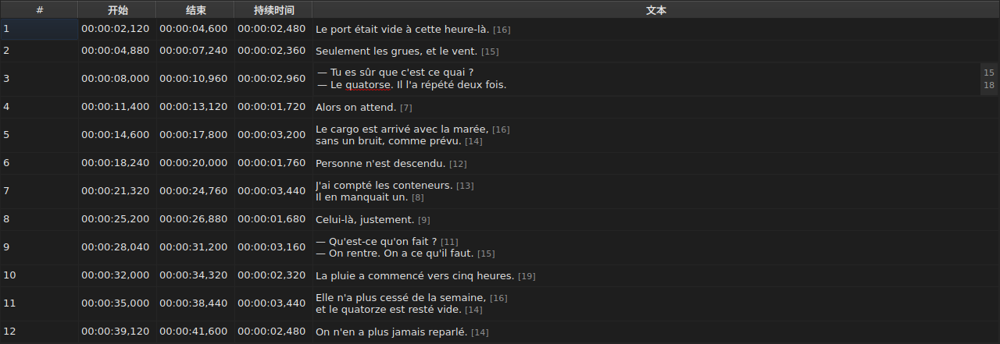
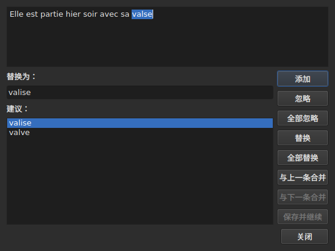

# 检查拼写…

<!-- machine-translated -->
> 本页为机器翻译，尚未经过熟悉该语言的读者审校。

`工具(O) ▸ 检查拼写…(K)` 以 Gaupol 的拼写检查器为蓝本，逐个检查词典不认识的单词。它还有一个配套的命令 `工具(O) ▸ 拼写检查设置…(P)`，用来设置语言、目标和文档，以及输入时的下划线。两者都依靠系统的词典，通过 Enchant 使用。

第一个命令的标签写作 `Chec&k Spelling…`：`C` 已经是 `Correct Texts…` 的助记键，而 `k` 在 `Tools` 菜单中是空闲的。两个命令都没有快捷键。

**在没有任何字幕的文档上，两者都被禁用**，与 [`Correct Texts…`](correct-texts.md) 一样：没有可检查的内容。所设语言没有词典时，`Check Spelling…` 同样被禁用，参见[没有词典时](#没有词典时)。

## 拼写检查设置…




| 组 | 选项 | 默认值 |
| :---- | :------ | :------ |
| `Language` | 系统提供的语言代码，以及已选的那个 | 系统的语言，如果它在其中 |
| `Target` | `Selection`、`Current Project`、`All Open Projects` | `Current Project` |
| `Document` | `Text`、`Translation` | `Text` |
| `Check spelling while editing` | 一个复选框，参见[输入时加下划线](#输入时加下划线) | 不勾选 |

在所显示的标签页中没有选中任何行时，`Selection` 被禁用；只要没有任何已打开的项目带有翻译，`Translation` 就被禁用。被记住但已不可用的设置——空的选区、不存在的翻译——打开时会回到 `Current Project` 或 `Text`。`OK` 保留设置，`Cancel` 不更改任何内容。

**这个窗口不依赖于词典**：只要文档有字幕，它就保持可用，即使所设语言没有词典也是如此，并且它正是让你离开一个没有词典的语言的地方。没有词典的语言仍然可以编辑，并显示在列表中，列表下方是 `no dictionary for` 加上它的代码这句话。

**这四项设置会从一次会话保存到下一次会话**，保存在 `subedit` 的设置文件中——其位置参见[首选项](preferences.md)：

| 键 | 取值 | 默认值 |
| :-- | :----- | :------ |
| `spell-check.language` | 语言代码，例如 `fr_FR`；为空：系统的语言 | 空 |
| `spell-check.target` | `selection`、`current-project`、`all-projects` | `current-project` |
| `spell-check.document` | `main`、`translation` | `main` |
| `spell-check.inline` | `true` 或 `false`——给单元格编辑器中的未知单词加下划线 | `false` |

键不接受的值会被忽略，默认值生效，并且窗口打开时会在错误流中指明该选项——参见[文件内容不符合预期时会怎样](preferences.md#文件内容不符合预期时会怎样)。

## 输入时加下划线




`Spell-Check Settings…` 中的 `Check spelling while editing` 复选框，会在文本单元格的编辑器中，**用红色波浪线并在你输入时**给每个未知单词加下划线——`Text` 列的编辑器和 `Translation` 列的编辑器都是如此。下划线随输入而变化：它随单词出现、移动和消失。**它默认不勾选**，与 Gaupol 一样：不勾选时，编辑器中没有任何变化。

**语言是同一个窗口中 `Language:` 的语言**，未知单词就是 `Check Spelling…` 会找到的那些：口语英语的情形相同（`goin'`、`we'd`、`1st`），切分单词的方式也相同。带下划线的单词不能通过菜单来更正：复选框只负责显示它。

**所设语言没有词典时，编辑器保持沉默**：不加任何下划线，也不会出任何故障，窗口中的 `no dictionary for` 这句话说明了原因。复选框对其后打开的编辑器生效；已经打开的编辑器保持原来的样子。

## 检查流程




窗口显示检查停下来的那条字幕的文本，其中的未知单词被选中。**每遇到一个未知单词，项目的标签页就会回到前台，字幕所在的行在表格中被选中。** 检查逐条字幕进行，目标涉及多个项目时，再逐个项目进行。

文本下方：`Replace with:` 框，其中填入第一个建议；以及 `Suggestions:` 列表。选择一个建议，就会把它复制到框中；在框中输入，会刷新列表。

| 按钮 | 作用 |
| :----- | :----------- |
| `Add` | 把该单词加入用户的个人词典，并转到下一个 |
| `Ignore` | 跳过该单词，转到下一个 |
| `Ignore All` | 跳过该单词，以及本次检查中它的所有其他出现之处 |
| `Replace` | 用 `Replace with:` 的内容替换该单词；框为空时被禁用 |
| `Replace All` | 对它的其他出现之处做同样的替换；框为空时被禁用 |
| `Join with Previous` | 把该单词与它前面的单词连接；没有前一个单词，或者两者之间没有空格分隔时被禁用 |
| `Join with Next` | 把该单词与它后面的单词连接，条件相同 |
| `Save and Resume` | 按文本区域现有的样子保留文本，并**从头开始**重新读取**这段文本** |
| `Close` | 关闭窗口 |

**文本区域是可编辑的。** 只要你在其中输入，就只有 `Save and Resume` 保持可用：其他操作作用于所选的单词，而它已不再是文本中的那个单词。

**没有未知单词时，检查会自行结束**：各按钮被禁用，文本被清空。目标中完全没有未知单词时，不会显示任何窗口。

### 中途关闭

`Close` 或窗口的关闭按钮，会像检查结束时一样**应用已经完成的操作**：已经处理完的文本，**以及**已经对当前文本做过的操作——替换、全部替换、连接。这与 Gaupol 不同，后者会丢失当前文本。不计入的是检查中尚未进行的部分，以及在文本区域中输入、但 `Save and Resume` 尚未提交的修改。

**每个被更改的项目只产生一条历史记录**，无论替换了多少处：`Undo` 一次撤销该项目的所有更正。菜单中它显示为 `Undo: correcting texts`。随后状态栏给出计数：

```text
Edited 2 and removed 0 subtitles
```

**替换列表**——用户替换了什么，换成了什么——在关闭时写入 `spell-check/<language>.repl`，位于 `subedit` 的配置目录下，而不是 Gaupol 的目录，后者从不被读取。此后它算作拼写检查器的建议之一，在这里和在 [`Correct Texts…`](correct-texts.md#连接或拆分单词由拼写检查器重新连接与拆分) 中都是如此。如果无法写入，会有一个错误对话框说明这一点，内容是 `Could not save the
replacements for` 加上语言和原因，但不会取消各项更正。

## 没有词典时

当所设语言——如果没有选择过，则是系统的语言——没有词典时，**`Check Spelling…` 被禁用**，当鼠标悬停在该条目上时，它的工具提示以及状态栏会说明原因：

```text
no dictionary for fr
```

`Spell-Check Settings…` 仍然可用，以便选择一个有词典的语言。在没有任何词典提供者的情况下构建的窗口，说的是同样的话，也什么都不检查。

## 消息

| 消息 | 位置 | 触发条件 |
| :------ | :---- | :--------------- |
| `no dictionary for fr` | 工具提示和状态栏 | 所设语言没有词典 |
| `Nothing to check.` | 状态栏 | 目标没有指向任何文本——例如空的选区 |
| `Edited N and removed M subtitles` | 状态栏 | 结束时或关闭时；`M` 保持为 `0` |
| `Could not save the replacements for fr: …` | 错误对话框 | 替换列表没有写入 |

## 示例

一个已打开的文件含有 `Elle est partie hier soir avec sa valse`。法语词典可用：`工具(O) ▸ 检查拼写…(K)` 停在 `valse` 上，在表格中选中该行，并给出建议 `valise`，它已经填在 `Replace with:` 中。先 `Replace` 再 `Close`：该行变成 `Elle est partie hier soir avec sa valise`，状态栏显示：

```text
Edited 1 and removed 0 subtitles
```
