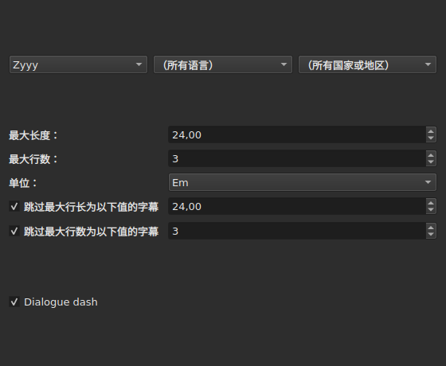
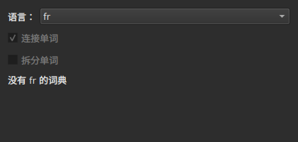
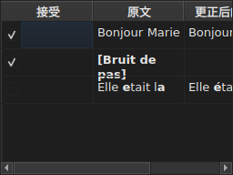

# 更正文本…

<!-- machine-translated -->
> 本页为机器翻译，尚未经过熟悉该语言的读者审校。

`工具(O) ▸ 更正文本…(O)` 会打开一个多页向导，以 Gaupol 的向导为蓝本：一页用于选择目标和任务，每个被勾选的任务各占一页，然后是一个进度页，最后是确认页，它只提出更改建议，绝不强制执行。

**空文档时被禁用**：没有可更正的内容。

**命令行对所有任务做同样的事**：[`subedit-cli correct`](../subedit-cli/correct.md)，使用相同的模式，得到相同的计数——区别在于窗口以 em 为单位测量的地方，命令行以字符为单位。**默认情况下，它会读取该向导记住的四项设置**：两类常见错误（`Human`、`OCR`）、`Remove all blank subtitles`，以及 `Line Break` 的最大行数；其余的一切（任务、任务的代码、行长度、语言、模式框）都取自它自己的命令行。参见[两个区块，其中一个与命令行共用](preferences.md#两个区块其中一个与命令行共用)和 [`subedit-cli config`](../subedit-cli/config.md)。

## 任务和目标——第一页

| 组 | 选项 | 默认值 |
| :---- | :------ | :------ |
| `Target` | `Selection`、`Current Project`、`All Open Projects` | `Current Project` |
| `Document` | `Text`、`Translation` | `Text` |
| `Tasks` | `Mentions`、`Join or Split Words`、`Common Errors`、`Capitalization`、`Line Break`——可勾选一项或多项 | 勾选 `Common Errors` 和 `Capitalization`，其他三项不勾选 |

在所显示的标签页中没有选中任何行时，`Selection` 被禁用；只要没有任何已打开的项目带有翻译，`Translation` 就被禁用。

**目标和文档不会被记住**：向导每次打开时总是回到 `Current Project` 和 `Text`。而被勾选的任务则会被记住。

**每个目标指的是什么**：

| 目标 | 作用于 |
| :----- | :------ |
| `Selection` | 所显示的标签页中选中的行 |
| `Current Project` | 所显示的标签页的整个文件 |
| `All Open Projects` | 每个已打开的标签页的整个文件 |

**对 `Translation` 使用 `All Open Projects` 时，会跳过没有翻译的项目**：没有翻译的项目在空列中没有可提出的建议，向导也不会把它计入。

**各任务页按 Gaupol 的顺序依次出现——`Mentions`、`Join or Split Words`、`Common Errors`、`Capitalization`、`Line Break`——而不是勾选各框的顺序。** 没有被勾选的任务没有页面；它记住的设置不会因此改变。**任何任务页都没有自己的“启用”框**：任务是否运行，只由第一页的那个框决定，别无他处。

## 任务页

四个模式页（除了没有模式的 `Join or Split Words` 之外的所有页）都有相同的基础部分：三个级联的下拉菜单——文字、语言、国家或地区——用来选择要应用的模式的代码，然后是该代码下的模式列表，每个名称一个复选框。**这三个菜单只提供模式目录中实际存在的内容**——随程序提供的模式，以及用户放入其中的模式（参见[被丢弃的模式](#被丢弃的模式)）——绝不是从别处读取的语言或国家列表。`Zyyy`（“任意文字”）是 `Common Errors` 的起始代码，它给出在任何地方都有效的模式。**其他三种类型只在某种文字之下才有模式**：它们的页面打开时停留在目录提供的第一个代码，即随程序提供的模式中的 `Latn`，而不是 `Zyyy`。

**每个模式的说明就是它所在复选框的工具提示。** 随程序提供的模式，其名称和说明遵循窗口的语言；用户自己的模式则按其文件所写的原样显示（[语言](invocation.md#语言)）。

**没有被勾选的模式会一直保持未勾选，直到再次勾选**，即使切换代码后再切换回来也是如此，而且这个选择会从向导的一次打开保存到下一次打开。再次勾选之后，它就回到原来的设置，被记住的选择也随之消失。

| 页 | 在基础部分之外增加的内容 |
| :--- | :----------------------- |
| `Mentions` | 两个复选框，`Sound in brackets` 和 `Sound in parentheses`，默认不勾选 |
| `Common Errors` | 两个复选框，`Human` 和 `OCR`，默认勾选 |
| `Capitalization` | 没有更多内容 |
| `Line Break` | 最大长度（默认为 `24`）、最大行数（`3`）、单位——`Characters` 或 `Ems`，默认为 `Ems`——以及两个跳过条件，见下文 |

**`Mentions` 的两个框不对应任何已编译的模式**：它们驱动核心对文本的一次扫描，与 [`Remove Hearing-Impaired Mentions…`](operations.md#remove-hearing-impaired-mentions) 直接执行的扫描相同。勾选其中**任意一个**即可启动。**该页的模式列表不会重复列出它们**：这两个名称只作为复选框出现一次。

**`Common Errors` 按类别筛选**：同时属于两个类别的模式，只要两个框中有一个被勾选就会应用；其他三个页面不区分这两类。

### Line Break——单位与跳过




| 设置 | 作用 | 默认值 |
| :------ | :----------- | :------ |
| `Maximum length` | 一行的长度，以所选的单位计；从 `1` 到 `1000` | `24` |
| `Maximum lines` | 目标行数；从 `1` 到 `100` | `3` |
| `Unit` | `Characters` 按字符计数；`Ems` 用窗口的字体测量宽度，一个平均大小的小写字母值 `0.55`——Gaupol 的单位 | `Ems` |
| `Skip subtitles with maximum line length of` | 最长一行不超过此长度（以所选的单位计）的字幕保持原样 | 勾选，`24` |
| `Skip subtitles with maximum line amount of` | 行数不超过此数目的字幕保持原样 | 勾选，`3` |

**跳过有自己的阈值**，与所要达到的限制不同：这是 Gaupol 的规则。如果一条字幕满足**所有已勾选框的阈值**，它就保持原样；否则会被断行，并且只有当断行使这条字幕更接近它超出的某个阈值——更短的长度，或更少的行数——时，才保留这次断行。一个框也不勾选：每条字幕都会被断行，无论它是否已经满足要求。

**更改单位会改变所提出的建议**：每一行的长度在每次计算时都按页面当时的单位测量，之前的测量不会留下任何痕迹。一段二十九个字符的文本，其中一半是窄字母，在 `Characters` 下超过 `24`，在 `Ems` 下则轻松满足。

**这七项设置会从一次会话保存到下一次会话**，单位也包括在内。

### 连接或拆分单词——由拼写检查器重新连接与拆分




这是单独的一页，位于 `Mentions` 与 `Common Errors` 之间，用来修复文字识别软件对空格造成的破坏。它没有模式列表：它依靠系统的词典，通过 Enchant 使用。

| 设置 | 作用 | 默认值 |
| :------ | :----------- | :------ |
| `Language` | 词典的语言；系统提供的代码，以及已选的那个 | 系统的语言，如果它在其中 |
| `Join words` | 把拼写错误的单词与相邻的单词连接 | 勾选 |
| `Split words` | 把拼写错误的单词切成两个 | 不勾选 |

**连接**：拼写错误的单词会与它前面或后面的单词连接，**当且仅当两个方向中只有一个能得到拼写正确的单词**。两个方向都可以或都不可以时，什么也不做。`bon jour` 变成 `bonjour`；连续的两个空格会先缩减为一个，但如果文本中没有任何连接，则会原样交还，空格也不例外。

**拆分**：拼写错误的单词被切开，当且仅当拼写检查器的建议中，**只有一个**是该单词加上一个空格——字母相同，顺序相同。这样的建议有两个或一个也没有：什么也不做。只有首字母是大写的单词（`Bonjourtous`）绝不会被拆分：它往往是人名，而词典里没有人名。

**用户的替换列表**（`spell-check/<language>.repl`，位于程序的配置目录中）算作拼写检查器的建议之一；向导读取它，但不会写入它。

**所选语言没有词典时，该页仍然保留，但变灰**：两个框被禁用，页面显示 `no dictionary for` 加上语言的代码。语言仍然可以编辑——也许有另一种语言的词典——而该任务无论在第一页是否被勾选，此时都什么也不做，也不报告任何错误。

**语言、两个框以及第一页的那个框，会从向导的一次打开保存到下一次打开。**

### 被丢弃的模式

用户放入自己的模式目录中的模式，会被加入随程序提供的模式之中，处于同一个目录和同样的菜单之下——加载之后，没有任何东西能区分它们。

| 模式 | 位置 |
| :------- | :---- |
| 随程序提供的 | `<prefix>/share/subedit/patterns`，与 `<prefix>/bin` 相邻 |
| 用户的 | `$XDG_DATA_HOME/subedit/patterns`，如果该变量未设置或不是绝对路径，则为 `~/.local/share/subedit/patterns` |

**格式就是 Gaupol 的，按原样读取**：每种文字、语言和国家或地区对应一个 `<Code>.<type>` 文件——`Latn-en.common-error`——它旁边是对应的激活文件 `.conf`。类型有 `common-error`、`capitalization`、`hearing-impaired` 和 `line-break`。随程序提供的文件可作为范本。**模式只在启动时读取一次**：窗口打开期间放入的文件，要到下次启动才能看到。

## 进度

在最后一个被勾选的任务页（如果没有勾选任何任务，则在第一页）按下 `Next` 之后，向导在后台线程中计算所建议的更正，屏幕上显示一个不确定进度的进度条。计算结束后，确认页会自动打开。

**在这一步按 `Cancel` 会放弃计算，但不会中断它**：不会应用任何内容，但向导在关闭之前会等待正在进行的计算结束——等待的时间受模式引擎对每次搜索施加的时间限制约束。

**在这一步按 `Back` 会不等待而直接回到上一页**：计算在后台结束，其结果被丢弃——向导不会自行跳到确认页。`Next` 会开始一次新的计算。

## 确认——最后一页




向导会更改的每一条文本占一行——任务保持原样的文本绝不会占一行。

| 列 | 显示的内容 |
| :----- | :------------ |
| `Accept` | 一个复选框，默认勾选：这条更正是否会被应用 |
| `Original` | 现有的文本，将要更改的部分用**粗体**显示 |
| `Corrected Text` | 所建议的文本，更改的部分用粗体显示，**可编辑**——对它的修改会改变将要写入的内容，而不会改变 `Accept` 框 |

**更改用粗体标出，绝不用颜色**：同样的差异在两种调色板中都能读出，不依赖任何色调。

**建议是删除的那一行**——字幕将不再剩下任何文本——其 `Corrected Text` 列为空，其整个 `Original` 用粗体显示。

| 按钮 | 作用 |
| :----- | :----------- |
| `Mark All` | 勾选所有行的 `Accept` |
| `Unmark All` | 取消勾选所有行的 `Accept` |
| `Preview` | 如果项目有影片，则让内置播放器定位到所选行的字幕——没有影片则什么也不做 |
| `Finish` | 应用已勾选的行并关闭向导 |

默认勾选的 `Remove all blank subtitles` 会删除更正之后将不剩任何文本的字幕，而不是把它们留成空的。

**计算无法应用的模式，会在表格下方说明名称**，并附上原因：

```text
Not applied: some pattern (will not compile)
```

以这种方式说明的模式，**每个原因只说明一次**，无论它在多少条文本或多少个项目上失败：屏幕不会说明具体是哪些。

| 原因 | 触发条件 |
| :----- | :--------------- |
| `cannot be translated` | 表达式使用了 Python 语法的转换所不接受的内容 |
| `will not compile` | 引擎拒绝该表达式 |
| `has an invalid replacement` | 替换文本不符合 Python 的读法 |
| `timed out` | 在某条文本上的搜索超过了引擎给予的时间 |
| `never settled` | 经过一百遍之后，`Repeat` 仍在改变文本 |
| `grew the text too long` | 模式处理期间，文本超过了 16,384 字节 |

**在某条文本上失败的模式，会让它保持在该模式处理之前的样子**：做了一半的替换，不如不替换。其他模式照常应用。

**无法读取的模式文件中的某一行，会在同一位置说明**，给出其文件、行号和原因——每次打开向导时都会说明，因为模式只在启动时读取一次：

```text
Could not be read: Zyyy.common-error, line 8 (malformed line)
```

| 原因 | 触发条件 |
| :----- | :--------------- |
| `directory cannot be read` | 无法遍历随程序提供的模式所在的目录 |
| `file cannot be read` | 无法读取某个模式文件 |
| `malformed line` | 既不是标题，也不是注释，也不是 `Key=Value` 的一行 |
| `field outside any pattern` | 第一个模式标题之前的 `Key=Value` |
| `unknown field` | 该类型的模式用不到的键——模式保留 |
| `missing field` | 缺少它，该类型的模式就什么也做不了的键——模式被丢弃 |
| `invalid value` | 键不接受的值——模式被丢弃 |
| `malformed activation` | `.conf` 中未指明任何内容的 `<pattern>` 元素 |

其他模式，即已被正确读取并应用的那些，不受影响。

## 撤销会说什么，以及 `Cancel` 绝不会做什么

**`Finish` 对每个被更改的项目产生一条历史记录**，而不是每条更正一条：`Undo` 一次撤销该项目上所有已接受的更正，每条文本都恢复为原来的样子。菜单中它显示为 `Undo: correcting texts`。

状态栏给出计数，先是被更改的文本，然后是被删除的字幕：

```text
Edited 3 and removed 1 subtitles
```

**在任何一页按 `Cancel`，都不会应用任何内容，也不会记住任何内容**——这次打开期间所选的设置不会，哪怕最细微的更正也不会。向导下一次打开时，从之前的设置重新开始。

## 示例

一个已打开的文件，某一行的两个单词之间有两个空格，另有一条方括号中的提示，没有其他文本。依次进入 `工具(O) ▸ 更正文本…(O)`，`Common Errors` 已被勾选，一直按 `Next` 到确认页：带有两个空格的那一行，左边显示 `Bonjour  Marie`，右边显示 `Bonjour Marie`，更正处为粗体，并且已被接受。`Finish` 应用它，状态栏显示：

```text
Edited 1 and removed 0 subtitles
```
