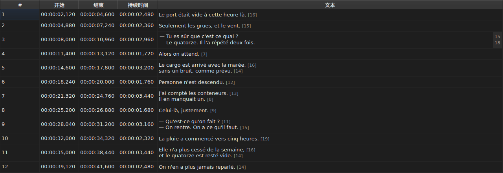
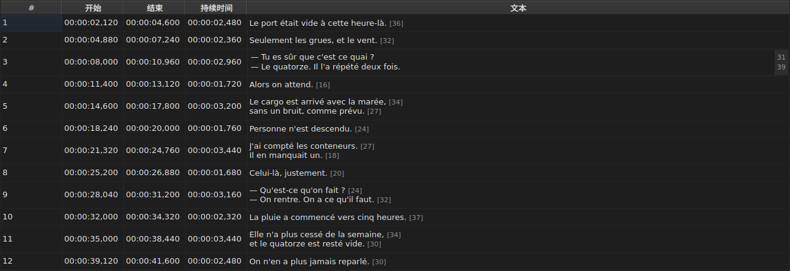

# 编辑单元格

<!-- machine-translated -->
> 本页为机器翻译，尚未经过熟悉该语言的读者审校。

有四列可以就地编辑：`Start`、`End`、`Duration` 和 `Text`——当项目有翻译时，再加上 `Translation` 列，共五列。`#` 不能编辑——该编号是行的序号，而不是文件的数据。

**打开单元格的编辑器**：双击它，或者选中它再按 `F2`。

## 文本

**翻译的编辑方式与文本相同**，使用同样的多行编辑框和同样的规则；只是单元格不同，主文本保持原样。没有任何更改的提交不会产生任何效果，对二者都是如此——参见[下文](#没有任何更改的提交不会产生任何效果)。

编辑器是一个**多行**编辑框，打开时与字幕等高：双行字幕就按它写出时的样子输入，两行都清晰可读，而且没有滚动条。用 `Shift+Enter` 添加一行会使编辑器变大；表格的行在提交时随之调整。

| 按键 | 效果 |
| :-- | :----- |
| `Enter` | 提交并关闭编辑器 |
| `Shift+Enter` | 在文本中插入换行 |
| `Esc` | 关闭编辑器；单元格保持原有内容 |
| `Tab` | 提交并移到下一个单元格 |

在其他地方单击同样会提交：失去焦点相当于按下 `Enter`。

**有十一个无需对话框的操作同样会在计算其目标之前提交**：`Italic`、`大小写(S) ▸ …`、`Dialogue`、`Merge Subtitles`、`Split Subtitle`、`Cut Texts`、`Paste Texts`、`Copy Texts`、`Remove Subtitles`、`Undo` 和 `Redo`。无论从菜单、工具栏还是窗口快捷键启动，它们取用的都是编辑器刚刚提交的文本，与在其他地方单击之后一样。不过，只要编辑器处于打开状态，`Ctrl+X`、`Ctrl+C` 和 `Ctrl+V` 仍归编辑器所有——参见[剪切、复制和粘贴文本](clipboard.md)：此时由菜单来启动 `Cut Texts`、`Copy Texts` 和 `Paste Texts`。

`Undo` 和 `Redo` 读取的是历史记录而不是文档：参见[撤销与重做](undo.md)。打开对话框的操作不需要这条规则，因为对话框在打开时会取得焦点，这本身就已经提交了输入。

### 标签就是文件中的标签

显示和输入的文本是**文件中的文本，包括标签**：SubRip 的 `<i>…</i>` 就那样写，Advanced SSA 的 `{\i1}…{\i0}` 也是如此。显示时不做任何转换——[`Italic`](operations.md#italic) 的表格说明了每种格式的写法。

因此，对于斜体，没有什么需要了解的：`Ctrl+I` 会为打开的文档设置正确的标签，而不带斜体标签的格式——TMPlayer、LRC——会禁用该条目，不必你自己去查找。粗体和下划线需要手动输入，与 Gaupol 相同。

**而且标签不会跟着文本操作变化**：把字幕改为小写，不会把其中的 `<I>` 变成 `<i>`；对话破折号放在文本之前，而不是放在起始标签之前。参见 [`Case` 与 `Dialogue`](operations.md#case-与-dialogue)。

## 行的长度

**文本编辑器在右侧的页边显示每一行的长度**，与该行的第一个显示行对齐。页边的宽度与最大的数字一样宽，**随输入更新**，并跟随滚动。空文本不显示任何内容。这些长度与表格中的相同——不含标签、向下取整，单位按设置而定——可以用 `编辑(E) ▸ 首选项…(E)` 中的 `Show line lengths in the editor` 复选框取消。参见[行长度](preferences.md#行长度)。

## 开始时间和结束时间

编辑器是一个单行编辑框，**限定为时间戳的形式**：输入过程中，它会拒绝永远不可能构成时间戳的内容。

接受的形式与读取文件时已接受的相同：

| 要素 | 可通过的内容 |
| :------ | :---------- |
| 字段 | `MM:SS` 或 `HH:MM:SS`，每段一位或两位数字 |
| 小数 | 一到三位，位于逗号或点号之后，也可以没有 |
| 符号 | 开头的 `-`，表示在视频起点之前的位置 |
| 范围 | 分钟和秒都小于 60 |

因此，`00:01:02,500`、`1:02.5` 和 `-0:01,000` 是三个有效的输入。

**读取时被拒绝的输入，会使单元格保持不变**。`00:70:00,000` 就是这种情况：它的形式正确，但分钟超出范围：编辑器关闭，什么也没有变。不会凭空编造任何位置——弄错一个位置是无声的，屏幕上没有任何迹象能让你区分时间不对的字幕和时间正确的字幕。

更改开始时间或结束时间，会立即更新 `Duration`。

## 持续时间

**输入持续时间会移动结束时间，而绝不移动开始时间**：结束时间变为 `Start + Duration`。移动开始时间会移动整条字幕，那是 [`Shift Positions…`](operations.md) 的工作，而且 `Start` 列本来就可以输入。

持续时间**以时间戳的形式**输入，也就是该列所显示的形式，上表中的各种形式都适用——只有一处不同：

| 要素 | 开始时间、结束时间 | 持续时间 |
| :------ | :--------- | :------- |
| 形式 | 时间戳的形式 | 相同 |
| 开头的 `-` 号 | 接受 | **输入时被拒绝** |

因此，`0:02.5` 和 `00:00:02,500` 是持续时间两秒半的两个有效输入；`-0:01,000` 无法输入。零持续时间是接受的：这时字幕在出现的那一刻就消失了。

**允许结束时间越过下一条字幕**。重叠部分会在表格中着色，并带有工具提示——参见[表格](table.md#异常情况)——这是一个提示，而不是拒绝：这也许正是你想要的。[诊断信息列表](files.md#读取的诊断信息)中也会列出它，并在你更正之后将其移除。

**输入的结束时间超出影片结尾时，不会报告**，这与 `Tools` 菜单中会把它推到那里的操作不同——参见[操作](operations.md#超出影片结尾)。单元格已经显示了你刚刚输入的值。

无法读取的输入会使单元格保持不变，与位置的情形相同；与所显示的持续时间相同的持续时间，不会进入历史记录。

## 没有任何更改的提交不会产生任何效果

打开一个单元格，什么也不输入，按 `Enter`：什么也不会发生。不会记录任何修改，文件仍被视为与磁盘上的相同。

比较针对的是**位置**，而不是字符串：在显示 `00:00:01,000` 的单元格中输入 `0:01.0`，指的是同一个时刻，因此同样不会改变任何内容。

## 被编辑的单元格会怎样

它**可以撤销**——一个单元格，一条记录。参见[撤销与重做](undo.md)。

它**会被保存**，而在未保存的情况下关闭窗口会要求确认。参见[打开与保存](files.md)。
