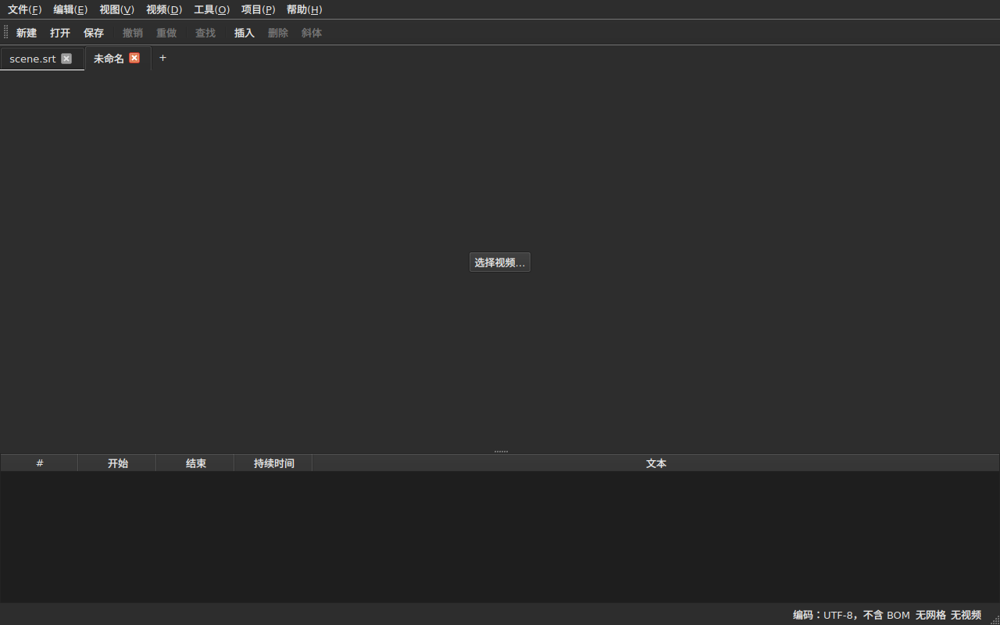
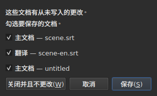
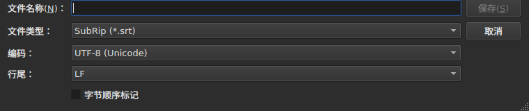
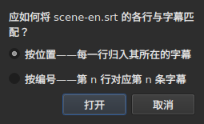
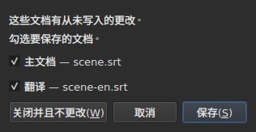

# 打开与保存

<!-- machine-translated -->
> 本页为机器翻译，尚未经过熟悉该语言的读者审校。

**File** 菜单有三条基本命令、两条用于标签页的命令，以及另外三条用于翻译的命令；**Projects** 菜单则一次作用于所有标签页。

| 命令 | 快捷键 | 作用 |
| :------ | :------- | :----------- |
| 新建项目(N) | `Ctrl+N` | 在新标签页中创建一个空项目——最后一个标签页之后的 `+` 按钮也有同样的作用 |
| 打开… | `Ctrl+O` | 选择一个文件并在新标签页中打开——或者替换一个空白项目 |
| 打开翻译…(T) | — | 选择一个翻译文件，并把它与当前标签页的主文件对齐 |
| 保存 | `Ctrl+S` | 重写已打开的文件 |
| 另存为… | `Ctrl+Shift+S` | 选择路径和格式，然后写入 |
| 保存翻译(L) | — | 重写翻译的文件 |
| 翻译另存为… | — | 为翻译选择路径和格式，然后写入 |
| 关闭(C) | `Ctrl+W` | 关闭当前标签页——只有一个标签页时禁用 |

`New Project`、`Open…` 和 `Save` 也在[工具栏](index.md#工具栏)中，按钮上的字样分别是 `New`、`Open` 和 `Save`。**翻译的三个条目不在工具栏中**：只有使用翻译的人才需要它们，而工具栏是给所有人用的。

## 多个项目，分在标签页中

**每个已打开的项目都有自己的标签页**，位于画面和表格的上方：标签是文件名，尚无文件的项目则为 `untitled`。单击标签页即可切换；`Ctrl+PageDown` 和 `Ctrl+PageUp` 无需鼠标即可实现同样的切换，并且在最后一个标签页之后回到第一个。**最后一个标签页之后的 `+` 按钮**会在新标签页中打开一个空项目，与 `New Project` 相同。




**`Open…` 从不触碰这些标签页**。打开文件不再替换窗口原先显示的内容：文件会出现在旁边的新标签页中，而你之前查看的标签页保留它原有的一切——历史记录、选区、关联的视频。这也是打开时不再询问任何问题的原因：没有什么要替换，也就没有什么会丢失。

**有一个例外：空白项目会让出它的位置**。不带文件启动，或者在 `New Project` 之后，窗口会显示一个什么也没有的 `untitled` 项目。此时打开的文件——不论通过 `Open…` 还是拖放——**会占用它的标签页，位置也在标签栏的同一处**，而不是在一个无用的项目旁边再开一个。项目为空白，是指它**没有文件、没有字幕、没有可撤销或重做的内容、没有影片，而且从未被修改过**：其中任何一项成立，它就保留自己的标签页。不是当前标签页的空白项目不受影响。

**已经打开的文件不会被打开第二次**。对另一个标签页已经持有的文件执行 `Open…`，会把焦点交还给那个标签页，并在状态栏中说明：

```text
premier.srt: already open
```

**每个标签页都是完整的项目，彼此独立**：它的历史记录、选区、关联的视频以及上次读取遇到的问题，只有在该标签页为当前标签页时才会显示，在切换到其他标签页期间也不会改变。**有一个例外，记录在 ADR 0033 中**：视频播放器在整个窗口中是唯一的——只有一个 mpv 进程——其影片随标签页而变；**每个标签页都会记住自己影片所在的位置**，在你回到它时，从那里暂停着继续。剪贴板属于窗口：想在一个标签页中复制、在另一个中粘贴，就要为此打开两个标签页。

**`Close` 会关闭当前标签页**，必要时会询问[未保存更改的问题](#未保存的更改)——只针对这个标签页，不涉及其他标签页。**只有一个标签页时禁用**：窗口始终至少保留一个，而关闭它就等于关闭窗口——系统自带的按钮已经能做到这一点。

**每个标签页上还有一个叉**，用来关闭**它的**项目，询问的问题相同。非当前标签页的叉关闭的是那个标签页，你正在查看的标签页保持显示；如果该项目有更改，它的标签页会在提问期间移到前面。**只剩一个标签页时没有叉**，原因与 `Close` 被禁用相同。

**标签页会表明自己已被修改**：只要它的某个文档与其文件不同，名称后面就会跟一个星号，如 `premier.srt*`——窗口标题对你正在查看的项目也是这样表示的。保存后星号消失。

## “项目”菜单

有两条命令一次作用于所有项目。

| 命令 | 快捷键 | 作用 |
| :------ | :------- | :----------- |
| 全部保存(A) | `Ctrl+Shift+L` | 逐个标签页写入每个已修改的文档 |
| 全部关闭(C) | `Ctrl+Shift+W` | 关闭所有项目——也就是关闭窗口 |

**`Save All` 按标签页的顺序进行**，先主文档，后翻译。有文件的文档会被重写到该文件，**其标签页不会移到前面**；**没有文件的文档会逐个打开 `Save As…`**，并显示在它的标签页上——这是 `Save All` 切换标签页的唯一情形，以便对话框表明是针对哪个项目。**取消某次 `Save As…`，或者某次保存失败，会停止其余的保存**：后面的项目不会被触碰，并且会有一个对话框说明已经写入了什么。

```text
Save All stopped: 1 of 3 documents saved
```

全部写完后，状态栏会说明这一点——`2 documents saved`，或者在没有任何修改时显示 `Nothing to save`。如果某次 `Save As…` 把某个标签页移到了前面，窗口随后会回到发起命令的那一个。

**`Close All` 与窗口的叉是同一回事**：窗口始终保留一个项目，关闭所有项目就是关闭窗口。因此它们对所有项目只提**一个问题**，与[有两个已修改的文档](#关闭时有两个已修改的文档)时相同，每个标签页中每个已修改的文档各有一个复选框：




**`Cancel` 不会关闭任何东西**，也不会写入任何内容。`Save` 会像 `Save All` 一样写入已勾选的文档：在其标签页后台写入，没有名称的文档除外，它的标签页会移到前面以进行 `Save As…`。如果所有项目中只有一个文档被修改，问的就是我们一直以来的那个简单问题，并显示在它的标签页上。`Save All As…` 并不存在：它是一连串的 `Save As…`，而 `Save All` 已经会对没有名称的文档逐个询问。

## 打开

对话框会过滤出**所读取的九种格式**，每种一个条目，另有第一个条目显示全部。格式随后**根据内容而不是扩展名**识别：内容为 SubRip 的 `.txt` 可以打开，过滤器什么也决定不了——它只是隐藏文件。

| 过滤器条目 | 扩展名 |
| :----------- | :-------- |
| `SubRip` | `.srt` |
| `WebVTT` | `.vtt` |
| `SubViewer 2` | `.sub` |
| `Sub Station Alpha` | `.ssa` |
| `Advanced SSA` | `.ass` |
| `MicroDVD` | `.sub` |
| `MPL2` | `.txt` |
| `TMPlayer` | `.txt` |
| `LRC` | `.lrc` |

**有两个扩展名各对应两种格式**——`.sub` 是 SubViewer 2 和 MicroDVD，`.txt` 是 MPL2 和 TMPlayer。这对打开没有影响，因为由内容决定；保存时，给出格式的是所选条目的**名称**，而不是它的模式。

**无法读取的文件什么也不会打开**。文件缺失、被系统拒绝、其编码使字节无法解码，或者不属于任何已知格式：模态对话框会**说明原因**，不会打开任何标签页，已有的标签页也不会变动。

| 消息 | 发生了什么 |
| :------ | :------------ |
| `does not exist` | 该路径不指向任何文件 |
| `cannot be opened: permission denied` | 系统拒绝打开 |
| `cannot be read` | 系统出于其他原因拒绝 |
| `cannot be decoded in the chosen encoding` | 字节无法按所选的编码读取 |
| `is in no format this tool knows` | 没有任何格式能识别其内容 |
| `holds nothing recognisable as a subtitle` | 格式已识别，但其中没有任何字幕 |

消息前面是路径：`notes.txt: is in no format this tool knows`。这些是命令行的用词，并非巧合——两个界面按同一方案读取文件。

### 将文件拖放到窗口上

**把文件拖放到窗口的任何位置都会将其打开**，可以从文件管理器拖入：表格、标签栏、`Select Video…` 按钮，以及**影片画面本身**，无论是在播放还是已停止。画面是由播放器绘制的单独窗口，没有什么能保证它会转交拖放；这一点已在真实桌面上手动验证过，环境是 Wayland 会话。`subedit-gui` 在那里以 X11 启动才能显示影片，因此拖放走的是 X11 协议——也就是 X11 会话的协议，而对它并没有单独试过。

- **每个字幕文件各开一个标签页**，按拖入的顺序——与 `Open…` 完全相同。**已经打开**的文件不会再次读取：它的标签页会移到前面，状态栏会说明这一点（`premier.srt: already open`）。
- **拖入的视频会与当前标签页关联**，与 `Select Video…` 相同。若与字幕一起拖入，则归入这些字幕所打开的最后一个标签页，与拖入的顺序无关。视频按其扩展名识别——与在文件旁边提议影片所用的列表相同。
- **一次拖入两个或更多视频不会被打开**：一个项目只关注一部影片。同一次拖入中的字幕则会打开。
- **打不开的文件不会阻止其他文件**。随后会有一个对话框说明哪些没有完成，每个文件一行，用词与 `Open…` 相同：

  ```text
  /films/notes.txt: is in no format this tool knows
  /films/absent.srt: does not exist
  ```

只接受本地文件：从浏览器拖来的链接，不指向窗口能读取的任何内容。

从命令行打开仍然可用：`subedit-gui film.srt`。此时同样的原因会写到错误流，窗口打开时为空——见[调用](invocation.md#打开失败时)。

## 读取的诊断信息

真实的文件很少是完美的，而读取会设法恢复而不是放弃：缺少序号、某一行无处归属、行尾混杂。**读取遇到的问题汇总在状态栏的一个按钮中**——`2 diagnostics`，位于状态栏对文档已有说明的左侧——，**单击后列表会在按钮上方的浮动窗口中打开**。窗口中没有任何一行被它占用：不论读取有没有话要说，表格都保持完整高度。单击别处或按 `Esc` 即可关闭列表。

```
a SubRip block without its number, settled by the reader: 5
```

**每一行都会计数**：遇到了什么、做了什么处理、发生了多少次。格式很糟的文件会遇到几百次，而了解每一类各有多少，才能据此采取行动；每次出现所在的行号则要在命令行中以详细级别 `-vvv` 查看。按钮统计的是这些行——每一类一行——，而不是出现次数。

**推测出的编码也会出现在这里**，只出现一次：它是在文件的任何一行存在之前，通过权衡字节而提出的。

```
an encoding nothing declared, settled by the reader: 1
```

只有当编码是**推测出来的、而且不是 UTF-8** 时才会显示——按 UTF-8 读取的 UTF-8 文件不算事件，每次打开都说明一遍，会让每个普通文档的状态栏里都多出一个按钮。带有字节序标记的文件同样不会触发它：它自己声明了编码，没有任何推测。

**同一列表还会统计字幕本身的问题**：一条字幕在前一条结束之前开始、结束早于开始、开始早于上一条字幕的开始。表格会为它们着色，但着色要靠滚动才能找到，在两千行的文件中很容易漏掉一处；这里各类都集中在一起，**每类一行并附带数量**，用词与 `inspect` 报告相同：

```
subtitle starts before the previous one ends: 12
subtitle starts before the previous one starts: 3
```

**单击其中一行会跳到第一条相关的字幕**，并在表格中选中它。这些行**会随修正而更新**——排序或修正持续时间会去掉一些，或减小它们的数量——，而不会关闭你正在阅读的列表。一条字幕可以被计两次：在前一条结束之前开始和在其开始之前开始是两项发现，需要用两种方式修正。要逐条列出它们，可使用 `subedit-cli inspect --detail`。

当没有任何内容可报告时——读取和字幕两方面都没有——按钮**不会出现**，并且**它随标签页而变**：每个项目保留自己读取的诊断信息，按钮显示的是当前所显示项目的诊断信息。

## 状态栏中的编码

**状态栏始终给出已打开文档的编码**，位于它对[帧网格](frame-grid.md)和[关联视频](video.md)所作说明的左侧：

| 情形 | 写出的内容 |
| :-------- | :-------------- |
| 文件按 UTF-8 读取，没有标记 | `Encoding: UTF-8, no BOM` |
| … 有标记 | `Encoding: UTF-8, BOM` |
| Latin-1 文件 | `Encoding: ISO-8859-1, no BOM` |

**诊断信息和这一行回答的不是同一个问题**，这正是两者并存的原因。诊断信息说明读取**做了**什么——它做了推测，你也许想核对一下；因此只有在发生推测时才会显示。状态栏说明文档**是**什么，并且始终显示，包括自己声明了编码、读取无需多说什么的文件。

**答案的来源不会显示在这里**。`inspect` 会给出——`detected`、`from its byte order mark`、`as asked for`——因为报告有地方可写；状态栏的一行没有，而在需要时诊断信息列表已经包含这些内容。

## 保存

`Save` 会把已打开的文件**按原有形式**重写：它的格式、编码、行尾、字节序标记和文件头。打开后不作修改直接保存的文件，一个字节也不会变——确切的保证见下文。

写入是**原子的**：先写入临时文件，再重命名覆盖原文件。保存在任何时刻被中断，都会让先前的版本完好无损。

保存一个从未存在于磁盘上的文档，相当于 `Save As…`。

**写入失败时会明确说明，并且不会丢失任何内容**：磁盘已满、文件只读、目录缺失——或者是**文件的编码无法写入的字符**，例如 Latin-1 文件中的 `ł`。此时的消息是 `holds a character the chosen encoding cannot write`，并且不会写入任何内容：把该字符替换成 `?` 会在刚输入它的人眼前丢失文本。消息会指出文件和原因，窗口保留其修改，标题中的标记也保持不变。

## 另存为

`Save As…` 会询问路径、格式，**以及所写入字节的形态**：编码、行尾、字节序标记。文档**随后就位于那里**：标题改变，`Save` 以新文件为目标并按所选的形态写入，原文件则保持原样。

**提供九种格式**，对话框打开时选中的条目是**文档本身的格式**。因此换个名称保存而不碰过滤器，格式不会改变。




**图像只显示对话框的底部**，不显示上方的文件列表：那取决于机器——它的目录、日期、侧边快捷方式——，因此它的照片永远不会两次相同。这一区域则是固定的，一切都发生在这里。

| 字段 | 提供的内容 | 默认值 |
| :---- | :------------- | :------ |
| `Encoding` | 字幕文件实际使用的十四种编码，外加 `Other…` | **所读取文件的编码** |
| `Other…` | 一个字段，可输入 ICU 能写入的任何编码，**带自动补全**——`cp1257`、`EUC-KR` | — |
| `Line endings` | `LF`、`CRLF` 或 `CR` | 所读取文件的行尾 |
| `Byte order mark` | 标记，**对不带标记的编码禁用** | 所读取文件的标记 |

**默认值是所读取文件的值，这是一项保证，而不只是为了方便**：打开后不碰这三个字段再次保存的文件，得到的字节与原来相同。

**列表很短，但并不是上限**。ICU 认识二百二十一种；菜单提供的是字幕文件实际使用的那些，因为有两百个条目的菜单对谁都没有帮助。`Other…` 会打开其余的部分。

**该字段会在这二百二十一种中自动补全**，因此无需知道确切的名称：输入 `1252` 会提示 `windows-1252`，输入 `koi` 会提示 `KOI8-R` 和 `KOI8-U`。补全依据的是名称**包含**什么，而不是以什么开头——西欧 Windows 编码的规范名称是 `windows-1252`，而人们心里想的是 `cp1252`。两者也都可以不经补全完整写出：ICU 接受它自己的别名。

**没人知道的名称不会写入任何内容**。输入 `klingon-1` 不会退回到 UTF-8：什么也不写入，并且消息会说明这一点。

**没有指明字节顺序的名称同样如此**。`UTF-16` 和 `UTF-32` 是 ICU 认识的名称，其转换器会写入**它自己的标记**：`Byte order mark` 复选框就不再决定任何事情了。这两者都会被拒绝，消息会指向 `UTF-16LE` 或 `UTF-16BE`，它们写出的字节相同，且受复选框控制。这与命令行的拒绝是同一种，用词也相同。

**所选编码无法写入的字符会中止保存**——例如 Latin-1 中的 `ł`。消息是 `holds a character the chosen encoding cannot write`，窗口保留其修改，目标文件不会被触碰。

**文档本身也不会变动**：它仍留在它的文件中，保持原有的格式和编码，下一次 `Save` 重写的是打开的那个文件。没有发生的保存不会改变任何内容——不论是磁盘上还是窗口中。

更改格式会改变表格显示的内容——小数分隔符随格式而定，SubRip 用逗号，WebVTT 用句点，而且**标签会改写为目标格式的词汇**：`<i>` 在 Sub Station Alpha 中变成 `{\i1}`，在 MicroDVD 中变成 `{Y:i}`，在 MPL2 中变成行首的 `/`。文档**已经变成**那个文件，所以表格显示的是文件所承载的内容。

**它不是命令，`Ctrl+Z` 也无法撤销它**。格式为 LRC、文本却仍写着 `<i>` 的文档，会是一个前后不一致的文档；不存在可以撤销的一半。

## 格式无法保留的内容，写入前先告知

**会有一个模态对话框发出警告，而你仍可以回答否**。它逐项列出目标格式无法容纳的内容，用词与命令行事后写出的相同：

```
ends are not carried by LRC, line breaks were joined in 2 subtitles, 1 tag dropped
```

| 按钮 | 效果 |
| :----- | :----- |
| `Save` | 仍然写入，接受损失 |
| `Cancel` | 不写入任何内容；文档不变，文件和格式都不变 |

`Cancel` 是默认按钮：不看内容就按下 Enter 键，文件会保持原样。

**没有损失时不会询问任何问题**。一个宣布“没有任何内容会丢失”的对话框，会教人把真正重要的那个也一并关掉。

可以告知的内容：

| 项目 | 何时 |
| :--- | :--- |
| 结束时间 | 目标格式不承载结束时间——TMPlayer、LRC |
| 换行 | 目标格式不承载换行——LRC |
| 标签 | 源格式的某个标签在目标格式中没有对应物，或者中间表示不认识它 |
| 文件头 | 所读取的文件带有文件头，而它无法转移 |
| 声明的字段 | SSA 各列的顺序、TMPlayer 时间的形态 |
| 精度 | 目标格式的计数更粗——MPL2 的十分之一秒、TMPlayer 的秒 |

**属于另一种格式的内容会被搁置**。WebVTT 文件带有 cue 标识符和位置设置；SubRip 带有显示坐标。以另一种格式写入时会忽略它们，而不是随意转换——它们并没有因此丢失，只是没有被写出。

## 往返保证

它有两半，缺一不可：

- **逐字节忠实**：针对已经采用 `subedit` 所写布局的文件——即 Gaupol 的布局，包括末尾的空行——，**不论其编码**：CP1252 或 UTF-16 的文件会按它自己的编码重写，包括标记；
- 其他情形下**幂等**：第一次保存会规范化布局，此后再保存不会再触碰任何内容。

具体来说，最后一个块之后没有空行的文件，会增加一个空行，仅此一次。这是不作修改的保存所能产生的唯一变化。

## 打开翻译

`文件(F) ▸ 打开翻译…(T)` 会在主文件旁设置**第二个文件**。只要没有字幕可供分配翻译的行，该条目就是禁用的。

**两个问题，依次提出**。先是文件选择器，即 `Open…` 的那个——过滤器相同，起始文件夹相同，编码的识别方式也与主文件相同——然后是**对齐方式：**




| 方式 | 作用 |
| :----- | :----------- |
| `By position`（默认） | 每一行归入其中点所在的字幕 |
| `By number` | 第 n 行归入第 n 条字幕，不看位置 |

**默认按位置**，因为中间只要缺了一行，*之后所有*行按序号都会错位，而按位置则只有一条字幕没有翻译。

**做了什么，写了什么：**

- 已附加各行的文本进入 `Translation` 列，该列随之出现；
- **找不到字幕的行会产生一条新字幕**，其位置**取自该行**——两种方式皆然；
- **不会排序任何内容**，文件和文档都不排序：各行按时间顺序遍历，并给出不在该顺序中的行数；
- **已打开的翻译会被替换**，其所有文本先被清除。

**发生了什么会说明**。每一行都找到了字幕、也没有字幕被落下时，状态栏会写出结果；否则会有**一个需要关闭的对话框**，与任何有话要说的操作一样：

```text
translation: 3 lines attached
translation: 2 lines attached; 1 subtitle left without a translation
translation: 3 lines attached; 1 subtitle born of a line; 2 lines out of order
```

各项只有在不为零时才会写出：已附加的行数、由行产生的字幕数、没有行与之对应的字幕数、顺序混乱的行数。完全没有行的文件会直接说明这一点（`translation: the file holds no line`），而不是归咎于字幕。

**偏移了的翻译会被识别，并按偏移后重新打开**。晚了两秒的翻译会对齐到错误的字幕上，而没有任何迹象能把它与正确的附加区分开来。当**按位置**打开的结果并不理想时，窗口会寻找**一个固定的偏移量**：每一行的开始时间与其周围字幕的开始时间之差给出候选值，按十毫秒分组，**每个候选值都由打开时的那次附加本身来评判**。如果只有一个偏移量能使打开的结果理想，对话框会在给出计数之后说明这一点，并**提议按偏移后重新打开：**

```text
translation: 4 subtitles born of a line; 4 subtitles left without a translation
the lines sit 2.000 s later than the subtitles; moved back, 4 lines would attach instead of 0
```

`Yes` 会撤销这次打开，并用按该偏移量调回的各行重新打开；默认答案 `No` 则保持打开的结果不变。**结果只是一条历史记录**：撤销它即可恢复一切，与任何打开操作一样。

**偏移量不固定时不会提出建议**——漂移，或只影响部分文件的偏移——；当两个偏移量会使打开的结果同样理想，或者没有任何偏移量能使其理想时也是如此：此时的语句不会说存在偏移。按序号打开也不会，因为那里不看位置。它**没有命令行**形式。

**打开翻译只是一条历史记录**，即 `Undo: opening a translation`，撤销它会恢复一切：文本、被删除的新字幕、被分离的翻译文件——列也随之消失。要用另一种方式打开，需要先撤销。

**刚打开的翻译不算已修改**：没有输入任何内容，关闭时也不会提议保存。如果产生了新字幕，则被修改的是主文档。

**已修改的翻译在被替换之前会提议保存**，有[未保存的更改](#未保存的更改)一节所述的三种结果。

| 消息 | 发生了什么 |
| :------ | :------------ |
| `the file is already open as the main document` | 所选文件就是主文档本身，不论其路径怎样写 |
| `does not exist`、`cannot be decoded in the chosen encoding`，… | 与 `Open…` 的原因相同 |

消息前面是路径，而且**什么都不会改变**：窗口保留其历史记录和修改。

**读取遇到的问题**（如果有）——被修复的行、被忽略的字段——会进入诊断信息列表，即[上一次读取](#读取的诊断信息)的列表。

**翻译不保留的内容**：其文件中**每条字幕各自**的设置——SSA 样式、WebVTT 字幕的位置。一条字幕只带有一组设置，即主文档的那一组；它们既不会被读回，也不会被重写。

## 保存翻译

**每个文档单独保存**，保存到各自的文件，保持各自的格式、编码和行尾：主文件为 `.srt` 时，`.ass` 格式的翻译；主文件为 UTF-8 时，Windows-1252 编码的翻译，保存后都保持原样。

| 条目 | 作用 |
| :---- | :----------- |
| `Save Translation` | 重写翻译的文件——它来自的那个文件 |
| `Save Translation As…` | `Save As…` 的选择器，在**翻译的**文件上打开，带有它的格式和编码 |

两者都在**项目没有翻译时禁用**。`Save Translation As…` 就是针对另一个文档的 `Save As…`：字段相同，[损失警告](#格式无法保留的内容写入前先告知)也相同，它统计的是**所写入的文件会丢失什么**——主文本的标签与翻译的标签不同，不写入斜体的格式，只有在翻译中确有斜体时才会对此提出警告。

**每个文档都有自己的已修改状态**。保存主文档后翻译仍为已修改，反之亦然；**只要两者之一已修改，窗口标题就显示为已修改**，而且只有一个星号。

**两者互不影响**：保存翻译不会写入主文档，也不会改变它的文件、格式或文本。

## 关闭时有两个已修改的文档

当**两个或更多文档**与其文件不同时，关闭当前标签页或窗口，会提出**一个问题**，每个文档一个复选框：




| 按钮 | 发生的事 |
| :----- | :----------- |
| `Save` | 写入复选框已勾选的文档，然后继续——一个都没勾选时禁用 |
| `Close Without Saving` | 丢弃两者，不论复选框如何 |
| `Cancel` | 什么都不发生；窗口保持原样 |

**取消勾选某个文档就意味着丢弃它**：`Save` 会写入其他文档，然后继续。**如果某次保存失败，操作不会继续**。不作回答就关闭对话框，等同于 `Cancel`。

**只有一个已修改的文档时，问的就是我们一直以来的那个问题**，见下文，句子会说明是哪一个：`The translation has changes that were never written.` 或 `The document has …`。

**从磁盘上消失的文件算作已修改**，列表也会这样说——`(file is gone from the disk)`：此时窗口所持有的是**唯一的副本**，不写入就关闭会毁掉它。只有一个文档属于这种情形时，句子是 `The document is no longer where it was read from.`

## 未保存的更改

当文档与磁盘上的不同时，关闭窗口、关闭当前标签页，或者打开会替换现有翻译的翻译，都会**要求确认**，有三种结果：

| 回答 | 发生的事 |
| :----- | :----------- |
| `Save` | 写入文档，然后继续操作 |
| `Discard` | 丢弃修改，然后继续操作 |
| `Cancel` | 什么都不发生；窗口保持原样 |

不作回答就关闭对话框，等同于 `Cancel`。

**如果保存失败**，操作不会继续：工作既没有写入，也没有丢失。
